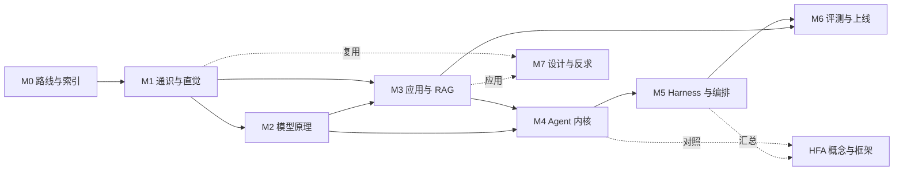

---
title: "AI / Agent 学习路径知识网络地图"
category: "学习方法论/路径规划"
type: "知识地图"
difficulty: "L1–L5"
generated: "2026-11-16T20:00:00+08:00"
source: "截图表格（8 个 GitHub 项目的用途对照）+ 各仓库 README 现行大纲"
tags:
  - 学习路径
  - 知识地图
  - agent
  - rag
  - harness
  - index
aliases:
  - AI学习路径
  - Agent学习地图
---

# AI / Agent 学习路径知识网络地图

> 一句话：八个仓库不是八门课，而是**同一条能力曲线上的八个位置**——AP 给直觉，K 给实现，LLU / G4B 给应用，LCC 给机制，HFA 给概念对照与评测，AW 给路线，CLN 给产品反求。顺着「直觉 → 原理 → 应用 → 内核 → 编排 → 评测」走，每个模块都有明确的入场券和出场物。

**边界声明**：截图只露出三处阶段交叉引用（「阶段 2 的路线参考来源」「阶段 6 概念对照」「阶段 7 评测」），原文档的阶段 1–7 定义本身不在截图内。下面 M0–M7 的模块划分是**按八个仓库的实际大纲反推的重建**，不是原文档照抄；与原计划不一致处以原文档为准，差异点已全部列入「待补充」。

## 零、怎么读这张图

**节点编号**：`M<模块>-<序号>`。M0 是索引层，M1–M7 是内容层。

**难度标尺**（本图自定，五级）：

| 级 | 含义 | 判据 |
|---|---|---|
| L1 | 认知 | 能复述概念，不动手 |
| L2 | 入门 | 照抄能跑通 |
| L3 | 进阶 | 能改、能判断该不该改 |
| L4 | 实战 | 能独立搭出一个可用的东西 |
| L5 | 体系 | 能设计、权衡、评测、讲给别人 |

**关联类型**（七种，全图只用这七种）：

| 类型 | 含义 | 例 |
|---|---|---|
| 前置 | 不学这个，后面那节读不懂 | 注意力 → Transformer |
| 递进 | 同一条线往下加一层机制 | s02 Tool Use → s03 Permission |
| 对照 | 同一件事的另一种讲法，用于交叉校验 | HFA 的 Agent 定义 ↔ LCC 的 Agent Loop |
| 应用 | 上层概念落到具体实现 | Embedding 原理 → 向量库检索 |
| 汇总 | 把前面多个机制合成一个整体 | s01–s14 → s15 集成 Harness |
| 替代 | 二选一即可，不必都走 | AP 的 L06 反向传播 ↔ K 的 micrograd |
| 复用 | 同一素材的第二种用途 | AP 既是课程，也是设计语言样本 |

**资源优先级**（沿用你的规定：视频/动图 > 图片 > 文字）：

| 档 | 形态 | 标注 |
|---|---|---|
| P1 | 视频、交互动画、动图 | 首选，能看就不读 |
| P2 | 静态图、SVG 架构图 | 次选，用于对齐结构 |
| P3 | 文字、代码、notebook | 兜底，用于查细节与复现 |

同一节点多形态并存时，**列在前的就是首选形态**。

## 一、模块分组

| 模块 | 主题 | 难度 | 承载资源 | 一句话目标 |
|---|---|---|---|---|
| M0 | 路线与索引 | — | AW | 先选一条路，再一步一步走 |
| M1 | 通识与直觉 | L1 | AP 阶段 1–2 | 把术语变成画面 |
| M2 | 模型原理 | L2–L4 | AP 阶段 3 + K 全 8 讲 | 知道 token 是怎么被算出来的 |
| M3 | 应用开发与 RAG | L2–L4 | LLU + G4B + AP 阶段 4 | 调得通 API，搭得起知识库 |
| M4 | Agent 内核 | L3–L4 | LCC s01–s14 + HFA Unit1 | 一个循环 + 一堆机制 |
| M5 | Harness 与编排 | L4–L5 | LCC s15–s17 + HFA Unit2–3 | 多机制合成一个运行时 |
| M6 | 评测、观测与上线 | L4 | HFA Unit4 + LLU C5 + G4B L03/L13/L14 | 能证明它可靠，才敢上线 |
| M7 | 设计与反求 | L3 | AP（作样本）+ CLN | 把别人的产品拆成自己的规范 |

**资源代号**（见第七节完整地址）：AP = buynao/aipath ｜ K = karpathy/nn-zero-to-hero ｜ LLU = datawhalechina/llm-universe ｜ G4B = microsoft/generative-ai-for-beginners ｜ LCC = shareAI-lab/learn-claude-code ｜ HFA = huggingface/agents-course ｜ AW = WenyuChiou/awesome-agentic-ai-zh ｜ CLN = JCodesMore/ai-website-cloner-template

## 二、章节节点

### M0 路线与索引（L1）

| ID | 节点 | 核心知识点 | 前置 | 后续 | 难度 | 载体 | 关键词 |
|---|---|---|---|---|---|---|---|
| M0-01 | 学习地图与 Track 分支 | Stage 0 基础准备 → Stage 8 共 10 站；Track A（CLI 使用者）/ Track B（Agent 建造者）二选一 | 无 | M1-01、M4-01 | L1 | AW README [P2 决策树图 + P3 文字] | roadmap、track、stage |
| M0-02 | 角色路线 | 研究 / 开发 / 教学 / 知识工作 / 日常使用五条支线，不必全走 | M0-01 | 各模块按角色取舍 | L1 | AW `resources/diagrams/branch-decision-tree.svg` [P2] | persona、branch |

> AW 的 Stage 4–6、Stage 8 具体标题未抓到，见「待补充」第 3 条。

### M1 通识与直觉（L1）

| ID | 节点 | 核心知识点 | 前置 | 后续 | 难度 | 载体 | 关键词 |
|---|---|---|---|---|---|---|---|
| M1-01 | AI 的三个圈 | AI ⊃ ML ⊃ DL 的边界；「学习」= 从数据里调参数 | 无 | M1-02 | L1 | AP L01 [P1 交互动画] | 人工智能、机器学习、边界 |
| M1-02 | 机器怎么学 | 损失函数、梯度下降 = 摸黑下山、数据与过拟合 | M1-01 | M2-01、M1-03 | L1 | AP L02 + L04 + L05 [P1 3D 下降动画] | 梯度下降、损失、过拟合 |
| M1-03 | 一个神经元 | 权重、偏置、激活；单神经元到一层的堆叠 | M1-02 | M2-04、M2-06 | L1 | AP L03 [P1 可拖权重] | 神经元、权重、激活函数 |
| M1-04 | LLM 全景与术语 | 大模型是什么、能做什么、生态里谁是谁；Token / Prompt / API / RAG / MCP 的白话定义 | M1-01 | M3-01、M4-01 | L1 | AP L25 + LLU C1 + AW Stage 1 [P1 动画 + P3 文字] | LLM、术语表、生态 |

### M2 模型原理（L2–L4）

| ID | 节点 | 核心知识点 | 前置 | 后续 | 难度 | 载体 | 关键词 |
|---|---|---|---|---|---|---|---|
| M2-01 | 反向传播与梯度流 | 计算图、链式法则、micrograd 的标量版 → tensor 版手工反传 | M1-02 | M2-02 | L3 | AP L06 [P1] ／ K L1+L5 [P1 视频 + P3 notebook] | backprop、计算图、micrograd |
| M2-02 | 语言模型骨架 | bigram → MLP；训练/采样/评估（负对数似然）三件套 | M2-01 | M2-03 | L3 | K L2+L3 [P1 视频 + P3 notebook] | 语言模型、makemore、NLL |
| M2-03 | 训练稳定性 | 激活与梯度统计、诊断图、BatchNorm 为什么救活了深层网络 | M2-02 | M2-07 | L4 | K L4 [P1 视频 + P3 notebook] | BatchNorm、梯度消失、诊断 |
| M2-04 | 卷积与层级结构 | 局部感受野、权重共享、树状堆叠 → WaveNet 式 CNN | M1-03 | M2-07 | L3 | AP L07 [P1 卷积扫描动画] ／ K L6 [P1] | CNN、卷积、感受野 |
| M2-05 | Embedding 与向量空间 | 词向量是坐标；相似度 = 距离；语义可运算 | M1-03 | M3-05 | L2 | AP L08 [P1 3D 星场漫游] | embedding、向量、余弦相似度 |
| M2-06 | 注意力机制 | Query/Key/Value；「高亮重要的部分」；为什么长依赖不再衰减 | M2-05 | M2-07 | L3 | AP L09 [P1 高亮动画] | attention、QKV、长依赖 |
| M2-07 | Transformer 与 GPT | 多头注意力 + 残差 + LayerNorm 组装；GPT = 自回归下一 token 预测 | M2-03、M2-04、M2-06 | M2-08、M3-01 | L4 | AP L10 [P1] ／ K L7 [P1 从零写 GPT] | Transformer、GPT、自回归 |
| M2-08 | Tokenizer 与 BPE | 分词是独立阶段；encode/decode；大量「模型怪癖」其实源自分词 | M2-07 | M3-03、M6-04 | L3 | AP L11 [P1] ／ K L8 + minbpe [P1 视频 + P3 代码] | tokenizer、BPE、minbpe |
| M2-09 | 预训练 / SFT / RLHF | 三阶段的先后与各自目的；对齐不是「再训一次」 | M2-07 | M6-04 | L3 | AP L12+L13 [P1] | 预训练、SFT、RLHF、对齐 |
| M2-10 | 解码与采样 | temperature / top-k 如何把「聚焦」调成「放飞」 | M2-07 | M4-02、M6-01 | L2 | AP L14 [P1 首页可玩的 next-token 游戏] | temperature、采样、top-k |
| M2-11 | Scaling Laws | 参数/数据/算力的配比；为什么「大」有可预测的收益 | M2-09 | M6-05 | L3 | AP L15 [P1] | scaling law、算力、配比 |

### M3 应用开发与 RAG（L2–L4）

| ID | 节点 | 核心知识点 | 前置 | 后续 | 难度 | 载体 | 关键词 |
|---|---|---|---|---|---|---|---|
| M3-01 | 调通一次 API | 原生 API / LangChain 封装 / FastAPI 三种调用形态；统一多厂商 | M1-04、M2-07 | M3-02、M3-07 | L2 | LLU C2 [P3 notebook] ／ G4B L06 [P1 视频 + P3 代码] | API、封装、LangChain |
| M3-02 | Prompt 工程 | 基础原则 → 进阶技巧（思维链、few-shot、角色、结构化输出） | M3-01 | M3-03、M4-05 | L2 | G4B L04+L05 [P1 视频] ／ LLU C2.3 ／ AP L16 [P1] | prompt、few-shot、CoT |
| M3-03 | 上下文窗口 | 上下文是预算不是仓库；塞什么、按什么顺序塞 | M2-08、M3-02 | M4-09 | L3 | AP L17 [P1] | context、窗口、预算 |
| M3-04 | 聊天应用 | 多轮状态、流式输出、会话裁剪 | M3-02 | M5-01 | L3 | G4B L07 [P1 视频 + P3 代码] | chat、多轮、流式 |
| M3-05 | 向量检索与向量库 | 文档加载 → 清洗 → 切片 → 向量化 → 入库 → 相似度召回 | M2-05、M3-01 | M3-06 | L3 | LLU C3 [P3 notebook] ／ G4B L08 [P1] ／ AP L18 [P1] | embedding、向量数据库、切片 |
| M3-06 | RAG 端到端 | 检索问答链、引用与溯源、Streamlit 部署；检索坏 vs 生成坏要分开定位 | M3-05 | M5-04、M6-02 | L4 | LLU C4 [P3 notebook] ／ G4B L15 [P1] ／ AP L28 [P1] | RAG、检索链、部署 |
| M3-07 | Function Calling | 模型输出「要调哪个函数+参数」，程序负责执行并回填结果 | M3-01 | M4-03 | L3 | G4B L11 [P1 视频 + P3 代码] ／ AP L19 [P1] | function calling、工具调用、schema |
| M3-08 | 多模态与生成 | 扩散=从噪声里擦出图像；图文统一表征 | M2-07 | M3-09 | L3 | AP L21+L22 [P1 去噪动画] ／ G4B L09 [P1] | diffusion、多模态、文生图 |
| M3-09 | Agent 框架初体验 | 用现成框架搭一个会调工具的 agent，先跑起来再问原理 | M3-07 | M4-02、M5-05 | L3 | G4B L17 [P1 视频] ／ HFA Unit2 [P3 文字 + P3 notebook] | agent framework、smolagents |
| M3-10 | 本地部署与开源模型 | Ollama / 本地推理；小模型（SLM）什么时候够用 | M3-01 | M6-05 | L3 | AP L27 [P1] ／ G4B L16+L19+L20+L21 [P1 部分] | 本地部署、Ollama、SLM |

### M4 Agent 内核（L3–L4）

> 本模块以 LCC 的 17 讲为主线：**每一讲只加一个机制，主循环不动**。这是全图信息密度最高的一段。

| ID | 节点 | 核心知识点 | 前置 | 后续 | 难度 | 载体 | 关键词 |
|---|---|---|---|---|---|---|---|
| M4-01 | Agent 是什么 | 目标 → 观察 → 选下一步 → 用工具 → 修正/停止/交还控制权；区别于「答一次」和「写死的脚本」 | M1-04、M3-09 | M4-02 | L2 | HFA Unit1 [P3 文字] ／ AW Stage 3 [P3] ／ AP L20 [P1] | agent、定义、边界 |
| M4-02 | Agent Loop | `messages[]` + `while True` + `tool_use`；一个工具一个循环就是一个 agent | M4-01 | 全模块 | L3 | LCC s01 [P3 代码 + P2 图] | agent loop、messages、tool_use |
| M4-03 | Tool Use | 加工具 = 加一个 handler，循环一行不改；dispatch map 与并发 | M4-02、M3-07 | M4-14 | L3 | LCC s02 | tool use、dispatch、并发 |
| M4-04 | 权限系统 | 先划边界再给自由：能跑什么、什么必须停、什么要批准 | M4-02 | M6-04 | L4 | LCC s03 | permission、审批、沙箱 |
| M4-05 | Hook 机制 | 在循环外挂扩展点，永不改写循环本身 | M4-02 | M5-02 | L4 | LCC s04 | hook、PreToolUse、扩展点 |
| M4-06 | 先规划再执行 | Todo 清单把「想做什么」外化成可见状态；完成率显著上升 | M4-02 | M4-11 | L2 | LCC s05 | todo、plan-then-execute |
| M4-07 | Subagent | 给子任务一份全新的 `messages[]`，只把最终文本作为一条 tool result 返回 | M4-02 | M4-09、M5-01 | L4 | LCC s06 | subagent、上下文隔离 |
| M4-08 | Skill 按需加载 | 先给目录（catalog），需要时才展开正文；渐进式披露 | M4-02 | M4-09 | L3 | LCC s07 [P3 + P2] | skill、渐进披露、catalog |
| M4-09 | Context Compact | 先压 tool result，再摘要历史；四级压缩的顺序不能反 | M4-02、M3-03、M4-07 | M5-01 | L4 | LCC s08 | compact、压缩、上下文腐化 |
| M4-10 | Memory | 三子系统：选择、抽取、固化；「记住重要的，忘掉不重要的」 | M4-02 | M5-01 | L4 | LCC s09 | memory、抽取、固化 |
| M4-11 | Task 系统 | 大目标拆成有序小任务，落盘持久化，为多 agent 协作铺路 | M4-06 | M4-13 | L4 | LCC s10 | task graph、blockedBy、持久化 |
| M4-12 | 后台任务 | 慢操作丢线程，完成时把通知注入回循环 | M4-02 | M4-13 | L3 | LCC s11 | background、通知队列 |
| M4-13 | 定时调度 | 按时间自触发，不需要人踢一脚 | M4-11、M4-12 | M5-03 | L4 | LCC s12 | cron、scheduler、持久调度 |
| M4-14 | Agent Teams | 常驻队友、原子领取任务、任务绑定的工作目录、类型化协议 | M4-11、M4-12、M4-03 | M5-01 | L5 | LCC s13 | multi-agent、teammate、worktree |
| M4-15 | MCP 接入 | 外部工具并进同一个工具池；命名空间与发现 | M4-03 | M5-01 | L3 | LCC s14 | MCP、工具池、命名空间 |

### M5 Harness 与编排（L4–L5）

| ID | 节点 | 核心知识点 | 前置 | 后续 | 难度 | 载体 | 关键词 |
|---|---|---|---|---|---|---|---|
| M5-01 | 集成 Harness | 工具、运行时上下文、任务、团队、调度、MCP 围着**同一个循环**组装 | M4 全部 | M5-02、M6-01 | L5 | LCC s15 [P3 代码 + P2 架构图] | harness、集成、运行时 |
| M5-02 | Workflow Runtime | 编排形状固定了就写进代码；保存的工作流 + 日志可恢复 | M4-05、M5-01 | M5-03 | L5 | LCC s16 | workflow、journal、resume |
| M5-03 | Goal Loop | 独立评估者审查每一次「我想停」；不可能/失败/超限就交还控制权 | M4-13、M5-02 | M6-01 | L5 | LCC s17 | goal gate、自动续跑、评估者 |
| M5-04 | Agentic RAG | 把检索变成 agent 的一个动作，而不是固定流水线 | M3-06、M4-02 | M6-02 | L4 | HFA Unit3 [P3 文字 + P3 notebook] | agentic rag、检索决策 |
| M5-05 | 框架对照 | smolagents（轻）/ LlamaIndex（数据）/ LangGraph（流程控制）三者取舍 | M3-09 | M5-04 | L4 | HFA Unit2.1–2.3 [P3 文字 + P3 notebook] | smolagents、LlamaIndex、LangGraph |
| M5-06 | 微调做函数调用 | 为 function calling 专门微调一个小模型 | M3-07、M2-09 | — | L5 | HFA Bonus Unit1 [P3 文字] | fine-tune、function calling |

### M6 评测、观测与上线（L4）

| ID | 节点 | 核心知识点 | 前置 | 后续 | 难度 | 载体 | 关键词 |
|---|---|---|---|---|---|---|---|
| M6-01 | 观测与追踪 | trace 每一步：prompt、工具、耗时、token；没有 trace 就没有调试 | M5-01 | M6-03 | L4 | HFA Bonus Unit2 [P3 文字 + P3 代码] | observability、trace、token |
| M6-02 | 系统评估与优化 | 生成侧与检索侧分开评；先定指标再谈优化 | M3-06、M5-04 | M6-03 | L4 | LLU C5 [P3 notebook] | eval、召回率、生成质量 |
| M6-03 | 最终项目与自动评测 | 提交即自动跑基准、进榜单；可复现才算交付 | M6-01、M6-02 | — | L5 | HFA Unit4 [P3 文字 + P3 代码] | benchmark、leaderboard、交付 |
| M6-04 | 责任 AI 与安全 | 偏见、越权、注入、隐私；上线前的红线清单 | M4-04、M2-08、M2-09 | — | L3 | G4B L03+L13 [P1 视频] ／ AP L29 [P1] | responsible AI、安全、注入 |
| M6-05 | 生命周期与 LLMOps | 监控、成本、版本、回滚；模型换了怎么不崩 | M2-11、M3-10 | — | L4 | G4B L14 [P1 视频] | LLMOps、生命周期、回滚 |

### M7 设计与反求（L3）

| ID | 节点 | 核心知识点 | 前置 | 后续 | 难度 | 载体 | 关键词 |
|---|---|---|---|---|---|---|---|
| M7-01 | 课程产品审计 | 拿 AP 当样本拆：6 阶段 30 讲的骨架、每讲固定四段（概念→交互 demo→易错点→小测）、双语、左侧固定目录 | M1-01 | M7-02 | L3 | AP 站点 + `src/data/lessons.js` [P2 结构 + P3 数据] | 竞品审计、课程结构、信息架构 |
| M7-02 | 站点反求与克隆 | 逐条观察当成「规则的样本」：量宽度、试状态、读声明值；共享组件按观察到的所有状态建；全局行为（平滑滚动、动效）单独识别 | M7-01、M3-01 | — | L4 | CLN `AGENTS.md` + `.agents/skills/clone-website` [P3 指令 + P3 代码] | 反求工程、CSS、克隆、响应式 |

## 三、依赖关系与关联类型

只列**跨模块**和**关键卡点**，模块内部的线性递进见上表「前置/后续」列。

| 从 | 关系 | 到 | 为什么这条边重要 |
|---|---|---|---|
| M1-02 | 前置 | M2-01 | 不懂「下山」，反向传播只是符号游戏 |
| M2-05 | 前置 | M3-05 | 没有向量空间直觉，向量库就只是调包 |
| M2-06 | 前置 | M2-07 | 注意力不懂，Transformer 只能背结构 |
| M2-07 | 前置 | M3-01 | 不知道模型在预测下一 token，就调不好 API |
| M3-04 | 递进 | M4-02 | 聊天是「一问一答」，agent 是「问答里插工具」 |
| M3-07 | 递进 | M4-03 | Function Calling 是**模型侧**能力，Tool Use 是**harness 侧**调度；这是全图最容易被混为一谈的一对 |
| M4-02 | 前置 | M4 全部 | 17 讲里 16 讲都在往同一个循环上挂东西 |
| M4-07 | 前置 | M4-09 | 不先做上下文隔离，压缩只是在给垃圾腾地方 |
| M4-06 | 前置 | M4-11 | todo 是给人看的，task graph 是给系统看的 |
| M4-11 + M4-12 | 前置 | M4-14 | 任务图 + 通知队列，才谈得上多 agent 分工 |
| M4 全部 | 汇总 | M5-01 | s15 明确是「多机制一个循环」的收口 |
| M5-01 | 前置 | M5-02 | 先有一个能跑的运行时，才谈得上把编排固化成代码 |
| M5-01 | 前置 | M6-01 | 没有统一运行时，trace 无从挂载 |
| M6-01 + M6-02 | 前置 | M6-03 | 观测与指标都在，最终项目才可能自动评分 |
| M5-04 | 汇总 | M3-06 + M4-02 | Agentic RAG = RAG 骨架 + agent 的决策权 |
| M1-01 | 复用 | M7-01 | AP 既是课程，也是「一门课该怎么设计」的样本 |
| AP L06 | 替代 | K L1+L5 | 只要直觉走 AP，要能自己写就上 K；两条不必都走 |

**三条对照轴**（这张图真正的价值所在——同一件事，两种讲法）：

1. **机制 ↔ 概念**：LCC 讲「这个机制怎么用 60 行代码实现」，HFA 讲「这个概念在框架里叫什么、怎么选」。学完 LCC 某一讲，立刻用 HFA 对应单元做名词对齐，术语就不再是散的。
2. **动画 ↔ 公式**：AP 给画面（拖权重、拧温度、走 3D 星场），K 给推导（手推梯度、从零写 GPT）。先用 AP 建图，再用 K 补证。
3. **课程 ↔ 产品**：AP 的内容是教材，AP 的结构是产品。M7 就是把这层「结构」抽出来复用。

## 四、知识网络图

主链是实线，虚线是「同一素材的第二种用途」。真正的学习顺序不是从左到右一条直线，而是**M1 打底 → 在 M3 和 M4 之间来回跳 → 用 M5/M6 收口**。

## 五、推荐学习路径

### 路径 A｜主线（约 8–10 周，从零到能交付）

| 段 | 节点序列 | 里程碑（做到什么算过） | 产出物 |
|---|---|---|---|
| 1 | M0-01 → M1-01 → M1-02 → M1-03 → M1-04 | 能用大白话讲清「模型在学习什么」 | 一页术语卡 |
| 2 | M2-05 → M2-06 → M2-07 → M2-08 | 能画出「一句话变成 token 再变成下一个 token」的全链路 | 一张自绘流程图 |
| 3 | M3-01 → M3-02 → M3-05 → M3-06 | 跑通一个能引用原文的知识库问答 | 可访问的 demo |
| 4 | M3-07 → M4-01 → M4-02 → M4-03 → M4-06 | 从零写一个 60 行的 agent loop + 2 个工具 | 一份能跑的代码 |
| 5 | M4-04 → M4-05 → M4-07 → M4-08 → M4-09 → M4-10 | 给循环加上权限、hook、子 agent、按需加载、压缩、记忆 | 机制清单打勾 6/6 |
| 6 | M4-11 → M4-14 → M5-01 → M5-02 → M5-03 | 多 agent 分工 + 可恢复工作流 + 目标闸门 | 一个无人值守跑完的任务 |
| 7 | M6-01 → M6-02 → M6-03 → M6-04 | 有 trace、有指标、有红线清单 | 一份评测报告 |

### 路径 B｜快线（2 周，只想用好 CLI Agent）

对应 AW 的 Track A。**跳过 M2 全部**，原理等卡住再回补。

`M1-04 → M3-02 → M3-03 → M4-02 → M4-03 → M4-04 → M4-06 → M4-08 → M5-01 → M6-01`

验收：能说清「它为什么停下来问我」「它为什么忘了前面的话」这两个问题。

### 路径 C｜建造线（AW 的 Track B）

`M3-05 → M3-07 → M4 全 15 讲 → M5-04 → M5-05 → M6-02 → M6-03`

验收：能在 smolagents / LlamaIndex / LangGraph 三者之间说出选型理由，而不是「我用过哪个」。

### 路径 D｜原理线（K 全 8 讲，每讲 2–4 小时）

`K L1 → L2 → L3 → L4 → L5 → L6 → L7 → L8`，与 AP 的 M2 各节点**交替看**：先 AP 建画面，再 K 写代码。

卡点提示：L5（手推反向传播）是全课唯一的陡坡，卡住就退回 L1 的 micrograd 重写一遍标量版。

### 路径 E｜做课 / 做产品线

`M7-01（拆 AP 结构）→ M1 全部（看它怎么讲）→ M7-02（拆站点实现）`

验收：交一份「同类课程的结构对照表 + 一份可复用的组件规范」。

## 六、检索关键词索引

| 关键词 | 直达节点 |
|---|---|
| agent loop / 主循环 | M4-02 |
| attention / QKV | M2-06 |
| BPE / tokenizer | M2-08 |
| BatchNorm / 梯度消失 | M2-03 |
| compact / 上下文腐化 | M4-09、M3-03 |
| cron / 定时 | M4-13 |
| diffusion / 文生图 | M3-08 |
| embedding / 向量库 | M2-05、M3-05 |
| eval / 评测 / 榜单 | M6-02、M6-03 |
| function calling | M3-07、M4-03 |
| goal loop / 自动续跑 | M5-03 |
| harness | M5-01 |
| hook | M4-05 |
| memory | M4-10 |
| MCP | M4-15 |
| permission / 审批 | M4-04 |
| prompt / few-shot | M3-02 |
| RAG / 检索链 | M3-06、M5-04 |
| scaling law | M2-11 |
| skill / 渐进披露 | M4-08 |
| subagent / 上下文隔离 | M4-07 |
| task graph / 持久化 | M4-11 |
| teams / 多 agent | M4-14 |
| temperature / 采样 | M2-10 |
| 反求 / 克隆 / CSS | M7-02 |
| 本地部署 / Ollama | M3-10 |
| 安全 / 注入 / 红线 | M6-04 |

## 七、资源类型与来源位置

| 代号 | 仓库 | 本图中的用途 | 主导资源形态 | 来源位置 |
|---|---|---|---|---|
| AP | buynao/aipath | M1、M2 主载体；M7 的结构样本 | **P1** 每讲配 2D/3D/Canvas 交互 demo；P3 双语文字 | `github.com/buynao/aipath`；大纲在 `src/data/lessons.js`，30 讲在 `src/lessons/L01–L30.jsx` |
| K | karpathy/nn-zero-to-hero | M2 的实现版对照 | **P1** YouTube 视频逐讲敲代码；P3 notebook | `github.com/karpathy/nn-zero-to-hero`；`lectures/` 下 8 个 notebook |
| LLU | datawhalechina/llm-universe | M3 的 RAG 主线、M6-02 | P3 notebook + 文字 | `github.com/datawhalechina/llm-universe`；`notebook/C1–C5`；在线版 `datawhalechina.github.io/llm-universe` |
| G4B | microsoft/generative-ai-for-beginners | M3 的广度补齐、M6-04/05 | **P1** 每课有短视频（L19–L21 待补）；P3 Python/TS 双语言代码 | `github.com/microsoft/generative-ai-for-beginners`；`00`–`21` 共 21 课 |
| LCC | shareAI-lab/learn-claude-code | M4、M5 主载体（本图骨架） | P3 可运行代码 + README；**P2** 部分讲有 SVG 图 | `github.com/shareAI-lab/learn-claude-code`；根目录 `s01_*`–`s17_*`，每讲含 `code.py` |
| HFA | huggingface/agents-course | M4-01 定义、M5 框架对照、M6 评测 | P3 文字 + notebook + quiz；部分单元有视频 | `github.com/huggingface/agents-course`；`hf.co/learn/agents-course` 的 Unit0–4 与三个 Bonus |
| AW | WenyuChiou/awesome-agentic-ai-zh | M0 路线层 | **P2** 学习地图与决策树图；P3 240+ 资源清单 | `github.com/WenyuChiou/awesome-agentic-ai-zh`；`stages/` 从 `00-foundations.md` 起 |
| CLN | JCodesMore/ai-website-cloner-template | M7-02 | P3 指令文件 + 技能脚本 | `github.com/JCodesMore/ai-website-cloner-template`；`AGENTS.md`、`.agents/skills/clone-website` |

> LCC 注意：仓库同时存在两套课表——根目录 `s01–s17`（现行 17 讲）与 `docs/`、`agents/`（旧的 12 讲）。**两套编号不对应**，本图一律按现行 17 讲。

## 八、待补充

| # | 缺什么 | 影响 | 怎么补 |
|---|---|---|---|
| 1 | 你原计划「阶段 1–7」的正式定义与分段判据 | 本图 M0–M7 是反推重建，可能与原计划错位 | 提供原文档，或按本图替换原阶段划分 |
| 2 | AP 的 L14（采样）与 L15（Scaling）在两处 README 表述里编号不一致 | M2-10 / M2-11 的载体编号需核对 | 打开 `src/data/lessons.js` 对一次 |
| 3 | AW 的 Stage 4–6、Stage 8 标题 | M0-01 只能给出已知的 0/1/2/3/7.5 | 抓 `stages/` 目录列表 |
| 4 | 各课程的实际学时与工作量 | 路径 A 的「8–10 周」是按节点数估的，非实测 | 学完一段回填真实耗时 |
| 5 | LCC s16 / s17 的代码规模与前置依赖强度 | M5-02 / M5-03 难度标 L5 是估计 | 读 `s16`、`s17` 的 `code.py` 行数与 import |
| 6 | G4B L19–L21 的视频是否已上线 | 这三节目前只有文字 | 定期回看课程表 |

## 关联

- **每个节点的知识正文**：见 [AI 与 Agent 基础](../16-AI与Agent基础/00-导读.md)（53 条，编号与本图一一对应）
- 上下文压缩的机制版：见 [上下文腐化与长时程策略](../02-上下文工程/02-上下文腐化与长时程策略.md)
- Skill 的定位与加载：见 [Skill 的结构与渐进式披露](../05-Skills体系/02-Skill的结构与加载.md)
- 工具接入的另一面：见 [MCP 协议原理与取舍](../06-MCP与工具接入/01-MCP协议原理与取舍.md)
- 循环的工程视角：见 [Agent 循环与工作流基础](../07-工作流与循环/01-Agent循环与工作流基础.md)、[循环的五个动作](../07-工作流与循环/03-循环的五个动作.md)
- Harness 的完整框架：见 [Harness 是什么](../04-Harness工程/01-Harness是什么.md)、[Harness 精读索引](../15-Harness精读/00-导读与索引.md)
- 学完之后怎么不白学：见 [费曼学习法](01-费曼学习法.md)、[输出飞轮与工程化成长](02-输出飞轮与工程化成长.md)

## 来源

- 截图（2026-11-16 剪贴板）：8 个 GitHub 项目的用途对照表，含「阶段 2 / 阶段 6 / 阶段 7」三处交叉引用
- 各仓库 README 现行大纲，抓取日期 2026-11-16：`buynao/aipath`（6 阶段 30 讲）、`karpathy/nn-zero-to-hero`（8 讲）、`datawhalechina/llm-universe`（C1–C5 + 进阶 RAG）、`microsoft/generative-ai-for-beginners`（21 课）、`huggingface/agents-course`（Unit0–4 + 3 Bonus）、`shareAI-lab/learn-claude-code`（s01–s17）、`WenyuChiou/awesome-agentic-ai-zh`（Stage 0–8）、`JCodesMore/ai-website-cloner-template`
