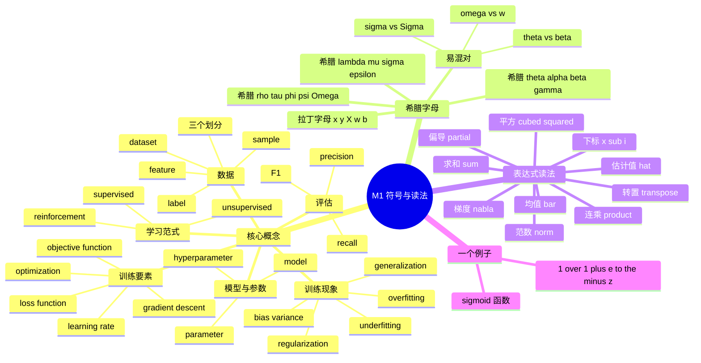
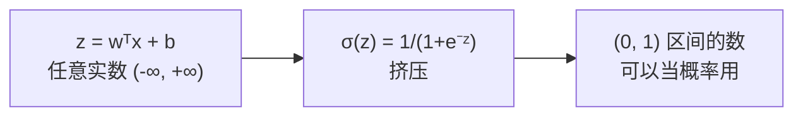

---
title: "机器学习前置知识 01｜这些概念、符号和公式到底怎么读？"
aliases: [机器学习前置知识M1, 数学符号与公式读法, ML Symbol Pronunciation, SIMPLEX-知几 M1]
tags: [课程笔记, 机器学习, 前置知识, 数学基础, 符号读法, SIMPLEX知几]
course: "SIMPLEX-知几《机器学习前置知识》"
module: "M1 数学符号与公式读法"
lecture: "01"
bvid: BV1HoYH6JEkx
url: "https://www.bilibili.com/video/BV1HoYH6JEkx"
duration: "14 分钟"
speaker: SIMPLEX-知几（Serena.G）
created: 2026-11-19
---

> [!info] 课程信息
> - 模块：M1 — 数学符号与公式读法（整个前置知识系列的第 0 层）
> - 讲次：01 · 这些概念、符号和公式到底怎么读？
> - 讲者：SIMPLEX-知几（Serena.G）
> - 时长：14 分钟
> - 视频：https://www.bilibili.com/video/BV1HoYH6JEkx
> - 形式：以「速查表」的方式逐行过一遍——英文词、中文词、英文读法；符号、读法、含义；表达式、读法。

> [!tip] 这一讲的定位
> 它不教你推导，只解决一个很实际的问题：**看得懂、读得出**。后面的线性代数、微积分、概率、优化四讲里，讲师会频繁说 "the gradient of L with respect to w"、"x sub i"、"w transpose x" 这类话。这一讲先把这套「口头记号」和「纸上记号」的对应关系建立起来——**读得出，才听得懂**。

## 本课学习目标

1. 能用英文读出机器学习论文/讲义里最常出现的 40 个核心概念，并知道每个词在流程里的位置（范式、数据、模型、训练、评估）。
2. 能认出并读对 20 个高频希腊字母，尤其能区分 **ω 与 w**、**σ 与 Σ**、**θ 与 β**、**φ 与 ψ** 这几组最容易在板书里混淆的符号。
3. 能读任意「带上下标的表达式」：$x_i$、$x_{ij}$、$x^2$、$x^{T}$、$\hat{y}$、$\bar{x}$、$\lVert x\rVert$、$\lvert x\rvert$。
4. 能把 $\sum$、$\prod$、$\nabla$、$\partial$ 与它们的口语说法对上号，并正确读出 $\dfrac{\partial L}{\partial w}$。
5. 理解 $\sigma(z)=\dfrac{1}{1+e^{-z}}$ 中每个部件的来历，知道为什么它被用作「把分数压到 0~1」的挤压函数。

## 知识导图

## 随堂笔记

### 模块 0 · 开场：这份「速查表」怎么用

讲师开场说得很直白：她把机器学习里**最常出现**的知识、符号、公式整理成了一份详细的速查表，「慢慢地分享给大家」，目的是让大家**能在读论文、听课时不卡在记号上**。

> [!quote] 讲师定位（意译）
> 这一讲不是讲模型，是把「你会反复遇到的东西」先摆出来：概念怎么叫、符号怎么念、公式怎么读。后面每一讲都会用到这套读法。

这份速查表分三块，正好对应本笔记的三个模块：

| 板块 | 表格列 | 解决什么问题 |
|---|---|---|
| 一、最重要的概念 | 英文 / 中文 / 常见读法 | 听课时听到 "hyperparameter" 不会懵；自己说的时候不会读错重音 |
| 二、最常见的数学字母与符号 | 符号 / 英文读法 / 常见含义 | 板书上一个 $\lambda$ 到底是正则系数还是特征值 |
| 三、高频数学表达式 | 表达式 / 英文读法 | $\hat{y}$、$\bar{x}$、$\nabla_\theta$ 这类记号能直接念出来 |

> [!warning] 为什么值得为一个「读法」专门花 14 分钟
> 因为**读错会连带理解错**。把 $\omega$（omega，权重）念成 $w$（double-u），在听 "w transpose x" 时就分不清是权重向量还是单个权重；把 $\sigma$（sigma，标准差/激活函数）与 $\Sigma$（summation，求和）听混，$\sigma^2$ 与 $\sum$ 就会打架。这一讲的价值在于**先把听觉和视觉对齐**。

### 模块 1 · 机器学习最重要的概念

#### 1.1 三种学习范式（最上层的分类）

| 英文 | 中文 | 常见读法 | 一句话理解 |
|---|---|---|---|
| Machine Learning | 机器学习 | machine learning | 让程序从数据里「调参数」，而不是人写死规则 |
| Supervised Learning | 监督学习 | supervised learning | 每个样本都带答案（label），学「输入→答案」的映射 |
| Unsupervised Learning | 无监督学习 | unsupervised learning | 没有答案，只学数据自身的结构（聚类、降维） |
| Reinforcement Learning | 强化学习 | reinforcement learning | 没有标准答案，只有「做完之后拿到的分数」（reward） |

> [!example] 三类范式的一句话区分
> - **监督**：给图片 + 标签「这是猫」，学怎么判猫。
> - **无监督**：只给一堆图片，学「这几张长得像」。
> - **强化**：给一个游戏，只告诉你「这局赢了/输了」，学怎么下。

#### 1.2 两个最基本的任务类型

| 英文 | 中文 | 常见读法（重音大写） | 输出是什么 |
|---|---|---|---|
| Classification | 分类 | class-i-fi-**CAY**-tion | 离散类别（猫/狗/鸟） |
| Regression | 回归 | re-**GRE**-ssion | 连续数值（房价、温度） |

> [!note] 读音要点
> - **classification** 的重音在倒数第二个音节 `CAY`，不是 `class-i-fi-ca-TION` 平读。
> - **regression** 的重音在 `GRE` 上；它与 `progress`（名词重音在前）是同一类重音规律。
> - 中文里说「回归」时，英文常说 *regression task*；说「分类任务」是 *classification task*。

#### 1.3 数据：一个样本长什么样

| 英文 | 中文 | 常见读法 | 说明 |
|---|---|---|---|
| Feature | 特征 | feature | 描述样本的一个维度，通常写成 $x$ |
| Label | 标签 | label | 样本的答案，通常写成 $y$ |
| Sample | 样本 | sample | 一条数据（一行） |
| Dataset | 数据集 | dataset | 所有样本的集合 |

> [!important] 一行 = 一个样本；一列 = 一个特征
> 讲师在这一段反复强调的其实就是这句话的符号版本：一个样本是向量 $x\in\mathbb{R}^d$，整个数据集是矩阵 $X\in\mathbb{R}^{n\times d}$（$n$ 个样本、$d$ 个特征）。**这个「行/列」的约定会在第二讲 M2 里成为 shape 检查的出发点。**

#### 1.4 数据集的三种划分

| 英文 | 中文 | 常见读法 | 用途 |
|---|---|---|---|
| Training Set | 训练集 | training set | 用来更新参数 |
| Validation Set | 验证集 | validation set | 用来选超参数、早停 |
| Test Set | 测试集 | test set | 只在最后用一次，估计泛化性能 |

> [!danger] 三条线不能混
> - 用**测试集**调超参数 = 提前泄题，最后报的分数是虚高的。
> - 用**训练集**评估 = 只能看到「背下来的程度」，看不到泛化。
> - 验证集存在的唯一理由是：**让测试集保持"没见过"的状态**。

#### 1.5 模型与参数

| 英文 | 中文 | 常见读法（重音） | 说明 |
|---|---|---|---|
| Model | 模型 | model | 从输入到输出的函数形式 |
| Parameter | 参数 | pa-**RAM**-eter | 训练学出来的量（权重 $w$、偏置 $b$、$\theta$） |
| Hyperparameter | 超参数 | **hyper**-parameter | 人来定的量（学习率、正则系数、层数） |

> [!tip] 怎么快速分辨参数与超参数
> 问一句：**「它是被梯度下降改过的吗？」** 是 → 参数；不是 → 超参数。学习率 $\alpha$、正则系数 $\lambda$、批大小 batch size 都属于后者。

#### 1.6 训练四件套

| 英文 | 中文 | 常见读法（重音） | 在公式里的常见符号 |
|---|---|---|---|
| Loss Function | 损失函数 | loss function | $L(\theta)$、$\ell(\cdot)$ |
| Objective Function | 目标函数 | objective function | $J(\theta)$，通常是 loss + 正则项 |
| Optimization | 优化 | op-ti-mi-**ZAY**-tion | $\min_\theta J(\theta)$ |
| Gradient | 梯度 | **GRAY**-dient | $\nabla_\theta J$ |
| Gradient Descent | 梯度下降 | gradient descent | $\theta \leftarrow \theta-\alpha\nabla_\theta J$ |
| Learning Rate | 学习率 | learning rate | $\alpha$ 或 $\eta$ |

> [!note] loss 与 objective 不是同义词
> - **Loss** 只衡量「预测错得多离谱」；
> - **Objective** 是「优化器真正最小化的东西」，往往等于 loss **加上正则项**。
> 所以加了 L2 之后，你最小化的是 objective，而不是纯粹的 loss——这个区别在 M5 优化那篇会展开。

#### 1.7 训练中会看到的现象

| 英文 | 中文 | 常见读法 | 说明 |
|---|---|---|---|
| Overfitting | 过拟合 | over-fitting | 训练集很好、测试集很差：把噪声也背下来了 |
| Underfitting | 欠拟合 | under-fitting | 两边都差：模型太简单或没训够 |
| Regularization | 正则化 | re-gu-la-ri-**ZAY**-tion | 给目标函数加惩罚项，抑制过拟合 |
| Generalization | 泛化 | ge-ne-ra-li-**ZAY**-tion | 在没见过的数据上表现好的能力 |
| Bias | 偏差 | **BY**-us | 模型的系统性偏离（太简单 → 高偏差） |
| Variance | 方差 | **VAIR**-iance | 模型对训练集扰动的敏感度（太复杂 → 高方差） |

> [!quote] 讲师原话（意译）
> 过拟合、欠拟合就是 overfitting / underfitting；正则就是 regularization；泛化就是 generalization；偏差方差就是 bias / variance。这几个词在论文里出现频率极高，读法和写法最好一次记住。

#### 1.8 评估指标（以分类为例）

| 英文 | 中文 | 常见读法 | 定义 |
|---|---|---|---|
| Precision | 精确率 | pre-**CI**-sion | 预测为正的里面，真正为正的比例 |
| Recall | 召回率 | re-**CALL** | 真正为正的里面，被找出来的比例 |
| F1 Score | F1 分数 | F-one score | precision 与 recall 的调和平均 |

> [!note] 讲师顺带给出的语境
> 这三个指标「都是在逻辑回归（logistic regression）里讲的」——因为二分类问题的预测结果是概率，需要一个阈值把概率切成 0/1，precision/recall 才随之变化。

### 模块 2 · 最常见的数学字母与符号

#### 2.1 拉丁字母：先分清「向量 / 矩阵 / 标量」

| 符号 | 英文读法 | 机器学习中的常见含义 |
|---|---|---|
| $x$ | x | 输入、特征（feature）；单个样本写成粗体/小写向量 |
| $y$ | y | 标签、目标变量（target） |
| $X$ | capital X / big X | 数据矩阵（$n$ 个样本 × $d$ 个特征） |
| $w$ | double-u | 权重（weight） |
| $b$ | bee | 偏置（bias） |

> [!important] 大小写就是维度：这是本课程后面所有 shape 讨论的地基
> - 小写斜体 $x$：标量或向量；
> - 大写 $X$：矩阵；
> - 带下标 $x_i$：第 $i$ 个样本（一行）；
> - 带两个下标 $x_{ij}$：第 $i$ 个样本的第 $j$ 个特征（一个格子）。
>
> 听到 "big X" 就该想到矩阵，听到 "x sub i" 就该想到「取第 i 行」。

#### 2.2 希腊字母：机器学习里的「惯用座位」

| 符号 | 英文读法 | 机器学习中的常见含义 |
|---|---|---|
| $\theta$ | theta | 模型参数（统称） |
| $\alpha$ | alpha | 学习率、系数 |
| $\beta$ | beta | 回归系数、参数 |
| $\gamma$ | gamma | 折扣因子（强化学习）、系数 |
| $\lambda$ | lambda | 正则化系数 |
| $\mu$ | mu | 均值（mean） |
| $\sigma$ | sigma | 标准差，或「函数符号」（如 $\sigma(z)$） |
| $\sigma^2$ | sigma squared | 方差（variance） |

继续往下（讲师在表里接着念的）：

| 符号 | 英文读法 | 机器学习中的常见含义 |
|---|---|---|
| $\epsilon$ | epsilon | 小误差、扰动、$\epsilon$-贪心里的探索率 |
| $\rho$ | rho | 相关系数（物理里是密度） |
| $\tau$ | tau | 温度参数（temperature）、时间常数 |
| $\phi$ | phi | 特征映射（feature map）$\phi(x)$ |
| $\psi$ | psi | 函数符号、势函数 |
| $\Omega$ | Omega | 正则项记号（如 $\Omega(\theta)$）；物理里是频率 |
| $\eta$ | eta | 学习率（与 $\alpha$ 同义，常见于教材） |

> [!warning] 讲师专门停下来讲的一组：$\omega$ 与 $w$
> 这两个符号**写法极像、读法完全不同**：
> - $w$ 读 **double-u**（"达不溜"），是 weight；
> - $\omega$ 读 **omega**（"欧米伽"），常表示频率/权重向量/参数。
>
> 讲师的说法（意译）：**「$\omega$ 更圆润，$w$ 更紧、更瘦一点」**，板书里如果分不清，就看上下文——出现在 $\omega^T x$ 里多半是权重向量，出现在 $e^{i\omega t}$ 里就是频率。

> [!warning] 第二组易混：$\sigma$ 与 $\Sigma$
> - 小写 $\sigma$：sigma，标准差；也是一个**函数名**（sigmoid，$\sigma(z)$）。
> - 大写 $\Sigma$：summation，求和号 $\sum_{i=1}^{n}$。
>
> 听到 "sigma squared" 是方差，听到 "sum over i" 才是求和。**这两个在听力上必须分开**，否则 $\sigma^2$ 与 $\sum$ 会互相污染。

> [!warning] 第三组易混：$\theta$ 与 $\beta$、$\phi$ 与 $\psi$
> - $\theta$（theta）与 $\beta$（beta）：都表示参数，但 $\theta$ 是「全体参数」的统称，$\beta$ 多用于线性模型的系数。
> - $\phi$（phi，/$f$\bar{a}/$i$）与 $\psi$（psi，/psa/$i$/）：前者是特征映射，后者是函数/势函数。中文口语里常被念成「fai」「普西」，都能听懂，但写的时候别混。

### 模块 3 · 高频数学表达式怎么读

#### 3.1 下标与上标

| 表达式 | 英文读法 | 中文说法 |
|---|---|---|
| $x_i$ | x sub i | 第 i 个分量/第 i 个样本 |
| $x_{ij}$ | x sub i j | 第 i 行第 j 列 |
| $x^2$ | x squared | x 的平方 |
| $x^3$ | x cubed | x 的立方 |
| $x^{-1}$ | x to the minus one | x 的负一次方（倒数） |

> [!tip] "sub" 与 "superscript" 的区分
> 下标念 **sub**（subscript），上标念 **super** 或直接 "to the"。$x_i^2$ 读作 "x sub i squared"——先念下标再念上标，这是英文口语的固定顺序。

#### 3.2 转置、估计值与均值

| 表达式 | 英文读法 | 说明 |
|---|---|---|
| $x^{T}$ | x transpose | 向量/矩阵转置 |
| $w^{T}x$ | w transpose x | 内积的矩阵写法（M2 会讲它等于 $\sum_i w_i x_i$） |
| $\hat{y}$ | y hat | 预测值/估计值 |
| $\bar{x}$ | x bar | 样本均值 |
| $\tilde{x}$ | x tilde | 近似值、加噪后的版本 |

> [!note] "hat" 的含义是「估计」
> $\hat{y}$ 与 $y$ 的关系是：$y$ 是真实标签，$\hat{y}$ 是模型给出的估计。所有带 hat 的量都是「我们算出来的、不是真值」，这个约定在 M4（MLE 估计参数 $\hat{\theta}$）里会反复出现。

#### 3.3 范数、绝对值、求和、连乘、梯度、偏导

| 表达式 | 英文读法 | 说明 |
|---|---|---|
| $\lVert x\rVert$ | norm of x | 向量长度（默认 L2 范数） |
| $\lVert x\rVert_2$ | L-two norm of x | 明确指 L2 |
| $\lVert x\rVert_1$ | L-one norm of x | L1，绝对值之和（M5 的 Lasso） |
| $\lvert x\rvert$ | absolute value of x | 标量绝对值 |
| $\sum$ | sum / summation | 求和 |
| $\prod$ | product | 连乘 |
| $\nabla$ | nabla / gradient | 梯度算子 |
| $\nabla_\theta L$ | gradient of L with respect to theta | 对 $\theta$ 求梯度 |
| $\partial$ | partial | 偏导符号 |
| $\dfrac{\partial L}{\partial w}$ | partial L with respect to w | L 对 w 的偏导 |

> [!important] "with respect to" 是读公式的钥匙
> 英文里所有导数都读成 "… with respect to …"（对……求导）。所以
> - $\dfrac{dL}{dw}$ → "d L by d w" 或 "derivative of L with respect to w"
> - $\dfrac{\partial L}{\partial w}$ → "partial L with respect to w"
> - $\nabla_\theta L$ → "gradient of L with respect to theta"
>
> 听懂这个短语，M3 整讲的板书就都能跟上。

### 模块 4 · 一个符号的深入：$\sigma(z)$ 为什么长这样

讲师在表里念到 $\sigma$ 时，特意解释了 **sigmoid** 这个「同名不同用」的情况：

$$\sigma(z)=\frac{1}{1+e^{-z}}$$

读法：**"sigma of z equals one over one plus e to the minus z"**。

> [!quote] 讲师原话（意译）
> 在 logistic regression 里，$\sigma$ 不是一个数，而是一个 **function**——我们把它记作 $\sigma(z)$。整个公式可以念作 "sigma of z equals 1 over 1 plus e to the minus z"。

为什么需要它？讲师给的理由是：**它把任意实数「挤」进 $(0,1)$**。

> [!example] 三个关键点（自己验算一遍就懂）
> | $z$ | $\sigma(z)$ | 直觉 |
> |---|---|---|
> | $0$ | $0.5$ | 分不清，正好一半 |
> | $+3$ | $\approx 0.95$ | 很有把握「是」 |
> | $-3$ | $\approx 0.05$ | 很有把握「不是」 |
>
> 并且 $\sigma(-z)=1-\sigma(z)$——这正是「二分类概率和为 1」的来源。

> [!note] 为什么它出现在逻辑回归里（讲师留下的伏笔）
> 因为线性模型给出的是 $z=w^Tx+b$（可正可负、无上界），而「是不是猫」需要一个 0~1 的概率。$\sigma$ 提供了这条**单调、可导、值域有界**的桥。它的导数还有一个漂亮形式 $\sigma'(z)=\sigma(z)(1-\sigma(z))$——M4 讲交叉熵、M3 讲链式法则时都会用到。

## 重点速记 Cheat Sheet

| 类别 | 词/符号 | 读法 | 一句话记忆 |
|---|---|---|---|
| 范式 | supervised / unsupervised / reinforcement | — | 有答案 / 没答案 / 只有分数 |
| 任务 | classification | class-i-fi-**CAY**-tion | 输出离散 |
| 任务 | regression | re-**GRE**-ssion | 输出连续 |
| 数据 | feature / label / sample / dataset | — | 列 / 答案 / 行 / 表 |
| 划分 | training / validation / test | — | 学参数 / 选超参 / 最后考 |
| 参数 | parameter | pa-**RAM**-eter | 被梯度改过 |
| 参数 | hyperparameter | **hyper**-parameter | 人来定 |
| 目标 | loss function | — | 只看错多少 |
| 目标 | objective function | — | loss + 正则 |
| 优化 | gradient | **GRAY**-dient | 最陡上升方向 |
| 优化 | gradient descent | — | 往负梯度走 |
| 优化 | learning rate | — | 步长 $\alpha$ 或 $\eta$ |
| 现象 | overfitting / underfitting | — | 背过头 / 没学会 |
| 现象 | regularization | re-gu-la-ri-**ZAY**-tion | 加惩罚 |
| 现象 | generalization | ge-ne-ra-li-**ZAY**-tion | 没见过的数据也行 |
| 指标 | precision / recall / F1 | — | 准 / 全 / 调和 |
| 符号 | $x_i$ / $x_{ij}$ | x sub i / x sub i j | 第 i 个 / 第 i 行第 j 列 |
| 符号 | $x^T$ / $w^Tx$ | x transpose / w transpose x | 转置 / 内积 |
| 符号 | $\hat{y}$ / $\bar{x}$ | y hat / x bar | 估计值 / 均值 |
| 符号 | $\lVert x\rVert$ | norm of x | 长度 |
| 符号 | $\sum$ / $\prod$ | sum / product | 求和 / 连乘 |
| 符号 | $\nabla$ / $\partial$ | nabla / partial | 梯度 / 偏导 |
| 符号 | $\theta$ / $\alpha$ / $\lambda$ | theta / alpha / lambda | 参数 / 学习率 / 正则 |
| 函数 | $\sigma(z)$ | sigma of z | 挤压到 0~1 |

## 易错点 / 常见误区

> [!danger] 1. $\omega$ 与 $w$ 混读
> 板书上 $\omega$ 圆润、$w$ 尖锐；读音上 omega ≠ double-u。听课听到 "omega transpose x" 却以为是 "w transpose x"，会误判讨论对象是「向量」还是「标量」。

> [!danger] 2. $\sigma$ 既是「标准差」又是「函数名」
> $\sigma^2$ 是方差，$\sigma(z)$ 是 sigmoid。判断依据：**后面有没有括号**。有括号 → 函数；没括号且带平方 → 统计量。

> [!danger] 3. loss 与 objective 混用
> 加了正则项之后，优化器最小化的是 objective（loss + penalty）。说「loss 越小越好」在加了正则后是**不准确**的表述。

> [!danger] 4. 把 validation set 当 test set 用
> 一旦用测试集挑过超参数，测试集就「已经见过」了，报出的数字不再是无偏估计。这是最常见的实验事故。

> [!danger] 5. 读 $\hat{y}$ 时漏掉 hat
> $\hat{y}$（y hat）是预测值，$y$ 是真实值。读和写都要带上 hat，否则公式里的误差项 $y-\hat{y}$ 就没有方向感了。

> [!warning] 6. "with respect to" 漏听
> $\nabla_\theta L$ 与 $\nabla_x L$ 数值完全不同。听公式时**必须抓住 with respect to 后面那个变量**。

## 思考题 & 课后延伸

1. 用英文把下式完整读一遍，再说出它的中文含义：
   $$\hat{y}=\sigma\left(w^{T}x+b\right),\qquad L=\frac{1}{n}\sum_{i=1}^{n}\left(y_i-\hat{y}_i\right)^2$$
   

参考读法

   "y hat equals sigma of w transpose x plus b; L equals one over n, sum over i equals one to n, of y sub i minus y hat sub i, squared."
   

2. 下列符号分别最可能代表什么？给出判断依据：$\lambda$、$\eta$、$\Omega(\theta)$、$\lVert w\rVert_1$。
3. 为什么说 $\sigma(-z)=1-\sigma(z)$？用这个性质解释「二分类的两个概率之和为 1」。
4. 如果一份论文里同时出现 $\theta$ 与 $\beta$，你会怎么判断哪个是「全体参数」？
5. 把本节所有带 "**ZAY**" 重音的词找出来（optimization、regularization、generalization），总结它们的重音规律。

## 术语表

| 英文 | 中文 | 读法 | 备注 |
|---|---|---|---|
| Machine Learning | 机器学习 | machine learning | — |
| Supervised Learning | 监督学习 | supervised learning | 有标签 |
| Unsupervised Learning | 无监督学习 | unsupervised learning | 无标签 |
| Reinforcement Learning | 强化学习 | reinforcement learning | 奖励信号 |
| Classification | 分类 | class-i-fi-**CAY**-tion | 离散输出 |
| Regression | 回归 | re-**GRE**-ssion | 连续输出 |
| Feature | 特征 | feature | $x$ |
| Label | 标签 | label | $y$ |
| Sample | 样本 | sample | 一行 |
| Dataset | 数据集 | dataset | $X$ |
| Training / Validation / Test Set | 训练/验证/测试集 | — | 三种用途 |
| Parameter | 参数 | pa-**RAM**-eter | $\theta$ |
| Hyperparameter | 超参数 | **hyper**-parameter | 人定 |
| Loss Function | 损失函数 | loss function | $L$ |
| Objective Function | 目标函数 | objective function | $J$ |
| Optimization | 优化 | op-ti-mi-**ZAY**-tion | $\min$ |
| Gradient | 梯度 | **GRAY**-dient | $\nabla$ |
| Gradient Descent | 梯度下降 | gradient descent | 更新规则 |
| Learning Rate | 学习率 | learning rate | $\alpha,\eta$ |
| Overfitting / Underfitting | 过拟合/欠拟合 | — | — |
| Regularization | 正则化 | re-gu-la-ri-**ZAY**-tion | $\lambda$ |
| Generalization | 泛化 | ge-ne-ra-li-**ZAY**-tion | — |
| Bias / Variance | 偏差/方差 | **BY**-us / **VAIR**-iance | 权衡 |
| Precision / Recall / F1 | 精确率/召回率/F1 | pre-**CI**-sion / re-**CALL** | 分类指标 |
| Sigmoid | S 型函数 | $\sigma(z)$ | $1/(1+e^{-z})$ |

## 延伸阅读

- 本系列下一篇：[[02-线性代数]]（向量、矩阵、内积、投影；这里出现的 $x$、$X$、$w^Tx$ 会在那里变成几何对象）
- 后续模块：[[03-微积分与矩阵微积分]]、[[04-概率统计]]、[[05-优化]]、[[06-NumPy与向量化]]
- 课程总索引：[[00-课程总索引]]
- 速查表原始出处：本讲的 PDF 讲义（视频为滚动浏览形式，本笔记的三张表即为其中三块）
- 读音不确定时：可用 Merriam-Webster 或 Cambridge Dictionary 查重音，注意 classification / regression / parameter / optimization 四个词的重音位置
