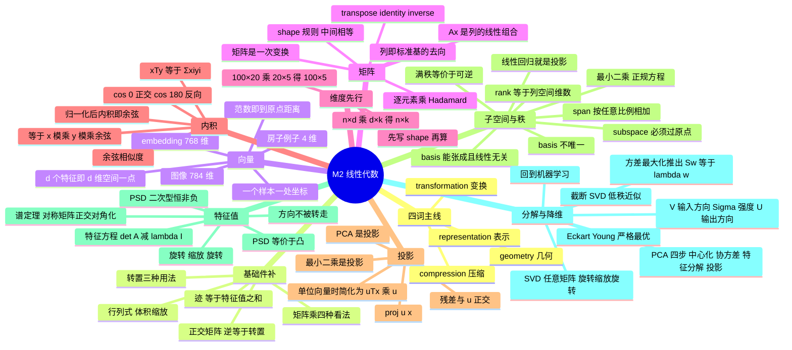
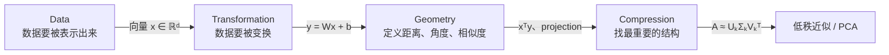
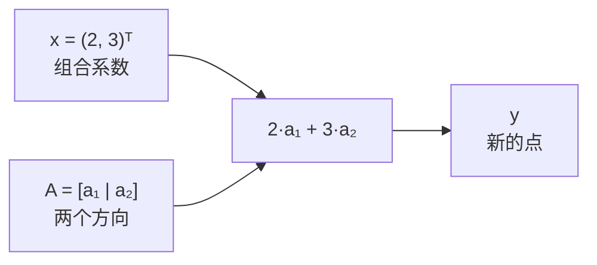
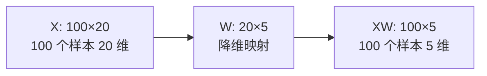
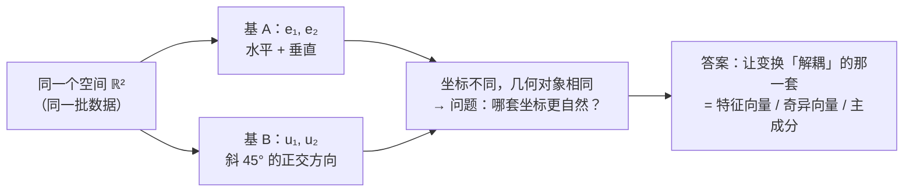
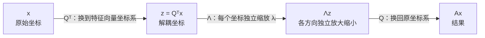
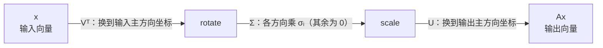
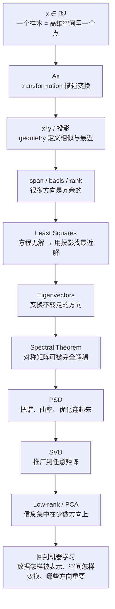

---
title: "机器学习前置知识 02｜线性代数：向量、矩阵、内积、投影 → Rank、特征值、SVD 与 PCA"
aliases: [机器学习前置知识M2, 线性代数与机器学习, Linear Algebra for ML, SIMPLEX-知几 M2]
tags: [课程笔记, 机器学习, 前置知识, 线性代数, 特征值, SVD, PCA, SIMPLEX知几]
course: "SIMPLEX-知几《机器学习前置知识》"
module: "M2 线性代数"
lecture: "02（上 + 下）"
bvid: BV1DaYK6nEVz
url: "https://www.bilibili.com/video/BV1DaYK6nEVz"
duration: "93 分钟（上 28 + 下 64）"
speaker: SIMPLEX-知几（Serena.G）
created: 2026-11-19
---

> [!info] 课程信息
>
> - 模块：M2 — 线性代数（本系列的骨架，后面微积分/概率/优化都建在它上面）
> - 讲次：02 上「向量、矩阵、内积与投影」+ 02 下「Rank、特征值、SVD 与 PCA」
> - 讲者：SIMPLEX-知几（Serena.G）
> - 视频：上 <https://www.bilibili.com/video/BV1DaYK6nEVz> ｜ 下 <https://www.bilibili.com/video/BV1HuYK6TEAL>
> - 时长：28 分钟 + 64 分钟

> [!tip] 一句话抓住这一讲  
> 讲师把整讲压缩成 **四个词**：**representation → transformation → geometry → compression**。  
> 数据先被**表示**成向量，**变换**靠矩阵，**几何**靠内积与投影，高维冗余靠 **SVD/PCA 压缩**。  
> 这一讲不按「行列式→矩阵乘法→特征值」的传统顺序走，而是按**机器学习里真正怎么用**的顺序走。

## 本课学习目标

1. 能把一个现实对象（房子、图片、一句话）写成向量，并说清 $d$ 的含义与量级（4 / 784 / 768）。
2. 理解「矩阵 = 一次空间变换」，会用 $Ax=\sum_i x_i a_i$ 解释矩阵乘法在做什么，并说出矩阵每一列的几何身份。
3. 见到任意矩阵表达式，先写 shape 再动笔算（dimension first, arithmetic second），能一眼判断 $XW$ 是否合法、结果是多少维。
4. 能区分转置、单位阵、逆（只有方阵且 invertible 才有逆）、逐元素乘（Hadamard）。
5. 会用 $x^Ty=\lVert x\rVert\lVert y\rVert\cos\theta$ 把内积读成「夹角/相似度」，并说出它的三处典型应用（embedding 检索、attention、推荐）。
6. 会推导并背诵投影公式 $\mathrm{proj}_u x=\dfrac{u^Tx}{u^Tu}u$，理解残差与 $u$ 正交（$r^Tu=0$）以及「最小二乘与 PCA 都是投影」。
7. 理解 span / basis / subspace 与 rank：为什么高维数据未必有很多独立方向，为什么「方程个数 ≠ 信息量」。
8. 会推出正规方程 $A^TA\hat x=A^Tb$，并解释「线性回归就是把 $y$ 投影到 $X$ 的列空间」。
9. 理解特征值/特征向量（方向不被转走）、对称矩阵可正交对角化、正定矩阵的能量非负，以及 PSD 为何等价于凸。
10. 理解 SVD $A=U\Sigma V^T$ 的「旋转–缩放–旋转」、截断 SVD 的低秩近似（Eckart–Young 最优性）。
11. 会推 PCA：从「最大化投影方差」到 $Sw=\lambda w$，并说清 PCA 是特征**变换**而不是特征**选择**。
12. 能解释四个前置零件：转置的三种用法、正交矩阵为什么 $Q^{-1}=Q^T$、行列式的几何意义（体积缩放，$\det=0\iff$ 不可逆）、迹等于特征值之和。

## 知识导图

## 怎么用这一篇

这一篇是按「听懂」而不是「读完」写的。如果读到某处卡住，先别硬扛——用下面两张表定位。

### 符号约定（先认脸，再看内容）

| 记号 | 读法 | 含义 | 形状 |
|---|---|---|---|
| $x$（小写、非粗体） | x | 一个标量，或一个向量（看上下文） | 标量 / $(d,)$ |
| $x_i$ | x sub i | 向量的第 $i$ 个分量 | 标量 |
| $\mathbf{x}$（粗体） | bold x | 明确指「向量」时 | $(d,)$ |
| $A$、$W$（大写） | capital A | 矩阵 | $(m,n)$ |
| $A_{ij}$ | A sub i j | 第 $i$ 行第 $j$ 列的元素 | 标量 |
| $A^T$ | A transpose | 转置 | $(n,m)$ |
| $A^{-1}$ | A inverse | 逆（只有可逆方阵有） | $(n,n)$ |
| $I$ | identity | 单位阵 | $(n,n)$ |
| $x^Ty$ | x transpose y | 内积，结果是个**标量** | $()$ |
| $xy^T$ | x y transpose | 外积，结果是个**矩阵** | $(m,n)$ |
| $\lVert x\rVert$ | norm of x | 范数（长度） | 标量 |
| $\det(A)$ | determinant of A | 行列式 | 标量 |
| $\mathrm{rank}(A)$ | rank of A | 秩（独立方向数） | 整数 |
| $\mathrm{span}$ | span | 张成空间 | 集合 |
| $\lambda$ | lambda | 特征值 | 标量 |
| $\sigma_i$ | sigma sub i | 奇异值 | 标量 |
| $\succeq 0$ | positive semidefinite | 半正定（不是「大于」） | 判断 |

> [!tip] 三个高频误读
> 1. $x^Ty$ 是**标量**，$xy^T$ 是**矩阵**——差一个转置位置，结果类型就变了。
> 2. $\lambda$ 是数、$A$ 是矩阵，所以永远写 $A-\lambda I$，不能写 $A-\lambda$。
> 3. $A\succeq0$ 说的是「这个矩阵半正定」，不是「它的元素都 $\ge0$」。

### 卡住了看哪节

| 你的感觉 | 去读 |
|---|---|
| 「矩阵乘为什么非得这么定义」 | 2.3 列的线性组合 + 0.5.5 四种看法 |
| 「转置除了换行列还有什么用」 | 0.5.1 |
| 「行列式是什么，为什么等于 0 就不可逆」 | 0.5.3 |
| 「正交矩阵凭什么 $Q^{-1}=Q^T$」 | 0.5.2 |
| 「投影公式那个分母哪来的」 | 5.2 推导 + 5.5 手算 |
| 「正规方程怎么推出来的」 | 8.3 + 8.5 逐行 |
| 「秩到底怎么数」 | 7.2 手算 |
| 「特征值怎么解出来的」 | 9.4 + 9.5 手算 |
| 「谱定理到底在说什么」 | 10.1 + 10.2 逐行 |
| 「半正定和凸有什么关系」 | 11.5 |
| 「SVD 和特征值是什么关系」 | 12.3 |
| 「PCA 的拉格朗日那步看不懂」 | 15.3 + 15.6 手算 |

### 五张动图，各看什么

读不进去时先看动画，比读公式快。

| # | 动图 | 位置 | 看完应该能回答 |
|---|---|---|---|
| 1 | 矩阵是变换 | 2.1 | 为什么说「矩阵 = 一次空间变换」而不是一张表 |
| 2 | 列的组合 | 2.4 前 | $Ax=x_1a_1+x_2a_2$ 到底在图上做什么 |
| 3 | 投影与残差 | 5.5 前 | 为什么残差最短时 $u$ 与 $x$ 同向，为什么它垂直 $u$ |
| 4 | 特征向量 | 9.2 前 | 「方向没被转走」是什么样子，椭圆的两条轴是什么 |
| 5 | PCA 主轴 | 14.3 前 | 为什么要「方差最大」，PC1 是哪个角度 |

> [!note] 动图在哪
> 全部在 `assets/` 下（`la-01`…`la-05`）。用的不是截图，而是脚本逐帧画的：坐标、椭圆、投影都是按公式真算出来的，所以你可以信任图上每个位置。
> 想改参数（比如换一个矩阵、换一组点）告诉我，改一行就能重画。

### 建议的读法

1. **第一遍只读「人话」与图**，跳过所有推导，目标是知道每个概念在干嘛；
2. **第二遍做手算**（每节标了「手算」的地方），拿纸跟着算一遍 2×2 的例子；
3. **第三遍再读推导**，这时候公式里的每一步你都能对上数字了；
4. 每节末尾的「自测」是用来验收的，答不上就回到对应小节。

> [!note] 这一篇和课程的对应
> 讲义主干仍然是讲义内容（模块 0–16）；标着「补」的小节是我加的**前置补丁**，课程里没讲但读后续内容会用到（行列式、正交矩阵、迹、矩阵乘的四种看法）。两者用「补」字区分，方便你知道哪些是原课内容、哪些是补的。

## 随堂笔记

> 正文按两场推进：**上半场**（模块 0–5）讲「表示 / 变换 / 几何」——向量、矩阵、内积与投影；**下半场**（模块 6–16）讲「秩 / 特征值 / SVD / PCA」。
> 中间插了一个 **模块 0.5 · 五个基础件**（转置、正交矩阵、行列式、迹、矩阵乘的四种看法），是读这两场之前必须先认的零件。
> 怎么读、卡在哪儿查哪节，见上一节「怎么用这一篇」。

## 上半场 · 向量、矩阵、内积与投影

### 模块 0 · 这一讲为什么这么排：四个词的主线

讲师开门见山：传统线代课从「矩阵乘法、行列式、特征值」的计算题开始，但那是**数学课的顺序**；作为机器学习的前置知识，她要按**使用顺序**讲。

> [!quote] 讲师原话（意译）  
> 线性代数在机器学习里不只是计算工具，它提供了一套**语言**——用来描述数据、描述模型、描述几何结构，以及描述高维数据里真正重要的信息。

这条主线压缩成四个词，正好也是四步递进：

| 步骤 | 词              | 数学对象                  | 回答什么问题              |
| -- | -------------- | --------------------- | ------------------- |
| 1  | representation | 向量 $x\in\mathbb{R}^d$ | 现实对象怎么变成数字          |
| 2  | transformation | 矩阵 $W$、$y=Wx+b$       | 数据怎么被改变             |
| 3  | geometry       | 内积 $x^Ty$、投影          | 谁和谁像、差多远、能不能被某个方向解释 |
| 4  | compression    | SVD / PCA             | 高维里真正有效的方向有几个       |

> [!important] 讲师的验收标准  
> **看到一个线性代数表达式时，不是想着怎么算每个元素，而是能立刻读出它的 shape、它把什么变成了什么、在几何上意味着什么。** 这条标准会贯穿整讲。

### 模块 0.5 · 五个基础件（补）

这五件东西后面到处要用，但课程里是「用到时才提一句」，第一次读很容易断在这里。先集中补齐。

#### 0.5.1 转置：三种用法

**定义**：$A^T$ 的第 $i$ 行第 $j$ 列 $=$ $A$ 的第 $j$ 行第 $i$ 列。二维就是沿对角线翻一下。

$$\begin{pmatrix}1&2&3\\4&5&6\end{pmatrix}^T=\begin{pmatrix}1&4\\2&5\\3&6\end{pmatrix}\qquad(2\times3)\to(3\times2)$$

比「换行列」更重要的三种用法：

**① 把内积搬到另一边**（最常见，几乎所有推导都在用它）：

$$(Ax)^Ty=x^T(A^Ty)$$

左边是「先把 $x$ 变换再和 $y$ 做内积」，右边是「先把 $y$ 用 $A^T$ 搬回来再和 $x$ 做内积」。两件事结果一样，但右边的形状常常更方便。

**② 让形状对得上**：$(d,)$ 的向量要变成列，就写 $x[:,None]$ 或转置；$X^TX$ 之所以能算，是因为 $(d,n)(n,d)\to(d,d)$。

**③ 对称性的判据**：$A=A^T$ 叫对称矩阵。协方差矩阵、$X^TX$、Hessian 都是对称的——这是谱定理能用的前提（见模块 10）。

> [!warning] 转置的两条运算律，方向别记反
> $$(AB)^T=B^TA^T\qquad (A^T)^{-1}=(A^{-1})^T$$
> 乘积转置要**换顺序**。这条在推梯度时天天用（见 [[03-微积分与矩阵微积分]]）。

#### 0.5.2 正交矩阵：$Q^TQ=I$ 意味着什么

如果方阵 $Q$ 的列向量两两垂直且长度都是 1，就称它 **orthogonal（正交矩阵）**，满足

$$Q^TQ=I\quad\Longleftrightarrow\quad Q^{-1}=Q^T$$

**为什么这条重要**：一般矩阵求逆要算一堆东西，正交矩阵的逆**就是转置**，白送。谱定理里的 $Q$、SVD 里的 $U$ 和 $V$，都是正交矩阵，所以 $\Sigma$ 之外的部分几乎没有计算成本。

正交矩阵的几何身份：**只旋转（或反射），不拉伸**。

| 性质 | 含义 |
|---|---|
| $\lVert Qx\rVert=\lVert x\rVert$ | 长度不变（没有缩放） |
| $(Qx)^T(Qy)=x^Ty$ | 夹角不变（内积不变） |
| 列向量是一组标准正交基 | 互相垂直、长度 1 |

手算一个：

$$Q=\frac{1}{\sqrt2}\begin{pmatrix}1&-1\\1&1\end{pmatrix},\qquad Q^TQ=\frac12\begin{pmatrix}1&1\\-1&1\end{pmatrix}\begin{pmatrix}1&-1\\1&1\end{pmatrix}=\frac12\begin{pmatrix}2&0\\0&2\end{pmatrix}=I$$

> [!tip] 为什么旋转不改变长度
> 把 $Q$ 想成「把整个坐标系转了个角度」。坐标系转了，向量本身没变，所以它的长度当然不变。这也解释了为什么谱定理里的「旋转–缩放–旋转」不会偷偷改变尺度——改变尺度的事全交给 $\Lambda$ 做了。

#### 0.5.3 行列式：一次变换把面积放大几倍

这是全文最该补的一块，因为「$\det(A-\lambda I)=0$」出现了三次，但 $\det$ 从没被解释过。

**几何定义**：$\det(A)$ 是这个变换把**单位面积（体积）放大/缩小的倍数**，带符号（负号表示翻转了方向）。

$$A=\begin{pmatrix}a&b\\c&d\end{pmatrix}\quad\Longrightarrow\quad\det(A)=ad-bc$$

手算：$A=\begin{pmatrix}2&0\\0&3\end{pmatrix}$，$\det=6$——它把 $x$ 方向拉 2 倍、$y$ 方向拉 3 倍，单位正方形的面积从 1 变成 6。对得上。

$$B=\begin{pmatrix}1&2\\2&4\end{pmatrix},\qquad \det(B)=1\cdot4-2\cdot2=0$$

$\det=0$ 意味着**面积被压成 0**：这个变换把整个平面压到一条线上（rank 从 2 掉到 1）。所以：

> [!important] $\det(A)=0$ 的三句等价话
> $$\det(A)=0\iff A\text{ 把某条非零方向压成 }0\iff A\text{ 不可逆}\iff\mathrm{rank}(A)<n$$
> 反过来，$\det\neq0$ 就是「没有方向被压掉」，所以能反推回去，所以可逆。

**与特征值的关系**（自检超好用）：

$$\det(A)=\prod_i\lambda_i,\qquad \mathrm{tr}(A)=\sum_i\lambda_i$$

手算验证 $A=\begin{pmatrix}3&1\\0&2\end{pmatrix}$：$\det=6$、$\mathrm{tr}=5$，特征值是 $3$ 和 $2$——乘积 6、和 5，对上。

> [!warning] 三维以上不要手算行列式
> 3×3 的展开公式能背但没意义。判断「是否可逆」用 rank 或「特征值有没有 0」，比算行列式快得多。

#### 0.5.4 迹：对角线之和，等于特征值之和

$$\mathrm{tr}(A)=\sum_i A_{ii}=\sum_i\lambda_i$$

它为什么有用？因为**求特征值很麻烦，但 $\mathrm{tr}$ 和 $\det$ 白送**。解出特征值以后，用这两个数一秒自检：

> [!example] 自检套路
> 解出 $\lambda_1=3,\lambda_2=2$，回头看一眼 $\mathrm{tr}(A)=5$、$\det(A)=6$。对上了就说明没算错；对不上就一定错了，不用往下做。

#### 0.5.5 矩阵乘法：四种看法，同一种运算

同一个 $AB$，可以有四种理解方式，**按问题挑一种**：

| 看法 | 怎么说 | 什么时候用 |
|---|---|---|
| ① 行 × 列 | $C_{ij}=\text{row}_i(A)\cdot\text{col}_j(B)$，每个元素是一次内积 | 手算某一位、写代码 |
| ② 列的线性组合 | $AB=[\,A b_1\ \ A b_2\ \cdots]$，$B$ 的每一列是系数 | 理解「作用」、理解 $Ax$ |
| ③ 行的线性组合 | $AB$ 的每一行是 $A$ 的行的组合，系数来自 $B$ 的行 | 理解「数据被混合」 |
| ④ 外积和 | $AB=\sum_k a_k b_k^T$（$a_k$ 是 $A$ 的第 $k$ 列，$b_k^T$ 是 $B$ 的第 $k$ 行） | 理解低秩、SVD、LoRA |

手算一个 2×2 乘法，四种看法都能对上：

$$A=\begin{pmatrix}1&2\\3&4\end{pmatrix},\quad B=\begin{pmatrix}5&6\\7&8\end{pmatrix}\quad\Longrightarrow\quad AB=\begin{pmatrix}19&22\\43&50\end{pmatrix}$$

- ①：$C_{11}=1\cdot5+2\cdot7=19$ ✓
- ④：$AB=5\begin{pmatrix}1\\3\end{pmatrix}(1,0)+7\begin{pmatrix}1\\3\end{pmatrix}(0,1)+\cdots$，四个秩 1 矩阵相加 ✓

**为什么 $AB\neq BA$**：看法 ② 说得很清楚——$AB$ 是「用 $B$ 的列当系数去组合 $A$ 的列」，$BA$ 是「用 $A$ 的列当系数去组合 $B$ 的列」。组合的对象不一样，结果当然不一样。

> [!tip] 一个直觉：矩阵乘法是「先做右边的，再做左边的」
> $ABx$ 要读成 $A(Bx)$：先用 $B$ 变换，再用 $A$ 变换。顺序换了，点落的位置就变了——这就是不满足交换律的几何原因。

### 模块 1 · 向量：一个样本，一处坐标

#### 1.1 先把「向量」从一列数字里救出来

> [!quote] 讲师原话（意译）  
> 千万不要把向量理解成「一列数字」。要把它理解成**高维空间里的一个点**。

这个视角转换是后面一切的基础：一旦向量是「空间里的点」，那么

- 两个点之间的距离 → 范数；
- 两个点的方向关系 → 内积/夹角；
- 一堆点聚在一起 → 聚类；
- 点被搬到别处 → 矩阵变换。

#### 1.2 $d$ 是什么：特征维度

一个样本写成

$x=\begin{pmatrix}x_1\\x_2\\\vdots\\x_d\end{pmatrix}\in\mathbb{R}^d,\qquad \lVert x\rVert_2=\sqrt{x_1^2+x_2^2+\cdots+x_d^2}$

这里的 $d$ 就是 **feature dimension（特征维度）**，也就是「用几个数字描述这个对象」。

> [!example] 讲师的房子例子（四个特征）  
> 一套房写成 $x=(80,\;2,\;10,\;5)$：  
> |  |  |  |  
> | --- | --- | --- |
>
> | 分量 | 含义       |
> | -- | -------- |
> | 80 | 面积（平米）   |
> | 2  | 卧室数      |
> | 10 | 房龄（年）    |
> | 5  | 距市中心（公里） |
>
> 于是这套房就变成 $\mathbb{R}^4$ 里的一个点。另一套 $(85,2,12,4)$ 是另一个点——**机器学习的全部工作，就变成研究这些点之间的结构**：谁离谁近？谁和谁在同一簇？沿哪个方向分布？

同样的思路换个对象就换一个 $d$：

| 对象                 | 表示                    | $d$        |
| ------------------ | --------------------- | ---------- |
| 一套房                | 面积/卧室/房龄/距离           | 4          |
| $28\times28$ 灰度图   | 784 个像素值排成一列          | $28^2=784$ |
| 一句话（LLM embedding） | 768 维向量               | 768        |
| 一张 ImageNet 彩色图    | $224\times224\times3$ | 150528     |

> [!note] 为什么「展开成一列」不丢失信息  
> 只要**顺序固定**，二维的图和一维的向量是一一对应的。这就是「flatten」操作的合法性来源，也是 NumPy 里 `reshape` 的语义（见 [[06-NumPy与向量化]]）。

#### 1.3 范数：坐标决定「在哪」，范数决定「多远」

$\lVert x\rVert_2=\sqrt{\sum_{i=1}^{d}x_i^2}$

讲师用勾股定理讲这件事：直角三角形「勾三股四弦五」，弦长 $=\sqrt{3^2+4^2}$，这就是二维的 L2 范数。三维时先算 $xy$ 平面的斜边，再与 $z$ 合成大斜边——**每多一维就多开一次方**，四维、七百维、一百万维都同理。

> [!quote] 讲师原话（意译）  
> 坐标决定的是这个向量**在哪里**；范数决定的是它**离原点有多远**。

> [!tip] 三种常见范数（后面 M5 会用到）  
> |  |  |  |  |  |  
> | --- | --- | --- | --- | --- |
>
> | 记号                      | 读法              | 公式                       | 别称               |
> | ----------------------- | --------------- | ------------------------ | ---------------- |
> | $\lVert x\rVert_2$      | L-two norm      | $\sqrt{\sum x_i^2}$      | 欧氏范数（默认）         |
> | $\lVert x\rVert_1$      | L-one norm      | $\sum\lvert x_i\rvert$   | 曼哈顿范数（Lasso 的来源） |
> | $\lVert x\rVert_\infty$ | L-infinity norm | $\max_i\lvert x_i\rvert$ | 最大分量             |
>
> L1 会「把不重要的分量压成 0」，这正是 L1 正则能做特征选择的几何原因（见 [[05-优化]]）。

#### 1.4 手算：两套房到底离多远（补）

拿讲师那两套房做一次完整计算，你会立刻看出一个坑。

$$x=(80,\;2,\;10,\;5),\qquad y=(85,\;2,\;12,\;4)$$

**先算差向量**（这一步最容易漏）：

$$x-y=(80-85,\;2-2,\;10-12,\;5-4)=(-5,\;0,\;-2,\;-1)$$

**再算范数**：

$$\lVert x-y\rVert_2=\sqrt{(-5)^2+0^2+(-2)^2+(-1)^2}=\sqrt{25+0+4+1}=\sqrt{30}\approx5.48$$

「5.48」这个数是什么单位？**没有单位**——因为它把「平米」「间」「年」「公里」加在了一起。

> [!danger] 这就解释了为什么必须做特征标准化
> 平方和里，面积那一项贡献 25（占 83%），房龄贡献 4，距离贡献 1，卧室数贡献 0。**距离几乎完全由面积决定**，其余三个特征形同不存在。
>
> 如果换成「面积用平方英尺、房龄用月」，同一个房子在空间里的位置会完全变——但房子本身没变。**量纲决定了几何，所以建模前必须标准化**（见 [[06-NumPy与向量化]] 里的 `(X - mu) / sigma`）。

#### 1.5 自测

> [!question]- 1. 向量 $x=(3,4)$ 的 L2 范数是多少？L1 范数呢？为什么 L1 更大或更小？
> L2 $=\sqrt{9+16}=5$；L1 $=|3|+|4|=7$。对同一向量，L1 一般 $\ge$ L2（除非只有一个非零分量时相等），因为 L1 不「因平方而缩水」，它更像「沿坐标轴走的路程」，L2 是「直线距离」。

> [!question]- 2. 为什么「把图片展开成一列」不丢信息？
> 只要**顺序固定且双方都知道这个顺序**，二维数组和一维向量就是一一对应。丢信息的是「打乱顺序」或「丢掉某些像素」，不是维度变换本身。

### 模块 2 · 矩阵：先别急着算，它是一次变换

> [!tip] 这张动图看三件事
> 1. **网格整体歪了**——不是某个点动，是「整个空间的坐标系」被搬走；
> 2. **红箭头 Ae1、绿箭头 Ae2** 就是矩阵的两列：它们分别告诉你「$x$ 轴、$y$ 轴被搬到哪」；
> 3. **蓝色的单位正方形**被压成了一个平行四边形——它的面积变化比例，就是 $\det(A)$（见 0.5.3）。
>
> 静图只能给你「变换后」的样子，动图才能让你看见「**从一个形状连续变成另一个形状**」这件事。

#### 2.1 为什么需要矩阵

有了向量（点），下一个问题自然是：**怎么改变这个点？**

> [!quote] 讲师原话（意译）  
> 矩阵出现的地方，就是我们要让向量发生变化的地方。矩阵做的事情，本质上是把 $\mathbb{R}^n$ 里的向量映射到 $\mathbb{R}^m$。

$y=Ax,\qquad A\in\mathbb{R}^{m\times n},\;x\in\mathbb{R}^{n}\;\Longrightarrow\; y\in\mathbb{R}^{m}$

| 记号  | 含义                                      |
| --- | --------------------------------------- |
| $A$ | 变换矩阵（transformation matrix），$m\times n$ |
| $x$ | 输入向量，$n$ 维                              |
| $y$ | 输出向量，$m$ 维                              |

#### 2.2 shape 规则：中间相等才能乘

$(m\times \boxed{n})\;(\boxed{n}\times p)\;\Longrightarrow\;(m\times p)$

> [!example] 讲师的口算例子  
> $A=\begin{pmatrix}2&0\\0&3\end{pmatrix},\qquad x=\begin{pmatrix}2\\1\end{pmatrix}$  
> $Ax=\begin{pmatrix}2\cdot 2+0\cdot 1\\0\cdot 2+3\cdot 1\end{pmatrix}=\begin{pmatrix}4\\3\end{pmatrix}$  
> 她的解读：**这个矩阵把第一个方向放大 2 倍、第二个方向放大 3 倍**。这就是「对角矩阵 = 各方向独立缩放」的最直观版本。

#### 2.3 核心洞察：$Ax$ 是 $A$ 的**列的线性组合**

把 $A$ 按列拆成 $a_1,a_2,\dots,a_n$，则

$Ax=x_1a_1+x_2a_2+\cdots+x_na_n$

> [!quote] 讲师原话（意译）  
> 这是一个非常重要的公式。它表明矩阵乘向量，本质上是在对矩阵的**列**做线性组合——而 $x$ 告诉我们**怎么组合**。

例：$A=[a_1\;a_2]$，$x=(2,3)^T$，则 $Ax=2a_1+3a_2$：取两列，第一列放 2 份、第二列放 3 份。

> [!tip] 这张动图看什么
> 两个系数 $x_1,x_2$ 一起从 0 涨到最大再回落，橙色的 $Ax$ 就在由 $a_1,a_2$ 张成的平行四边形里来回移动。
> **注意虚线**：它始终是「先沿 $a_1$ 走 $x_1$ 份、再沿 $a_2$ 走 $x_2$ 份」的折线——这就是 $Ax=x_1a_1+x_2a_2$ 的字面执行过程。

#### 2.4 矩阵的每一列 = 一个标准基向量被送到了哪里

在几何空间中，*e*1​,*e*2​,… 就像是空间的“骨架”或“坐标轴的刻度”。

- 二维空间中，*e*1​=(1,0) 是 x 轴上的单位向量，*e*2​=(0,1) 是 y 轴上的单位向量。

矩阵 *A* 代表一个**线性变换**（可以理解为对空间进行拉伸、旋转、剪切）。

- 空间里的所有点，都会在这个变换下“搬家”。
- 既然整个空间是由坐标轴撑起来的，那么我们只需要知道**坐标轴搬到了哪里**，就能知道整个空间被变成了什么样。

把 $x=e_j$（第 $j$ 个标准基向量，只有第 $j$ 位是 1，其余都是0的列向量）代进去：

$Ae_j=a_j$

> [!important] 记住这句话，线代就通了一半  
> **矩阵的第&#x20;**$j$**&#x20;列，就是「第&#x20;**$j$**&#x20;个坐标轴上的单位向量，经过这次变换后去了哪里」【把坐标轴上的单位向量 *ej*​ 扔进变换器 *A* 里，它飞出来变成了向量 *aj*​。】。**  
> 所以「写出一个矩阵」等于「声明每个坐标轴被搬到哪儿」。深度学习的 $h=Wx+b$ 与这里的 $Ax$ 是**完全相同**的事情。
>
> - 权重矩阵 *W* 的每一列 *wj*​，可以看作是网络学习到的一&#x4E2A;**“特征模板”**。
> - 输入 *x* 的每一个分量 *xj*​，就&#x662F;**“激活权重”**。
> - 输出 *h* 就是**这些特征模板按输入权重叠加后的结果**。
> - 偏置 *b* 只是在这个变换的基础上做了一个整体平移。

#### 2.5 转置、单位阵、逆

| 操作  | 记号       | 定义/shape                    | 讲师强调的点              |
| --- | -------- | --------------------------- | ------------------- |
| 转置  | $A^T$    | $(m\times n)\to(n\times m)$ | 行列互换                |
| 单位阵 | $I_n$    | 对角为 1、其余为 0                 | $Ix=x$，乘了等于没乘       |
| 逆   | $A^{-1}$ | 需 $A$ 为方阵且可逆                | $A^{-1}A=AA^{-1}=I$ |

> [!danger] 关于「逆」的两条硬约束（讲师专门停下来讲）
>
> 1. **只有方阵（square matrix）才可能求逆**——行数≠列数的一律没有逆；
> 2. **方阵也不一定有逆**，还必须 invertible（满秩/行列式非零）。
>
> 常见的错误是「以为所有矩阵都能求逆然后写 $A^{-1}b$」。在最小二乘里矩阵通常不是方阵，所以我们写 $(A^TA)^{-1}A^Tb$ 而不是 $A^{-1}b$。

#### 2.6 矩阵乘法 ≠ 逐元素乘法

> [!warning] 两种完全不同的操作
>
> - **矩阵乘法** $AB$：行乘列，**不满足交换律**（$AB\neq BA$ 一般成立）；
> - **逐元素乘**（Hadamard product）$A\odot B$：相同位置相乘，**可交换**。
>
> 讲师强调这一点，是因为写代码时 `*` 与 `@`（或 `np.dot`）搞混是最常见的 bug（见 [[06-NumPy与向量化]]）。

#### 2.7 手算：一个矩阵到底做了什么（补）

取一个「剪切」矩阵：

$$A=\begin{pmatrix}1&2\\0&1\end{pmatrix}$$

**第一步：看它的两列**（这两列就是答案，不用算）：

$$a_1=\begin{pmatrix}1\\0\end{pmatrix},\qquad a_2=\begin{pmatrix}2\\1\end{pmatrix}$$

所以这次变换做的事是：**$x$ 轴不动**（$e_1$ 还是落在 $(1,0)$），**$y$ 轴被推斜了**（$e_2=(0,1)$ 跑到 $(2,1)$）。整个平面像被从侧面推了一把——这就是 shear（剪切）。

**第二步：算一个具体的点**。取 $x=(3,1)^T$：

$$Ax=x_1a_1+x_2a_2=3\begin{pmatrix}1\\0\end{pmatrix}+1\begin{pmatrix}2\\1\end{pmatrix}=\begin{pmatrix}3+2\\0+1\end{pmatrix}=\begin{pmatrix}5\\1\end{pmatrix}$$

对照「行乘列」的算法验证一次：$(1\cdot3+2\cdot1,\ 0\cdot3+1\cdot1)=(5,1)$ ✓。

> [!important] 两种算法必须能给同一个答案
> 「行乘列」是**计算**的方法，「列的线性组合」是**理解**的方法。算的时候用前者（快），想的时候用后者（有几何）。如果两者对不上，一定是你算错了。

**第三步：看 shape 为什么会「吃掉」中间那一维**。若把一个 $2\times3$ 的矩阵作用在三维向量上：

$$A\in\mathbb{R}^{2\times3},\quad x\in\mathbb{R}^{3}\quad\Longrightarrow\quad Ax\in\mathbb{R}^{2}$$

三维输入被压成二维输出——**维度不是「变多了」，是被 $A$ 的列数进来的信息、按 $A$ 的行数出去的信息重新装配**。这也解释了为什么 $A$ 最多只有 $\min(2,3)=2$ 个独立方向（rank 的概念，见模块 7）。

#### 2.8 自测

> [!question]- 1. $A=\begin{pmatrix}0&-1\\1&0\end{pmatrix}$ 做了什么？两列分别是什么？
> 两列是 $(0,1)^T$ 和 $(-1,0)^T$。$e_1$ 转到「上」，$e_2$ 转到「左」——这是**逆时针旋转 90°**。验证：$A(1,0)=(0,1)$，$A(0,1)=(-1,0)$，长度都没变，只改了方向。

> [!question]- 2. 为什么 $(3,)\times(2,3)$ 不合法？
> 中间维是 $3$ 和 $2$，不相等。用「列的组合」来理解：$A$ 的列是三维的，你只有 2 个系数可用，配不上 3 列。

> [!question]- 3. 一个矩阵的「每一列」为什么就是「每个坐标轴的去向」？
> 因为 $Ae_j$ 会挑出 $A$ 的第 $j$ 列（$e_j$ 只有第 $j$ 位是 1，其余系数是 0，所以只有第 $j$ 列被留下）。而 $e_j$ 正是第 $j$ 根坐标轴上的单位向量——所以「坐标轴去哪了」=「第 $j$ 列是什么」。

### 模块 3 · 维度先行：先有 shape，再动笔算

> [!quote] 讲师原话（意译）  
> **Dimension first, arithmetic second.** 写矩阵公式时出的错，多数不是原理错，而是 shape 没对齐。

标准流程：**先标 shape，再判能不能乘，最后算数**。

$X\in\mathbb{R}^{n\times d},\quad W\in\mathbb{R}^{d\times k}\;\Longrightarrow\;XW\in\mathbb{R}^{n\times k}$

> [!example] 讲师的两步例子
>
> 1. 抽象版：$X(n\times d)\cdot W(d\times k)=(n\times k)$，中间的 $d$ 相消（「外侧的两个留下来」）。
> 2. 具体版：$100$ 个样本、每个 $20$ 维特征 → $X\in\mathbb{R}^{100\times20}$；想压到 $5$ 维表示 → $W\in\mathbb{R}^{20\times5}$；  
>    $XW\in\mathbb{R}^{100\times5}$  
>    含义：**样本数还是 100 个，但每个样本从 20 维变成 5 维**——一次降维（压缩）映射。

> [!tip] 检查清单（写公式前默念）
>
> 1. 每个量的 shape 写出来；
> 2. 相邻两个维度是否相等；
> 3. 结果的 shape 是什么（往往就是你想要的 batch × 特征）；
> 4. 转置是不是加对了位置（$Wx$ 与 $x^TW^T$ 等价，别两个都转）。

### 模块 4 · 内积：把坐标变成一个夹角

#### 4.1 定义与手算

$x^Ty=\sum_{i=1}^{d}x_iy_i$

例：$x=(1,2)$，$y=(3,4)$ → $x^Ty=1\cdot3+2\cdot4=11$。

> [!note] 讲师提醒：向量「乘法」有好几种  
> 点积（dot product，结果标量）、外积（outer product，结果矩阵）、逐元素乘（结果向量）都叫「乘」，**做题前先分类讨论结果是什么类型**。

#### 4.2 几何含义：模长 × 模长 × 余弦

$x^Ty=\lVert x\rVert\,\lVert y\rVert\cos\theta$

两边同除模长就得到**余弦相似度**：

$\cos\theta=\frac{x^Ty}{\lVert x\rVert\lVert y\rVert}$

> [!important] 内积 = 相似度探针  
> 它一次回答三件事：**方向差多少（夹角）、长度差多少（模）、在对方方向上有多少分量（投影）**。

#### 4.3 三个极端情形（讲师要求「一定要记得分类讨论」）

| 夹角 $\theta$ | $\cos\theta$ | 几何关系  | 含义        |
| ----------- | ------------ | ----- | --------- |
| $0^\circ$   | $1$          | 同向    | 完全相似（正相关） |
| $90^\circ$  | $0$          | 正交/垂直 | 无关（不相关）   |
| $180^\circ$ | $-1$         | 反向    | 完全相反（负相关） |

> [!warning] 「相关」有正有负  
> 说「两个向量相关」时，必须说清是同向相关还是反向相关。$\cos\theta=-1$ 也是强相关——只是方向相反。

#### 4.4 归一化之后，内积就是余弦

若 $\lVert x\rVert=\lVert y\rVert=1$，则 $x^Ty=\cos\theta$。

> [!quote] 讲师原话（意译）  
> 这就是为什么很多 embedding 系统会先做 normalization——归一化之后，内积直接就是相似度，省掉除法。

#### 4.5 机器学习里的三处「内积」

| 场景        | 形式              | 说明                                                                       |
| --------- | --------------- | ------------------------------------------------------------------------ |
| 词/句向量检索   | $\cos(e_1,e_2)$ | 「machine learning」与「artificial intelligence」的 embedding 方向接近 → 余弦高 → 语义近 |
| Attention | $QK^T$          | 每个 query 与每个 key 的内积，就是「相关性打分」                                           |
| 推荐系统      | $u^Tv$          | 用户向量与物品向量的内积 ≈ 喜好程度                                                      |

> [!quote] 讲师原话（意译）  
> attention score 最核心的一步就是 $q$ 乘 $k$ 的转置，本质上就是很多 query 和 key 之间的内积。所以 embedding retrieval、attention、推荐，拆开来看都是内积。

#### 4.6 手算：同一个内积，两条路算给你看（补）

取 $x=(3,2)$、$y=(1,4)$。

**路 1：代数（逐项乘加）**

$$x^Ty=3\cdot1+2\cdot4=3+8=11$$

**路 2：几何（模长 × 模长 × 余弦）**

$$\lVert x\rVert=\sqrt{9+4}=\sqrt{13}\approx3.606,\qquad \lVert y\rVert=\sqrt{1+16}=\sqrt{17}\approx4.123$$

$$\cos\theta=\frac{11}{3.606\times4.123}=\frac{11}{14.87}\approx0.740\ \Longrightarrow\ \theta\approx42.3^\circ$$

两条路给出同一个 $11$，只是「11」在路 1 里是「数字相乘的结果」，在路 2 里被翻译成「夹角 42°」。

> [!tip] 为什么这个换算这么有用
> 距离（范数）会随数据缩放而变，夹角**不会**。所以判断「两个东西像不像」时，工程师更信余弦而不是内积原值——这就是 embedding 检索要做归一化的原因。

#### 4.7 自测

> [!question]- 1. $x=(1,0)$、$y=(1,1)$，内积是多少？夹角多少度？如果只把 $y$ 放大 10 倍呢？
> 内积 $=1$；$\cos\theta=1/(1\cdot\sqrt2)\approx0.707$，夹角 45°。把 $y$ 放大 10 倍后内积变 10，但夹角**还是 45°**——长度变了，方向没变。

> [!question]- 2. 「内积为 0」和「两个向量无关」是同一件事吗？
> 不是。内积为 0 是**正交**（几何关系），线性无关是**不能互相表示**（代数关系）。正交一定无关，但无关不一定正交（比如 $(1,0)$ 和 $(1,1)$ 无关，夹角却是 45°）。

### 模块 5 · 投影：拆成「能解释的部分」与残差

#### 5.1 问题设定

手上只有方向 $u$，想用 $u$ 尽量好地近似 $x$——最好的近似是什么？

> [!quote] 讲师原话（意译）  
> 投影就是把一个向量拆成两部分：**能被这个方向解释的部分（parallel）**，和**解释不了的残差（residual / error）**。

#### 5.2 公式与推导

$\mathrm{proj}_u x=\frac{u^Tx}{u^Tu}\,u$

**推导（残差正交法，两行搞定）**：设投影为 $cu$，则残差 $r=x-cu$ 必须与 $u$ 垂直：

$u^Tr=0\;\Longrightarrow\;u^T(x-cu)=0\;\Longrightarrow\;c=\frac{u^Tx}{u^Tu}$

> [!tip] 单位向量时公式变漂亮  
> 若 $\lVert u\rVert=1$，则 $u^Tu=1$，于是  
> $\mathrm{proj}_u x=(u^Tx)\,u$  
> 这就是为什么很多算法（PCA、attention 的归一化）喜欢先把方向单位化。

#### 5.3 讲师的手算例子

$x=(3,2)^T$，$u=(1,0)^T$（$x$ 轴方向）：

$u^Tx=3,\quad u^Tu=1\;\Longrightarrow\;\mathrm{proj}_u x=(3,0)^T$

几何上就是「把 $y$ 方向的分量打掉，只留 $x$ 方向的影子」。

#### 5.4 残差：为什么它一定正交

$\mathrm{proj}_u x+r=x,\qquad r^Tu=0$

| 量                       | 名字               | 含义                     |
| ----------------------- | ---------------- | ---------------------- |
| $\mathrm{proj}_u x$     | parallel / 可解释部分 | 沿 $u$ 方向的成分            |
| $r=x-\mathrm{proj}_u x$ | residual / error | 与 $u$ 正交、无法被 $u$ 解释的成分 |

> [!important] 为什么投影是「地基级」概念  
> 讲师点明：**最小二乘和 PCA 表面上毫不相干，其实都是投影。**
>
> - 最小二乘：把 $b$ 投影到 $A$ 的列空间上（方程无解时找最近的解）；
> - PCA：把数据投影到「方差最大的方向」上。
>
> 记住这一点，后面的 rank、SVD、PCA 就都能挂到同一根钉子上。

---

## 下半场 · Rank、特征值、SVD 与 PCA

> [!info] 承接说明  
> 上半场解决了「怎么表示、怎么变换、怎么量距离、怎么投影」。下半场解决的是**高维数据里到底有几个方向是真的**——以及怎么把这些方向找出来。

> [!tip] 这张动图看什么
> $u$ 转一整圈，红色 `proj` 是 $x$ 在 $u$ 上的影子，橙色虚线 `r` 是残差。
> - 灰白的**直角标记**一直跟着走——说明残差始终垂直于 $u$；
> - 左上角的 $|r|$ 会变：**当 $u$ 与 $x$ 同向时最小（等于 0），垂直时最大（等于 $|x|$）**。
>
> 这就是「投影 = 最近点」的可见版本，也是最小二乘与 PCA 共用的那个动作。

#### 5.5 手算：非单位向量的投影，逐行来（补）

这是最容易出错的地方——**投影公式有分母，而很多人口算时把它丢了**。

取 $x=(3,2)$，方向 $u=(1,1)$（注意 $\lVert u\rVert=\sqrt2\ne1$）。

**第 1 步：算分子** $u^Tx$（$x$ 在 $u$ 方向上有多少「分量」）

$$u^Tx=1\cdot3+1\cdot2=5$$

**第 2 步：算分母** $u^Tu$（$u$ 自己有多长，用「平方」表示）

$$u^Tu=1^2+1^2=2$$

**第 3 步：求系数** $c=\dfrac{u^Tx}{u^Tu}=\dfrac52=2.5$

**第 4 步：乘回去**

$$\mathrm{proj}_u x=c\,u=2.5\begin{pmatrix}1\\1\end{pmatrix}=\begin{pmatrix}2.5\\2.5\end{pmatrix}$$

**第 5 步：算残差并验证正交**

$$r=x-\mathrm{proj}_u x=(3-2.5,\ 2-2.5)=(0.5,\ -0.5)$$

$$r^Tu=0.5\cdot1+(-0.5)\cdot1=0\ \checkmark$$

> [!important] 分母 $u^Tu$ 到底在修正什么
> 分子 $u^Tx$ 算的是「$x$ 的影子在 $u$ 方向上有多长」，但这个长度是**以 $u$ 的长度为单位**量的。要把这个「几倍 $u$」换算成真正的坐标，必须除以 $\lVert u\rVert^2=u^Tu$。
>
> 三种读法，任选一种记住：
> - **代数**：设投影 $=cu$，要求 $(x-cu)\perp u$，解出 $c=\frac{u^Tx}{u^Tu}$；
> - **单位化**：先把 $u$ 归一成 $\hat u=u/\lVert u\rVert$，此时 $\mathrm{proj}=(u^Tx/\lVert u\rVert)\hat u$，展开就是同一个式子；
> - **反例**：若漏掉分母写成 $(u^Tx)u$，本例会得到 $(5,5)$——比原向量还长，显然不对。

#### 5.6 自测

> [!question]- 1. $x=(4,0)$、$u=(1,1)$，投影是什么？残差是什么？
> $u^Tx=4$、$u^Tu=2$，$c=2$，投影 $=(2,2)$；残差 $=(4,0)-(2,2)=(2,-2)$，验证 $r^Tu=2-2=0$ ✓。

> [!question]- 2. 如果 $x$ 本来就沿着 $u$ 方向，投影和残差分别是什么？
> 投影 $=x$，残差 $=0$。因为此时 $x$ 完全「能被 $u$ 解释」，没有剩余。

> [!question]- 3. 为什么「投影 = 最近点」？
> 平面上所有 $cu$ 里，离 $x$ 最近的那个，正是让残差垂直于 $u$ 的那个。如果不垂直，就还能沿 $u$ 再挪一点、让距离更短——这和「垂线段最短」是同一件事。

### 模块 6 · Span / Basis / Subspace：高维空间未必需要那么多坐标轴

> [!quote] 讲师承接上一段  
> 上一次讲到 projection：如果一个向量 $x$ 不完全落在某一个方向 $u$ 上，我们就把它拆成沿 $u$ 的一部分，和与 $u$ 正交的一部分（residual，残差）。那么很自然的下一个问题是——**如果不是一个方向，而是很多个方向呢？**

这一问直接引出三个概念：`span`、`basis`、`subspace`。

#### 6.1 span：把向量按任意比例加起来能得到什么

$\mathrm{span}\{v_1,\dots,v_k\}=\Big\{\sum_{i=1}^{k}\alpha_i v_i \;:\; \alpha_i\in\mathbb{R}\Big\}$

讲师原话（意译）：这个式子看起来非常抽象，但其实非常简单——**把这些向量按任意比例相加，所有能够得到的向量构成的集合，就是它们的 span**。中文叫「张成空间」。

| 手上有什么             | span 是                      | 几何形状                |
| ----------------- | --------------------------- | ------------------- |
| 只有 $v_1=(1,0)^T$  | 只能是 $(\alpha,0)^T$          | 一条直线（一维）            |
| 再加上 $v_2=(0,1)^T$ | $(\alpha_1,\alpha_2)^T$ 任意取 | 整个平面 $\mathbb{R}^2$ |

> [!important] span 不会凭空「长出」新维度  
> 讲师特意强调：$v_1=(1,0)$ 本身是一维的，你怎么缩放、怎么拉伸，它都还在 $x$ 轴上，**不会跑到别的维度去**。想让 span 变大，唯一的办法是**加入一个真正的新方向**。

记号写法：$\mathrm{span}\{v_1,v_2\}=\mathbb{R}^2$。这里的上标 $2$ 就是 feature dimension——**二维**。讲师要求学生把这个上标和「特征维度」牢牢绑定。

#### 6.2 redundant direction：看起来三个，其实只有两个

讲师在图上画了 $v_1,v_2,v_3$ 三支箭头，然后特意在下方写下一行字：

$v_3=1.2\,v_1+0.7\,v_2$

> [!warning] 这就是「冗余方向」（redundant direction）  
> $v_3$ 是由 $v_1$ 和 $v_2$ 张出来的——**它没有提供任何新的自由度（degree of freedom）**。表面上数了三个向量，真正独立的方向只有两个。图上右上角标的 `dim = 2` 就是这个意思。

这一观察往下推，就解释了一个几乎所有人都踩过的坑：**方程的个数 ≠ 未知数的个数 ≠ 实际能解出的信息量**。

> [!example] 讲师举的「初中小把戏」  
> $\begin{cases}x+2y=3\\ 3x+6y=9\end{cases}$  
> 两个方程、两个未知数，看着「应该能解出 $x,y$」。但第二个式子就是第一个乘 3——讲师原话：**它是个废物，看起来高级，没有用**。
>
> 写成矩阵就是 $B=\begin{pmatrix}1&2\\2&4\end{pmatrix}$，第二行是第一行的 2 倍，真正携带的信息只有一行。

#### 6.3 basis：描述一个空间「最精简」的一组方向

一组向量要成为某个空间的 **basis（基）**，必须**同时**满足两个条件：

1. **能 span 整个空间**——张得够大；
2. **彼此之间不能有冗余**——用向量代数的语言说，就是必须 **linearly independent（线性无关）**。

> [!quote] 讲师对 basis 的通俗定义  
> basis 可以理解成：**描述这个空间所需要的、最精简的一组坐标轴方向。**

$\mathbb{R}^2$ 里最熟悉的一组基是 $e_1=(1,0)^T,\;e_2=(0,1)^T$。但——

> [!important] 基不是唯一的（这一段是后面全部内容的引信）  
> $u_1=\frac{1}{\sqrt2}\begin{pmatrix}1\\1\end{pmatrix},\qquad u_2=\frac{1}{\sqrt2}\begin{pmatrix}1\\-1\end{pmatrix}$  
> 同样构成 $\mathbb{R}^2$ 的一组基，而且是**标准正交基**（normalized + orthogonal，系数 $\frac{1}{\sqrt2}$ 就是把长度归一化）。
>
> 讲师原话（意译）：**同一个空间，我们可以选择完全不同的坐标轴。** eigenvectors、SVD、PCA 干的都是同一件事——**怎么挑一套更自然的 basis**。很多矩阵分解也是在干这件事。

#### 6.4 subspace：大空间里「自己也是一个空间」的小空间

subspace 的定义思路：在一个非常大的空间里面，**本身仍然满足线性空间结构**的小空间。

| 在 $\mathbb{R}^3$ 里 | 是什么          |
| ------------------ | ------------ |
| 过原点的一张平面           | 2 维 subspace |
| 过原点的一条直线           | 1 维 subspace |

> [!danger] 「过原点」不能漏  
> 不过原点的平面/直线**不是** subspace——它对加法不封闭（两点相加会跑出这个平面）。这是 subspace 与「随便一块面」的分界线。

#### 6.5 回到标题：为什么高维空间未必需要那么多坐标轴

讲师把话题拉回机器学习：

> [!example] 厘米与米：两个 feature，一个自由度  
> 同一批数据里同时记录「身高（厘米）」和「身高（米）」：  
> $175\text{ cm}\quad\text{与}\quad 1.75\text{ m}\qquad\Longrightarrow\qquad x_2=\frac{x_1}{100}$  
> 看起来是两个 feature、两个维度，但它们之间有**完全确定的线性关系**，第二个 feature 没有带来任何新的独立信息。

于是要区分两种「维度」：

| 名字                  | 记号                                  | 含义             |
| ------------------- | ----------------------------------- | -------------- |
| nominal dimension   | $X\in\mathbb{R}^{n\times d}$ 里的 $d$ | 你**记了**多少个数字   |
| intrinsic dimension | $\mathrm{rank}(X)$                  | 数据**真正在变**的方向数 |

> [!important] 这一讲最实用的一句判断  
> **名义维度高，不代表内在维度高。** 现实数据里这种 correlation 极其常见（共线的特征、重复的指标、恒等换算的单位）。
>
> 讲师原话（意译）：这正是我们做**降维、低秩近似、表征学习**的出发点。线性代数之所以是机器学习的基础，就是因为它提供了这套判断的语言。

#### 6.6 手算：怎么一眼看出「有几个独立方向」（补）

**例 1（二维）**：$v_1=(1,0)$、$v_2=(0,1)$、$v_3=(2,3)$。

把 $v_3$ 用前两个写出来：$v_3=2v_1+3v_2$。所以 $v_3$ **没有带来新方向**，$\mathrm{span}\{v_1,v_2,v_3\}$ 仍然是整个平面，维数是 **2**，不是 3。

**例 2（三维）**：$u_1=(1,2,3)$、$u_2=(2,4,6)$、$u_3=(0,1,0)$。

- $u_2=2u_1$ —— 冗余，扔掉；
- $u_3$ 的前两位是 $(0,1)$，**不能**由 $u_1$ 缩放得到（否则第一位得是 0，第二位也得是 0）。

所以独立方向是 **2 个**：$\mathrm{span}$ 是一张过原点的平面，不是整个三维空间。

> [!tip] 判断「能不能被表示」的土办法
> 先看**有没有一个分量是别人都没有的**。$u_3$ 的第二位是 1，而 $u_1$ 的第二位是 2、第一位是 1 —— 比例对不上，所以它一定是新方向。这个办法在 2–3 维时比解方程快。

#### 6.7 自测

> [!question]- 1. $v_1=(1,1)$、$v_2=(2,2)$、$v_3=(0,1)$，span 是几维？
> $v_2=2v_1$ 冗余；$v_3$ 与 $v_1$ 不成比例（$v_1$ 两位相等，$v_3$ 是 $(0,1)$），所以独立方向 2 个——span 是整个 $\mathbb{R}^2$。

> [!question]- 2. 为什么 subspace 必须过原点？
> 因为它要对**数乘**封闭：如果 $v$ 在里面，$0\cdot v=0$ 也必须在里面。所以任何不含原点的直线/平面都不可能是 subspace。

> [!question]- 3. 「基不唯一」跟后面哪件事直接相关？
> 跟**换基**相关：同一批数据换一组基，坐标全变、几何不变。特征向量、SVD 的 $V$、PCA 的主成分，本质都是在挑一套「更自然的基」。

### 模块 7 · Rank：矩阵里到底藏着几个独立方向

既然一个空间里可能存在很多冗余方向，我们就需要一个量来回答：**把冗余全部磨掉之后，到底还剩几个真正独立的方向？** 这个量就是 **rank（秩）**。

$\boxed{\mathrm{rank}(A)=\dim\mathrm{Col}(A)=\dim\mathrm{Row}(A)}$

其中 $\mathrm{Col}(A)$ 是列空间（column space），$\mathrm{Row}(A)$ 是行空间。

> [!important] 为什么这个公式「非常漂亮」  
> 列空间的维数（看列有几个独立方向）与行空间的维数（看行有几个独立方向）**永远相等**。所以这两个本来不同的量可以合并成一个统一的数字——这才叫 rank。

| 例子                | 矩阵                                       | rank | 判定                |
| ----------------- | ---------------------------------------- | ---- | ----------------- |
| 满秩 full rank      | $A=\begin{pmatrix}1&0\\0&1\end{pmatrix}$ | $2$  | 两列独立，$=\min(2,2)$ |
| 缺秩 rank deficient | $B=\begin{pmatrix}1&2\\2&4\end{pmatrix}$ | $1$  | 两列在同一条直线上         |

对于 $n\times n$ 的方阵，「满秩」就是 $\mathrm{rank}(A)=n$。讲师在图上把两种情况并排画出来：左边两支张开的箭头（rank = 2），右边两支叠在同一条线上的箭头（rank deficient — same line）。

> [!quote] 讲师原话  
> **Rank counts directions, not size.**（秩数的是方向，不是尺寸。）

#### 7.1 rank 的三处直接后果

| 后果   | 英文              | 具体表现                  |
| ---- | --------------- | --------------------- |
| 冗余   | redundancy      | 有列可以被别的列线性表示 → 白存了    |
| 可识别性 | identifiability | 参数不可唯一确定（共线特征让回归系数不稳） |
| 可逆性  | invertibility   | 方阵可逆 $\iff$ 满秩        |

> [!example] 讲师的数据例子  
> $X\in\mathbb{R}^{10000\times500}$：1 万个样本、每个 500 个特征，但 $\mathrm{rank}(X)=30$。  
> 含义：这批数据**名义上活在 $\mathbb{R}^{500}$ 里，实际上只在一个 30 维子空间附近变化**。剩下 470 个方向是冗余或噪声。

> [!danger] rank deficiency 的几何意义：信息真的丢了  
> $A=\begin{pmatrix}1&0\\0&0\end{pmatrix},\qquad Ax=\begin{pmatrix}x_1\\0\end{pmatrix}$  
> 第二个方向被彻底压成 0。**你只看到输出 $y$ 的时候，永远不可能知道原来的 $x_2$ 是多少。** 这就是「不可逆」的物理含义，也是为什么第 8 节的最小二乘必须换一条路走。

#### 7.2 手算：消元法数 rank（补）

$$A=\begin{pmatrix}1&2&3\\2&4&6\\1&1&1\end{pmatrix}$$

**第 1 步**：第二行减去第一行的 2 倍

$$R_2\leftarrow R_2-2R_1=(2-2,\ 4-4,\ 6-6)=(0,0,0)$$

**第 2 步**：第三行减去第一行

$$R_3\leftarrow R_3-R_1=(1-1,\ 1-2,\ 1-3)=(0,-1,-2)$$

矩阵变成

$$\begin{pmatrix}1&2&3\\0&0&0\\0&-1&-2\end{pmatrix}$$

**第 3 步**：数非零行——有 2 行非零，所以 $\mathrm{rank}(A)=2$。

> [!important] 这个方法为什么成立
> 行变换（把一行的倍数加到另一行）**不改变行空间、不改变 rank**。所以把矩阵化简成「一堆 0 + 几行非零」，非零行的个数就是 rank。
>
> 注意：$\mathrm{rank}\le\min(m,n)$。这里是 $3\times3$，但 rank 只有 2——**方阵也不一定满秩**。

#### 7.3 自测

> [!question]- 1. $B=\begin{pmatrix}1&2\\2&4\\3&6\end{pmatrix}$ 的 rank 是多少？它的列空间长什么样？
> 三行都是 $(1,2)$ 的倍数，列方向只有 1 个（第 2 列 $=2\times$ 第 1 列），所以 $\mathrm{rank}=1$。列空间是通过原点、方向 $(1,2,3)^T$ 的一条直线。

> [!question]- 2. rank 与「$Ax=b$ 有几个解」的关系是什么？
> 若 $\mathrm{rank}(A)=\mathrm{rank}([A|b])$ 且等于未知数个数 → 唯一解；等于 rank 但小于未知数个数 → 无穷多解；$\mathrm{rank}([A|b])>\mathrm{rank}(A)$ → 无解。机器学习的常态是最后一种（见模块 8）。

### 模块 8 · 最小二乘：方程无解时，退而求其次找「最近」的解

#### 8.1 为什么机器学习里「无解」才是常态

在纯线代课上我们常问 $Ax=b$ 有没有解。但在机器学习里，**更常见的情况是它没有精确解**。

> [!important] 无解的根本原因（一句话讲透）  
> 不管 $x$ 怎么变，$Ax$ **永远只能落在 $A$ 的列空间 $\mathrm{Col}(A)$ 里**。  
> 如果 $b\notin\mathrm{Col}(A)$，那么**不存在任何 $x$ 能让 $Ax=b$**。这不是算不出来，是几何上不可能。

于是退一步：不求相等，求「尽可能接近」。

$\hat{x}=\arg\min_{x}\lVert Ax-b\rVert_2^2$

这个 $\hat x$ 就叫 **least squares solution（最小二乘解）**。

#### 8.2 它和投影是同一件事

看右边那张图：$\mathrm{Col}(A)$ 是一张平面，$b$ 在平面外，所有 $Ax$ 只能落在平面里。我们要找平面里离 $b$ 最近的点——

$$A\hat{x}=\text{$b$ 在 $\mathrm{Col}(A)$ 上的正交投影}$$

> [!quote] 讲师原话（意译）  
> 从结构上来看，这和我们上一次讲的 projection 是**完全一样的事情**。$A\hat x$ 就是 $b$ 在 $A$ 的列空间上的正交投影。

#### 8.3 三步推出正规方程

既然 $A\hat x$ 是正交投影，那么残差 $r=b-A\hat x$ 必须与整个列空间正交。而 $A$ 的每一列都在列空间里，所以：

$A^Tr=0\;\Longrightarrow\;A^T(b-A\hat x)=0\;\Longrightarrow\;\boxed{A^TA\hat{x}=A^Tb}$

这个方程叫 **Normal Equation（正规方程）**。若 $A^TA$ 可逆，闭式解为：

$\boxed{\hat{x}=(A^TA)^{-1}A^Tb}$

> [!warning] 这个「逆」是有条件的  
> $A^TA$ 只有在 $A$ **列满秩**（full column rank）时才可逆。讲师特意点出这一条——上一节刚讲过 rank deficiency 会丢信息，这里就兑现了。  
> 这也解释了为什么工程实现里通常用 QR 分解或 SVD，而不是真的去算 $(A^TA)^{-1}$（数值上更稳，且能处理不满秩）。

#### 8.4 线性回归 = 把 $y$ 投影到设计矩阵的列空间

回到机器学习最常见的形式：

$y=X\beta+\varepsilon,\qquad \hat y=X\beta,\qquad \hat\beta=\arg\min_\beta\lVert X\beta-y\rVert_2^2$

> [!example] 讲师的「木桶效应」例子  
> 100 个观测、每个样本只有 2 个特征：  
> $y\in\mathbb{R}^{100},\quad X\in\mathbb{R}^{100\times 2}\;\Longrightarrow\;X\beta \text{ 最多落在二维子空间里}$  
> 真实的 $y$ 有 100 维，一般**不可能**刚好躺在这个二维子空间上。所以最小二乘的目标就是：在这个二维子空间里找到离 $y$ 最近的那个点。
>
> 讲师原话（意译）：这就是一个**短板效应**——模型的表达能力被列空间的维数卡死了。

> [!important] 不要把线性回归记成一条公式  
> 讲师的原话：**线性回归说到底就是把 $y$ 正交投影到设计矩阵 $X$ 的列空间里。**  
> 记住这个结构（投影 + 信号 + 残差），比背 $(X^TX)^{-1}X^Ty$ 有用得多——因为它能直接迁移到岭回归、核方法、PCA。

#### 8.5 手算：三个点拟合一条过原点的直线（补）

这是全文最值得动手算一遍的例子——它的结果在 [[05-优化]] 里会再出现一次（那里从「梯度下降」角度算，这里从「投影」角度算，同一个答案）。

三个点：$(1,2)$、$(2,3)$、$(3,5)$，模型 $\hat y=wx$（无截距）。写成矩阵：

$$A=\begin{pmatrix}1\\2\\3\end{pmatrix},\qquad b=\begin{pmatrix}2\\3\\5\end{pmatrix},\qquad A w=b\ \text{无解（三点不共线）}$$

**第 1 步：算 $A^TA$**（这里 $A$ 只有一列，所以 $A^TA$ 是一个数）

$$A^TA=1^2+2^2+3^2=14$$

**第 2 步：算 $A^Tb$**

$$A^Tb=1\cdot2+2\cdot3+3\cdot5=2+6+15=23$$

**第 3 步：解正规方程**

$$14w=23\ \Longrightarrow\ w^\star=\frac{23}{14}\approx1.643$$

**第 4 步：验证残差确实正交**（这一步是「最小二乘」的验收条件）

| $x$ | $\hat y=1.643x$ | $y$ | 残差 $r=y-\hat y$ |
|---|---|---|---|
| 1 | 1.643 | 2 | $+0.357$ |
| 2 | 3.286 | 3 | $-0.286$ |
| 3 | 4.929 | 5 | $+0.071$ |

$$A^Tr=1(0.357)+2(-0.286)+3(0.071)=0.357-0.572+0.213\approx0\ \checkmark$$

> [!important] 残差「和为 0」和「与列正交」不是一回事
> $r$ 的和是 $0.357-0.286+0.071=0.142\ne0$，但 $A^Tr=0$。为什么？因为 $A^Tr$ 是**按 $x$ 加权**的和，权重正是每一列（这里只有一列，元素是 $1,2,3$）。这就是「正交」比「加起来为零」更强的地方。

#### 8.6 自测

> [!question]- 1. 为什么不能直接写 $w=A^{-1}b$？
> $A$ 是 $3\times1$，不是方阵，根本没有逆。最小二乘走的是「$A^TA$ 是 $1\times1$（方阵）」这条路——**先把非方阵的问题变成方阵的问题**，再求逆。

> [!question]- 2. 如果三个点恰好共线（比如 $(1,2),(2,4),(3,6)$），会发生什么？
> 此时 $b$ 正好落在 $A$ 的列空间里，残差为 0，最小二乘退化成精确解：$w=2$，$A^Tr=0$ 也成立（残差全是 0）。

> [!question]- 3. 如果 $A$ 有两列完全相同，$(A^TA)^{-1}$ 还存在吗？
> 不存在。两列相同 → 列不满秩 → $A^TA$ 奇异（有零特征值）。这时解不唯一（无穷多组 $w$ 给出同样的拟合），工程上要用伪逆、加正则（岭回归）或删掉冗余特征。

### 模块 9 · 特征向量：方向没被转走的那个方向

#### 9.1 从「谱的视角」看矩阵

前面看矩阵，都是看它把点搬到哪里。现在换一个问法：**有没有哪些方向，被 $A$ 作用之后方向不变，只是长度变了？**

> [!quote] 讲师原话（意译）  
> 我们现在进入**谱的视角（spectral viewpoint）**。$Ax$ 和原来的 $x$ 相比，矩阵 $A$ 作为 transformation matrix，可能改变长度，也可能改变方向。但有一些非常特殊的方向，经过 $A$ 之后**方向不会被真正改变**，只会被拉长、缩短或者翻转。

这些方向就是 **eigenvector（特征向量）**：

$\boxed{Av=\lambda v,\qquad v\neq 0}$

| 符号        | 名称          | 身份              |
| --------- | ----------- | --------------- |
| $v$       | eigenvector | 特征向量：方向不变的那个方向  |
| $\lambda$ | eigenvalue  | 特征值：在这个方向上的缩放倍数 |

> [!tip] 这张动图看什么
> 黑箭头 $v$ 绕单位圆匀速转，橙箭头 $Av$ 是被 $A$ 作用后的结果。
> - 绝大多数角度，**$Av$ 和 $v$ 不共线**（方向被转走了）；
> - 当 $v$ 转到两条粉色直线（特征方向）上，**$Av$ 与 $v$ 就会重合在同一条直线上**，左上角提示变成 `Av parallel to v -> eigenvector!`。
> - 蓝椭圆是单位圆被压成的样子，它的两条轴，正好就是这两个特征方向。
>
> 一句话：**特征向量 = 变换后没被转走方向的那几个方向**。

#### 9.2 手算一个例子

$A=\begin{pmatrix}3&0\\0&2\end{pmatrix},\qquad v_1=\begin{pmatrix}1\\0\end{pmatrix},\qquad v_2=\begin{pmatrix}0\\1\end{pmatrix}$

$Av_1=\begin{pmatrix}3\\0\end{pmatrix}=3v_1\;\Rightarrow\;\lambda_1=3,\qquad Av_2=\begin{pmatrix}0\\2\end{pmatrix}=2v_2\;\Rightarrow\;\lambda_2=2$

#### 9.3 $\lambda$ 的四种含义

| $\lambda$                 | 几何效果                              |
| ------------------------- | --------------------------------- |
| $\lvert\lambda\rvert>1$   | 沿这个方向**拉长**（$\lambda=3$ → 放大 3 倍） |
| $0<\lvert\lambda\rvert<1$ | 沿这个方向**压缩**（$\lambda=0.5$ → 变成一半） |
| $\lambda=0$               | 这个方向被**完全压扁、删掉**                  |
| $\lambda<0$               | 方向**翻过来**（$\lambda=-1$ 是纯翻转）      |

> [!important] 为什么特征向量这么重要  
> 因为它告诉我们：**一个线性变换「最自然」的方向是什么。**  
> 在这些方向上，矩阵的作用简单到不能再简单——**只是乘一个数字**。所以只要能找到一组特征向量当新坐标轴，原本复杂的变换就会变得非常简单。

#### 9.4 怎么算：特征方程

从 $Av=\lambda v$ 出发移项：

$Av-\lambda v=0\;\Longrightarrow\;(A-\lambda I)v=0$

> [!danger] 这里有一个几乎人人踩过的坑：$A-\lambda$ 是错的  
> $\lambda$ 是**标量**，$A$ 是**矩阵**，两者不能直接相减。必须把它写成 $\lambda I$（单位矩阵乘标量），才能保证量纲一致。  
> 讲师专门停下来强调：**提出公因子时要写 $A-\lambda I$，不能只写 $A-\lambda$。**

因为要求 $v\neq 0$，所以 $(A-\lambda I)$ 必须是**奇异矩阵**（不可逆，否则只能得到 $v=0$），于是行列式为零：

$\boxed{\det(A-\lambda I)=0}$

这叫 **characteristic equation（特征方程）**。求解流程固定两步：

1. 解 $\det(A-\lambda I)=0$ 得到所有 $\lambda$；
2. 把每个 $\lambda$ 代回 $(A-\lambda I)v=0$ 解出对应的 $v$。

#### 9.5 手算：解一个非对角矩阵的特征值（补）

对角矩阵太特殊（一眼就能看出答案），换一个真需要算的：

$$A=\begin{pmatrix}2&1\\1&2\end{pmatrix}$$

**第 1 步：写 $A-\lambda I$**（注意是 $\lambda I$，不是 $\lambda$）

$$A-\lambda I=\begin{pmatrix}2-\lambda&1\\1&2-\lambda\end{pmatrix}$$

**第 2 步：算行列式并令其为 0**

$$\det(A-\lambda I)=(2-\lambda)^2-1\cdot1=\lambda^2-4\lambda+3=(\lambda-3)(\lambda-1)=0$$

$$\lambda_1=3,\qquad \lambda_2=1$$

**第 3 步：自检**（用 0.5.4 的两条）

$$\mathrm{tr}(A)=2+2=4=3+1\ \checkmark\qquad \det(A)=4-1=3=3\times1\ \checkmark$$

**第 4 步：求特征向量**（把每个 $\lambda$ 代回 $(A-\lambda I)v=0$）

对 $\lambda_1=3$：

$$\begin{pmatrix}-1&1\\1&-1\end{pmatrix}\begin{pmatrix}v_1\\v_2\end{pmatrix}=0\ \Longrightarrow\ -v_1+v_2=0\ \Longrightarrow\ v=\begin{pmatrix}1\\1\end{pmatrix}$$

对 $\lambda_2=1$：

$$\begin{pmatrix}1&1\\1&1\end{pmatrix}v=0\ \Longrightarrow\ v_1+v_2=0\ \Longrightarrow\ v=\begin{pmatrix}1\\-1\end{pmatrix}$$

**第 5 步：验证方向确实没被转走**

$$A\begin{pmatrix}1\\1\end{pmatrix}=\begin{pmatrix}2+1\\1+2\end{pmatrix}=\begin{pmatrix}3\\3\end{pmatrix}=3\begin{pmatrix}1\\1\end{pmatrix}\ \checkmark$$

> [!important] 这个例子为什么值得记住
> $A=\begin{pmatrix}2&1\\1&2\end{pmatrix}$ 会把一般的向量转走，但它对 $(1,1)$ 只做「放大 3 倍」、对 $(1,-1)$ 只做「保持 1 倍」。**这两个方向是它的「自然方向」**——后面谱定理、PCA 全都在找这样的方向。
>
> 另外注意：两个特征向量 $(1,1)$ 与 $(1,-1)$ 的内积是 $1-1=0$，**正好垂直**。这不是碰巧，是对称矩阵的必然（下一节）。

#### 9.6 自测

> [!question]- 1. $A=\begin{pmatrix}1&0\\0&1\end{pmatrix}$ 的特征值是多少？特征向量呢？
> $\lambda_1=\lambda_2=1$，**任何**非零向量都是特征向量（$Av=v$ 恒成立）。这说明「特征值重复」时特征向量可以有一整个平面那么多。

> [!question]- 2. 若某个 $\lambda=0$，几何上意味着什么？
> 那个方向被压成了 0（$Av=0$），信息丢失，矩阵不可逆。这也对上 0.5.3：$\det=\prod\lambda_i=0$。

> [!question]- 3. 为什么一定要写 $\det(A-\lambda I)=0$，不能写 $\det(A-\lambda)=0$？
> 因为「矩阵减标量」没有定义。$\lambda$ 要乘上单位阵 $I$ 才能变成「同形状的矩阵」，才能和 $A$ 相减。写错这一步，量纲就不成立，后面全错。

### 模块 10 · 谱定理：对称矩阵总能被一组正交方向「解耦」

上面的特征分解有个前提问题：一般的矩阵不一定有足够多的特征向量（可能重复、可能复数）。但有一类矩阵特别乖——**实对称矩阵**。

$A=A^T$

> [!quote] 讲师对「对称」的直观解释  
> 转置就是把行和列换个位置。转置之后还是自己，就是对称——相当于沿对角线折一下，上面和下面是一样的。

#### 10.1 谱定理（Spectral Theorem）

> [!important] 这是整讲最该背下来的一句话  
> **实对称矩阵一定拥有一组标准正交的特征向量基（orthonormal eigenbasis）。**

具体三条结论：

1. 所有特征值 $\lambda_i$ 都是**实数**；
2. 特征向量可以选成**彼此正交**（且单位长度）；
3. 于是

$\boxed{A=A^T\;\Longrightarrow\;A=Q\Lambda Q^T,\qquad Q^TQ=I}$

| 对象        | 是什么                                             |
| --------- | ----------------------------------------------- |
| $Q$       | 列向量是特征向量：$Q=[v_1\;v_2\;\cdots\;v_n]$            |
| $\Lambda$ | 对角矩阵 $\mathrm{diag}(\lambda_1,\dots,\lambda_n)$ |
| $Q^TQ=I$  | 因为特征向量正交归一，$Q$ 是正交矩阵，$Q^{-1}=Q^T$               |

#### 10.2 为什么这个分解「漂亮」：旋转–缩放–旋转

把 $A=Q\Lambda Q^T$ 代进 $Ax$：

$Ax=Q\Lambda Q^Tx$

从右向左读，就是三段动作：

| 步骤        | 数学                  | 几何含义                           |
| --------- | ------------------- | ------------------------------ |
| $Q^T$     | change coordinates  | 把 $x$ 用特征向量表示（换基）              |
| $\Lambda$ | scale independently | 每个方向各乘自己的 $\lambda_i$，**互不干扰** |
| $Q$       | rotate back         | 换回原来的坐标系                       |

> [!quote] 讲师原话（意译）  
> $\Lambda$ 是对角矩阵，所以不同的坐标之间**完全不会混淆**——第一位乘 $\lambda_1$、第二位乘 $\lambda_2$，其它位置都是 0。这就是 **decoupling（解耦）**：把一个复杂的矩阵变换，变成一组最自然方向上的、各自独立的几个数字。

#### 10.3 为什么机器学习里到处是对称矩阵

> [!example] 三个一定会遇到的对称矩阵  
> |  |  |  |  |  
> | --- | --- | --- | --- |
>
> | 矩阵         | 形式                                | 出现在哪         |
> | ---------- | --------------------------------- | ------------ |
> | 协方差矩阵      | $X^TX$ / $\frac{1}{n-1}X^TX$      | PCA、特征标准化    |
> | Gram 矩阵    | $X^TX$（核方法里是 $K_{ij}=k(x_i,x_j)$） | 核技巧、SVM      |
> | Hessian 矩阵 | $\nabla^2 f(x)$                   | 优化（牛顿法、凸性判定） |
>
> 讲师原话（意译）：一旦看到这三类矩阵，**谱视角就变得非常自然**——它们全都能正交对角化。

#### 10.4 手算：把上一个例子的 $A$ 真正拆成 $Q\Lambda Q^T$（补）

沿用 $A=\begin{pmatrix}2&1\\1&2\end{pmatrix}$，已求得 $\lambda_1=3,v_1=(1,1)$、$\lambda_2=1,v_2=(1,-1)$。

**第 1 步：把特征向量归一化**（长度变成 1）

$$\hat v_1=\frac{1}{\sqrt2}\begin{pmatrix}1\\1\end{pmatrix},\qquad \hat v_2=\frac{1}{\sqrt2}\begin{pmatrix}1\\-1\end{pmatrix}$$

**第 2 步：拼成 $Q$**

$$Q=\frac{1}{\sqrt2}\begin{pmatrix}1&1\\1&-1\end{pmatrix}$$

验证正交：两列内积 $=\frac12(1\cdot1+1\cdot(-1))=0$ ✓；每列长度 $=\frac12(1+1)=1$ ✓。所以 $Q^TQ=I$，即 $Q^{-1}=Q^T$。

**第 3 步：验证 $Q\Lambda Q^T$ 能还原 $A$**（$\Lambda=\mathrm{diag}(3,1)$）

$$Q\Lambda Q^T=\frac{1}{\sqrt2}\begin{pmatrix}1&1\\1&-1\end{pmatrix}\begin{pmatrix}3&0\\0&1\end{pmatrix}\frac{1}{\sqrt2}\begin{pmatrix}1&1\\1&-1\end{pmatrix}$$

先算前两个：

$$=\frac{1}{2}\begin{pmatrix}3&1\\3&-1\end{pmatrix}\begin{pmatrix}1&1\\1&-1\end{pmatrix}=\frac12\begin{pmatrix}3+1&3-1\\3-1&3+1\end{pmatrix}=\frac12\begin{pmatrix}4&2\\2&4\end{pmatrix}=\begin{pmatrix}2&1\\1&2\end{pmatrix}=A\ \checkmark$$

> [!important] 这一步在验证什么
> 它在验证「**换基 → 缩放 → 换回**」这条路是通的：$Q^T$ 把向量搬到特征向量坐标系，$\Lambda$ 在那里做最简单的缩放，$Q$ 再搬回来。搬回来之后结果和直接乘 $A$ 完全一样——**说明我们找到的这套坐标真的把变换解耦了**。

#### 10.5 自测

> [!question]- 1. 为什么「对称」保证了特征向量互相垂直？
> 设 $Av_1=\lambda_1v_1$、$Av_2=\lambda_2v_2$，且 $\lambda_1\ne\lambda_2$。考虑 $v_1^TAv_2=v_1^T(\lambda_2v_2)=\lambda_2v_1^Tv_2$，又因为 $A=A^T$ 有 $v_1^TAv_2=(Av_1)^Tv_2=\lambda_1v_1^Tv_2$。两式相减得 $(\lambda_1-\lambda_2)v_1^Tv_2=0$，而 $\lambda_1\ne\lambda_2$，所以 $v_1^Tv_2=0$。

> [!question]- 2. 如果矩阵不对称，还能正交对角化吗？
> 一般不能。比如 $A=\begin{pmatrix}1&1\\0&1\end{pmatrix}$（特征值都是 1，只有一个方向的特征向量），凑不出一组正交基。这就是为什么要靠 SVD（模块 12）处理一般矩阵。

### 模块 11 · 正半定 PSD：任何方向上，能量都不会是负的

课件上这一页的画法值得记一下：把 $x^TAx=\text{const}$ 画成等值线，得到的是一族**同心椭圆**——椭圆轴的方向就是特征向量方向，轴的长短由 $1/\sqrt{\lambda_i}$ 决定。所以「$A\succeq0$」在图上等价于「这族椭圆是闭合的、不会退化成双曲线」。

#### 11.1 定义

$\boxed{A\succeq 0\;\Longleftrightarrow\;x^TAx\ge 0\quad\forall x}$

读法：**Positive Semi-Definite（半正定）**，缩写 **PSD**。注意那个符号 $\succeq$ 读作「大于等于（矩阵意义）」，不是普通的大小比较。

其中 $x^TAx$ 有一个专门的名字：

> [!important] Quadratic form（二次型）
> $$x^TAx=\sum_{i,j}a_{ij}x_ix_j$$
> 它是一个**标量**，可以理解成「在 $x$ 这个方向上的能量」。

#### 11.2 手算一个例子

$$A=\begin{pmatrix}2&0\\0&3\end{pmatrix},\qquad x=\begin{pmatrix}x_1\\x_2\end{pmatrix}$$

$$x^TAx=2x_1^2+3x_2^2\;\ge\;0\quad(\text{因为平方恒非负})$$

所以这个 $A$ 是 PSD 的。注意这里能写「$\ge$」是因为两边都是标量。

#### 11.3 与特征值完全等价（对称矩阵的情形）

> [!important] PSD 的判据
> 对**对称**矩阵 $A$：
> $$A=A^T,\;A\succeq 0\;\Longleftrightarrow\;\lambda_i(A)\ge 0\quad\forall i$$

**推导（用谱定理，三行）**：把 $A=Q\Lambda Q^T$ 代进二次型，并令 $z=Q^Tx$：

$$x^TAx=x^TQ\Lambda Q^Tx=z^T\Lambda z=\sum_i \lambda_i z_i^2$$

每个 $z_i^2\ge 0$，所以**只要所有 $\lambda_i\ge 0$，整个和就非负**；反之只要有一个 $\lambda_i<0$，取对应的 $z$ 就能让二次型为负。等价性成立。

#### 11.4 最经典的 PSD：$X^TX$

> [!example] 三步证明（讲师现场推的）
> $$x^T(X^TX)x=(Xx)^T(Xx)=\lVert Xx\rVert_2^2\;\ge\;0$$
> 用了结合律把 $x^TX^T$ 拼成 $(Xx)^T$，最后变成一个范数的平方——**范数平方当然非负**。

由此立刻得到：**协方差矩阵是 PSD 的，Gram 矩阵也是 PSD 的**。（这也解释了为什么 PCA 里那些特征值不会出现负数。）

#### 11.5 PSD 与优化的关系：为什么它是凸性的开关

设 $f(x)$ 的 Hessian 是 $H=\nabla^2f(x)$。

> [!important] 一句话记住 PSD 的地位
> **$H\succeq 0$ ⟺ 函数在任何方向上都不会「向下弯」（no negative curvature）⟺ $f$ 是凸函数。**

讲师原话（意译）：这就是为什么 PSD 会成为 **convex optimization** 里最重要的条件——它保证你走的每一步都不会突然掉进一个下弯的坑里，局部最优就是全局最优。

#### 11.6 手算：三个矩阵，三种定号（补）

只看特征值就够，但要会算。

**① $\begin{pmatrix}2&1\\1&2\end{pmatrix}$**：上一节算过 $\lambda=3,1$，都 $>0$ → **正定**（strictly positive definite，$A\succ0$）。

**② $\begin{pmatrix}1&2\\2&1\end{pmatrix}$**：$\mathrm{tr}=2$、$\det=1-4=-3$，解 $\lambda^2-2\lambda-3=0$ 得 $\lambda=3,-1$。一正一负 → **不定**（indefinite）。

用二次型验证一次，取 $x=(1,-1)$：

$$x^TAx=1-2-2+1=-2<0$$

存在方向让「能量」为负，所以不是 PSD。

**③ $\begin{pmatrix}1&1\\1&1\end{pmatrix}$**：$\mathrm{tr}=2$、$\det=0$，得 $\lambda=2,0$。有一个零 → **半正定**（$\succeq0$ 但 $\not\succ0$）。

取 $x=(1,-1)$ 验证：$x^TAx=1-1-1+1=0$——刚好等于 0，不违反 $\ge0$，所以仍是 PSD。

> [!important] 三档定号的完整图景
> | 情况 | 特征值 | 符号 | 几何 |
> |---|---|---|---|
> | 正定 | 全 $>0$ | $A\succ0$ | 碗：各方向都往上弯 |
> | 半正定 | 全 $\ge0$，有 0 | $A\succeq0$ | 碗底有一条平沟 |
> | 不定 | 有正有负 | — | 马鞍：一个方向弯上、一个方向弯下 |
> | 负定 | 全 $<0$ | $A\prec0$ | 倒扣的碗 |

#### 11.7 自测

> [!question]- 1. 为什么 $X^TX$ 一定是 PSD，而且常常是「半」正定？
> $x^TX^TXx=\lVert Xx\rVert^2\ge0$，所以必 PSD。若 $X$ 列不满秩（有冗余方向），则存在 $x\ne0$ 使 $Xx=0$，此时二次型 $=0$，所以只能半正定。

> [!question]- 2. $\lambda=0$ 对优化意味着什么？
> 那个方向上的曲率为 0——函数在该方向是「平的」。这会让二阶判据失效（既不能判极小也不能判鞍），也让 $A$ 不可逆（如岭回归里加 $\lambda I$ 就是为了把 0 抬起来）。

> [!question]- 3. $f(x,y)=x^2-y^2$ 的 Hessian 是什么？它说明什么？
> $H=\begin{pmatrix}2&0\\0&-2\end{pmatrix}$，特征值 $2,-2$，不定 → 这是**鞍点**，不是极值。对照 $f=x^2+y^2$ 的 $H=2I$（正定，极小），差别只在第二个方向的符号。

### 模块 12 · SVD：任意矩阵都能拆成「旋转—缩放—旋转」

#### 12.1 谱定理不够用的地方

谱定理非常漂亮，但有个硬限制：**它只对对称矩阵成立**。普通的特征分解 $A=Q\Lambda Q^{-1}$ 也要求 $A$ 是方阵、且特征向量够用。

那如果 $A$ 是一般的 $m\times n$（甚至 $m\neq n$）、既不方也不可逆呢？

$$\boxed{A=U\Sigma V^T,\qquad \sigma_1\ge\sigma_2\ge\cdots\ge0}$$

这就是 **SVD（Singular Value Decomposition，奇异值分解）**。

> [!important] SVD 为什么这么重要
> 它**不要求方阵，也不要求可逆**。讲师原话（意译）：这是一个**几乎普适的坐标分解**（a universal coordinate decomposition）——任何矩阵都能这么拆。

#### 12.2 三个矩阵各是什么身份（从右向左读 $Ax$）

$$Ax=U\Sigma V^Tx$$

| 矩阵 | 列向量叫什么 | 身份 |
|---|---|---|
| $V$ | right singular vectors（右奇异向量） | **input directions**：输入空间里最重要的方向 |
| $\Sigma$ | singular values（奇异值）$\sigma_i$ | **strength**：每个方向被放大多少（降序） |
| $U$ | left singular vectors（左奇异向量） | **output directions**：变换后落到输出空间的哪个方向 |

> [!quote] 讲师原话（意译）
> 一套 SVD 可以理解成：**$V$ 是输入里最重要的方向是什么，$\Sigma$ 是每个方向到底有多强，$U$ 是最终被输出到哪一方。** 从右向左理解，这是 SVD 最重要的点。
>
> 补充一点：$U$ 和 $V$ 回答的是**所有正交变换**，所以除了 rotation 也可能包含 reflection。用「旋转–缩放–旋转」去理解是最好用的。

#### 12.3 SVD 与特征值的漂亮联系

> [!example] 两边各乘一次转置
> $$A^TA=(V\Sigma U^T)(U\Sigma V^T)=V\Sigma^T\Sigma V^T$$
> $$AA^T=(U\Sigma V^T)(V\Sigma^T U^T)=U\Sigma\Sigma^T U^T$$
> 中间那对 $U^TU$、$V^TV$ 因为正交都等于 $I$，直接消掉。

于是：

| 结论 | 内容 |
|---|---|
| $V$ 的列 | 是 $A^TA$ 的特征向量 |
| $U$ 的列 | 是 $AA^T$ 的特征向量 |
| $\sigma_i^2$ | 是 $A^TA$（也即 $AA^T$）的特征值 |

> [!important] 这张对照表要记住
> SVD 可以理解成把谱定理**推广到任意矩阵**：谱定理拆 $A$（对称），SVD 拆 $A$ 的两条「影子」$A^TA$ 与 $AA^T$。这也直接解释了第 14 节 PCA 的实现方式——**PCA 实际上就是在对协方差矩阵做 SVD**。

#### 12.4 手算：一个 $2\times2$ 矩阵的完整 SVD（补）

$$A=\begin{pmatrix}0&3\\4&0\end{pmatrix}$$

**第 1 步：算 $A^TA$**（它必是对称 PSD，见 11.4）

$$A^TA=\begin{pmatrix}0&4\\3&0\end{pmatrix}\begin{pmatrix}0&3\\4&0\end{pmatrix}=\begin{pmatrix}16&0\\0&9\end{pmatrix}$$

**第 2 步：求 $A^TA$ 的特征值 → 开根号得奇异值**

$$\lambda_1=16,\ \lambda_2=9\ \Longrightarrow\ \sigma_1=4,\ \sigma_2=3$$

（这就是 12.3 那条「$\sigma_i^2$ 是 $A^TA$ 的特征值」的直接用法。）

**第 3 步：$V$ 就是 $A^TA$ 的特征向量**——本例已是对角阵，所以

$$v_1=e_1=\begin{pmatrix}1\\0\end{pmatrix},\qquad v_2=e_2=\begin{pmatrix}0\\1\end{pmatrix},\qquad V=I$$

**第 4 步：用 $u_i=\dfrac{Av_i}{\sigma_i}$ 反算 $U$**

$$u_1=\frac{Av_1}{\sigma_1}=\frac{1}{4}\begin{pmatrix}0\\4\end{pmatrix}=\begin{pmatrix}0\\1\end{pmatrix},\qquad u_2=\frac{Av_2}{\sigma_2}=\frac{1}{3}\begin{pmatrix}3\\0\end{pmatrix}=\begin{pmatrix}1\\0\end{pmatrix}$$

**第 5 步：验证 $U\Sigma V^T=A$**

$$U=\begin{pmatrix}0&1\\1&0\end{pmatrix},\quad \Sigma=\begin{pmatrix}4&0\\0&3\end{pmatrix},\quad V^T=I$$

$$U\Sigma V^T=\begin{pmatrix}0&1\\1&0\end{pmatrix}\begin{pmatrix}4&0\\0&3\end{pmatrix}=\begin{pmatrix}0&3\\4&0\end{pmatrix}=A\ \checkmark$$

> [!important] 这个分解在说什么人话
> $A$ 只做了一件事：**把 $y$ 方向拉 4 倍、把 $x$ 方向拉 3 倍**（$\Sigma$）。但它的输出顺序是「先 $y$ 后 $x$」，所以还要一次 $U$（交换两轴）来把结果摆正。$V=I$ 说明它没有额外旋转输入。
>
> 一般矩阵的 $V$ 与 $U$ 都非平凡——它们负责「把输入转到主方向」和「把结果转回来」，这就是「旋转–缩放–旋转」的来源。

#### 12.5 手算：截断到 $k=1$，误差正好等于被扔掉的 $\sigma$（补）

保留最大的一个奇异值：

$$A_1=\sigma_1u_1v_1^T=4\begin{pmatrix}0\\1\end{pmatrix}(1,\ 0)=4\begin{pmatrix}0&0\\1&0\end{pmatrix}=\begin{pmatrix}0&0\\4&0\end{pmatrix}$$

误差：

$$A-A_1=\begin{pmatrix}0&3\\4&0\end{pmatrix}-\begin{pmatrix}0&0\\4&0\end{pmatrix}=\begin{pmatrix}0&3\\0&0\end{pmatrix}$$

$$\lVert A-A_1\rVert_F=\sqrt{0+9+0+0}=3=\sigma_2\ \checkmark$$

> [!important] Eckart–Young 的可算版本
> $$\lVert A-A_k\rVert_F=\sqrt{\sigma_{k+1}^2+\sigma_{k+2}^2+\cdots}$$
> 也就是说：**扔掉的那些奇异值，其平方和开根，就是误差**。本例扔掉了 $\sigma_2=3$，误差正是 3。
>
> 但这个例子里 $\sigma_1=4$、$\sigma_2=3$ 相差不大（相对误差 $3/5=60\%$），所以**截到 1 维是灾难性压缩**。真正能压缩的情况是奇异值衰减很快（如 $10,9.9,9,8,0.5,0.1$），这才对应上一节说的「看衰减」。

#### 12.6 自测

> [!question]- 1. 为什么 SVD 要绕道 $A^TA$，而不直接对 $A$ 做特征分解？
> 因为 $A$ 一般不是方阵、也不对称，特征值可能是复数、特征向量可能不够用。而 $A^TA$ 一定是对称半正定（11.4 证过），必有正交特征基、特征值都是非负实数——**问题被转化成一个一定可解的形式**。

> [!question]- 2. 若某个 $\sigma_i=0$，说明什么？
> 说明 $A$ 把某个方向压成了 0，$\mathrm{rank}(A)<\min(m,n)$。零奇异值的个数 = 被压掉的维数，也就等于「$n-\mathrm{rank}$」。

> [!question]- 3. $U$ 和 $V$ 的列都是单位正交的，这有什么用？
> 它们都是正交矩阵，逆等于转置（0.5.2），所以 $A=U\Sigma V^T$ 的「反解」几乎不需要计算——求 $A^{-1}$ 或伪逆时只要转置一下。

### 模块 13 · 低秩近似：只留下矩阵里最强的那几个方向

既然 $A=U\Sigma V^T$，把它按列展开：

$$A=\sum_{i=1}^{r}\sigma_i u_i v_i^T,\qquad r=\mathrm{rank}(A)$$

> [!note] 每一项都是一个「秩 1 积」
> $u_iv_i^T$ 是一个 $m\times n$ 的矩阵，但它的 rank 恰好是 1——它只描述了**一个方向**。所以原矩阵被拆成了 $r$ 个「单方向」的叠加，$\sigma_i$ 就是每一份的**权重/重要性**。

截断到前 $k$ 项：

$$\boxed{A_k=\sum_{i=1}^{k}\sigma_i u_i v_i^T,\qquad \mathrm{rank}(A_k)\le k}$$

#### 13.1 Eckart–Young 定理：这不是「随便删」，是严格最优

> [!important] 定理内容
> $$A_k=\arg\min_{\mathrm{rank}(B)\le k}\lVert A-B\rVert_F$$
> 在 **Frobenius 范数**下，截断 SVD 给出的 $A_k$ 就是**所有秩不超过 $k$ 的矩阵里，离 $A$ 最近的那一个**。

讲师原话（意译）：所以低秩近似**不是随便删掉一些信息，而是有严格最优性保证的**。

#### 13.2 什么时候可以截断：看奇异值的衰减

奇异值是按 $\sigma_1\ge\sigma_2\ge\cdots$ 降序排的，所以「越往后越弱」。

> [!example] 奇异值衰减的例子
> $$\sigma=(10,\;9.9,\;9,\;8,\;0.5,\;0.1,\;\dots)$$
> 前四个占了绝大部分能量，后面的几乎可以忽略——**保留 $k=4$ 就够**。
>
> 对应图上那根「黄色柱子 vs 灰绿柱子」的对比：前三个显著，后面迅速塌下去。

#### 13.3 图片压缩：一个立刻能用的例子

一张灰度图就是矩阵 $A\in\mathbb{R}^{m\times n}$：

| 存法 | 需要存的数字个数 |
|---|---|
| 直接存 $A$ | $m\cdot n$ |
| 存 $U_k,\Sigma_k,V_k$ | $m\cdot k+k+n\cdot k=k(m+n+1)$ |

只要 $k\ll\min(m,n)$，存储量就大幅下降，而图片里的主要结构还在。

> [!tip] 这个思路在机器学习里的化身
> 低秩近似 = 推荐系统里的矩阵补全、LoRA 微调（$W+\Delta W$ 用两个低秩矩阵表示）、模型压缩、去噪——**底层是同一件事**。

### 模块 14 · PCA：找的是方差最大的正交方向

#### 14.1 先纠正一个流传很广的误解

> [!danger] PCA 不是在「删特征」
> 讲师原话（意译）：我们第一次学 PCA，可能会把它理解成「把不重要的 feature 删掉」，但**这个理解非常不准确**。
>
> **PCA 真正做的是：重新挑一套更有效的坐标轴。**

看右边那张散点图：数据云斜着展开，但原来的坐标轴是水平/垂直的——**这两个轴根本没有贴合数据的走向**。PCA 做的是把它们**旋转**到贴着数据主轴的方向（PC1、PC2）。

#### 14.2 四步流程

| 步骤 | 操作 | 为什么要这么做 |
|---|---|---|
| 1 | **centre**：$X\leftarrow X-\bar X$ | 方差是「绕均值的变化」，不减均值算出来的是错的 |
| 2 | **covariance**：$S=\dfrac{1}{n-1}X^TX$ | 把「数据」变成「数据怎么一起变」 |
| 3 | **directions**：对 $S$ 做 eigen 或 SVD | 找到主轴（= $S$ 的特征向量） |
| 4 | **project**：$Z=XW_k$ | 把数据投影到前 $k$ 个主方向上 |

> [!note] 顺序不能反
> 第 1 步必须在第 2 步之前。讲师强调：**为什么不 centre 不行？因为 PCA 要找的是「相对均值」的方差结构，而均值本身是位置，不是变化。**

> [!tip] 这张动图看什么
> 绿线是当前选的坐标轴，灰点是把每个样本投影到这条轴上的位置，右侧橙色条是**投影方差**。
> - 轴转到 0°（水平）时，点挤在一起，方差条很矮；
> - 轴转到约 25°（数据真正展开的方向）时，**灰点铺得最开、方差条最高**；
> - 那个让方差最大的角度，就是 PC1；垂直于它的方向就是 PC2。
>
> PCA 的全部内容就是这张图：**找一个让投影最「铺开」的方向**。模块 15 的拉格朗日推导，求的正是这个角度的闭式解。

#### 14.3 主成分之间必须垂直

- PC1：投影后方差**最大**的方向；
- PC2：与 PC1 **垂直**、且剩余方差最大的方向；
- PC3、PC4……以此类推。

$$Z = XW_k,\qquad W_k=[\,w_1\;w_2\;\cdots\;w_k\,]$$

> [!important] 解释方差（explained variance）是递减的
> PC1 解释最多，PC2 少一点，PC3 更少……所以图上的 `PC1`、`PC2` 下标就是重要性排名。

#### 14.4 一个数字例子

> [!example] 讲师给的降维例子
> $X\in\mathbb{R}^{5000\times100}$（5000 个样本、100 维特征）。
> PCA 发现前 **10** 个主成分就解释了约 **95%** 的 variance → 取 $W_{10}\in\mathbb{R}^{100\times10}$：
> $$Z=XW_{10}\in\mathbb{R}^{5000\times10}$$
> **100 维 → 10 维，信息基本没丢。**

#### 14.5 PCA 是 feature **transformation**，不是 feature selection

> [!danger] 这是最容易搞混的一点
> 新的主成分**通常不是原来某一个 feature**，而是很多原始 feature 的**线性组合**：
> $$\mathrm{PC}_1=0.6x_1+0.4x_2-0.2x_3+\cdots$$
> 所以 **PCA 的本质是 feature transformation（特征变换），不是 feature selection（特征选择）。**
>
> 如果你需要「保留原始特征的可解释性」，那要用的是别的方法（如 Lasso），不是 PCA。

#### 14.6 手算：三个点走一遍 PCA 的全流程（补）

数据（三个样本、两个特征）：$(1,1)$、$(2,2)$、$(3,3)$。这组数据明显沿对角线分布，PCA 应该把它压成 1 维。

**第 1 步 中心化**：均值 $\bar x=(2,2)$，减掉：

$$X_c=\begin{pmatrix}-1&-1\\0&0\\1&1\end{pmatrix}$$

**第 2 步 协方差矩阵**（$n=3$，所以除以 $n-1=2$）：

$$S=\frac{1}{2}X_c^TX_c=\frac{1}{2}\begin{pmatrix}(-1)^2+0+1^2&(-1)(-1)+0+1\cdot1\\ -1&-1\end{pmatrix}=\frac12\begin{pmatrix}2&2\\2&2\end{pmatrix}=\begin{pmatrix}1&1\\1&1\end{pmatrix}$$

**第 3 步 求特征值**：$\mathrm{tr}=2$、$\det=1-1=0$ → $\lambda^2-2\lambda=0$ → $\lambda_1=2,\ \lambda_2=0$。

特征向量：$\lambda_1=2$ 时 $(S-2I)v=0$ 给出 $-v_1+v_2=0$ → $v_1=(1,1)/\sqrt2$；$\lambda_2=0$ 时 $v_2=(1,-1)/\sqrt2$。

**第 4 步 投影到第一主成分**：

$$z=X_c\,w_1=\frac{1}{\sqrt2}\begin{pmatrix}-1-1\\0\\1+1\end{pmatrix}=\begin{pmatrix}-1.414\\0\\1.414\end{pmatrix}$$

**验收**：$z$ 的方差

$$\mathrm{Var}(z)=\frac{(-1.414)^2+0^2+1.414^2}{3-1}=\frac{2+0+2}{2}=2=\lambda_1\ \checkmark$$

> [!important] 这四步把前面所有东西串起来了
> - 中心化 → 模块 1 的「平移不改形状，只改位置」；
> - 协方差 → 模块 11 的「$X^TX$ 是 PSD」；
> - 特征分解 → 模块 10 的谱定理；
> - 投影 → 模块 5 的「找最近的方向」；
> - 最后方差 $=\lambda$ → 模块 15 的推导结论。
>
> **一个 3 行的小例子，把整篇的主角都请出来了。** 建议亲手算一遍。

> [!note] $\lambda_2=0$ 意味着什么
> 第二个方向的方差是 0——数据在这个方向上完全没有变化。所以「2 维压成 1 维」在这里**没有任何信息损失**，压缩比 100%。真实数据里 $\lambda_2$ 不会恰好为 0，只是很小，于是「丢掉它」就是有损但可接受的压缩。

#### 14.7 自测

> [!question]- 1. 不中心化会怎样？用上面的数据算一下。
> 不减均值时 $\frac{1}{2}X^TX=\frac12\begin{pmatrix}1+4+9&1+4+9\\ \cdot&1+4+9\end{pmatrix}=\begin{pmatrix}7&7\\7&7\end{pmatrix}$，特征值变成 14 和 0——**方向没变（还是对角线），但方差从 2 变成 14**。多出来的 12 全部来自「均值的位置」，不是「数据的变化」。做降维时方向对、数值全错。

> [!question]- 2. 为什么第二主成分必须垂直于第一主成分？
> 否则它会重复解释第一方向已经解释过的方差，「解释方差」就不再有可加性（$\lambda_1+\lambda_2$ 会超过总方差）。正交是「互不重复」的数学保证。

> [!question]- 3. 工业界为什么常用 SVD 而不是显式算协方差？
> 因为 $X^TX$ 会把条件数平方（$\sigma$ 变成 $\sigma^2$），数值误差被放大；而且显式构造 $d\times d$ 的矩阵在 $d$ 很大时很贵。直接对 $X$ 做 SVD 更稳、更快。

### 模块 15 · PCA 的核心推导：最大化投影方差

这一节把上一节那句话——「找方差最大的方向」——真正推出来。

#### 15.1 设定

数据已中心化，$X\in\mathbb{R}^{n\times d}$。选一个方向 $w\in\mathbb{R}^d$。

> [!warning] 必须先约束长度，否则问题无意义
> 如果不限制 $w$，那只要把 $w$ 放大 10 倍，方差就放大 100 倍——**优化会跑向无穷**。
> 所以规定：
> $$w^Tw=1\quad(\lVert w\rVert_2=1)$$

投影后的坐标（每个样本一个标量）：

$$z=Xw\in\mathbb{R}^{n}$$

#### 15.2 目标函数化简

方差定义：

$$\mathrm{Var}(z)=\frac{1}{n-1}\lVert Xw\rVert_2^2=w^T\Big(\frac{1}{n-1}X^TX\Big)w$$

括号里正是协方差矩阵。记

$$S=\frac{1}{n-1}X^TX\qquad\Longrightarrow\qquad \mathrm{Var}(z)=w^TSw$$

所以 PCA 的问题变成：

$$\boxed{\max_{w}\;w^TSw\quad\text{s.t.}\quad w^Tw=1}$$

#### 15.3 拉格朗日乘子法

构造拉格朗日函数：

$$\mathcal{L}(w,\lambda)=w^TSw-\lambda(w^Tw-1)$$

对 $w$ 求梯度并令其为 0（$S$ 对称，所以 $\nabla_w(w^TSw)=2Sw$）：

$$\nabla_w\mathcal{L}=2Sw-2\lambda w=0\;\Longrightarrow\;\boxed{Sw=\lambda w}$$

> [!important] 这就是最漂亮的一步
> 我们一开始问的是「**哪个方向上的投影方差最大**」，推到最后居然变成了「**求协方差矩阵的特征向量**」。
> 讲师原话（意译）：一个关于「方差」的优化问题，最后落回到了线性代数里最熟悉的特征值问题。

#### 15.4 为什么「最大特征值」对应「最大方差」

两边左乘 $w^T$：

$$w^TSw=\lambda\,w^Tw=\lambda$$

左边正好就是投影方差。所以：

> [!important] 结论
> $$\text{投影方差}=\text{特征值}\;\lambda$$
> 因此**最大的 $\lambda_1$ 对应的特征向量 $w_1$ 就是 PC1**，第二大的 $\lambda_2$ 对应 PC2，依次类推。

#### 15.5 与 SVD 的最终合流

若 $X=U\Sigma V^T$，则

$$X^TX=V\Sigma^TU^T U\Sigma V^T=V\Sigma^2V^T\;\Longrightarrow\;S=\frac{1}{n-1}V\Sigma^2V^T$$

于是：

| 对应关系 | 内容 |
|---|---|
| 主方向 | $V$ 的列向量 |
| 第 $i$ 个特征值 | $\lambda_i=\dfrac{\sigma_i^2}{n-1}$ |
| 投影方差 | 也是 $\dfrac{\sigma_i^2}{n-1}$ |

> [!quote] 讲师原话（意译）
> 到这里，**PCA、特征分解、SVD 就全部连起来了**。它们说的是同一件事。

#### 15.6 把 15.3 那三行拆开（补）

这一段是全文最容易「假装看懂」的地方。逐句对上：

**① 为什么 $\nabla_w(w^TSw)=2Sw$**

$w^TSw$ 是一个标量（二次型）。对向量求导时，若 $S$ 对称，结果就是 $2Sw$；若不对称，是 $(S+S^T)w$。这里 $S$ 是协方差矩阵，**一定对称**（模块 10 讲过），所以是 $2Sw$。

一个一维类比帮你记住：$\frac{d}{dw}(a w^2)=2aw$，把 $a$ 换成矩阵 $S$、把 $\partial$ 换成 $\nabla$，就是 $2Sw$。

**② 为什么拉格朗日函数长这样**

约束是 $w^Tw-1=0$（记作 $g(w)=0$），目标是 $f(w)=w^TSw$。拉格朗日乘子法把「带约束」变成「不带约束」：

$$\mathcal L(w,\lambda)=f(w)-\lambda\,g(w)=w^TSw-\lambda(w^Tw-1)$$

$\lambda$ 是「约束的价格」——这里它恰好会变成特征值（见第 ④ 步）。

**③ 为什么求导得 $Sw=\lambda w$**

$$\nabla_w\mathcal L=2Sw-\lambda\cdot2w=0\ \Longrightarrow\ Sw=\lambda w$$

这正是特征值方程。**所以「最大化方差」和「求特征向量」是同一件事**——这不是巧合，是拉格朗日把约束的梯度（$2w$）和目标函数的梯度（$2Sw$）强行拉成共线。

**④ 为什么 $\lambda$ 就是方差**

$$w^TSw=w^T(\lambda w)=\lambda\,w^Tw=\lambda$$

（第二个等号用了 $Sw=\lambda w$，第三个用了约束 $w^Tw=1$。）

**数字验证**（接 14.6 的 $S=\begin{pmatrix}1&1\\1&1\end{pmatrix}$、$w=(1,1)/\sqrt2$）：

$$Sw=\begin{pmatrix}1&1\\1&1\end{pmatrix}\begin{pmatrix}0.707\\0.707\end{pmatrix}=\begin{pmatrix}1.414\\1.414\end{pmatrix}$$

$$w^TSw=0.707\times1.414+0.707\times1.414=2=\lambda_1\ \checkmark$$

> [!important] 这段推导的价值在哪
> 它回答了「为什么 PCA 要算特征值」这个一直悬着的问题：**因为「方差最大」这个优化问题的最优值，正好就是特征值**。$\lambda$ 不是一个中间产物，它就是你想最大化的那个量的最大值。

#### 15.7 自测

> [!question]- 1. 如果去掉 $w^Tw=1$ 这个约束，会怎样？
> 优化会跑向无穷：把 $w$ 放大 $c$ 倍，$w^TSw$ 放大 $c^2$ 倍，没有上界。所以「找方向」必须先把长度定死，否则问题没有答案。

> [!question]- 2. 若把 $w$ 取成第二特征向量，$w^TSw$ 等于多少？
> 等于 $\lambda_2$。所以「按特征值降序排列」= 「按解释方差降序排列」，PC1 就是 $\lambda_1$ 对应的方向。

> [!question]- 3. 为什么 PCA 的主成分彼此正交，而 SVD 的 $U$、$V$ 也正交？这是同一件事吗？
> 是同一件事。PCA 的 $S$ 对称 ⇒ 谱定理给正交特征基；而 $S=\frac{1}{n-1}V\Sigma^2V^T$，所以 PCA 的主方向就是 SVD 的 $V$。两条路在 15.5 已经合流。

### 模块 16 · 把线性代数的结果，重新读回机器学习

#### 16.1 一张字典

| 概念 | 在机器学习里是什么意思 | 核心形式 |
|---|---|---|
| 向量 / 范数 | representation、distance、regularization | $x\in\mathbb{R}^d$、$\lVert x\rVert$ |
| 内积 / 投影 | similarity、attention、least squares | $x^Ty$、$P=QQ^T$ |
| 秩 / 子空间 | redundancy、identifiability、structure | $\mathrm{rank}(X)$ |
| 特征值 / PSD | covariance、curvature、stability | $Av=\lambda v$ |
| SVD / PCA | compression、denoising、dimensionality reduction | $A=U\Sigma V^T$ |

#### 16.2 四句话串起整讲

> [!important] 讲师最后留下的四句话（原文照录）
> 1. **Vectors are representations** —— 向量是表示；
> 2. **Matrices are transformations** —— 矩阵是变换；
> 3. **Projections are approximations** —— 投影是逼近；
> 4. **Spectral methods search for natural coordinates** —— 谱方法在寻找一套自然的坐标系。
>
> 一句话总纲：**向量是表示、矩阵是变换、投影是逼近、谱结构是在找一个最自然的坐标系。**

#### 16.3 整讲的逻辑链（讲师现场复盘）

> [!quote] 讲师收尾的话（意译）
> 从数学的角度看，线性代数最核心的问题一直没变：**数据怎样被表示，空间怎样变换，哪些方向是重要的，以及我们怎么保留最重要的结构。**
>
> 所以不要把线性代数只当成一门课（subject）——**它更像一种语言（language）**。不管是线性表征、PCA、神经网络，还是张量、优化、表征学习，很多公式本质上就是用这门语言在说话。
>
> 建立**几何式的直觉**，比会算更重要。之后学机器学习的任何一个方向，都请把线性代数当作最重要的基础。

## 重点速记 Cheat Sheet

### 上半场：表示 · 变换 · 几何

| 主题 | 结论 | 一句话 |
|---|---|---|
| 四词主线 | representation → transformation → geometry → compression | 表示、变换、几何、压缩 |
| 向量 | $x\in\mathbb{R}^d$ 是 $d$ 维空间一点 | 坐标决定「在哪」，范数决定「多远」 |
| 范数 | $\lVert x\rVert_2=\sqrt{\sum x_i^2}$ | 勾股定理的 $d$ 维推广 |
| 矩阵 | $y=Ax$ 把 $\mathbb{R}^n\to\mathbb{R}^m$ | 矩阵 = 空间变换 |
| 列的线性组合 | $Ax=\sum_i x_ia_i$ | $x$ 是组合系数 |
| 列的身份 | $Ae_j=a_j$ | 第 $j$ 列 = 第 $j$ 个基的去向 |
| shape | $(m\times n)(n\times p)=(m\times p)$ | 中间相等才能乘 |
| 转置 | $(m\times n)\to(n\times m)$ | 行列互换 |
| 逆 | 只有方阵 + invertible 才有 | $A^{-1}A=I$ |
| 内积 | $x^Ty=\sum x_iy_i=\lVert x\rVert\lVert y\rVert\cos\theta$ | 相似度探针 |
| 正交 | $\cos\theta=0$ | 内积为 0 |
| 投影 | $\mathrm{proj}_ux=\dfrac{u^Tx}{u^Tu}u$ | 单位向量时 $=(u^Tx)u$ |
| 残差 | $r^Tu=0$ | 残差与方向正交 |
| 投影的意义 | 最小二乘、PCA 都是投影 | 一切「最近近似」的母题 |

### 下半场：秩 · 特征值 · SVD · PCA

| 主题 | 结论 | 一句话 |
|---|---|---|
| span | $\mathrm{span}\{v_i\}=\{\sum\alpha_iv_i\}$ | 按任意比例相加能得到的一切 |
| 冗余方向 | $v_3=1.2v_1+0.7v_2$ 不带来新自由度 | 三个向量，dim 还是 2 |
| basis | 能 span 全空间 + 线性无关 | 最精简的一组坐标轴 |
| 基不唯一 | $e_1,e_2$ 与 $\frac{1}{\sqrt2}(1,\pm1)$ 都可以 | eigenvectors/SVD/PCA 都在挑基 |
| subspace | 过原点的平面/直线 | 「过原点」是硬条件 |
| intrinsic dim | 名义 $d$ 大 ≠ 内在维度大 | 厘米与米只有一个自由度 |
| rank | $\mathrm{rank}(A)=\dim\mathrm{Col}(A)=\dim\mathrm{Row}(A)$ | 数方向，不数尺寸 |
| 可逆判据 | $A\in\mathbb{R}^{n\times n}$ 可逆 $\iff$ $\mathrm{rank}(A)=n$ | 满秩才不丢信息 |
| 最小二乘 | $\hat x=\arg\min\lVert Ax-b\rVert_2^2$ | $Ax$ 无解时找最近解 |
| 正规方程 | $A^TA\hat x=A^Tb$，$\hat x=(A^TA)^{-1}A^Tb$ | 前提：$A$ 列满秩 |
| 最小二乘的几何 | $A\hat x$ = $b$ 在 $\mathrm{Col}(A)$ 上的正交投影 | 线性回归也是投影 |
| 特征方程 | $Av=\lambda v,\;v\neq0$ | 方向没被转走 |
| 求解 | $\det(A-\lambda I)=0$ 再解 $(A-\lambda I)v=0$ | 必须写 $\lambda I$，不是 $\lambda$ |
| 谱定理 | $A=A^T\Rightarrow A=Q\Lambda Q^T,\;Q^TQ=I$ | 对称矩阵可正交对角化 |
| 谱定理的几何 | $Q^T$ 换基 → $\Lambda$ 独立缩放 → $Q$ 换回 | 旋转–缩放–旋转，解耦 |
| PSD | $A\succeq0\iff x^TAx\ge0\;\forall x$ | 任何方向能量非负 |
| PSD 判据 | 对称 $A\succeq0\iff\lambda_i\ge0\;\forall i$ | 用 $\sum\lambda_iz_i^2$ 证 |
| 典型 PSD | $X^TX$：$x^TX^TXx=\lVert Xx\rVert^2\ge0$ | 协方差 / Gram 天然 PSD |
| PSD 与优化 | $H=\nabla^2f\succeq0\iff f$ 凸 | 没有向下弯的方向 |
| SVD | $A=U\Sigma V^T$，$\sigma_1\ge\cdots\ge0$ | 不要求方阵、不要求可逆 |
| SVD 三段解读 | $V$=输入方向，$\Sigma$=强度，$U$=输出方向 | 从右向左读 $Ax$ |
| SVD ↔ 特征值 | $A^TA=V\Sigma^2V^T$，$AA^T=U\Sigma^2U^T$ | $\sigma_i^2=\lambda_i(A^TA)$ |
| 秩 1 展开 | $A=\sum_{i=1}^r\sigma_iu_iv_i^T$ | 若干单方向叠加 |
| 截断 SVD | $A_k=\sum_{i=1}^k\sigma_iu_iv_i^T$ | 秩不超过 $k$ |

| Eckart–Young | $A_k=\arg\min_{\mathrm{rank}(B)\le k}\lVert A-B\rVert_F$ | 严格最优，不是随便删 |
| PCA 四步 | centre → covariance → eigen/SVD → project | 顺序不能换 |
| PCA 目标 | $\max\;w^TSw$ s.t. $w^Tw=1$ | $S=\frac{1}{n-1}X^TX$ |
| PCA 推导 | $Sw=\lambda w$，且方差 $=\lambda$ | 方差最大化 = 特征值问题 |
| PCA 本质 | feature **transformation** | 不是删特征，是换坐标系 |
| 四句话总纲 | 向量=表示，矩阵=变换，投影=逼近，谱方法=找自然坐标系 | 整讲的落点 |

## 易错点 / 常见误区

> [!danger] 1. 把向量当「一列数字」
> 只当数字看，就看不到「距离、夹角、方向」这些几何量，后面所有直觉都会断掉。

> [!danger] 2. 以为矩阵就是「元素表格」
> 矩阵的真正身份是**变换**。看不懂 $W$ 时就问：它把每个坐标轴搬到哪里去了？

> [!danger] 3. 以为所有矩阵都能求逆
> 必须方阵 **且** 可逆。非方阵只能谈伪逆 $(A^TA)^{-1}A^T$（最小二乘的解）。

> [!danger] 4. 矩阵乘法与逐元素乘混用
> $AB\neq A\odot B$；代码里 `@` 与 `*` 是两件事。

> [!danger] 5. 忘记「相关」有方向
> $\cos\theta=-1$ 是强相关（反向），不是「不相关」。

> [!danger] 6. 投影公式漏掉分母
> 写成 $ (u^Tx)u$ 只在 $\lVert u\rVert=1$ 时成立；一般情形必须除以 $u^Tu$。

> [!warning] 7. 写公式不先写 shape
> 讲师的原话：多数错误不是原理错，是 shape 错。养成「先标 shape」的习惯能省掉一半 debug。

> [!danger] 8. 以为「方程个数 = 能解出的信息量」
> $\begin{cases}x+2y=3\\3x+6y=9\end{cases}$ 两个方程但只有一维信息。要看 **rank**，不看行数。

> [!danger] 9. 以为基是唯一的 / 以为坐标就是数据本身
> 同一批数据换一组基，坐标全变、几何不变。PCA 做的正是换基。

> [!danger] 10. 把「名义维度」当「内在维度」
> $X\in\mathbb{R}^{10000\times500}$ 但 rank 只有 30。看到高维数据先问一句：**它的 rank 是多少？**

> [!danger] 11. 最小二乘直接写 $A^{-1}b$
> $A$ 一般不是方阵，没有逆。正解是 $\hat x=(A^TA)^{-1}A^Tb$，且**要求 $A$ 列满秩**。

> [!danger] 12. 特征方程里把 $A-\lambda I$ 写成 $A-\lambda$
> 标量不能减矩阵。这一步错了后面全错，而且错得很隐蔽。

> [!danger] 13. 以为所有矩阵都能正交对角化
> 只有**实对称**矩阵保证有一套标准正交特征向量基。一般矩阵要靠 SVD。

> [!danger] 14. 把 PCA 当特征选择
> PCA 出来的是原始特征的**线性组合**，不可解释为「保留了某几个特征」。要可解释性就用 Lasso 之类。

> [!danger] 15. 做 PCA 忘了先中心化
> 不减均值，算出来的「方差」里混进了均值（位置），主方向会偏。

> [!warning] 16. 以为截断 SVD 是「随便丢信息」
> Eckart–Young 定理保证它是 Frobenius 范数下的**最优**秩 $k$ 近似。可以放心用，但要挑对 $k$（看奇异值衰减）。

## 思考题 & 课后延伸

1. 设 $X\in\mathbb{R}^{100\times20}$、$W\in\mathbb{R}^{20\times5}$、$b\in\mathbb{R}^{5}$，写出 $XW+b$ 的 shape，并解释「$b$ 是怎么加到 100 个样本上的」（提示：broadcasting，见 [[06-NumPy与向量化]]）。
2. $A=\begin{pmatrix}2&0\\0&3\end{pmatrix}$ 把哪些方向放大了？它是否可逆？逆矩阵是什么，几何上意味着什么？
3. 证明 $\mathrm{proj}_ux$ 与残差 $r$ 正交，并用这个性质解释「为什么最小二乘的解让误差平方和最小」。
4. 若 $x=(3,4)^T$、$u=(1,1)^T$，求 $\mathrm{proj}_ux$ 与残差 $r$，并验证 $r^Tu=0$。
5. 为什么 attention 里要除以 $\sqrt{d_k}$？（提示：内积随维度增长，softmax 会饱和）
6. $A=\begin{pmatrix}1&2\\2&4\end{pmatrix}$ 的 rank 是多少？它的列空间是什么？方程 $Ax=b$ 对哪些 $b$ 有解？
7. 证明：若 $A\in\mathbb{R}^{n\times n}$ 且 $\mathrm{rank}(A)<n$，则存在非零向量 $x$ 使 $Ax=0$。（提示：列线性相关）
8. 推导正规方程 $A^TA\hat x=A^Tb$，并说明为什么「残差与列空间正交」是唯一合理的判据（提示：如果残差还有沿列空间的分量，说明还能再靠近一点）。
9. 求 $A=\begin{pmatrix}3&1\\0&2\end{pmatrix}$ 的特征值与特征向量。它是否对称？能否正交对角化？
10. 若 $A$ 是 PSD，证明 $A+I$ 一定可逆。（提示：$\lambda_i+1\ge1>0$）
11. 一个 $1000\times1000$ 的矩阵，奇异值只有前 5 个显著，其余接近 0。它的 rank 大约是多少？用 SVD 存储它需要多少个数字（对比原来的 $10^6$）？
12. 设 $X\in\mathbb{R}^{n\times d}$ 已中心化，$S=\frac{1}{n-1}X^TX$。证明 $S$ 是 PSD 的，并说明它的特征值之和等于什么（提示：tr 与特征值之和）。
13. 为什么 PCA 的主成分必须两两正交？如果不加这个约束，第二个主成分会退化成什么？（提示：它只会重复第一个）

> [!question]- 答案（先自己想，再点开）
> **1.** $(100,20)(20,5)\to(100,5)$，加 $b$ 后仍是 $(100,5)$：$b$ 是 $(5,)$，被广播到 100 行，每行加同一个向量。
>
> **2.** 放大了两个坐标轴方向（$e_1$ 放大 2 倍、$e_2$ 放大 3 倍）；$\det=6\ne0$ 所以可逆，$A^{-1}=\mathrm{diag}(1/2,1/3)$——几何上是「把拉伸撤回去」。
>
> **3.** 设投影 $cu$，$r=x-cu$，则 $u^Tr=u^Tx-c\,u^Tu=0$（代入 $c$ 即得）。最小二乘里 $A\hat x$ 是 $b$ 在列空间的投影，残差与整个列空间正交；若残差还有沿列空间的分量，就说明还能把 $A\hat x$ 再挪近一点，与「最近」矛盾。
>
> **4.** $u^Tx=7$、$u^Tu=2$，$c=3.5$，投影 $(3.5,3.5)$；残差 $(-0.5,0.5)$；$r^Tu=-0.5+0.5=0$ ✓。
>
> **5.** $q^Tk$ 的量级随 $d_k$ 增大而增大（$d_k$ 个独立项相加，标准差约 $\sqrt{d_k}$），softmax 会因此饱和成 one-hot、梯度趋近 0。除以 $\sqrt{d_k}$ 是把这个量级拉回 $O(1)$。
>
> **6.** 第二列 $=2\times$ 第一列，$\mathrm{rank}=1$；列空间是过原点、方向 $(1,2)^T$ 的直线；只有 $b$ 也在这条直线上（即 $b_2=2b_1$）时才有解。
>
> **7.** rank $<n$ ⇒ 列线性相关 ⇒ 存在不全为零的系数 $c_i$ 使 $\sum c_ia_i=0$，取 $x=(c_1,\dots,c_n)\ne0$ 即得 $Ax=0$。
>
> **8.** 残差 $r=b-A\hat x$ 必须与 $\mathrm{Col}(A)$ 正交，而 $A$ 的每列都在列空间里，故 $A^Tr=0$，展开即 $A^TA\hat x=A^Tb$。「唯一合理」的理由：只要 $r$ 在列空间上有非零分量，就能沿那个方向再挪一点让 $\lVert r\rVert$ 更小。
>
> **9.** $\det(A-\lambda I)=(3-\lambda)(2-\lambda)=0$ ⇒ $\lambda=3,2$。$\lambda=3$：$v=(1,0)$；$\lambda=2$：$v=(1,-1)$。$A\ne A^T$，所以不能正交对角化（两个特征向量不正交），但因特征值互异仍可普通对角化。
>
> **10.** $\lambda_i(A+I)=\lambda_i+1$。PSD 给 $\lambda_i\ge0$，故 $\lambda_i+1\ge1>0$，全为正 ⇒ 可逆。
>
> **11.** rank $\approx5$（零奇异值 995 个）。存 $U_5(1000\times5)$、$\Sigma_5(5)$、$V_5^T(5\times1000)$：$5(1000+1000+1)=10005$ 个数，对比 $10^6$，约 **100 倍**压缩。
>
> **12.** $x^TSx=\frac{1}{n-1}\lVert Xx\rVert^2\ge0$ ⇒ PSD；$\sum_i\lambda_i=\mathrm{tr}(S)=\frac{1}{n-1}\sum_j\mathrm{Var}(x_{\cdot j})$，即各特征方差之和（总方差）。
>
> **13.** 若不要求正交，第二个方向会重新选中第一个方向（它在所有方向里方差最大），于是两份「解释方差」重复计算同一批信息，$\lambda_1+\lambda_2$ 会超过总方差，降维就失去意义。

## 最小可用集：只记这 12 条

如果时间只够记一页，记这些。其余都可以从这 12 条推回来。

| # | 结论 | 为什么它够了 |
|---|---|---|
| 1 | 向量 = 空间里的点；范数 = 到原点距离 | 一切几何直觉的起点 |
| 2 | $Ax=\sum_i x_ia_i$：矩阵乘是**列的混合** | 矩阵乘、shape、秩、SVD 都从这句来 |
| 3 | $A$ 的第 $j$ 列 = 第 $j$ 根坐标轴的去向 | 把矩阵读成「变换」的唯一钥匙 |
| 4 | shape 先对齐：$(m,n)(n,p)\to(m,p)$ | 90% 的公式错误在这里被拦住 |
| 5 | $x^Ty=\lVert x\rVert\lVert y\rVert\cos\theta$ | 相似度、正交、投影全由它派生 |
| 6 | $\mathrm{proj}_ux=\frac{u^Tx}{u^Tu}u$，残差 $\perp u$ | 最小二乘与 PCA 的共同母题 |
| 7 | rank = 独立方向数；满秩 ⇔ 可逆 ⇔ $\det\ne0$ | 判断「信息够不够」的统一标准 |
| 8 | 正规方程 $A^TA\hat x=A^Tb$ | 线性回归的闭式解，也是「投影」的代数形式 |
| 9 | $Av=\lambda v$：方向不变、只改长度 | 谱方法、PCA、稳定性分析的核心 |
| 10 | 对称 ⇒ $A=Q\Lambda Q^T$，$Q^TQ=I$ | 把变换解耦成「旋转–缩放–旋转」 |
| 11 | $A\succeq0\iff\lambda_i\ge0\iff$ 二次型非负 | 连到凸性与优化（[[05-优化]]） |
| 12 | 任意矩阵 $A=U\Sigma V^T$；截断误差 $=\sqrt{\sum_{i>k}\sigma_i^2}$ | 降维、压缩、PCA 都靠它 |

> [!tip] 怎么验证自己真的记住了
> 合上笔记，拿一张纸回答三个问题：
> 1. 为什么矩阵乘是「列的混合」，而不是「元素两两相乘」？
> 2. 为什么最小二乘的解会让残差垂直于列空间，而不是让残差长度最小就完事？
> 3. 为什么「方差最大的方向」会等于「协方差矩阵的特征向量」？
>
> 三个都能不看稿讲清，这篇就算过了。讲不清的，回到对应模块的手算部分再走一遍。

## 术语表

| 英文 | 中文 | 记号 | 备注 |
|---|---|---|---|
| Vector | 向量 | $x$ | $d$ 维空间中的一点 |
| Feature Dimension | 特征维度 | $d$ | 用几个数字描述对象 |
| Norm | 范数 | $\lVert x\rVert$ | 到原点的距离 |
| Matrix | 矩阵 | $A$ | 一次线性变换 |
| Transformation Matrix | 变换矩阵 | $W$ | $y=Wx+b$ |
| Transpose | 转置 | $A^T$ | 行列互换 |
| Identity Matrix | 单位矩阵 | $I$ | 乘了不变 |
| Inverse | 逆矩阵 | $A^{-1}$ | 需方阵且可逆 |
| Hadamard Product | 逐元素乘 | $A\odot B$ | 与矩阵乘法不同 |
| Inner Product | 内积 | $x^Ty$ | 夹角/相似度 |
| Cosine Similarity | 余弦相似度 | $\cos\theta$ | 归一化后的内积 |
| Orthogonal | 正交 | $x^Ty=0$ | 夹角 90° |
| Projection | 投影 | $\mathrm{proj}_ux$ | 拆成可解释部分 + 残差 |
| Residual | 残差 | $r$ | 与投影方向正交 |
| Embedding | 嵌入 | $e$ | 对象的稠密向量表示 |
| Span | 张成空间 | $\mathrm{span}\{v_i\}$ | 按任意比例相加能得到的一切 |
| Basis | 基 | $\{v_1,\dots,v_n\}$ | 能 span + 线性无关，不唯一 |
| Linear Independence | 线性无关 | — | 没有冗余方向 |
| Redundant Direction | 冗余方向 | — | 可被其它方向线性表示 |
| Subspace | 子空间 | — | 过原点、自身构成线性空间 |
| Rank | 秩 | $\mathrm{rank}(A)$ | 独立方向数 = $\dim\mathrm{Col}(A)$ |
| Full Rank | 满秩 | $\mathrm{rank}(A)=\min(m,n)$ | 方阵满秩则可逆 |
| Rank Deficient | 缺秩 | $\mathrm{rank}(A)<n$ | 有方向被压掉，信息丢失 |
| Nominal / Intrinsic Dim | 名义/内在维度 | $d$ / $\mathrm{rank}(X)$ | 记了多少数字 vs 真正在变的方向 |
| Least Squares | 最小二乘 | $\hat x$ | 无解时找最近解 |
| Normal Equation | 正规方程 | $A^TA\hat x=A^Tb$ | 残差正交于列空间的产物 |
| Eigenvalue / Eigenvector | 特征值 / 特征向量 | $\lambda$ / $v$ | $Av=\lambda v$，方向不变 |
| Characteristic Equation | 特征方程 | $\det(A-\lambda I)=0$ | 解特征值的第一步 |
| Spectral Theorem | 谱定理 | $A=Q\Lambda Q^T$ | 对称矩阵可正交对角化 |
| Orthonormal Eigenbasis | 标准正交特征基 | $Q^TQ=I$ | 谱定理的核心结论 |
| Decoupling | 解耦 | — | 各方向独立缩放、互不干扰 |
| Quadratic Form | 二次型 | $x^TAx$ | 某方向上的「能量」 |
| PSD | 半正定 | $A\succeq0$ | $x^TAx\ge0\;\forall x$ |
| Hessian | 海森矩阵 | $\nabla^2f$ | 二阶导矩阵，PSD ⟺ 凸 |
| SVD | 奇异值分解 | $A=U\Sigma V^T$ | 任意矩阵的旋转–缩放–旋转 |
| Singular Value | 奇异值 | $\sigma_i$ | 每个方向的强度，降序 |
| Right / Left Singular Vector | 右/左奇异向量 | $V$ / $U$ | 输入方向 / 输出方向 |
| Low-Rank Approximation | 低秩近似 | $A_k$ | 只留最强的 $k$ 个方向 |
| Eckart–Young Theorem | Eckart–Young 定理 | — | 截断 SVD 是最优秩 $k$ 近似 |
| Frobenius Norm | Frobenius 范数 | $\lVert A\rVert_F$ | 所有元素平方和开根 |
| PCA | 主成分分析 | — | 找方差最大的正交方向 |
| Principal Component | 主成分 | PC1, PC2… | 原始特征的线性组合 |
| Explained Variance | 解释方差 | $\lambda_i$ | 该主成分涵盖的信息量 |
| Feature Transformation | 特征变换 | — | PCA 的本质（≠ 特征选择） |

## 延伸阅读

- 上一篇：[[01-数学符号与公式读法]]（$x_i$、$x^T$、$\lVert x\rVert$、$\nabla$ 的读法都在那里）
- 下一篇：[[03-微积分与矩阵微积分]]（把这里的「变换」变成「导数」，$A$ 变成 Jacobian）
- 相关：[[05-优化]]（L1/L2 范数、约束优化）、[[06-NumPy与向量化]]（shape/broadcasting 的代码版）
- 课程总索引：[[00-课程总索引]]
- 视频：上 https://www.bilibili.com/video/BV1DaYK6nEVz ｜ 下 https://www.bilibili.com/video/BV1HuYK6TEAL
