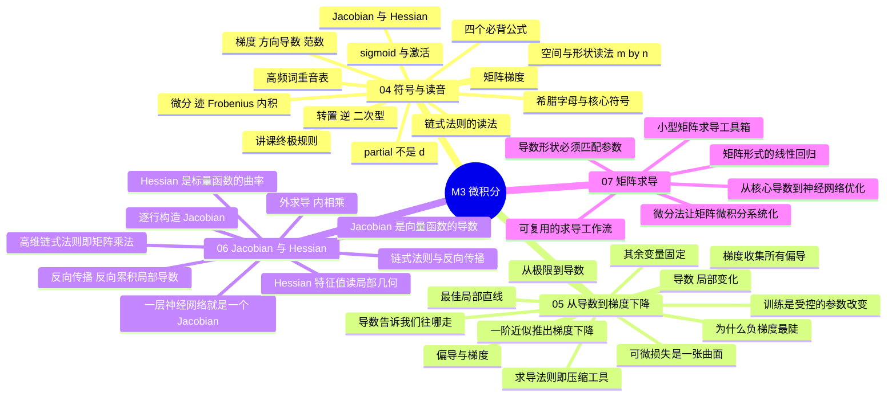

---
title: "机器学习前置知识 03｜微积分与矩阵微积分：从符号读音到梯度、Jacobian、Hessian、反向传播"
aliases: [机器学习前置知识M3, 微积分与矩阵微积分, Calculus and Matrix Calculus, SIMPLEX-知几 M3]
tags: [课程笔记, 机器学习, 前置知识, 微积分, 梯度, Jacobian, Hessian, 反向传播, SIMPLEX知几]
course: "SIMPLEX-知几《机器学习前置知识》"
module: "M3 微积分与矩阵微积分"
lecture: "04–07（四讲）"
bvid: BV11zYL6qExM
url: "https://www.bilibili.com/video/BV11zYL6qExM"
duration: "约 110 分钟（31.5 + 29.6 + 31.5 + 16.9）"
speaker: SIMPLEX-知几（Serena.G）
created: 2026-11-19
---

> [!info] 课程信息
> - 模块：M3 — 微积分与矩阵微积分（M2 讲「空间怎么变」，M3 讲「**模型怎么朝着正确方向变**」）
> - 讲次：四讲连播
>   | 讲 | 标题 | 时长 | BV |
>   |---|---|---|---|
>   | 04 | 微积分公式到底怎么读？Gradient / Jacobian / Hessian 英文读法 | 31.5′ | [BV11zYL6qExM](https://www.bilibili.com/video/BV11zYL6qExM) |
>   | 05 | 从导数到梯度下降：为什么负梯度方向 Loss 降得最快 | 29.6′ | [BV1A4YD6YEsv](https://www.bilibili.com/video/BV1A4YD6YEsv) |
>   | 06 | Jacobian、Hessian 与矩阵微积分：高维模型到底怎么求导 | 31.5′ | [BV1pmYS6FEFw](https://www.bilibili.com/video/BV1pmYS6FEFw) |
>   | 07 | 链式法则与反向传播：神经网络到底是怎么计算梯度的 | 16.9′ | [BV1bkYd6oEZf](https://www.bilibili.com/video/BV1bkYd6oEZf) |
> - 讲者：SIMPLEX-知几（Serena.G）

> [!tip] 一句话抓住这一讲
> **微积分在机器学习里只回答一个问题：参数往哪个方向改、改多少。**
> 导数给出「往哪改」，梯度给出「多元时怎么一起改」，Jacobian 处理「输出也是向量」，Hessian 处理「曲率/该走多大步」，链式法则 + 反向传播解决「深层模型怎么高效算」。
> 第 04 讲是**读音课**，不推公式——目标是「看到公式能念出来、听起来像内行」。

## 本课学习目标

1. 能把 $\theta,\eta,\epsilon,\sigma,\phi,\nabla,\Delta,\mathcal{L},\hat y,\theta^*,\approx,\to$ 这些符号**念对**，并说出它们在 ML 里的默认含义。
2. 能区分 $\partial$（partial）与 $d$，能正确读出 $\dfrac{\partial f}{\partial x}$、$\nabla_\theta\mathcal{L}$、$J_f(x)$、$H_f(x)$。
3. 能把矩阵形状读成「m by n」而不是「m times n」，能读出 $f:\mathbb{R}^n\to\mathbb{R}^m$、$x\in\mathbb{R}^n$。
4. 理解导数 = 局部线性近似（local change / best local line），会用极限定义写出它。
5. 理解梯度 = 所有偏导数拼成的向量，并**证明**「负梯度方向是下降最快的方向」（一阶近似 + Cauchy–Schwarz）。
6. 理解 Jacobian（向量函数对向量求导，$m\times n$）与 Hessian（标量函数二阶导，$n\times n$ 对称），会用 Hessian 特征值读局部几何。
7. 会用链式法则的矩阵形式 $J_{f\circ g}(x)=J_f(g(x))J_g(x)$，并理解反向传播 = 从输出往回累积局部导数。
8. 记住四个「上课前必须能念出来」的公式，并形成「首次说名称、之后读含义」的讲课习惯。

## 知识导图

## 随堂笔记

### 第 04 讲 · 微积分符号与英文读法（Pre-lecture Reading Guide）

> [!note] 这一讲的性质
> 课件封面写得很清楚：**Pre-lecture Reading Guide for Module 03**——它是后面三讲的**预备读物**，不是推导课。
> 全篇 14 节，实质是一份「**符号 → 怎么念 → 在 ML 里什么意思**」的三列表格合集。价值在于：把「心里知道但念不出来」的公式变成能开口讲的话。

> [!quote] 讲师开场（意译）
> 第二讲讲完线性代数，第三讲进入微积分。但在讲主要内容之前，我希望大家先把**重要的概念和读法**理清楚——所以我先录这一讲。
> **能读清楚，不只是「会做题」，它体现的是专业性和严谨性。** 请大家把主次搞清楚。

#### 04.0 先解决「念不出来」这件事

讲师在这一讲里的态度是：**读法不是装饰，是理解的一部分**。几个他反复强调的例子：

| 例子 | 讲师的解释 |
|---|---|
| $\theta_t$ 读 "theta sub t" | 表示**第 $t$ 次迭代**的参数（当前参数），$\theta_{t+1}$ 是下一次迭代的参数 |
| $\eta=0.01$ 读 "eta equals zero point zero one" | 就是 learning rate 取 0.01 |
| $\epsilon$ 读 "epsilon" | 一个**很小的正数**；在极限语境里表示无穷小量，常作 small positive number / step budget |
| $\sigma$ 读 "sigma" | 常见于 **sigmoid notation**（logistic regression 里就用 sigmoid） |
| $\phi(z)$ / $\phi'(z)$ | 分别读 "phi of z" / "**phi prime of z**"（对它求一阶导） |
| $\nabla$ 读 "nabla" 或 "del" | 但上课时**更常读数学含义**：$\nabla f(x)$ 读 "the gradient of f at x"，而不是机械读 "nabla f of x" |
| $\Delta x$ 读 "delta x" | 表示 change / 变化量 |
| $\mathcal{L}$ 读 "script L" | 一旦上下文是损失函数，直接读 **"the loss"** |
| $\hat y$ 读 "y hat" | prediction，用来和 observation（观测值）区分：$\hat y=wx+b$ |
| $\theta^*$ 读 "theta star" | optimal point 或 stationary point（最优点 / 不动点） |
| $\approx$ 读 "is approximately equal to" | 例：$\pi\approx3.1415926$ 必须说 approximately，**不能直接说 equals** |
| $\to$ 读 "arrow" | 按语境读 maps to / goes to / leads to |

#### 04.1 希腊字母与核心符号

| 符号 | 名称 | 推荐读法 | 讲课备注 |
|---|---|---|---|
| $\theta$ | theta | "theta" | 参数最常用；$\theta_i$ 读 "theta sub i" |
| $\eta$ | eta | "eta" | 常作 learning rate（学习率） |
| $\epsilon$ | epsilon | "epsilon" | 常作 small positive number / step budget |
| $\sigma$ | sigma | "sigma" | 常见于 sigmoid notation |
| $\phi$ | phi | "phi" | activation function（激活函数）中常见 |
| $\nabla$ | nabla / del | **通常直接说 "gradient"** | 讲公式时优先读数学含义，而不是机械读 nabla |
| $\Delta$ | capital delta | "delta" | change / perturbation（变化量、扰动） |
| $\mathcal{L}$ | script L | 通常说 **"the loss"** | 在 ML 讲课中最自然 |
| $\hat y$ | y-hat | "y hat" | prediction（预测值） |
| $\theta^*$ | theta star | "theta star" | stationary / optimal point（驻点、最优点） |
| $\approx$ | approximately equal | "is approximately equal to" | **不要**直接说 equals |
| $\to$ | arrow | "maps to" / "goes to" / "leads to" | 根据语境选择 |

> [!important] 这张表最该记住的一条
> $\nabla$ 不是必须念 "nabla"。讲到公式时，**优先把数学含义说出来**——"gradient"、"the gradient of the loss"。机械念符号听起来很外行。

#### 04.2 一个会反复用到的公式

课件单独框出了它，标注 "A formula you will use repeatedly"：

$$\theta_{t+1}=\theta_t-\eta\nabla_\theta\mathcal{L}(\theta_t)$$

> [!example] 标准读法（建议背下来）
> "Theta sub t plus one equals theta sub t minus eta times the gradient of the loss with respect to theta, evaluated at theta sub t."

这一句就是梯度下降。第 05 讲会把「为什么是减、为什么是梯度方向」推出来。

#### 04.3 $\partial$ 与 $d$：多变量微积分里不能混

> [!danger] Important distinction（课件用了红色警告框）
> $\partial$ 读作 **"partial"**，**不是**普通的 $d$。
> 在多变量微积分里，这个区分**必须保留**——$\dfrac{\partial f}{\partial x}$ 读 "the partial derivative of f with respect to x"，而 $\dfrac{df}{dx}$ 读 "the derivative of f with respect to x"（全导数）。

#### 04.4 梯度、方向导数与范数

$$\nabla f(x),\qquad D_uf(x)=\nabla f(x)^Tu$$

| 表达式 | 读法 |
|---|---|
| $\nabla f(x)$ | "the gradient of f at x" |
| $D_uf(x)$ | "the directional derivative of f at x in the direction u" |
| $\nabla f(x)^Tu$ | "the gradient of f at x transpose times u"；**概念上**是 "the dot product between the gradient and u" |

范数的三种写法：

| 表达式 | 读法 |
|---|---|
| $\lVert u\rVert$ | "the norm of u" |
| $\lVert u\rVert=1$ | "the norm of u equals one"；等价说法 "u is a unit vector" |
| $\lVert x\rVert_2$ | "the L-two norm of x" 或 "the Euclidean norm of x" |

还有一个带不等式的完整句子（Cauchy–Schwarz）：

$$D_uf(x)=\nabla f(x)^Tu\le\lVert\nabla f(x)\rVert\,\lVert u\rVert$$

> [!example] 完整读法
> "The directional derivative of f at x in the direction u equals the gradient of f at x transpose times u, **and is less than or equal to** the norm of the gradient times the norm of u."

#### 04.5 空间、归属与矩阵形状

| 表达式 | 读法 |
|---|---|
| $\mathbb{R}$ | "the real numbers" |
| $\mathbb{R}^n$ | "R n" 或 "n-dimensional real space" |
| $f:\mathbb{R}^n\to\mathbb{R}$ | "f maps R n to R" |
| $f:\mathbb{R}^n\to\mathbb{R}^m$ | "f maps R n to R m" |
| $x\in\mathbb{R}^n$ | "**x is in R n**" 或 "x belongs to R n" |
| $m\times n$（矩阵形状） | "**m by n**"，**不是** "m times n" |
| $(m\times p)(p\times n)=m\times n$ | "m by p **times** p by n **gives** m by n" |

> [!warning] 两个最容易露怯的地方
> 1. 形状读 "m by n"（by），运算才读 "times"；
> 2. $\in$ 读 "is in" 或 "belongs to"，不是 "equals"。

#### 04.6 Jacobian：向量函数对向量求导

$$J_f(x)=\Big[\frac{\partial f_i}{\partial x_j}\Big],\qquad J_f(x)\in\mathbb{R}^{m\times n}$$

> [!example] 推荐讲法（课件原文）
> "**The Jacobian of f at x is the matrix whose i-j entry is the partial derivative of f i with respect to x j.**"

| 表达式 | 读法 |
|---|---|
| $J_f(x)$ | "the Jacobian of f at x" |
| $W_{ij}$ | "W sub i j" 或简单说 "W i j" |
| $J_f(x)\Delta x$ | "the Jacobian of f at x times delta x" |

以及一阶近似：

$$f(x+\Delta x)\approx f(x)+J_f(x)\Delta x$$

读作："f of x plus delta x is approximately equal to f of x plus the Jacobian of f at x times delta x."

#### 04.7 Hessian 与曲率

$$H_f(x)=\nabla^2f(x)=\Big[\frac{\partial^2f}{\partial x_i\partial x_j}\Big]$$

| 表达式 | 读法 / 说明 |
|---|---|
| $H_f(x)$ | "the Hessian of f at x" |
| $\nabla^2f(x)$ | **优先也说** "the Hessian of f at x"；"nabla squared f of x" 可接受但语义更弱 |
| $f_{xy}$ | "f sub x y" |
| $f_{xy}=f_{yx}$ | "f sub x y equals f sub y x"；或 "the mixed partial derivatives are equal" |
| $f\in C^2$ | 读 "f is in C two"，再解释 "f is twice continuously differentiable" |

**定性（definiteness）——这里有一个必须避开的坑：**

| 表达式 | 正确读法 |
|---|---|
| $H\succ0$ | "**H is positive definite**" |
| $H\prec0$ | "**H is negative definite**" |

> [!danger] 绝对不要读成「H 大于零」
> 课件原话：**Do not read these as simply "H is greater than zero" or "less than zero."** 矩阵没有全序，$\succ$ 讲的是「二次型恒正/恒负」，也就是 M2 里的 PSD 概念（严格版）。
>
> 顺带记住牛顿步：$\Delta x_{\text{Newton}}=-H^{-1}\nabla f$。

#### 04.8 链式法则的读法

$f\circ g$ 读 **"f composed with g"**。

> [!note] 一个语感建议
> "f circle g" 在用**指称符号**时可以，但在讲课中不够自然——正式讲授时说 "f composed with g"。

$$J_{f\circ g}(x)=J_f(g(x))\,J_g(x)$$

> [!example] 推荐读法
> "The Jacobian of f composed with g at x equals the Jacobian of f **evaluated at g of x**, times the Jacobian of g at x."

标量情形：

$$\frac{d}{dx}f(g(x))=f'(g(x))\,g'(x)$$

读作："the derivative with respect to x of f of g of x equals f prime evaluated at g of x times g prime of x."

#### 04.9 sigmoid 与激活函数记号

sigmoid 的导数有一个非常常用的写法：

$$\frac{\partial a}{\partial z}=a(1-a)$$

读作："the partial derivative of a with respect to z equals a times one minus a."

激活层的 Jacobian：

$$J_a(x)=\mathrm{diag}\big(\phi'(z)\big)W$$

读作："the Jacobian of a with respect to x equals the **diagonal matrix formed from** phi prime of z, times W."

#### 04.10 转置、逆与二次型

| 表达式 | 读法 |
|---|---|
| $A^T$ | "A transpose" |
| $H^{-1}$ | "H inverse" |
| $a^Tx$ | "a transpose x"；概念上 "the inner product of a and x" |
| $x^TAx$ | "x transpose A x" |
| $A+A^T$ | "A plus A transpose" |
| $(Wz-y)z^T$ | "W z minus y, times z transpose" |

> [!danger] Common mistake（课件原框）
> - 对 $A^T$ **不要**说 "A to the T"；
> - 对 $H^{-1}$，说 "H inverse" 比机械说 "H to the minus one" 自然得多。

#### 04.11 矩阵梯度

$$\nabla_W\mathcal{L}$$

推荐读法：**"the gradient of the loss with respect to W."**

两个必背结果：

$$\nabla_W\,\tfrac12\lVert Wz-y\rVert_2^2=(Wz-y)z^T$$

读作："The gradient with respect to W of one half the squared L-two norm of W z minus y equals W z minus y, times z transpose."

$$\nabla_x\big(x^TAx\big)=(A+A^T)x$$

读作："the gradient with respect to x of x transpose A x equals A plus A transpose, times x."

#### 04.12 微分、迹与 Frobenius 内积

| 表达式 | 读法 |
|---|---|
| $d\mathcal{L}$ | "d L" |
| $dW$ | "d W" |
| $dr=X\,dw$ | "d r equals X times d w" |

> [!danger] Do not confuse these（课件原框）
> $dw$ 读 "**d w**"，而 $\dfrac{d}{dw}$ 读 "**d by d w**" 或 "the derivative with respect to w"。两个东西长得像，含义完全不同。

$$\mathrm{tr}(A^TB)\;\Rightarrow\;\text{"the trace of A transpose B"}$$

$$\langle A,B\rangle_F=\mathrm{tr}(A^TB)$$

读作："the Frobenius inner product of A and B equals the trace of A transpose B."

$$d\mathcal{L}=\langle\nabla_W\mathcal{L},dW\rangle_F=\mathrm{tr}\big[(\nabla_W\mathcal{L})^TdW\big]$$

推荐读法："d L equals the Frobenius inner product between the gradient of the loss with respect to W and d W."

> [!tip] 为什么矩阵微积分要用「微分 + 迹」
> 因为一旦把标量损失写成 $d\mathcal{L}=\mathrm{tr}[(\nabla_W\mathcal{L})^TdW]$ 的形式，**梯度的形状就被 $dW$ 的形状唯一确定了**。这是第 06 讲的核心技巧，也是「导数形状必须匹配参数」这条规则的来源。

#### 04.13 高频词汇与重音

| 词 | 近似读音 | 重音 |
|---|---|---|
| Derivative | dih-RIV-uh-tiv | RIV |
| Gradient | GRAY-dee-uhnt | GRAY |
| Jacobian | juh-KOH-bee-uhn | KOH |
| Hessian | HESS-ee-uhn | HESS |
| Calculus | KAL-kyuh-luhs | KAL |
| Curvature | KER-vuh-cher | KER |
| Tangent | TAN-juhnt | TAN |
| Stationary | STAY-shuh-nair-ee | STAY |
| Scalar | SKAY-ler | SKAY |
| Transpose | trans-POHZ | POHZ |
| Eigenvalue | EYE-guhn value | EYE |
| Cauchy–Schwarz | KOH-shee shwarts | 标准数学人名 |
| Frobenius | froh-BEE-nee-us | BEE |
| Sigmoid | SIG-moyd | SIG |
| Perturbation | per-ter-BAY-shuhn | BAY |
| Diagonal | dye-AG-uh-nuhl | AG |
| Approximation | uh-prok-suh-MAY-shuhn | MAY |

> [!tip] 三个最容易念错的
> **Hessian** 不是 "HEE-sian"，是 HESS；**Eigenvalue** 的 Eigen 读 "EYE-guhn"；**Cauchy** 是 "KOH-shee"，不是 "靠基"。

#### 04.14 上课前必须能念出来的四个公式

| # | 公式 | 标准读法 |
|---|---|---|
| 1 | 梯度下降 $\theta_{t+1}=\theta_t-\eta\nabla_\theta\mathcal{L}(\theta_t)$ | "Theta sub t plus one equals theta sub t minus eta times the gradient of the loss with respect to theta, evaluated at theta sub t." |
| 2 | 方向导数 $D_uf(x)=\nabla f(x)^Tu$ | "The directional derivative of f at x in the direction u equals the gradient of f at x transpose times u." |
| 3 | 多变量链式法则 $J_{f\circ g}(x)=J_f(g(x))J_g(x)$ | "The Jacobian of f composed with g at x equals the Jacobian of f evaluated at g of x, times the Jacobian of g at x." |
| 4 | 矩阵梯度 $\nabla_W\tfrac12\lVert Wz-y\rVert_2^2=(Wz-y)z^T$ | "The gradient with respect to W of one half the squared L-two norm of W z minus y equals W z minus y, times z transpose." |

#### 04.15 讲课时的一条终极规则

> [!important] Final Rule for Lecturing（课件最后一页）
> **First appearance：** 你可以先说出符号的名字。
> **After that：** 一律读它的**数学含义**。
>
> | 符号 | 首次可读 | 之后一律读 |
> |---|---|---|
> | $\nabla_\theta\mathcal{L}$ | "nabla" | "the gradient of the loss with respect to theta" |
> | $J_f(x)$ | "Jacobian" | "the Jacobian of f at x" |
> | $H_f(x)$ | "Hessian" | "the Hessian of f at x" |
> | $D_uf(x)$ | "D sub u f" | "the directional derivative of f at x in the direction u" |
>
> 课件原话：这种风格**比逐个机械地念符号既更自然也更精确**（both more natural and more precise）。

### 第 05 讲 · 从导数到梯度下降：为什么负梯度方向让 Loss 降得最快

#### 05.0 这一讲的学习地图

课件先用一页把整条链画清楚——**四个词、一条主线**：

| 阶段 | 关键词 | 学什么 |
|---|---|---|
| 01 | **Local change** | derivative、partial derivative |
| 02 | **Direction** | gradient、directional derivative |
| 03 | **Structure** | Jacobian、Hessian |
| 04 | **Composition** | chain rule、backpropagation |

而 ML 的终点站是这条链：

$$\mathcal{L}(\theta)\;\longrightarrow\;\nabla_\theta\mathcal{L}(\theta)\;\longrightarrow\;\theta_{t+1}=\theta_t-\eta\nabla_\theta\mathcal{L}(\theta_t)$$

> [!quote] 课件原话
> The goal is **not calculus for its own sake**—it is fluency with the derivatives that appear in model training.

> [!quote] 讲师开场就把这一讲的问题摆出来了（意译）
> 大家**先不用急着记住**梯度下降那个公式。这一讲要回答的是三个问题：
> **为什么 gradient 能告诉我们该往哪里移动？为什么是「减去」gradient？这个 gradient 到底是怎么算出来的？**
> 这条主线用一句话概括就是 **from local change to gradient-based learning**——从最基础的局部变化，一路推到机器学习里的训练问题。

#### 05.1 训练就是「受控地改变参数」

课件把训练的因果链画成三块：

$$\underbrace{\theta}_{\text{parameters}}\;\longrightarrow\;\underbrace{\hat y=f(x;\theta)}_{\text{prediction}}\;\longrightarrow\;\underbrace{\mathcal{L}(\hat y,y)}_{\text{loss}}$$

于是「学习」这个问题可以被精确地问出来：

> [!important] Question asked by learning
> **If $\theta\mapsto\theta+\Delta\theta$, how does $\mathcal{L}$ change?**

而答案就是**一阶模型（first-order model）**：

$$\boxed{\mathcal{L}(\theta+\Delta\theta)\approx\mathcal{L}(\theta)+\nabla_\theta\mathcal{L}(\theta)^T\Delta\theta}$$

课件在这一行旁边标注：**"This approximation is the mathematical engine behind gradient descent."**——整讲的推导都从这一行出发。

#### 05.2 导数：局部变化率

$$f'(x)=\lim_{h\to0}\frac{f(x+h)-f(x)}{h}$$

> [!quote] 课件的定义式解读
> A derivative is a **local linear model**：它告诉我们**输出对输入的瞬时敏感度**（instantaneous sensitivity of output to input）。

#### 05.3 导数 = 「最佳局部直线」的斜率

课件用一张图讲这件事：非线性曲线在一点附近**近似像一条直线**，那条红色切线就是导数。

| 项目 | 内容 |
|---|---|
| Definition | $f'(x)=\lim_{h\to0}\dfrac{f(x+h)-f(x)}{h}$ |
| **Local linearization** | $f(x+\Delta x)\approx f(x)+f'(x)\Delta x$ |

> [!important] 三条解读（课件原文）
> 1. **符号**告诉你变化的方向（the sign tells the direction of change）；
> 2. **大小**告诉你局部敏感度（the magnitude tells local sensitivity）；
> 3. 步长越小，这个近似越准（the approximation improves as the step becomes smaller）。

#### 05.4 从极限定义走一遍：二次函数的五步

课件用 $f(x)=x^2$ 做完整的 from-first-principles 演示：

| 步骤 | 内容 |
|---|---|
| Step 1 | $f(x)=x^2$ |
| Step 2 | $f'(x)=\lim_{h\to0}\dfrac{(x+h)^2-x^2}{h}$ |
| Step 3 | $=\lim_{h\to0}\dfrac{x^2+2xh+h^2-x^2}{h}$ |
| Step 4 | $=\lim_{h\to0}\dfrac{h(2x+h)}{h}=\lim_{h\to0}(2x+h)$ |
| Step 5 | $\boxed{f'(x)=2x}$ |

> [!example] 为什么要费这个劲：它立刻用在 ML 上
> $$\mathcal{L}(w)=(wx-y)^2\;\Longrightarrow\;\frac{d\mathcal{L}}{dw}=2(wx-y)\,x$$
> 同一个求导逻辑就变成了**参数的更新信号**：
> $$w\leftarrow w-\eta\frac{d\mathcal{L}}{dw}$$

#### 05.5 求导法则 = 压缩工具（compression tools）

> [!quote] 课件原话
> Instead of taking limits every time, use a **small set of reusable patterns**.

| 法则 | 公式 | 用途（课件原话） |
|---|---|---|
| Power rule | $\dfrac{d}{dx}x^n=nx^{n-1}$ | 多项式项的敏感度 |
| Product rule | $\dfrac{d}{dx}[u(x)v(x)]=u'v+uv'$ | 两个都在变的因子 |
| Quotient rule | $\dfrac{d}{dx}\dfrac{u}{v}=\dfrac{u'v-uv'}{v^2}$ | 两个变化量的比值 |
| **Chain rule** | $\dfrac{d}{dx}f(g(x))=f'(g(x))g'(x)$ | **复合变换** |

> [!important] 课件用红字强调的那一句
> **The chain rule is the crucial one for neural networks: layers are nested functions.**
> （链式法则是神经网络的关键：每一层都是嵌套的函数。）

#### 05.6 一维优化：导数告诉我们往哪走

$$\theta_{t+1}=\theta_t-\eta\,\mathcal{L}'(\theta_t)$$

| 情形 | 结论 |
|---|---|
| $\mathcal{L}'(\theta_t)>0$ | $\theta$ **减小**（往左走） |
| $\mathcal{L}'(\theta_t)<0$ | $\theta$ **增大**（往右走） |
| $\mathcal{L}'(\theta^*)=0$ | 到驻点了 |

> [!warning] 驻点 ≠ 最小值
> 课件原话：**Stationary does not always mean minimum; curvature resolves that later.**（驻点不一定是极小值，曲率才能判定——这正是第 06 讲 Hessian 要解决的。）

#### 05.7 偏导数：把其它变量全部固定

> [!quote] 课件定义
> A partial derivative measures sensitivity to **one coordinate while treating the others as constants**.

$$f(x,y)=x^2+3xy+2y^2$$

| 对谁求 | 结果 | 做法 |
|---|---|---|
| 对 $x$ | $\dfrac{\partial f}{\partial x}=2x+3y$ | 把 $y$ 当常数 |
| 对 $y$ | $\dfrac{\partial f}{\partial y}=3x+4y$ | 把 $x$ 当常数 |

在点 $(x,y)=(1,2)$ 处：$\partial f/\partial x=2+6=8$，$\partial f/\partial y=3+8=11$。

> [!note] 这两个数字在回答两个不同的问题
> 课件原话：Each number answers a different **"what if I nudge this coordinate?"** question.
> 8 说的是「$x$ 轻轻动一点，$f$ 变多快」；11 说的是「$y$ 轻轻动一点，$f$ 变多快」。

#### 05.8 多变量损失是一张曲面

把 $\mathcal{L}(\theta)$ 想成地形，**等值线（contour）就是「损失相同的切片」**，跨过等值线就意味着目标值变了。

课件用的例子是一个**二次碗（quadratic bowl）**：

$$f(x,y)=\frac12x^2+2y^2\qquad\Longrightarrow\qquad\nabla f(x,y)=\begin{pmatrix}x\\4y\end{pmatrix}$$

> [!important] 三条几何事实（课件原文）
> 1. 梯度**垂直于**等值线（gradient is perpendicular to a level set）；
> 2. $+\nabla f$ 指向**上升最快**的方向；
> 3. $-\nabla f$ 指向**局部下降最快**的方向。

> [!quote] 讲师把图上的箭头讲活了（意译）
> 左边那一圈圈的椭圆就是**等高线（contour lines / level sets）**——同一条线上 $f(x,y)=c$ 是常数，你可以把它想成地形图的等高线，一条线上高度相同。
> 图上**红色的箭头是 $+\nabla f$，蓝色的箭头是 $-\nabla f$**。到这里，「为什么梯度下降要往负方向走」就变成一件很自然的事，而不是一条硬记的规则。

#### 05.9 梯度：把所有偏导数收进一个向量

$$f:\mathbb{R}^n\to\mathbb{R}\qquad\Longrightarrow\qquad\nabla f(x)\in\mathbb{R}^n$$

> [!note] 形状的含义
> 一个标量输出、$n$ 个输入敏感度 → 梯度是一个 **$n$ 维向量**（课件写作 $n\times1$）。**输出是标量，输入是向量，导数的形状跟着输入走。**

$$\text{worked example: }f(x,y)=x^2+xy+y^2$$

$$\frac{\partial f}{\partial x}=2x+y,\qquad\frac{\partial f}{\partial y}=x+2y\;\Longrightarrow\;\nabla f(x,y)=\begin{pmatrix}2x+y\\x+2y\end{pmatrix}$$

在 $(1,2)$ 处：

$$\nabla f(1,2)=\begin{pmatrix}4\\5\end{pmatrix}$$

> [!example] 这个 $(4,5)$ 怎么读
> 课件原话：near $(1,2)$, the **steepest increase** points in the direction $[4,5]$。
> 注意它只是**方向**——真正要走多远由学习率决定。

#### 05.10 为什么梯度是最陡的方向（完整证明）

这一步是整讲最漂亮的推导，课件用五步走完：

| 步骤 | 内容 |
|---|---|
| **START** | 沿单位方向 $u$ 走：$g(t)=f(x+tu)$ |
| **DIFFERENTIATE** | $g'(t)=\dfrac{d}{dt}f(x+tu)$ |
| **CHAIN RULE** | $g'(0)=\sum_{i=1}^{n}\dfrac{\partial f}{\partial x_i}u_i$ |
| **DOT PRODUCT** | $D_uf(x)=\nabla f(x)^Tu$ |
| **CAUCHY–SCHWARZ** | $D_uf(x)\le\lVert\nabla f(x)\rVert\,\lVert u\rVert=\lVert\nabla f(x)\rVert$ |

> [!note] 讲师对「$t$ 是什么」的解释
> $g(t)=f(x+tu)$ 里的 $t$ 表示**沿方向 $u$ 走了多远**（走了 $t$ 步）。所以 $g'(0)$ 就是「刚起步时，函数值随步长变化的速率」——这正是方向导数的定义。
> 把 $\sum_i\frac{\partial f}{\partial x_i}u_i$ 写成向量形式，就得到 $D_uf(x)=\nabla f(x)^Tu$：**方向导数就是梯度与单位方向的内积**。

最后一步用了 $\lVert u\rVert=1$。于是：

$$u_{\max}=\frac{\nabla f(x)}{\lVert\nabla f(x)\rVert},\qquad u_{\min}=-\frac{\nabla f(x)}{\lVert\nabla f(x)\rVert}$$

> [!important] 结论（记这一句就够）
> 在**单位方向**下，方向导数在 $+\nabla f$ 方向**最大**、在 $-\nabla f$ 方向**最小**。
> 所以「下降最快」的方向就是梯度的**反方向**——这不是规定，是被 Cauchy–Schwarz 不等式逼出来的唯一答案。

#### 05.11 梯度下降是「一阶近似 + 步长预算」推出来的

| 步骤 | 内容 | 含义 |
|---|---|---|
| **1 · LOCAL MODEL** | $\mathcal{L}(\theta+\Delta\theta)\approx\mathcal{L}(\theta)+\nabla\mathcal{L}(\theta)^T\Delta\theta$ | 用一条超平面替损失 |
| **2 · STEP BUDGET** | $\lVert\Delta\theta\rVert\le\epsilon$ | 步子不能无限大，否则线性近似失效 |
| **3 · BEST DIRECTION** | $\Delta\theta^*=\arg\min_{\lVert\Delta\theta\rVert\le\epsilon}\nabla\mathcal{L}(\theta)^T\Delta\theta=-\epsilon\dfrac{\nabla\mathcal{L}(\theta)}{\lVert\nabla\mathcal{L}(\theta)\rVert}$ | 在预算内选最陡下降方向 |
| **4 · PRACTICAL STEP** | $\boxed{\theta_{t+1}=\theta_t-\eta\nabla_\theta\mathcal{L}(\theta_t)}$ | 把 $\epsilon$ 折进学习率 $\eta$ |

两个旋钮的职责被分得很清楚：

| 符号 | 作用 |
|---|---|
| $\eta>0$（learning rate） | 控制**步长大小**（controls step size） |
| $-\nabla\mathcal{L}$（descent direction） | 控制**走的方向**（controls step direction） |

> [!quote] 这一讲最该带走的一句话
> 梯度下降不是「启发式规则」，它是**在一阶近似下、给定步长预算时使损失下降最多的那一步**。所以它成立的前提是：**步长要小到线性近似还成立**。

#### 05.12 落地例子：线性回归，一个参数一个梯度

> [!example] 课件要求「推出来而不是背下来」
> | 环节 | 内容 |
> |---|---|
> | MODEL | $\hat y=wx$ |
> | LOSS | $\mathcal{L}(w)=\frac12(wx-y)^2$ |
> | CHAIN RULE | $\dfrac{d\mathcal{L}}{dw}=\dfrac{d\mathcal{L}}{d(wx-y)}\cdot\dfrac{d(wx-y)}{dw}=(wx-y)\,x$ |
> | UPDATE | $\boxed{w\leftarrow w-\eta(wx-y)x}$ |

数值演示（$x=2,\;y=5,\;w=1,\;\eta=0.1$）：

$$\hat y=2,\qquad \frac{d\mathcal{L}}{dw}=(2-5)\cdot2=-6,\qquad w_{\text{new}}=1-0.1\times(-6)=1.6$$

> [!important] 「梯度 = 预测误差 × 输入敏感度」
> 课件原话：The gradient contains two pieces: **prediction error × input sensitivity**.
> $x=2$ 是输入敏感度（$x$ 越大，同样的权重误差放大得越厉害），$(wx-y)=-3$ 是预测误差。这一步从 1.0 走到 1.6，一下就朝更好的拟合靠近了。

### 第 06 讲 · Jacobian、Hessian 与矩阵微积分：高维模型怎么求导

> [!quote] 讲师交代这一讲的路线（意译）
> 上一讲解决了「**梯度告诉我们往哪里走**」。这一讲处理两个更复杂的问题：
> 1. 如果函数**输入是向量、输出也是向量**，「导数」到底长什么样？（Jacobian）
> 2. 如果我们不只想知道往哪变，还想知道**曲率有多厉害**呢？（Hessian）
>
> 路线是：Jacobian → Hessian → 曲率 → chain rule → 多变量 chain rule → backpropagation → 单神经元的完整反向传播。

#### 06.1 Jacobian = 向量值函数的导数

前面处理的是 $f:\mathbb{R}^n\to\mathbb{R}$（输出标量）。但神经网络里**输出也是向量**：

$$f:\mathbb{R}^n\to\mathbb{R}^m\qquad\Longrightarrow\qquad J_f(x)\in\mathbb{R}^{m\times n}$$

> [!important] 一句话记住行列的含义
> **Rows = outputs. Columns = inputs.**（行数 = 输出维数，列数 = 输入维数）

局部线性化变成矩阵乘向量：

$$f(x+\Delta x)\approx f(x)+J_f(x)\,\Delta x$$

课件原话：把 $J$ 想成一个**把「小的输入变化」映射成「小的输出变化」的矩阵**。

#### 06.2 手算：逐行构造 Jacobian

> [!example] 两个输入、两个输出
> $$f(x,y)=\begin{pmatrix}f_1(x,y)\\f_2(x,y)\end{pmatrix}=\begin{pmatrix}x^2+y\\xy\end{pmatrix}$$
>
> | 步骤 | 内容 |
> |---|---|
> | ROW 1 | $\nabla f_1(x,y)^T=[\,2x\quad1\,]$ |
> | ROW 2 | $\nabla f_2(x,y)^T=[\,y\quad x\,]$ |
> | ASSEMBLE | $J_f(x,y)=\begin{pmatrix}2x&1\\y&x\end{pmatrix}$ |

在 $(x,y)=(1,2)$ 处：

$$J_f(1,2)=\begin{pmatrix}2&1\\2&1\end{pmatrix}$$

给一个很小的输入扰动：

$$\Delta x=\begin{pmatrix}0.01\\-0.02\end{pmatrix}\;\Longrightarrow\;\Delta f\approx J\Delta x=\begin{pmatrix}0\\0\end{pmatrix}$$

> [!note] 为什么结果是 0
> 课件原话：**Here the two first-order effects cancel.**（两个一阶效应刚好抵消。）
> 这不是算错——它恰好说明：在这个点上，沿着 $(0.01,-0.02)$ 这个特定方向走，$f$ 的一阶变化为零。**Jacobian 只能告诉你一阶信息**，二阶的事要靠 Hessian。

#### 06.3 一层神经网络就是一个 Jacobian

线性层 $z=Wx+b$ 展开成分量：

$$z_i=\sum_j W_{ij}x_j+b_i\qquad\Longrightarrow\qquad\frac{\partial z_i}{\partial x_j}=W_{ij}$$

于是：

$$\boxed{J_z(x)=W}$$

> [!important] 这个结论非常省事
> 「线性层对输入的导数」**就是权重矩阵本身**。因为 $W_{ij}$ 恰好就是「第 $j$ 个输入对第 $i$ 个输出的敏感度」，定义上完全对齐。

加上激活 $a=\varphi(z)$ 之后，因为激活是逐元素作用的：

$$\boxed{J_a(x)=\mathrm{diag}\big(\varphi'(z)\big)\,W}$$

> [!quote] 课件原话
> **This is one building block of backpropagation.**（这就是反向传播的一块积木。）
> $J_a$ 就是「先按对角矩阵逐元素缩放，再乘 $W$」——形状上 $\mathrm{diag}$ 是 $m\times m$、$W$ 是 $m\times n$，乘出来仍是 $m\times n$，与「输出 $m$、输入 $n$」一致。

#### 06.4 Hessian = 标量函数的曲率

$$H_f(x)=\nabla^2f(x)=\Big[\frac{\partial^2f}{\partial x_i\partial x_j}\Big]_{i,j=1}^{n}\in\mathbb{R}^{n\times n}$$

二变量时展开就是：

$$H_f(x,y)=\begin{pmatrix}f_{xx}&f_{xy}\\f_{yx}&f_{yy}\end{pmatrix}$$

> [!important] 若 $f\in C^2$ 则 Hessian 对称
> $f_{xy}=f_{yx}\;\Longrightarrow\;H_f(x)=H_f(x)^T$。
> 这就是 M2 里「对称矩阵可以正交对角化」在这里派上用场的地方——**Hessian 一定有一套正交特征向量基**。

> [!quote] 讲师对「两个矩阵各管什么」的总结
> **Jacobian 描述的是函数的一阶变化（多个输出如何随多个输入变化）；Hessian 描述的是梯度的二阶曲率（梯度本身如何变化）。**
> 换句话说：Jacobian 管「往哪变」，Hessian 管「变的时候弯得有多厉害」。

两类元素的含义：

| 位置 | 含义 |
|---|---|
| 对角线 $f_{xx},f_{yy}$ | 各个坐标方向上的**曲率**（coordinate-wise curvature） |
| 非对角线 $f_{xy}$ | 坐标之间的**局部交互**（local interactions） |

二阶局部模型（一阶的基础上多一项）：

$$f(x+\Delta x)\approx f(x)+\nabla f(x)^T\Delta x+\frac12\Delta x^TH_f(x)\Delta x$$

> [!note] 一阶给方向，二阶给形状
> 课件原话：First order gives direction. **Second order describes the shape of the local bowl or saddle.**

由此得到牛顿法的一步：

$$\Delta x_{\text{Newton}}=-H^{-1}\nabla f$$

> [!tip] 为什么牛顿法要用 $H^{-1}$
> 梯度只说「往下坡」，但不告诉你「这个坡有多陡、各个方向陡得一样不一样」。乘 $H^{-1}$ 就是**用曲率把梯度重新缩放**（rescale the gradient）——在平缓的方向走大步，在陡峭的方向走小步。

#### 06.5 用 Hessian 的特征值读局部几何

这一页把 M2 的 PSD 直接搬到优化里：

| 情形 | 条件 | 几何 | 等值线 |
|---|---|---|---|
| **Local minimum** | $H\succ0$，所有特征值为正 | 碗（bowl） | 同心椭圆 |
| **Local maximum** | $H\prec0$，所有特征值为负 | 山（hill） | 同心椭圆 |
| **Saddle point** | $H$ **indefinite**，特征值有正有负 | 马鞍 | 两条交叉直线 |

课件给的例子：

$$f(x,y)=x^2+4y^2\;\Longrightarrow\;H=\begin{pmatrix}2&0\\0&8\end{pmatrix}\succ0$$

> [!important] 判据可以一句话说完
> **$H$ 的特征值全正 → 极小；全负 → 极大；有正有负 → 鞍点。**
> 这也解释了 05.6 那句「驻点不一定是最小值」——驻点只保证 $\nabla f=0$，是不是极小要看 $H$ 的定性。

#### 06.6 链式法则：外层求导，再乘内层

$$y=f(g(x))\;\Longrightarrow\;\frac{dy}{dx}=\frac{dy}{du}\cdot\frac{du}{dx}=f'(u)\,g'(x),\qquad u=g(x)$$

> [!example] 课件的手算例子
> $$y=(3x+1)^2,\qquad u=3x+1$$
> $$\frac{dy}{du}=2u,\qquad\frac{du}{dx}=3\;\Longrightarrow\;\boxed{\frac{dy}{dx}=6(3x+1)}$$

课件用**计算图**（computation graph）画这件事：$x\to u=3x+1\to y=u^2$，反向时**把局部导数乘起来**（backward: multiply local derivatives）。

| 方向 | 做什么 |
|---|---|
| Forward | 算中间变量 $u$ 的值 |
| Backward | 从 $y$ 往 $x$ 走，逐段乘局部导数 |

#### 06.7 高维时，链式法则就变成矩阵乘法

$$x\in\mathbb{R}^n\;\xrightarrow{\;g\;}\;u=g(x)\in\mathbb{R}^p\;\xrightarrow{\;f\;}\;y=f(u)\in\mathbb{R}^m$$

$$\boxed{J_{f\circ g}(x)=J_f(g(x))\,J_g(x)}$$

形状检查（这是最好用的 debug 手段）：

$$(m\times p)\,(p\times n)=m\times n$$

> [!important] 顺序不能反
> 前向是 $g$ 先、$f$ 后；**导数复合时矩阵也要按同样顺序乘**：先 $J_g$（$p\times n$）在右，再 $J_f$（$m\times p$）在左。课件原话：Jacobians compose **in the same order as local linear maps**。
>
> 课件还专门提示：**Shape checking is a powerful way to catch derivative mistakes.**（形状检查是抓导数错误最有力的手段。）

#### 06.8 反向传播 = 反向累积局部导数

| 阶段 | 内容 |
|---|---|
| **FORWARD PASS** | $x\to z=Wx+b\to a=\varphi(z)\to\hat y\to\mathcal{L}(\hat y,y)$ |
| **BACKWARD PASS** | $\dfrac{\partial\mathcal{L}}{\partial\hat y}\to\dfrac{\partial\mathcal{L}}{\partial a}\to\dfrac{\partial\mathcal{L}}{\partial z}\to\dfrac{\partial\mathcal{L}}{\partial W}$ |

关键的一步：

$$\frac{\partial\mathcal{L}}{\partial W}=\frac{\partial\mathcal{L}}{\partial z}\cdot\frac{\partial z}{\partial W}$$

> [!important] 一句话记住反向传播
> 课件原话：**Every gradient is a product of upstream sensitivity and a local derivative.**
> （每个梯度都是「上游敏感度」乘「局部导数」。）
>
> 前向传播把中间值**存下来**（这就是为什么训练比推理更吃显存），反向传播再把这些局部导数**从后往前乘**回去。

#### 06.9 完整例子：一个神经元，推出每一个反向信号

课件用一个神经元把整条链走完，这是全模块最值得手抄一遍的一页。

**前向：**

$$z=wx+b,\qquad a=\sigma(z)=\frac{1}{1+e^{-z}},\qquad\mathcal{L}=\frac12(a-y)^2$$

**反向（局部导数）：**

$$\frac{\partial\mathcal{L}}{\partial a}=a-y,\qquad\frac{\partial a}{\partial z}=\sigma(z)\big(1-\sigma(z)\big)=a(1-a),\qquad\frac{\partial z}{\partial w}=x,\qquad\frac{\partial z}{\partial b}=1$$

**合并（链式相乘）：**

$$\frac{\partial\mathcal{L}}{\partial w}=\frac{\partial\mathcal{L}}{\partial a}\cdot\frac{\partial a}{\partial z}\cdot\frac{\partial z}{\partial w}=(a-y)\,a(1-a)\,x$$

$$\frac{\partial\mathcal{L}}{\partial b}=\frac{\partial\mathcal{L}}{\partial a}\cdot\frac{\partial a}{\partial z}\cdot\frac{\partial z}{\partial b}=(a-y)\,a(1-a)$$

**更新：**

$$w\leftarrow w-\eta\frac{\partial\mathcal{L}}{\partial w},\qquad b\leftarrow b-\eta\frac{\partial\mathcal{L}}{\partial b}$$

> [!quote] 课件收尾的那句话
> **Backprop does not invent new calculus; it organizes repeated chain-rule products efficiently.**
> （反向传播没有发明新的微积分，它只是把反复出现的链式乘积**高效地组织起来**。）

### 第 07 讲 · 矩阵微积分：从公式到可复用的求导流程

#### 07.1 第一原则：导数的形状必须匹配参数

$$\mathcal{L}(W)\in\mathbb{R},\quad W\in\mathbb{R}^{m\times n}\qquad\Longrightarrow\qquad\nabla_W\mathcal{L}=\Big[\frac{\partial\mathcal{L}}{\partial W_{ij}}\Big]\in\mathbb{R}^{m\times n}$$

> [!important] Rule of thumb（课件原话）
> **Same shape as $W$.** 如果梯度**不能与参数直接相减**（shape 对不上），那一定是形状错了。
> 原话：*If your gradient cannot be subtracted from the parameter, check the shape.*

> [!quote] 讲师解释「为什么形状必须一样」（意译）
> 因为训练时做的运算就是
> $$W_{\text{new}}=W-\eta\nabla_W\mathcal{L}$$
> **$W$ 和梯度要直接相减，所以它们的 shape 必须完全一致。** 这不是审美问题，是减法本身的要求。
> 所以形状检查是最省时间的 debug：算完先别急着往下推，先看「能不能减」。

四类导数，按「输入类型 × 输出类型」排：

| 映射 | 导数 | 形状 |
|---|---|---|
| scalar → vector | **gradient** | 同输入向量 |
| vector → vector | **Jacobian** | $m\times n$ |
| scalar → matrix | **matrix gradient** | 同参数矩阵 |
| scalar 对 vector 的**二阶**导 | **Hessian** | $n\times n$ |

#### 07.2 小型矩阵求导工具箱

> [!important] 这四个必须背下来（课件原话：These patterns appear constantly）
> | 名称 | 公式 | 一句话 |
> |---|---|---|
> | Linear form | $\nabla_x(a^Tx)=a$ | same shape as $x$ |
> | Quadratic norm | $\nabla_x\frac12\lVert x\rVert_2^2=x$ | radial sensitivity（径向敏感度） |
> | Quadratic form | $\nabla_x(x^TAx)=(A+A^T)x$ | 对称 $A$ 时就是 $2Ax$ |
> | Linear map loss | $\nabla_W\frac12\lVert Wx-y\rVert_2^2=(Wx-y)x^T$ | error × input$^T$ |

> [!warning] 但不要盲背
> 课件原话：**Do not memorize blindly: check dimensions and derive from differentials when uncertain.**
> 尺寸检查永远比记忆可靠——尤其第 4 个，$x$ 换成矩阵 $X$ 之后转置的位置会变。

#### 07.3 用微分法推线性回归的梯度

> [!example] 课件要求「用干净的微分论证推出来」
> | 步骤 | 内容 |
> |---|---|
> | MODEL | $\hat y=Xw$ |
> | LOSS | $\mathcal{L}(w)=\dfrac{1}{2N}\lVert Xw-y\rVert_2^2$ |
> | RESIDUAL | $r=Xw-y$，于是 $\mathcal{L}=\dfrac{1}{2N}r^Tr$ |
> | DIFFERENTIAL | $d\mathcal{L}=\dfrac1N r^Tdr$，且 $dr=X\,dw$ |
> | SUBSTITUTE | $d\mathcal{L}=\dfrac1N r^TX\,dw=\Big(\dfrac1N X^Tr\Big)^Tdw$ |
> | **READ OFF GRADIENT** | $\boxed{\nabla_w\mathcal{L}=\dfrac1N X^T(Xw-y)}$ |

形状检查（每一步都写出来）：

$$X\in\mathbb{R}^{N\times d},\quad r\in\mathbb{R}^{N},\quad X^Tr\in\mathbb{R}^{d},\quad w\in\mathbb{R}^{d}$$

> [!note] 为什么最后一步叫「读出来」
> 因为一旦把 $d\mathcal{L}$ 写成 $\big(\text{某物}\big)^Tdw$ 的形式，那个「某物」**按定义就是梯度**——$d\mathcal{L}=\nabla^Tdw$。所以矩阵微积分的核心技巧不是求导，而是**把微分整理成这个标准型**。

#### 07.4 微分法让矩阵微积分系统化

目标形式：

$$\boxed{d\mathcal{L}=\langle\nabla_W\mathcal{L},\;dW\rangle_F}$$

其中内积是 **Frobenius 内积**：

$$\langle A,B\rangle_F=\mathrm{tr}(A^TB)$$

> [!example] 课件例子：$\mathcal{L}(W)=a^TWb$
> $$d\mathcal{L}=a^T(dW)\,b=\mathrm{tr}\big(a^T(dW)b\big)=\mathrm{tr}\big(ba^TdW\big)$$
> 对照 $\mathrm{tr}\big[(\nabla_W\mathcal{L})^TdW\big]$ 的形式，立刻读出：
> $$\boxed{\nabla_W\mathcal{L}=ab^T}$$
> 完全不需要对每个 $W_{ij}$ 求偏导。

**可复用的五步工作流：**

1. 写出标量损失；
2. 取微分（differential）；
3. 用迹的恒等式把 $dW$ **移到右边**；
4. 匹配成 $d\mathcal{L}=\mathrm{tr}\big[(\nabla_W\mathcal{L})^TdW\big]$；
5. 检查梯度形状。

#### 07.5 从导数到神经网络优化：一个训练循环里的所有概念

| # | 阶段 | 做什么 | 用到的对象 |
|---|---|---|---|
| 1 | **Forward** | 算预测与损失 | $\hat y=f(x;\theta)$、$\mathcal{L}(\hat y,y)$ |
| 2 | **Local derivatives** | 对每层的运算求导 | $J$、$\nabla$、$\phi'(z)$ |
| 3 | **Backward** | 用链式法则复合 | $\nabla_\theta\mathcal{L}$ |
| 4 | **Update** | 参数往低处走 | $\theta\leftarrow\theta-\eta\nabla_\theta\mathcal{L}$ |

$$\theta\;\longrightarrow\;\mathcal{L}\;\longrightarrow\;\nabla_\theta\mathcal{L}\;\longrightarrow\;\theta_{\text{new}}$$

> [!important] 这一页的价值
> 它说明：**这个模块里出现的每一个对象，都在一个训练循环里有确切的位置。** 不是「学完再说」，而是「学完就会用」。

#### 07.6 求解导数题的可靠工作流

| # | 步骤 | 做什么 | 例子 |
|---|---|---|---|
| 1 | **Write shapes** | 谁标量、谁向量、谁矩阵 | $\theta\in\mathbb{R}^d,\;W\in\mathbb{R}^{m\times n}$ |
| 2 | **Expose composition** | 给中间变量起名字 | $z=Wx+b,\;a=\phi(z)$ |
| 3 | **Differentiate locally** | 求简单的导数积木 | $\phi'(z),\;J_z,\;\nabla_a\mathcal{L}$ |
| 4 | **Compose** | 链式法则 / 矩阵乘 | $J_{f\circ g}=J_fJ_g$ |
| 5 | **Sanity-check** | 验形状与符号 | $\nabla_\theta\mathcal{L}\in\mathbb{R}^d$ |

> [!danger] 课件用红字写的那一条
> **If the shape does not work, the derivative is almost certainly wrong.**
> （如果形状不对，那这个导数几乎一定是错的。）——这是最省时间的自检手段。

#### 07.7 Module 03 工具箱总表

| Object | Map | Derivative | Shape | ML 里的角色 |
|---|---|---|---|---|
| Derivative | $f:\mathbb{R}\to\mathbb{R}$ | $f'(x)$ | $1$ | 一维敏感度 |
| Gradient | $f:\mathbb{R}^n\to\mathbb{R}$ | $\nabla f$ | $n\times1$ | **下降方向** |
| Jacobian | $f:\mathbb{R}^n\to\mathbb{R}^m$ | $J_f$ | $m\times n$ | 向量变换 |
| Hessian | $f:\mathbb{R}^n\to\mathbb{R}$ | $H_f$ | $n\times n$ | **曲率** |
| Matrix gradient | $\mathcal{L}:\mathbb{R}^{m\times n}\to\mathbb{R}$ | $\nabla_W\mathcal{L}$ | $m\times n$ | **参数更新** |

> [!important] 模块总结公式（课件原文）
> **Derivative intuition + shape discipline + chain rule → backprop fluency**
> （导数的直觉 + 形状的纪律 + 链式法则 → 反向传播的熟练度）

#### 07.8 模块结尾

课件最后一页只放了五个记号：

$$\nabla\mathcal{L}\qquad J\qquad H\qquad\text{chain rule}\qquad\text{backprop}$$

> [!quote] 它的判决
> **You now have the calculus needed to read gradient-based ML.**
> 下一页写着 **Next: Probability and Statistics**——M4 开始处理「不确定性怎么描述」。

## 重点速记 Cheat Sheet

### 04 讲：符号与读法

| 主题 | 结论 |
|---|---|
| $\nabla$ | 通常直接读 **"gradient"**，不机械读 nabla |
| $\mathcal{L}$ | 读 "the loss"；$\hat y$ 读 "y hat"；$\theta^*$ 读 "theta star" |
| $\partial$ vs $d$ | $\partial$ 读 **"partial"**，多变量里不能读 d |
| 形状 | $m\times n$ 读 **"m by n"**，不是 "m times n" |
| 归属 | $x\in\mathbb{R}^n$ 读 "x is in R n" |
| $H\succ0$ | **"H is positive definite"**，不是 "H greater than zero" |
| $A^T$ / $H^{-1}$ | "A transpose" / "H inverse"（不说 "A to the T"） |
| $dw$ vs $d/dw$ | "d w" vs "d by d w"，不能混 |

### 05 讲：导数与梯度

| 主题 | 结论 | 一句话 |
|---|---|---|
| 导数定义 | $f'(x)=\lim_{h\to0}\frac{f(x+h)-f(x)}{h}$ | 局部线性模型 |
| 一阶近似 | $f(x+\Delta x)\approx f(x)+f'(x)\Delta x$ | 符号给方向，大小给敏感度 |
| 链式法则 | $f(g(x))'=f'(g(x))g'(x)$ | 神经网络的关键法则 |
| 一维更新 | $\theta_{t+1}=\theta_t-\eta\mathcal{L}'(\theta_t)$ | 正导数往左、负导数往右 |
| 驻点 | $\mathcal{L}'(\theta^*)=0$ | 不一定是极小值 |
| 偏导 | 固定其它变量 | $\partial f/\partial x$ 里 $y$ 当常数 |
| 梯度 | $\nabla f\in\mathbb{R}^n$，形状跟着**输入** | 收集所有偏导 |
| 方向导数 | $D_uf(x)=\nabla f(x)^Tu$ | 梯度与单位方向的内积 |
| **最陡方向** | $D_uf\le\lVert\nabla f\rVert\lVert u\rVert=\lVert\nabla f\rVert$ | Cauchy–Schwarz 逼出的唯一答案 |
| **梯度下降** | $\theta_{t+1}=\theta_t-\eta\nabla\mathcal{L}$ | 一阶近似 + 步长预算的最优解 |
| 线性回归单参数 | $\frac{d\mathcal{L}}{dw}=(wx-y)x$ | 误差 × 输入 |

### 06 讲：Jacobian、Hessian、反向传播

| 主题 | 结论 | 一句话 |
|---|---|---|
| Jacobian | $J_f\in\mathbb{R}^{m\times n}$ | 行=输出，列=输入 |
| 局部线性化 | $f(x+\Delta x)\approx f(x)+J_f\Delta x$ | $J$ 把 $\Delta x$ 映到 $\Delta f$ |
| 线性层的 Jacobian | $J_z(x)=W$ | 导数就是权重矩阵 |
| 加激活后 | $J_a(x)=\mathrm{diag}(\phi'(z))W$ | 逐元素缩放再乘 $W$ |
| Hessian | $H_f=\nabla^2f\in\mathbb{R}^{n\times n}$，$C^2$ 时对称 | 曲率 |
| 对角/非对角 | 各坐标曲率 / 坐标间交互 | — |
| 二阶模型 | $f+\nabla f^T\Delta x+\frac12\Delta x^TH\Delta x$ | 一阶给方向，二阶给形状 |
| 牛顿步 | $\Delta x=-H^{-1}\nabla f$ | 用曲率缩放梯度 |
| 定性判据 | $H\succ0$ 极小；$H\prec0$ 极大；indefinite 鞍点 | 看特征值符号 |
| 高维链式 | $J_{f\circ g}=J_f(g(x))J_g(x)$ | $(m\times p)(p\times n)=m\times n$ |
| 反向传播 | $\frac{\partial\mathcal{L}}{\partial W}=\frac{\partial\mathcal{L}}{\partial z}\frac{\partial z}{\partial W}$ | 上游敏感度 × 局部导数 |
| sigmoid 导数 | $\sigma'(z)=\sigma(z)(1-\sigma(z))=a(1-a)$ | 单神经元推导的核心 |

### 07 讲：矩阵微积分

| 主题 | 结论 | 一句话 |
|---|---|---|
| 形状原则 | $\nabla_W\mathcal{L}$ 与 $W$ 同形 | 不能相减就是错了 |
| 线性型 | $\nabla_x(a^Tx)=a$ | 同 $x$ 形状 |
| 二次范数 | $\nabla_x\frac12\lVert x\rVert^2=x$ | 径向敏感度 |
| 二次型 | $\nabla_x(x^TAx)=(A+A^T)x$ | 对称时 $2Ax$ |
| 线性映射损失 | $\nabla_W\frac12\lVert Wx-y\rVert^2=(Wx-y)x^T$ | 误差 × 输入$^T$ |
| 线性回归梯度 | $\nabla_w\mathcal{L}=\frac1N X^T(Xw-y)$ | 由微分法读出 |
| Frobenius 内积 | $\langle A,B\rangle_F=\mathrm{tr}(A^TB)$ | 微分法的标准型 |
| 目标形式 | $d\mathcal{L}=\langle\nabla_W\mathcal{L},dW\rangle_F$ | 整理成这个就能读出梯度 |
| $\mathcal{L}=a^TWb$ | $\nabla_W\mathcal{L}=ab^T$ | 迹的轮换一步到位 |
| 五步工作流 | 形状 → 拆复合 → 局部求导 → 复合 → 验形状 | 形状不对一定是错 |

## 易错点 / 常见误区

> [!danger] 1. 把 $\partial$ 读成 $d$
> 多变量里这是两个不同的东西。$\partial$ 读 "partial"，表示「只对一个变量求，其余固定」。

> [!danger] 2. 矩阵形状读成 "m times n"
> 形状读 **"m by n"**，只有做乘法时才说 "times"。

> [!danger] 3. 把 $H\succ0$ 读成「H 大于零」
> 矩阵没有全序。$H\succ0$ 是 "positive definite"，指的是二次型恒正，等价于所有特征值为正。

> [!danger] 4. 以为导数给出「最优点」
> 导数只给**局部线性模型**。$\mathcal{L}'(\theta^*)=0$ 只说明是驻点，是极小/极大/鞍点要看 Hessian。

> [!danger] 5. 步长太大还相信一阶近似
> 梯度下降的推导前提是 $\lVert\Delta\theta\rVert$ 足够小、线性近似还成立。$\eta$ 太大会直接让损失上升甚至发散。

> [!danger] 6. 偏导时忘了「其它变量固定」
> 对 $x$ 求偏导时 $y$ 是常数，$3xy$ 对 $x$ 的导数是 $3y$，不是 $3$。

> [!danger] 7. 把梯度方向当成「上升」还是「下降」搞混
> $+\nabla f$ 是**上升最快**，$-\nabla f$ 才是**下降最快**。梯度下降里的减号不是习惯，是 Cauchy–Schwarz 的结论。

> [!danger] 8. Jacobian 的行列搞反
> **行数是输出维数 $m$，列数是输入维数 $n$**。搞反了 $J\Delta x$ 直接乘不起来——所以形状检查能救命。

> [!danger] 9. 链式法则的矩阵顺序乘反
> $J_{f\circ g}=J_f(g(x))J_g(x)$，顺序与前向一致。写反了形状对不上（或即使对上也算错）。

> [!danger] 10. 反向传播时把「上游敏感度」和「局部导数」搞混
> 每一个梯度都是**两者相乘**。$\partial\mathcal{L}/\partial W=(\partial\mathcal{L}/\partial z)(\partial z/\partial W)$，前一项是从后面传回来的，后一项是本层自己的。

> [!danger] 11. 矩阵梯度忘了转置
> $\nabla_W\frac12\lVert Wx-y\rVert^2=(Wx-y)x^T$，是**列向量乘行向量**。写成 $(Wx-y)^Tx$ 就变成标量了，形状立刻不对。

> [!danger] 12. 盲背矩阵求导公式
> 课件明确说不要盲背：$x$ 换成矩阵 $X$ 之后转置位置会变。**用微分法现场推，比记忆可靠。**

## 思考题 & 课后延伸

1. 用五步极限定义推出 $f(x)=x^3$ 的导数，并写出它在 $x=2$ 处的局部线性近似。
2. 设 $f(x,y)=x^2y+e^{xy}$，求 $\nabla f$，并写出在 $(0,1)$ 处的值。
3. 用 Cauchy–Schwarz 证明：对任意单位向量 $u$，$D_uf(x)\ge-\lVert\nabla f(x)\rVert$，并说明等号何时成立。
4. 若 $\mathcal{L}(\theta)=\frac12\lVert\theta\rVert^2$，写出梯度下降的更新式，并说明它等价于「每一步把 $\theta$ 按比例缩小」——这就是 weight decay 的来源。
5. 设 $f(x)=\begin{pmatrix}x_1^2\\x_1x_2\end{pmatrix}$，求 $J_f$，并计算 $J_f(1,3)$。
6. 设 $f(x,y)=x^2-y^2$，求 Hessian，判断 $(0,0)$ 是什么点，并画出等值线形状。
7. 用 $J_{f\circ g}=J_fJ_g$ 推出 $\dfrac{d}{dx}(3x+1)^2$，验证与 06.6 的手算一致。
8. 对单神经元例子，若把损失换成 $\mathcal{L}=\lvert a-y\rvert$（L1），反向信号会变成什么？为什么它比平方损失更「抗异常值」？
9. 用微分法推 $\nabla_W\,\mathrm{tr}(W^TAW)$。（提示：$d\mathcal{L}=\mathrm{tr}(dW^TAW+W^TA\,dW)$，再用迹的轮换与对称性）
10. 为什么训练比推理更吃显存？请用「前向存中间值」这句话解释。

## 术语表

| 英文 | 中文 | 记号 | 备注 |
|---|---|---|---|
| Derivative | 导数 | $f'(x)$ | 一维敏感度，局部线性模型 |
| Partial Derivative | 偏导数 | $\dfrac{\partial f}{\partial x}$ | 其余变量固定 |
| Gradient | 梯度 | $\nabla f$ | 形状同输入，$n\times1$ |
| Directional Derivative | 方向导数 | $D_uf(x)$ | $\nabla f^Tu$ |
| Local Linearization | 局部线性化 | — | 用直线/超平面近似 |
| First-order Model | 一阶模型 | $\mathcal{L}+\nabla\mathcal{L}^T\Delta\theta$ | 梯度下降的数学引擎 |
| Learning Rate | 学习率 | $\eta$ | 控制步长 |
| Stationary Point | 驻点 | $\theta^*$ | 梯度为 0，未必是极小 |
| Jacobian | 雅可比矩阵 | $J_f$ | 向量对向量，$m\times n$ |
| Hessian | 海森矩阵 | $H_f=\nabla^2f$ | 标量函数二阶导，$n\times n$ 对称 |
| Curvature | 曲率 | — | Hessian 描述 |
| Positive / Negative Definite | 正定 / 负定 | $H\succ0$ / $H\prec0$ | 全正 / 全负特征值 |
| Indefinite | 不定 | — | 特征值有正有负 → 鞍点 |
| Saddle Point | 鞍点 | — | 一阶为 0 但非极值 |
| Newton Step | 牛顿步 | $-H^{-1}\nabla f$ | 用曲率重缩放梯度 |
| Chain Rule | 链式法则 | $J_{f\circ g}=J_fJ_g$ | 复合函数的导数 |
| Composition | 复合 | $f\circ g$ | 读 "f composed with g" |
| Computation Graph | 计算图 | — | 前向算值、反向传梯度 |
| Forward / Backward Pass | 前向 / 反向传播 | — | 存中间值 / 累积局部导数 |
| Backpropagation | 反向传播 | — | 链式法则的高效组织 |
| Upstream Sensitivity | 上游敏感度 | $\partial\mathcal{L}/\partial z$ | 从后面传回来的那一段 |
| Local Derivative | 局部导数 | $\partial z/\partial W$ | 本层自己的那一段 |
| Matrix Gradient | 矩阵梯度 | $\nabla_W\mathcal{L}$ | 与 $W$ 同形状 |
| Differential | 微分 | $d\mathcal{L}$ | 矩阵微积分的系统化工具 |
| Trace | 迹 | $\mathrm{tr}(A)$ | 对角元之和，用于轮换 |
| Frobenius Inner Product | Frobenius 内积 | $\langle A,B\rangle_F$ | $\mathrm{tr}(A^TB)$ |
| Shape Check | 形状检查 | — | 最有效的自检手段 |
| Vectorization | 向量化 | — | M6 主题 |

## 延伸阅读

- 上一篇：[[02-线性代数]]（投影 → 最小二乘、对称矩阵 → 谱定理、PSD → 凸性，都在这里被反复调用）
- 上一篇的上一篇：[[01-数学符号与公式读法]]（$\nabla$、$\sum$、$\lVert\cdot\rVert$ 的基础读法）
- 下一篇：[[04-概率统计]]（从「确定性怎么改」转到「不确定性怎么描述」）
- 相关：[[05-优化]]（本讲的梯度下降在那里变成完整算法：动量、凸性、L1/L2、拉格朗日）
- 相关：[[06-NumPy与向量化]]（本文所有 shape 规则在代码里的落地）
- 课程总索引：[[00-课程总索引]]

