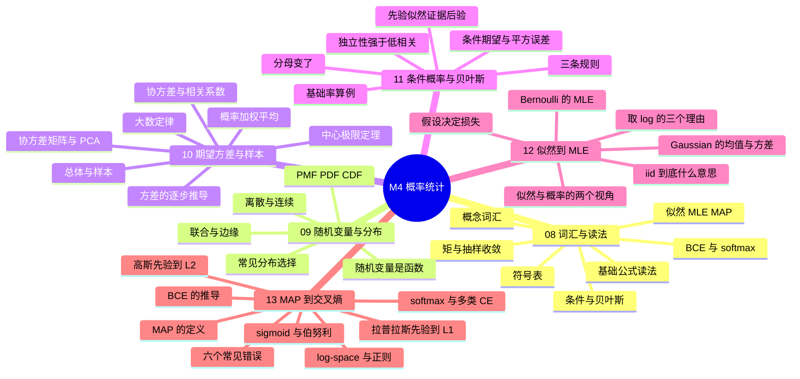

---
title: "机器学习前置知识 04｜概率论与统计：从随机变量、贝叶斯到 MLE、MAP 与交叉熵"
aliases: [机器学习前置知识M4, 概率论与统计, Probability and Statistics for ML, SIMPLEX-知几 M4]
tags: [课程笔记, 机器学习, 前置知识, 概率统计, 随机变量, 贝叶斯, MLE, MAP, 交叉熵, SIMPLEX知几]
course: "SIMPLEX-知几《机器学习前置知识》"
module: "M4 概率论与统计"
lecture: "08–13（六讲）"
bvid: BV1JrYa63EY2
url: "https://www.bilibili.com/video/BV1JrYa63EY2"
duration: "约 207 分钟（14.4 + 40.9 + 53.0 + 15.8 + 39.2 + 43.5）"
speaker: SIMPLEX-知几（Serena.G）
created: 2026-11-20
---

> [!info] 课程信息
>
> - 模块：M4 — 概率论与统计（M3 讲「模型怎么朝着正确方向改」，M4 讲「**改多少才叫有把握**」——不确定性怎么描述、参数怎么从数据里学出来）
> - 讲次：六讲连播
>
>   | 讲 | 标题 | 时长 | BV |
>   |---|---|---|---|
>   | 08 | 概率论与统计：关键词汇、符号与公式英文读法 | 14.4′ | [BV1JrYa63EY2](https://www.bilibili.com/video/BV1JrYa63EY2) |
>   | 09 | 随机变量与概率分布：如何描述不确定性 | 40.9′ | [BV1rDY66KEBF](https://www.bilibili.com/video/BV1rDY66KEBF) |
>   | 10 | 期望、方差与大数定律：从分布到样本 | 53.0′ | [BV1Sie56CETN](https://www.bilibili.com/video/BV1Sie56CETN) |
>   | 11 | 条件概率与贝叶斯定理：如何用证据更新判断 | 15.8′ | [BV1bzex63E3g](https://www.bilibili.com/video/BV1bzex63E3g) |
>   | 12 | 从似然函数到最大似然估计 MLE | 39.2′ | [BV1iXeM6BEWF](https://www.bilibili.com/video/BV1iXeM6BEWF) |
>   | 13 | 从 MAP 到 Cross-Entropy：概率论如何变成机器学习 | 43.5′ | [BV12veg6ZE5n](https://www.bilibili.com/video/BV12veg6ZE5n) |
>
> - 讲者：SIMPLEX-知几（Serena.G）
> - 形式：08 是**读音课**（把词、符号、公式念对），09–11 建立「不确定性怎么描述」，12–13 把它变成「参数怎么学」。

> [!tip] 一句话抓住这一讲
> **概率论在机器学习里只回答两件事：怎么描述不确定，怎么从数据里把参数捞出来。**
> 分布回答第一件（$p(x)$ 长什么样），期望方差把它压成几个数，条件概率与贝叶斯回答「新证据来了怎么改判断」，似然与 MLE 回答「哪个参数最能解释我看到的这批数据」，MAP 再加一个「哪个参数本来就比较可信」，而**交叉熵不是工程技巧，它就是伯努利似然的负对数**。
> 第 08 讲是读音课，不推公式——目标是「看到 $p_{X,Y}(x,y)$、$\hat\theta_{\mathrm{MLE}}$、$\mathcal{L}_{\mathrm{BCE}}$ 能念出来」。

## 本课学习目标

1. 能把 $\Omega,\omega,\mu,\sigma^2,\rho,\Sigma,\bar x,s^2,\hat\theta,\mathcal{L},\ell$ 这些记号**念对**，并把公式读成一句英文（而不是逐个符号翻译）。
2. 能说清随机变量是一个**函数** $X:\Omega\to\mathbb R$，理解「一旦结果变成数字，概率就能做代数」。
3. 能区分 PMF / PDF / CDF 三张面孔各自回答什么问题，记住 $f_X=\frac{d}{dx}F_X$ 与 $F_X(x)=\int_{-\infty}^{x}f_X(t)\,dt$。
4. 能按「结果类型」选分布：二值→Bernoulli、计数→Binomial、到达次数→Poisson、多类→Categorical、等待时间→Exponential、实值噪声→Gaussian。
5. 会算期望、方差、协方差与相关系数，能推导 $Var(X)=E[X^2]-(E[X])^2$，并说清「为什么要平方」。
6. 能读懂协方差矩阵 $\Sigma$ 的两条读法（对角线是方差、非对角是配对协方差），并说出它与 PCA 的关系 $Var(v^Tx)=v^T\Sigma v$。
7. 能区分总体参数与样本统计量，理解 $s^2$ 为什么除以 $n-1$（Bessel 修正），以及大数定律与中心极限定理各自管什么。
8. 会用 $P(A\mid B)=\frac{P(A\cap B)}{P(B)}$ 与贝叶斯公式做题，并能解释「灵敏度 0.95、患病率 1% 时后验只有 0.161」。
9. 能写出似然、对数似然、MLE 与 MAP 的定义，独立推导 Bernoulli 与 Gaussian 的 MLE。
10. 能把四个「假设 → 损失」的对应对上号（Gaussian→平方误差、Bernoulli→BCE、Categorical→多类交叉熵、Poisson→Poisson NLL），并说清 $L_2$ 对应高斯先验、$L_1$ 对应拉普拉斯先验。

## 知识导图

## 随堂笔记

## 上半场 · 不确定性怎么描述

### 模块 0 · 六讲为什么这么排

#### 0.1 整条链：从一个随机结果，到一个训练好的概率模型

这六讲不是「概率论教材的顺序」，而是**按机器学习里真正要用到的顺序**排的。第 09 讲开篇有一页把整条链画成九步：

$$1\ \text{Random variable} \to 2\ \text{Distribution} \to 3\ \text{Estimation} \to 4\ \text{Prediction} \to 5\ \text{Conditional}$$
$$9\ \text{ML loss} \leftarrow 8\ \text{MAP \& Bayes} \leftarrow 7\ \text{MLE} \leftarrow 6\ \text{Likelihood}$$

课件对这一页的注解是：

> Compact probabilistic view of learning. A model specifies $p(x\mid\theta)$ or $p(y\mid x,\theta)$. The dataset supplies evidence. Training selects or updates $\theta$ so the model explains the observations well.

也就是：**模型给出一个带参数的概率故事，数据提供证据，训练就是挑一个让证据最不像巧合的 $\theta$。** 后面 12、13 两讲全在这句话上展开。

#### 0.2 这个模块的六项交付

第 09 讲第二页（`What this module should let you do`）把六讲的目标摊开成六张卡片，副标题是一句很重要的定位：

> The goal is **not to memorize distributions** — it is to **reason under uncertainty**.

| # | 能力 | 课件原文 |
|---|---|---|
| ① | 表示不确定 | Define random variables and choose distributions that match discrete or continuous outcomes. |
| ② | 概括一个分布 | Compute expectation, variance, covariance, and covariance matrices, then interpret their meaning. |
| ③ | 从样本推理 | Distinguish population parameters from sample statistics and understand LLN/CLT intuition. |
| ④ | 用证据更新 | Use conditional probability, total probability, Bayes' theorem, and conditional expectation. |
| ⑤ | 拟合参数 | Write likelihoods and derive MLEs for Bernoulli and Gaussian models. |
| ⑥ | 连回机器学习 | Recognize MSE, cross-entropy, regularization, logistic regression, and softmax as probabilistic ideas. |

课件的 TAKEAWAY 把这六条收成一句话：

> **Machine learning often means: choose a probabilistic story, observe data, then estimate or update the unknown quantities in that story.**

> [!important] 六讲的分工
> - **08**：把词、符号、公式**念对**（读音课，不推公式）。
> - **09**：把「不确定的结果」变成数学对象（随机变量、分布、PMF/PDF/CDF、常见分布、联合与边缘）。
> - **10**：把分布**压成几个数**（期望、方差、协方差），再讲「样本凭什么代表总体」（LLN、CLT）。
> - **11**：新证据进来，判断怎么改（条件概率、贝叶斯、条件期望）。
> - **12**：参数怎么从数据里学（似然、log、MLE）。
> - **13**：先验怎么进来（MAP、正则），以及**交叉熵为什么长这样**。

### 模块 1 · 概率与统计的词汇、符号与读法（08）

#### 1.1 这一讲只解决一件事：把公式说成人话

课件封面给了一句方法论，值得抄下来：

> **A good way to read math aloud is not to translate every symbol mechanically, but to turn the formula into a clear English sentence.**

读公式不是逐符号翻译，而是把它说成一句清楚的英文。这句话决定了整讲的写法：每个公式旁边都有一行 `Read aloud:`，读的是**意思**，不是符号名。

#### 1.2 概念词汇：先保证听到不懵

课件把概念分成三栏：词、音标、常用读法/含义。挑出需要记住的：

| 术语 | 读法 | 一句话含义 |
|---|---|---|
| random variable | a "random variable" | 随机变量 |
| sample space | "the sample space" | 样本空间 |
| distribution | "this variable follows a distribution" | 这个变量服从某分布 |
| PMF | P-M-F（mass） | 离散分布用；概率质量函数 |
| PDF | P-D-F（density） | 连续分布用；概率密度函数 |
| CDF | C-D-F（cumulative） | 累计分布函数 |
| marginal distribution | "marginalize out $X$" | 边缘分布：把不要的变量求和/积分掉 |
| Bernoulli / binomial / Poisson | ber-NOO-lee / bye-NOH-mee-əl / PWAH-son | 二值 / 二项 / 泊松 |
| categorical | 多分类 | softmax 的分布假设 |
| Gaussian | GOW-see-ən，也常说 normal | 高斯/正态 |

> [!note] 「marginalize out」比中文术语更好用
> 讲师特意强调：说 "marginalize out $X$" 比死记「边缘化」更能表达动作——**把不关心的变量消掉**。这就是 09 讲联合分布那一页在做的事。

#### 1.3 符号表：这一节最该背下来的一页

| 符号 | 念法 | 含义 |
|---|---|---|
| $\Omega$ | capital omega | 样本空间 |
| $\omega$ | lowercase omega | 一个结果 |
| $\sim$ | is distributed as / follows | 服从 |
| $\mathbb R$ | the real numbers | 实数 |
| $\mu$ | mu（"myoo"） | 均值 |
| $\sigma$ / $\sigma^2$ | sigma / sigma squared | 标准差 / 方差 |
| $\rho$ | rho（"row"） | 相关系数 |
| $\Sigma$ | capital sigma | 协方差矩阵 |
| $\bar x$ / $s^2$ | x bar / s squared | 样本均值 / 样本方差 |
| $^T$ | transpose | 转置 |
| $\to_p$ | converges in probability | 依概率收敛（LLN） |
| $\to_d$ | converges in distribution | 依分布收敛（CLT） |

配套的等价读法（课件原文）：

> Equivalent reading: "**X is a function from the sample space Omega to the real numbers.**"

> [!warning] $\Sigma$ 有两个身份
> 大写 $\Sigma$ 在这里是**协方差矩阵**；而在求和式 $\sum$ 里它是**求和号**。判断依据是**后面有没有下标和范围**：$\sum_x x p_X(x)$ 是求和，$\Sigma=E[(X-\mu)(X-\mu)^T]$ 是矩阵。这一点在 10 讲会直接用到。

#### 1.4 基础公式：一行公式配一行读法

| 公式 | 读出来是 |
|---|---|
| $X:\Omega\to\mathbb R,\ \omega\mapsto X(\omega)$ | "X maps Omega to the real numbers; omega maps to X of omega." |
| $p_X(x)=P(X=x)$ | "p sub X of x equals the probability that X equals x." |
| $\sum_x p_X(x)=1$ | "the sum over x of p sub X of x equals one." |
| $P(a\le X\le b)=\int_a^b f_X(x)\,dx$ | "the probability that X lies between a and b equals the integral from a to b of f sub X of x d x." |
| $F_X(x)=P(X\le x)$ | "F sub X of x equals the probability that X is less than or equal to x." |
| $p_{X,Y}(x,y)=P(X=x,Y=y)$ | "p sub X comma Y of x comma y equals the probability that X equals x and Y equals y." |
| $p_Y(y)=\sum_x p_{X,Y}(x,y)$ | "p sub Y of y equals the sum over x of the joint probability." |

边缘化那一页还给了一句可以直接背的口语句：

> **"To get the marginal, we sum out or integrate out the variable we do not need."**

#### 1.5 矩、抽样与收敛：四个数字加两个定理

$$E[X]=\sum_x x\,p_X(x)\qquad Var(X)=E[(X-\mu)^2]=E[X^2]-(E[X])^2$$
$$Cov(X,Y)=E[(X-\mu_X)(Y-\mu_Y)]\qquad \rho(X,Y)=\frac{Cov(X,Y)}{\sigma_X\sigma_Y}\in[-1,1]$$
$$\Sigma=E[(X-\mu)(X-\mu)^T]\qquad \bar x=\frac1n\sum_i x_i,\quad s^2=\frac{1}{n-1}\sum_i(x_i-\bar x)^2$$
$$\bar X_n\to_p\mu\qquad \frac{\sqrt n(\bar X_n-\mu)}{\sigma}\to_d\mathcal N(0,1)$$

读法要点只有三条：

- $N(0,1)$ 读作 "**a standard normal distribution**"，不是 "N zero one"。
- $\to_p$ 就是 "converges in probability to"，口语里直接说 "tends to $\mu$"。
- $s^2$ 的分母要念出来："one over **n minus one**"——这个 $n-1$ 后面 10 讲会解释（Bessel 修正）。

#### 1.6 条件与贝叶斯：一个词读错就全错

| 公式 | 读出来是 |
|---|---|
| $P(A\mid B)=\frac{P(A\cap B)}{P(B)}$ | "the probability of A **given** B equals the probability of A intersect B divided by the probability of B." |
| $P(A)=\sum_{j=1}^{m}P(A\mid B_j)P(B_j)$ | "the probability of A equals the sum from j equals one to m of the probability of A given B sub j times the probability of B sub j." |
| posterior $\propto$ likelihood $\times$ prior | "posterior is proportional to likelihood times prior." |
| $X\perp Y$ | "X is **independent** of Y." |
| $E[Y\mid X=x]=\sum_y y\,p(y\mid x)$ | "the conditional expectation of Y given X equals x is the sum over y of y times p of y given x." |

> [!danger] $X\perp Y$ 读成 perpendicular 是硬伤
> 在概率语境里这个符号是**独立**，不是垂直。讲师在原话里专门停了一下："这里直接读 independent，不要说 perpendicular。"垂直是向量内积为零，独立是联合分布可分解——两件事。

三个词的分工（课件用三格并排）：

| 词 | 中文 | 一句话 |
|---|---|---|
| prior | 先验 | 看数据**之前**的信念 |
| likelihood | 似然 | 数据对参数的**支持程度** |
| posterior | 后验 | 加入证据**之后**的信念 |

#### 1.7 似然、MLE、MAP：读法要连参数一起念

$$\mathcal L(\theta;\mathcal D)=p(\mathcal D\mid\theta)\qquad \ell(\theta)=\log \mathcal L(\theta)=\sum_{i=1}^{n}\log p(x_i\mid\theta)$$
$$\hat\theta_{\mathrm{MLE}}=\arg\max_\theta \mathcal L(\theta;\mathcal D)\qquad \hat\theta_{\mathrm{MAP}}=\arg\max_\theta\left[\log p(\mathcal D\mid\theta)+\log p(\theta)\right]$$

- $\mathcal L$ 读 "**script L**" 或直接 "L of theta semicolon D"；分号读作 "semicolon"，表示「给定这批数据」。
- $\hat\theta_{\mathrm{MLE}}$ 读 "theta hat M-L-E"，$\arg\max_\theta$ 读 "the arg max over theta of …"。
- MAP 不加点读 "map"，跟三个字母一样都行；课件写的是 "**map** M-A-P"。

课件用一句话把两者分开：

> **MLE asks which parameter explains the data best; MAP asks which one also stays plausible under the prior.**

#### 1.8 BCE 与 softmax：最后四个公式

$$\mathcal L_{\mathrm{BCE}}(y,p)=-\left[y\log p+(1-y)\log(1-p)\right]$$
$$z=w^Tx+b,\quad p=\sigma(z)=\frac{1}{1+e^{-z}},\quad p_k=\frac{e^{z_k}}{\sum_j e^{z_j}}$$
$$\mathcal L_{\mathrm{CE}}(y,p)=-\sum_{k=1}^{K}y_k\log p_k$$

读音上只有两处容易错：$\sigma(z)$ 读 "sigma of z"（不是 "sigma z"）；$p_k$ 读 "p sub k"。

> [!warning] 讲师最后强调的一件事
> **不要把 PDF 说成 "probability itself"。** 密度是密度，概率是概率：$f_X(x)$ 可以大于 1，$P(a\le X\le b)$ 必须在 $[0,1]$。这句话在 09 讲还会再出现一次，属于本模块的「保命提醒」。

### 模块 2 · 随机变量：把结果变成数（09）

#### 2.1 定义：随机变量是一个函数

$$X:\Omega\to\mathbb R,\qquad \omega\mapsto X(\omega)$$

课件对它的解释值得逐句读：

> A random variable is a function from outcomes to numerical values. Think of $\Omega$ as the space of all possible outcomes. **$X$ does not create randomness; it assigns numbers to outcomes so that algebra and calculus become available.**

例子（掷一次硬币）：$\Omega=\{H,T\}$，定义 $X(H)=1$、$X(T)=0$，于是 $X$ 是 Bernoulli 值。

> [!important] 为什么非要变成数
> 因为变成数之后，才能做加法、求导、算期望。课件那句 **"Once outcomes are numeric, probability becomes algebra."** 就是这个意思——随机性不是 $X$ 造出来的，$X$ 只是给结果贴了个数字标签。

#### 2.2 离散与连续：结果类型决定表示方式

| | 离散 discrete | 连续 continuous |
|---|---|---|
| 取值 | 可数（类别、点击数、掷硬币） | 区间上的值（身高、温度、模型残差） |
| 概率怎么放 | 直接放在**每个值**上 | 单点概率为 0，**区间**才有概率 |
| 表示 | 概率质量函数 PMF $p_X(x)=P(X=x)$ | 概率密度函数 PDF $P(a\le X\le b)=\int_a^b f_X(x)dx$ |
| 归一化 | $\sum_x p_X(x)=1$ | $\int_{-\infty}^{\infty}f_X(x)dx=1$ |

讲师在这一页现场补了一个例子：$X\sim U(0,1)$，则 $f_X(x)=1$（在 $0<x<1$ 上）。密度等于 1 不代表「概率是 1」，因为**密度的高度不是概率**。

#### 2.3 三张面孔：PMF、PDF、CDF 各自回答什么

| 表示 | 回答的问题 | 公式 |
|---|---|---|
| PMF（离散） | 在某一点**有多少**概率 | $p_X(x)=P(X=x)$，$p_X(x)\ge0$，$\sum_x p_X(x)=1$ |
| PDF（连续） | 在某处**有多集中** | $f_X(x)\ge0$，$P(a\le X\le b)=\int_a^b f_X(x)dx$ |
| CDF（通用） | **累积**到这点有多少概率 | $F_X(x)=P(X\le x)$，单调不减、右连续，$F_X(-\infty)=0$、$F_X(\infty)=1$ |

两者的换算关系（讲师手写在 CDF 栏下方，是本节最重要的两条）：

$$f_X(x)=\frac{d}{dx}F_X(x)\qquad F_X(x)=\int_{-\infty}^{x}f_X(t)\,dt$$

> [!example] 讲师举的离散例子
> 掷骰子：$X\in\{1,2,3,4,5,6\}$，每个 $p_X=1/6$。此时 CDF 是一条**阶梯**：$F_X(3)=3/6$。连续情形里阶梯变成斜坡，而斜坡的**斜率**就是密度。

课件底部的 ML 连接（很值得记）：

> **ML connection.** A classifier may output a discrete distribution over labels. A regression model may specify a continuous density over targets. Both are probability distributions; their representations differ.

也就是说：分类输出的是 PMF（softmax 给的那组数），回归输出的是 PDF（高斯那支）。

### 模块 3 · 常见分布：分布是建模选择（09）

#### 3.1 六种分布各自的岗位

| 结果类型 | 分布 | 核心参数化 | 典型 ML 用途 |
|---|---|---|---|
| 二值 | Bernoulli | $P(X=1)=p$ | 二分类标签、点击/不点击 |
| 成功次数 | Binomial | $X\sim\mathrm{Binomial}(n,p)$ | 重复二值试验 |
| 事件计数 | Poisson | $P(X=k)=e^{-\lambda}\lambda^k/k!$ | 计数、到达次数 |
| $K$ 类之一 | Categorical | $\pi_1,\dots,\pi_K,\ \sum_k\pi_k=1$ | softmax 分类 |
| 正的等待时间 | Exponential | rate $\lambda$ | 时长、生存分析基线 |
| 实值噪声 | Gaussian | $\mu,\ \sigma^2$ | 残差、先验、隐变量模型 |

课件的收尾句是这一节的主张：

> **TAKEAWAY** A distribution is a modeling choice. The "right" choice depends on the outcome type and the assumptions you are willing to make.

> [!note] 这张表在第 12 讲会回收
> 12 讲最后那张「假设 → 损失」的对照表，四行里的前三行（Gaussian、Bernoulli、Categorical）就是这里的分布。**选分布等于选损失**，这是 M4 到 M5 的接缝。

#### 3.2 联合分布与边缘化：把不要的变量消掉

$$p_{X,Y}(x,y)=P(X=x,\,Y=y)$$

课件给了一张 5×5 的联合概率表（行 $x_1..x_4$、列 $y_1..y_4$），最右一列是 $p_X(x)$、最后一行是 $p_Y(y)$，右下角合计 1.00。**行和与列和都自洽**，可以直接当练手题：

| | $y_1$ | $y_2$ | $y_3$ | $y_4$ | $p_X(x)$ |
|---|---|---|---|---|---|
| $x_1$ | .02 | .04 | .03 | .01 | **.10** |
| $x_2$ | .05 | .10 | .08 | .03 | **.26** |
| $x_3$ | .04 | .14 | .18 | .07 | **.43** |
| $x_4$ | .01 | .07 | .10 | .03 | **.21** |
| $p_Y(y)$ | **.12** | **.35** | **.39** | **.14** | 1.00 |

边缘化的公式与「为什么成立」：

$$p_Y(y)=\sum_x p_{X,Y}(x,y)\qquad f_Y(y)=\int f_{X,Y}(x,y)\,dx$$

> **Why marginalization works.** For discrete $X$, fix $Y=y$. The events $\{X=x_1,Y=y\},\{X=x_2,Y=y\},\dots$ are disjoint, and their union is exactly $\{Y=y\}$. Therefore, by additivity,
> $$P(Y=y)=P\Big(\bigcup_x\{X=x,Y=y\}\Big)=\sum_x P(X=X,\,Y=y)=\sum_x p_{X,Y}(x,y).$$

（课件原文此处把 $P(X=x,Y=y)$ 印成了 $P(X=X,Y=y)$，属印刷笔误，推导本身没问题。）

> [!tip] 一句话记住
> **"Sum or integrate out what you do not need."** 边缘化不是新操作，就是把不关心的那个变量按行或按列加掉。

### 模块 4 · 期望：把分布压成一个数（10）

#### 4.1 为什么需要这个数

10 讲开场先讲动机：两个模型在验证集上的表现可能「平均一样，但波动差很多」。讲师现场举了两组数（手写在封面上）：

$$\text{A: } 4,8,5,1,7,9 \quad(\bar x=5.2)\qquad \text{B: } 0,10,9,5$$

只报一个平均数，B 那种「忽高忽低」的模型就看不出来。所以需要**两个数**：一个说中心在哪（平均），一个说散得多开（分散）。这一讲的手写笔记就是这四个字：**① 平均 ② 分散**。

#### 4.2 定义：概率加权平均

$$E[X]=\sum_x x\,p_X(x)\quad\text{(discrete)}\qquad E[X]=\int x\,f_X(x)\,dx\quad\text{(continuous)}$$
$$E[g(X)]=\sum_x g(x)p_X(x)\quad\text{or}\quad \int g(x)f_X(x)\,dx$$

课件对它的定义有一句很关键的限定：

> Expectation is the **long-run center** of a random variable — **not necessarily a value that can actually occur.**

> [!example] 期望不一定是「可能值」
> 掷一枚公平骰子，$E[X]=3.5$——但骰子永远不会掷出 3.5。期望是**长期平均**，不是某一次的结果。

#### 4.3 线性性：不需要独立

$$E[aX+bY+c]=aE[X]+bE[Y]+c$$

课件的注解只有一句，但很重要：**No independence assumption is required.**（不需要独立假设）

> [!important] 这条性质会被反复用
> 10 讲推导 $Var(X)=E[X^2]-(E[X])^2$ 时用的就是它；12 讲推导 Gaussian 的 MLE 时也在用。**线性性对期望永远成立**，而方差没有这种好事（$Var(X+Y)\ne Var(X)+Var(Y)$，除非独立或不相关）。

#### 4.4 一个完整的算例：从 PMF 到均值

课件的例子（每页都值得抄一遍流程）：

| 步骤 | 内容 |
|---|---|
| ① 指定分布 | $x=0,1,2,3$；$p_X(x)=0.10,\ 0.20,\ 0.40,\ 0.30$ |
| ② 逐项加权 | $x\cdot p_X(x)=0.00,\ 0.20,\ 0.80,\ 0.90$ |
| ③ 求和 | $E[X]=0(0.10)+1(0.20)+2(0.40)+3(0.30)=\mathbf{1.90}$ |

课件的注解是全页的精华：

> $x=2$ has the largest mass, but the expectation is 1.90 because **every possible value contributes**.

> [!warning] 期望不是众数
> 「概率最大的那个值」是众数（这里是 2），「长期平均」是期望（1.90）。两者经常不一样；写模型时说的「预测值」通常是条件期望，不是众数。

#### 4.5 Bernoulli 的特例：为什么 0/1 的平均就是概率

若 $X\sim\mathrm{Bernoulli}(p)$：

$$E[X]=0\cdot(1-p)+1\cdot p=p$$

课件紧接着给了一句把「样本」和「概率」连起来的话：

> Thus **the mean of many 0/1 observations estimates the positive-outcome probability.**

这句话是 12 讲 MLE 的伏笔：$\hat p_{\mathrm{MLE}}=\frac1n\sum_i x_i$ 就是这个平均。

### 模块 5 · 方差：第二个数字（10）

#### 5.1 同样的期望，完全不同的不确定性

10 讲用两组数据把问题摆出来：两组均值都是 5，但一组挤在 5 附近，另一组在 0 和 10 之间来回跳。**只报均值，两个模型看起来一样。** 课件因此在期望之后紧接着给方差，并配了两张同均值、不同宽度的钟形曲线（标注 "small variance / large variance"）。

$$Var(X)=E\big[(X-\mu)^2\big],\qquad \mu=E[X]$$

#### 5.2 为什么要平方

课件给了两条理由，都很短但都要记住：

> **Why square the deviations?** Positive and negative deviations should not cancel. Squaring also penalizes large deviations more strongly.

如果直接求 $E[X-\mu]$，正负会抵消成 0（这是恒等式，不是巧合）；取绝对值虽然不抵消，但不可导。平方**既保号又可导**，代价是单位变成了「平方单位」——所以还需要标准差。

$$Standard\ deviation:\ \sigma=\sqrt{Var(X)}$$

> it has the same units as $X$.

#### 5.3 逐步推导：$Var(X)=E[X^2]-(E[X])^2$

课件把这一步拆成五行，每一行都标了理由，是这一讲最值得照抄的推导：

$$Var(X)=E\big[(X-\mu)^2\big]$$
$$=E\big[X^2-2X\mu+\mu^2\big]$$
$$=E[X^2]-2\mu E[X]+\mu^2$$
$$=E[X^2]-2\mu^2+\mu^2$$
$$=E[X^2]-\mu^2$$

| 步骤 | 依据（课件原文） |
|---|---|
| ① $(x-\mu)^2$ 展开 | algebraic expansion |
| ② 拆成三项 | linearity of $E[\cdot]$ |
| ③ 常数提出 | constants pull outside expectation |
| ④ 代入 $\mu=E[X]$ | substitute $\mu=E[X]$ |

课件的收尾句说明了这个等式的用处：

> This form often lets us compute variance from **two moments: $E[X]$ and $E[X^2]$**.

> [!tip] 记法
> 「平方的期望 减去 期望的平方」——$E[X^2]-(E[X])^2$。做题时先算 $E[X]$，再算 $E[X^2]$，最后相减，比按定义算 $\sum (x-\mu)^2p(x)$ 快得多。

#### 5.4 一个立刻能用的例子：Bernoulli 的方差

$$\text{若 } X\sim\mathrm{Bernoulli}(p),\quad E[X]=p\ \Rightarrow\ E[X^2]=p\ \Rightarrow\ Var(X)=p-p^2=p(1-p)$$

（因为 $X$ 只取 0/1，$X^2=X$，所以 $E[X^2]=E[X]=p$。这条小技巧在 12 讲算 Bernoulli 似然时会再用一次。）

> [!note] 方差不是线性算子
> $Var(aX+b)=a^2Var(X)$，常数 $b$ 平移不改变方差，缩放要平方；而 $Var(X+Y)$ **不等于** $Var(X)+Var(Y)$，差的那一项就是协方差——这正是下一节的内容。

### 模块 6 · 协方差、协方差矩阵与 PCA 的伏笔（10）

#### 6.1 协方差问的是「这两个变量一起动吗」

$$Cov(X,Y)=E\big[(X-\mu_X)(Y-\mu_Y)\big]$$

课件的定义句是：**Covariance captures the direction of linear co-movement; its magnitude depends on scale.**（方向可靠，大小不可比——因为它带着两个变量的单位）

三档读法（配三张散点图）：

| 取值 | 含义 |
|---|---|
| 正 | 大 $X$ 常伴着大 $Y$（同向） |
| 负 | 大 $X$ 常伴着小的 $Y$（反向） |
| 近零 | 几乎没有**线性**共同变化；但可能有非线性依赖 |

#### 6.2 相关系数：把尺度除掉

$$\rho(X,Y)=\frac{Cov(X,Y)}{\sigma_X\sigma_Y}\in[-1,1]$$

除以两个标准差之后，$\rho$ 与单位无关，只留方向与强度。这一页的散点图里有一组标了 "MEAN ZERO"，用来说明：**中心化之后协方差不变**（平移不改协方差）。

#### 6.3 协方差矩阵：一整个特征向量的「散布」

对 $X\in\mathbb R^d$、均值 $\mu$：

$$\Sigma=E\big[(X-\mu)(X-\mu)^T\big]\in\mathbb R^{d\times d}$$

二维时写成矩阵就很直观：

$$\Sigma=\begin{bmatrix}Var(X_1) & Cov(X_1,X_2)\\ Cov(X_1,X_2) & Var(X_2)\end{bmatrix}$$

课件的三条读法：

- **diagonal** = 每个特征自己的方差；
- **off-diagonal** = 两两之间的协方差；
- $\Sigma$ **symmetric positive semidefinite**（对称半正定）。

#### 6.4 与 PCA 的连接：为什么「协方差 + 特征向量」就是 PCA

这一页的右侧专门留了一块 "PCA connection"，把 02 讲的 SVD/PCA 接回来：

$$Var(v^TX)=v^T\Sigma v\qquad v_1=\arg\max_{\|v\|=1} v^T\Sigma v$$

> which is the eigenvector associated with the largest eigenvalue of $\Sigma$.

课件的 takeaway：**Covariance + eigenvectors = the geometry behind PCA.**

> [!important] 这句话把 M2 和 M4 缝在一起
> 02 讲说「PCA 找方差最大的方向」，这里给出了「方差」的矩阵形式 $v^T\Sigma v$。于是「找方向」变成一个约束优化问题（$\|v\|=1$ 下最大化二次型），解就是 $\Sigma$ 的最大特征向量——正是 02 讲拉格朗日乘子那一步的同一个结论。

### 模块 7 · 总体、样本与大数定律（10）

#### 7.1 两个对象：分布有参数，数据给统计量

课件的标题本身就是一句提醒：**Population vs. sample: what do we actually observe?**

| | 总体量 population quantities | 样本统计量 sample statistics |
|---|---|---|
| 由什么定义 | 未知的**数据生成分布** | 给定的观测 $x_1,\dots,x_n$ |
| 例子 | $\mu=E[X]$、$\sigma^2=Var(X)$ | $\bar x=\frac1n\sum_i x_i$、$s^2=\frac{1}{n-1}\sum_i(x_i-\bar x)^2$ |
| 性质 | 固定但通常**不知道** | **抽样之前是随机的** |

课件在页面上画了一条链：`population distribution (μ, σ²) → sample → statistics (x̄, s²)`。

> [!warning] 「随机」的是统计量，不是参数
> 参数 $\mu$ 是一个固定的未知数；$\bar x$ 每次抽样都不一样，所以 $\bar x$ 是随机变量。把这两者混起来，就会说出「$\mu$ 的概率是 0.7」这种不成立的话（频率学派语境下）。

#### 7.2 $s^2$ 为什么除以 $n-1$

课件把这件事单独点了一句：**Bessel correction**，并在 12 讲用一张小问答框解释了动机：

> **Why $1/(n-1)$ elsewhere?** Bessel's correction targets **unbiased estimation** of population variance, a different goal.

也就是说：除以 $n$ 是「让似然最大」（MLE），除以 $n-1$ 是「让期望等于真值」（无偏）。**两个目标不同，不是谁对谁错。**

#### 7.3 大数定律：平均为什么会稳定

对 i.i.d.、均值有限的随机变量，记 $\bar X_n=\frac1n\sum_i X_i$，则

$$\bar X_n\to_p\mu\qquad\text{即}\qquad \forall\varepsilon>0,\ P\big(|\bar X_n-\mu|>\varepsilon\big)\to0$$

课件的直觉解释：**Independent fluctuations partly cancel.**（独立的抖动会互相抵消）随着 $n$ 增大，经验平均会越来越贴着总体均值。

课件还给了 ML 的连接句：

> **ML connection:** empirical losses and sample averages are useful, under suitable assumptions they approximate population quantities.

这句话是「为什么可以用训练集上的平均损失代替真实期望损失」的全部理由。

#### 7.4 中心极限定理：平均为什么会变成正态

$$X_1,\dots,X_n\ \text{i.i.d.},\ \text{mean }\mu,\ \text{finite variance }\sigma^2\ \Rightarrow\ \frac{\sqrt n(\bar X_n-\mu)}{\sigma}\to_d\mathcal N(0,1)$$

等价地，$n$ 大时

$$\bar X_n\approx\mathcal N\!\left(\mu,\ \frac{\sigma^2}{n}\right)$$

课件列了「这解释了哪些现象」：

- 样本均值的不确定性（uncertainty of sample means）；
- 近似的置信区间；
- 为什么「聚合」能平滑噪声；
- 为什么 mini-batch 的统计量常常可以当高斯处理。

以及一个非常实用的推论：

$$SE(\bar X)=\frac{\sigma}{\sqrt n}\qquad\text{Doubling precision requires roughly \textbf{four times} as much data.}$$

> [!example] 这条结论的实际含义
> 想让误差减半，数据要翻四倍（因为 $\sqrt n$ 在分母）。这就是为什么「加数据」在后期性价比越来越低，也是为什么 batch size 翻倍带来的收益远小于直觉。

> [!note] 两个定理别混
> - **LLN**：$\bar X_n$ 会**靠近** $\mu$（说的是位置）。
> - **CLT**：$\bar X_n$ 的**分布形状**接近正态（说的是形状）。
> LLN 不告诉你形状，CLT 不告诉你收敛到哪。两个一起用，才有「$\bar X_n\approx\mathcal N(\mu,\sigma^2/n)$」这句常用的话。

### 模块 8 · 条件概率：分母变了（11）

#### 8.1 定义：把样本空间「缩小」到 $B$

$$P(A\mid B)=\frac{P(A\cap B)}{P(B)},\qquad P(B)>0$$

课件的解释句是这一节的钥匙：

> **Conditioning changes the denominator.** We no longer compare $A\cap B$ with the full sample space, only with the portion compatible with $B$.

右图的图注更直白：**Condition on $B$ = "zoom in" to $B$.**（把镜头推进到 $B$ 里面去看）

> [!example] 课件里的百分比算例
> 30% 的人选微积分（$C$），20% 选统计（$S$），12% 两个都选。问「选了微积分的人里，选统计的比例」：
> $$P(S\mid C)=\frac{0.12}{0.30}=0.40$$
> 注意分母从「全体」换成了「选微积分的那 30%」——这就是「分母变了」。

#### 8.2 三条规则：乘法、全概率、贝叶斯

这一页把后面要用的工具一次性摆齐（课件原话：**one reusable toolkit**）：

| 规则 | 公式 | 用途 |
|---|---|---|
| 乘法法则 | $P(A\cap B)=P(A\mid B)P(B)=P(B\mid A)P(A)$ | 把联合概率拆成「条件 × 边缘」 |
| 全概率 | $P(A)=\sum_{j=1}^{m}P(A\mid B_j)P(B_j)$（$B_j$ 是样本空间的一个划分） | 不知道 $P(A)$ 时，按情形分块求和 |
| 贝叶斯 | $P(A\mid B)=\dfrac{P(B\mid A)P(A)}{P(B)}$ | 把条件方向反过来 |

课件说这三条会反复出现在：classifiers、latent-variable models、mixture models、filtering、Bayesian inference。

#### 8.3 独立性强于「低相关」

$$X\perp Y\iff p_{X,Y}(x,y)=p_X(x)p_Y(y)\qquad A\perp B\iff P(A\cap B)=P(A)P(B)$$
$$P(A\mid B)=P(A)\quad(P(B)>0)$$

这一页有一块浅粉色的警告，是本节最容易被忽略的一句：

> **Zero covariance does not generally imply independence.** For jointly Gaussian variables it does; outside that special case, nonlinear dependence can remain.

右图配了一个反例：$Y=X^2$，$X$ 对称分布。

> [!danger] 不相关 ≠ 独立
> $Cov(X,Y)=0$ 只说明**没有线性**关系。$Y=X^2$ 时 $Cov(X,Y)=0$（对称性抵消），但 $Y$ 完全由 $X$ 决定——依赖得非常彻底。只有当 $(X,Y)$ **联合高斯**时，不相关才等价于独立。这条在 13 讲的「六个常见错误」里又出现了一次。

### 模块 9 · 贝叶斯：用证据更新信念（11）

#### 9.1 四项对应：一条公式四个名字

$$P(A\mid B)=\frac{P(B\mid A)P(A)}{P(B)}$$

课件把四个部件逐一标注，这是全课最该背的一张对应表：

| 名称 | 公式 | 课件原文 |
|---|---|---|
| **Prior** 先验 | $P(A)$ | belief about $A$ before seeing new evidence |
| **Likelihood** 似然 | $P(B\mid A)$ | compatibility of the evidence with $A$ |
| **Evidence** 证据 | $P(B)$ | normalization |
| **Posterior** 后验 | $P(A\mid B)$ | belief after incorporating $B$ |

右侧的流程图自上而下是 `prior → likelihood → posterior`，likelihood 旁边还标了 `× then normalize`。底部一句话收口：

> **posterior ∝ likelihood × prior.**

> [!important] 记住「正比」就够了
> $P(B)$ 与 $A$ 无关，只起归一化作用。所以做判断时可以先只算 $P(B\mid A)P(A)$，最后再归一化——13 讲 MAP 就是靠这一点把分母直接丢掉的（"the evidence term can be dropped because it does not depend on θ"）。

#### 9.2 贝叶斯不是新公理，是同一个联合概率写了两次

课件的推导只有四步：

$$P(A\cap B)=P(A\mid B)P(B)\quad\text{(condition on }B\text{)}$$
$$P(A\cap B)=P(B\mid A)P(A)\quad\text{(condition on }A\text{)}$$
$$P(A\mid B)P(B)=P(B\mid A)P(A)\quad\text{(set equal)}$$
$$P(A\mid B)=\frac{P(B\mid A)P(A)}{P(B)}\quad\text{(divide by }P(B)>0\text{)}$$

分母怎么算？用全概率：

$$P(B)=P(B\mid A)P(A)+P(B\mid A^c)P(A^c)\qquad\text{更一般地}\quad P(B)=\sum_j P(B\mid A_j)P(A_j)$$

课件对此的注：**Prior × likelihood gives an unnormalized posterior; $P(B)$ normalizes it.**

#### 9.3 基础率算例：0.95 的灵敏度，只换来 0.161 的后验

这是 11 讲最有冲击力的一页。设定：

> Prevalence $P(C)=0.01$；Sensitivity $P(+\mid C)=0.95$；False-positive rate $P(+\mid C^c)=0.05$.

计算：

$$P(C\mid +)=\frac{P(+\mid C)P(C)}{P(+)}=\frac{0.95\times0.01}{0.95\times0.01+0.05\times0.99}=\frac{0.0095}{0.0590}\approx0.161$$

课件的直观解释（**Imagine 1,000 people**）：

> About 10 truly have the condition; roughly 9.5 test positive. Of the other 990, about 49.5 test positive falsely. So only about 9.5 of 59 positives are true positives.

> [!danger] 这就是「基础率谬误」
> 灵敏度 95% 听起来很高，但患病率只有 1% 时，**阳性里真患病的只有 16%**——因为健康人基数太大，5% 的假阳性能凑出近 50 个。课件的 ML lesson 说得很准：
> **in unbalanced classification, precision depends on both classifier quality and class prevalence.**
> 所以在极度不平衡的数据上，光看「准确率/灵敏度」会严重高估模型的实用价值。

### 模块 10 · 条件期望：回归到底在预测什么（11）

#### 10.1 定义：看完 $X$ 之后的平均

$$\mathbb E[Y\mid X=x]=\sum_y y\,p(y\mid x)\quad\text{(discrete)}\qquad \mathbb E[Y\mid X=x]=\int y\,f(y\mid x)\,dy\quad\text{(continuous)}$$

课件的两句注解：

- **It is a function of the observed input $x$.**（它是 $x$ 的函数，不是常数）
- Interpretation：**Once $X=x$ is known, what is our best average prediction for $Y$?**

讲师在页面上手写了一个离散例子：$P(Y=0\mid X=x)=0.20$、$P(Y=1\mid X=x)=0.50$，于是条件期望是这两个数按概率加权的结果。

#### 10.2 为什么平方误差回归瞄准的正是它

课件的右栏标题是 `WHY SQUARED-ERROR REGRESSION TARGETS IT`，推导只有三行，但把「MSE 从哪来」讲透了。固定 $x$，令 $a=f(x)$：

$$R(a)=\mathbb E\big[(Y-a)^2\mid X=x\big]$$

求导：

$$R'(a)=\mathbb E\big[2(a-Y)\mid X=x\big]=2\big(a-\mathbb E[Y\mid X=x]\big)$$

令 $R'(a)=0$：

$$f^*(x)=\mathbb E[Y\mid X=x]$$

再验证二阶导：$R''(a)=2>0$，所以是极小值。

> [!important] 这一步是 M4 到 M5 的第一道缝
> 「最小化平方误差 ⇒ 预测条件均值」不是约定，是可以推出来的结论。反过来说：**只要你用 MSE，你就在假设 $Y$ 在给定 $x$ 后以条件均值为中心**。换成绝对值损失，最优点会变成条件中位数；换成交叉熵，最优点变成条件概率——这条线在 12、13 讲会走完。

## 下半场 · 参数怎么学出来

### 模块 11 · 似然：把数据固定，把参数当未知（12）

#### 11.1 同一支公式，两种看法

$$L(\theta;\mathcal D)=p(\mathcal D\mid\theta)$$

对观测数据 $\mathcal D=\{x_1,\dots,x_n\}$，在条件独立下：

$$L(\theta;\mathcal D)=\prod_{i=1}^{n}p(x_i\mid\theta)$$

标题本身就是定义：**Likelihood: treat the data as fixed and the parameter as unknown.**（把数据当成固定的，把参数当成未知的）

课件左下角有一张 `Two viewpoints` 卡片，把 probability 与 likelihood 的区别写得非常干净：

> **Probability:** with $\theta$ fixed, what data could occur?
> **Likelihood:** with data fixed, which $\theta$ values explain what we observed best?

> [!important] 区别不在公式，在「谁在动」
> $p(x\mid\theta)$ 这支公式两个视角都在用。**概率**视角：$\theta$ 不动，问不同数据出现的可能；**似然**视角：数据不动，问不同 $\theta$ 解释这批数据的强弱。名字换了，是因为问的问题换了。

#### 11.2 似然曲线的峰就是估计值

右侧的图是一条单峰曲线：横轴 $\theta$、纵轴 $L(\theta)$，红色虚线从峰顶落到轴上，落点标 $\hat\theta$。课件用一句话说明：

> **TAKEAWAY** $\hat\theta_{\mathrm{MLE}}$ is the parameter value **at the peak** of the likelihood.

于是 MLE 的定义就是「找峰」：

$$\hat\theta_{\mathrm{MLE}}=\arg\max_\theta L(\theta;\mathcal D)$$

> [!note] $\arg\max$ 读法与含义
> $\arg\max_\theta L(\theta)$ 读 "the arg max over theta of L of theta"；它返回的是**让函数最大的那个 $\theta$**，不是最大值本身。最大值是 $\max_\theta L(\theta)$，两者差一个「arg」。

### 模块 12 · 为什么取 log：三个理由（12）

#### 12.1 取对数不改变峰在哪

$$\ell(\theta)=\log L(\theta)=\sum_{i=1}^{n}\log p(x_i\mid\theta)$$

$$\arg\max_\theta L(\theta)=\arg\max_\theta \ell(\theta)=\arg\min_\theta\big[-\ell(\theta)\big]$$

为什么可以随便取 log？讲师在页面空白处补了两行（课件正文没有，是口播 + 手写）：

$$\log(ab)=\log a+\log b\qquad a>b>0\ \Rightarrow\ \log a>\log b$$

第二行是关键：**log 是单调递增的，所以它不改变「谁最大」**。课件副标题也是这个意思：**The logarithm preserves the maximizer and turns products into sums.**

#### 12.2 三个工程上的理由

| 卡片 | 课件原文 |
|---|---|
| **Numerically stable** | Adding log-probabilities avoids multiplying many tiny numbers that may underflow. |
| **Easier derivatives** | Sums differentiate more cleanly than products, simplifying optimization. |
| **Direct ML losses** | Negative log-likelihood is a loss: $\mathrm{NLL}(\theta)=-\ell(\theta)$. |

> [!example] 为什么连乘会「下溢」
> 1000 个 0.01 相乘是 $10^{-2000}$，双精度浮点在 $10^{-308}$ 就下溢成 0；取 log 变成 $-2000\log10\approx-4605$，是个正常的数。讲师手写在 `Numerically stable` 旁边的那串 `1000·`、`log10^-…` 就是在举这个例子。

> [!tip] NLL 为什么就是「损失」
> 似然要**最大**，损失要**最小**，所以取负号：$\mathrm{NLL}(\theta)=-\ell(\theta)$。这一步把「统计估计」翻译成「优化问题」，12 讲后面所有推导都站在这个翻译上。

### 模块 13 · Bernoulli 的 MLE：一个完整推导（12）

#### 13.1 设定与似然

$$x_i\overset{iid}{\sim}\mathrm{Bernoulli}(p),\quad x_i\in\{0,1\},\quad S=\sum_{i=1}^{n}x_i$$

课件先把「i.i.d.」拆开讲清楚，因为后面的连乘全靠它：

| 卡片 | 原文 |
|---|---|
| **Identically distributed** | Every $X_i$ follows the same distribution: $X_i\sim p(x\mid\theta)$ |
| **Independent** | Given $\theta$, the joint distribution factorizes: $p(x_1,\dots,x_n\mid\theta)=\prod_{i=1}^{n}p(x_i\mid\theta)$ |

并附了一句很诚实的提醒：

> **Real-world temporal, spatial, grouped, or shifted data can violate i.i.d. assumptions. The assumption is a modeling convenience, not a universal truth.**

于是似然：

$$L(p)=\prod_{i=1}^{n}p^{x_i}(1-p)^{1-x_i}=p^{S}(1-p)^{n-S}$$

（合并同底数幂：$\sum x_i=S$、$\sum(1-x_i)=n-S$）

#### 13.2 取对数、求导、解方程

$$\ell(p)=S\log p+(n-S)\log(1-p)$$
$$\ell'(p)=\frac{S}{p}-\frac{n-S}{1-p}$$

令 $\ell'(p)=0$，两边乘 $p(1-p)$：

$$S(1-p)-(n-S)p=0\ \Rightarrow\ S-Sp-np+Sp=0\ \Rightarrow\ S-np=0$$

$$\boxed{\hat p_{\mathrm{MLE}}=\frac{S}{n}=\frac1n\sum_{i=1}^{n}x_i}$$

二阶导验证它确实是极大值：

$$\ell''(p)=-\frac{S}{p^2}-\frac{n-S}{(1-p)^2}<0\quad(0<S<n)$$

> [!important] 这个结果的意义
> Bernoulli 的 MLE 就是**样本均值**——和 10 讲「0/1 的平均估计正概率」那句完全对上。课件的注是：**The dataset enters the estimate through the sufficient statistic $S=\sum x_i$.**（数据只通过 $S$ 这个充分统计量起作用）

#### 13.3 两个算例

| 算例 | 数据 | 结果 |
|---|---|---|
| 课件例题 | $n=10,\ S=7$ | $\hat p=0.7$，"The likelihood peaks at $p=0.7$." |
| 讲师补充 | 某用户连续 20 次打开 app，其中 5 次点击推荐 | $n=20,\ S=5$，$\hat p_{\mathrm{MLE}}=5/20=0.25$ |

边界情形（课件专门列了）：$S=0\Rightarrow\hat p=0$；$S=n\Rightarrow\hat p=1$。

> [!warning] 边界情形是 MLE 的经典坑
> 20 次里 1 次都没点击，MLE 会给出 $\hat p=0$，意思是「以后永远不会点击」。这在工程上显然不合理——这正是需要**先验**的地方（13 讲 MAP），也是拉普拉斯平滑的由来。

### 模块 14 · Gaussian 的 MLE：为什么它等于样本均值与样本方差（12）

#### 14.1 对数似然的样子

$$\ell(\mu,\sigma^2)=-\frac{n}{2}\log(2\pi\sigma^2)-\frac{1}{2\sigma^2}\sum_{i=1}^{n}(x_i-\mu)^2$$

课件先给出结论，再分别推：

$$\hat\mu_{\mathrm{MLE}}=\frac1n\sum_i x_i\qquad \hat\sigma^2_{\mathrm{MLE}}=\frac1n\sum_i(x_i-\hat\mu)^2$$

并附一句很关键的对比：

> The unbiased sample variance uses $1/(n-1)$; Gaussian MLE uses $1/n$. **"MLE" and "unbiased" optimize different criteria.**

#### 14.2 推均值：固定 $\sigma^2$，只剩平方项

只保留与 $\mu$ 有关的项（写成 $C$ 吸收常数）：

$$\ell(\mu)=C-\frac{1}{2\sigma^2}\sum_{i=1}^{n}(x_i-\mu)^2$$

求导（注意链式法则带出的 $-1$）：

$$\frac{\partial\ell}{\partial\mu}=-\frac{1}{2\sigma^2}\sum_i 2(x_i-\mu)(-1)=\frac{1}{\sigma^2}\sum_i(x_i-\mu)$$

令其为零：

$$\sum_i x_i-n\mu=0\ \Rightarrow\ \boxed{\hat\mu_{\mathrm{MLE}}=\frac1n\sum_i x_i}$$

课件的 TAKEAWAY 把这件事和最小二乘连起来：

> The Gaussian log-likelihood differs from negative squared error **only by constants and scaling**. This is the probabilistic reason least-squares regression uses an MSE objective.

#### 14.3 推方差：把 $\sigma^2$ 当变量

记 $Q=\sum_i(x_i-\mu)^2$：

$$\ell(\sigma^2)=-\frac{n}{2}\log(2\pi\sigma^2)-\frac{Q}{2\sigma^2}$$
$$\frac{d\ell}{d\sigma^2}=-\frac{n}{2\sigma^2}+\frac{Q}{2\sigma^4}$$

令其为零并乘 $2\sigma^4$：

$$-n\sigma^2+Q=0\ \Rightarrow\ \boxed{\hat\sigma^2_{\mathrm{MLE}}=\frac{Q}{n}=\frac1n\sum_i(x_i-\hat\mu)^2}$$

#### 14.4 为什么是 $1/n$ 而不是 $1/(n-1)$

课件用两个问答框直接回答：

| 问 | 答 |
|---|---|
| **Why $1/n$?** | MLE maximizes the parameter maximizing the assumed likelihood. |
| **Why $1/(n-1)$ elsewhere?** | Bessel's correction targets **unbiased estimation** of population variance, a different goal. |

> [!quote] 讲师写在页面上的总结
> **Maximum Likelihood ≠ Unbiased.**（最大似然 不等于 无偏）
> 一个在优化「这批数据出现的可能性」，一个在优化「长期平均等于真值」，两个目标本来就不一样。

#### 14.5 从高斯 MLE 到最小二乘回归

讲师在页面空白处补了一条链（这是全讲唯一把 MLE 与回归连起来的地方）：

$$y_i=f_\theta(x_i)+\varepsilon_i,\quad \varepsilon_i\overset{iid}{\sim}\mathcal N(0,\sigma^2)$$
$$\Rightarrow\ y_i\mid x_i\sim\mathcal N\big(f_\theta(x_i),\sigma^2\big)$$
$$\Rightarrow\ \mathrm{NLL}\propto\frac{1}{2\sigma^2}\sum_i\big(y_i-f_\theta(x_i)\big)^2$$

> [!important] 平方误差不是拍脑袋定的
> 假设噪声是高斯，负对数似然就正比于残差平方和，最小化它就是最小二乘。**换噪声假设就换损失**：噪声是拉普拉斯，得到的会是绝对值损失（对应中位数回归）。

### 模块 15 · 从假设到损失：四个对照（12 → 13）

#### 15.1 一张表收掉整个 M4

课件的标题就是结论：**Maximum likelihood explains common ML loss functions.** 副标题：Choosing an observation model determines the negative log-likelihood you optimize.

| Task / model | 概率假设 | 得到的 NLL |
|---|---|---|
| Gaussian regression | $y\mid x\sim\mathcal N(f_\theta(x),\sigma^2)$ | squared error，按 $1/(2\sigma^2)$ 缩放 |
| Bernoulli classification | $y\mid x\sim\mathrm{Bernoulli}(p_\theta(x))$ | binary cross-entropy |
| Categorical classification | $y\mid x\sim\mathrm{Categorical}(p_\theta(x))$ | multiclass cross-entropy |
| Poisson count regression | $y\mid x\sim\mathrm{Poisson}(\lambda_\theta(x))$ | Poisson deviance / Poisson NLL |

表格底部那一句，是整个 M4 最该记住的判断：

> **MSE and cross-entropy are not arbitrary engineering choices: each corresponds to a probabilistic assumption about how targets are generated.**

#### 15.2 三条推导链（讲师手写在表旁边）

- 高斯：$y\mid x\sim\mathcal N(f_\theta(x),\sigma^2)\Rightarrow$ 二乘 $\Rightarrow\sum(y-f_\theta(x))^2$
- 伯努利：$p(y\mid x,\theta)=p_\theta(x)^y[1-p_\theta(x)]^{1-y}\Rightarrow-\log p(y\mid x,\theta)=-y\log p_\theta(x)-(1-y)\log[1-p_\theta(x)]$
- 多类：$y\in\{1,\dots,K\}$、$\pi_\theta(x)=(\pi_1,\dots,\pi_K)$、$\sum_k\pi_k=1$，$y\mid x\sim\mathrm{Categorical}(\pi_\theta(x))\Rightarrow p_\theta(y=c\mid x,\theta)=\pi_c$，NLL $=-\log\pi_c$

> [!tip] 记住「损失 = 负对数似然」这一条
> 四个格子其实是同一件事的四种写法：**先假定目标变量服从什么分布，再取负对数**。会这一条，就不用背交叉熵公式——从 $p(y\mid x)$ 写起，取负 log 自然出来（模块 18 会完整走一遍 BCE）。

### 模块 16 · MAP：给似然加一个先验（13）

#### 16.1 定义：最大化后验，而不只是似然

$$p(\theta\mid\mathcal D)=\frac{p(\mathcal D\mid\theta)p(\theta)}{p(\mathcal D)}$$
$$\hat\theta_{\mathrm{MAP}}=\arg\max_\theta p(\theta\mid\mathcal D)=\arg\max_\theta p(\mathcal D\mid\theta)p(\theta)$$
$$\hat\theta_{\mathrm{MAP}}=\arg\max_\theta\big[\log p(\mathcal D\mid\theta)+\log p(\theta)\big]$$

标题里的 "**not just** likelihood" 就是全部差别：MAP 多了 $p(\theta)$ 这一项。课件的 TAKEAWAY 用两个动词把差别钉住：

> **MLE uses only the data likelihood. MAP adds $\log p(\theta)$, rewarding parameter values favored by the prior.**

页面上黄色荧光笔写的是全称：`MAP: Maximum A Posteriori`。

#### 16.2 三个例子：先验什么时候说话

讲师用三个例子说明「数据多少决定了先验的分量」：

| 例子 | 设定 | 结论 |
|---|---|---|
| 例 1 | 只抛两次硬币 | 数据太少，先验的影响很大（此页讲师只口述，未落笔） |
| 例 2 | $n=10000$，7000 正 | $\hat p_{\mathrm{MLE}}=7000/10000=0.7$，$\hat p_{\mathrm{MAP}}\approx\hat p_{\mathrm{MLE}}$——**数据多了，似然主导** |
| 例 3 | 线性模型 $f_W(x)=\langle W^Tx\rangle$，$W_A=[0.5,-0.3,0.2]^T$，$W_B=[50,-80,120]^T$ | 两组权重都能拟合数据，但 $W_B$ 的分量离谱；先验 $w\sim\mathcal N(0,\tau^2 I)$ 会把 $W_B$ 压回去 → 选 $W_A$ |

讲师在例 2 旁边写的红框很清楚：

> 数据少时，prior 可以做（稳健）估计；数据多：likelihood 主导。

> [!important] 「同样能拟合，选哪个」是 MAP 回答的问题
> 例 3 是整讲最有说服力的地方：MLE 只看 data fitting，$W_A$ 与 $W_B$ 可能打平；MAP 额外问一句「这个参数本身可信吗」，于是选了分量正常的 $W_A$。这就是正则化的统计学解释——**不是为了让损失好看，而是因为我们对参数本来就有信念**。

#### 16.3 从 argmax 到 argmin：把估计变成优化问题

$$\hat\theta_{\mathrm{MAP}}=\arg\max_\theta\frac{p(\mathcal D\mid\theta)p(\theta)}{p(\mathcal D)}=\arg\max_\theta p(\mathcal D\mid\theta)p(\theta)$$

分母与 $\theta$ 无关，直接丢掉（课件副标题：**The evidence term can be dropped because it does not depend on θ.**），再取 log 并转成最小化：

$$\hat\theta_{\mathrm{MAP}}=\arg\min_\theta\big[-\log p(\mathcal D\mid\theta)-\log p(\theta)\big]$$

课件底部一句话说完了整个正则化的结构：

> **Data-fit term + prior penalty = regularized training objective.**

讲师在页边标注了三个词：`negative log`、`data-fitting term`、`likelihood`。也就是说：**第一项是损失，第二项是惩罚，加起来就是带正则的目标函数。**

### 模块 17 · 先验决定正则：高斯给 $L_2$，拉普拉斯给 $L_1$（13）

#### 17.1 高斯先验 → $L_2$

设 $w\in\mathbb R^d$：

$$p(w)=(2\pi\tau^2)^{-d/2}\exp\left(-\frac{\|w\|_2^2}{2\tau^2}\right)$$
$$-\log p(w)=\frac{d}{2}\log(2\pi\tau^2)+\frac{1}{2\tau^2}\|w\|_2^2=C+\frac{1}{2\tau^2}\|w\|_2^2$$

所以

$$\boxed{\mathcal J_{\mathrm{MAP}}(w)=\mathrm{NLL}(w)+\frac{\lambda}{2}\|w\|_2^2,\qquad \lambda=\frac{1}{\tau^2}}$$

课件的 TAKEAWAY：**A narrower Gaussian prior (smaller $\tau^2$) implies stronger $L_2$ regularization.**（先验越窄 → $\lambda$ 越大 → 惩罚越强）

#### 17.2 拉普拉斯先验 → $L_1$

对独立同分布的拉普拉斯权重：

$$p(w_j)=\frac{1}{2b}\exp\left(-\frac{|w_j|}{b}\right)\qquad -\log p(w_j)=\log(2b)+\frac{|w_j|}{b}$$

各坐标求和：

$$-\log p(w)=\mathcal C+\frac{1}{b}\sum_j|w_j|=\mathcal C+\frac{1}{b}\|w\|_1$$

所以

$$\boxed{\mathcal J_{\mathrm{MAP}}(w)=\mathrm{NLL}(w)+\lambda\|w\|_1}$$

课件的 Interpretation 框把两句话并列：

> **Gaussian prior ↔ $L_2$ shrinkage; Laplace prior ↔ $L_1$ sparsity preference.**

#### 17.3 对照表与「系数为什么是 $\lambda/2$」

| 先验 | 负对数里的惩罚项 | 目标函数 |
|---|---|---|
| 高斯 $\mathcal N(0,\tau^2)$ | $\frac{1}{2\tau^2}\|w\|_2^2$ | $\mathrm{NLL}+\frac{\lambda}{2}\|w\|_2^2$，$\lambda=1/\tau^2$ |
| 拉普拉斯（独立坐标） | $\frac{1}{b}\|w\|_1$ | $\mathrm{NLL}+\lambda\|w\|_1$ |

讲师在板书上把 $\lambda=1/\tau^2$ 代进去，得到 $\frac{\lambda}{2}\|w\|_2^2$——**注意这个 $\frac12$，它来自高斯密度指数上的 $\frac12$**。很多实现里写 $\frac{\lambda}{2}\|w\|^2$ 而不是 $\lambda\|w\|^2$，根子就在这里。

#### 17.4 MLE 与 MAP 的完整对照（讲师板书）

| | 估计式 | 优化视角 |
|---|---|---|
| MLE | $\hat\theta_{\mathrm{MLE}}=\arg\max_\theta p(\mathcal D\mid\theta)$ | $\min_\theta-\log p(\mathcal D\mid\theta)$ |
| MAP | $\hat\theta_{\mathrm{MAP}}=\arg\max_\theta p(\mathcal D\mid\theta)p(\theta)$ | $\min_\theta[-\log p(\mathcal D\mid\theta)-\log p(\theta)]$ |

再加一层（完全的贝叶斯推断，不取点估计）：

$$p(y^*\mid x^*,\mathcal D)=\int p(y^*\mid x^*,\theta)\,p(\theta\mid\mathcal D)\,d\theta$$

讲师用一个两点例子说明它是**加权平均**：若 $\theta=1$ 的后验是 0.4、$\theta=2$ 的是 0.6，则预测是 $0.4\,p(y^*\mid x^*,\theta=1)+0.6\,p(y^*\mid x^*,\theta=2)$；而 MAP 只会取 $\hat\theta=2$ 那一个点。

> [!note] 三个层次别混
> **MLE**：只用数据。**MAP**：数据 + 先验，但仍给一个点。**完全贝叶斯**：不取点，对整个后验积分。三者的计算成本与信息量依次递增。

### 模块 18 · 从 Bernoulli 到 BCE，再到 softmax（13）

#### 18.1 先把分类写成概率

二分类：$z=w^Tx+b$，$p=\sigma(z)=\frac{1}{1+e^{-z}}$，且

$$p=P(Y=1\mid x),\qquad Y\mid x\sim\mathrm{Bernoulli}(p),\qquad 0<p<1$$

伯努利分布把两个标签写进一支公式：

$$p(y\mid x,\theta)=\hat p^{\,y}(1-\hat p)^{\,1-y}$$

> [!tip] 这支公式为什么好用
> $y=1$ 时只剩下 $\hat p$，$y=0$ 时只剩下 $(1-\hat p)$——**一个式子同时覆盖两种标签**，所以后面取 log 之后能直接得到分段形式的 BCE。

#### 18.2 BCE 的完整推导

$$\log p(y\mid x,\theta)=y\log\hat p+(1-y)\log(1-\hat p)$$

取负号（因为要最小化负对数似然）：

$$\boxed{\mathcal L_{\mathrm{BCE}}=-\big[y\log\hat p+(1-y)\log(1-\hat p)\big]}$$

课件的数值验算：若 $y=0$、$\hat p=0.1$，则 $\mathcal L=-\log(1-0.1)$。

> [!example] 这个数值验算值得自己算一遍
> $y=0$ 时只剩 $-\log(1-\hat p)$。模型给 $\hat p=0.1$（认为「不是1」），损失 $-\log0.9\approx0.105$，很小——说明模型判对了、也很自信。若模型给 $\hat p=0.9$，损失 $-\log0.1\approx2.30$，这就是「自信地判错」的代价。

#### 18.3 softmax：从两类到 $K$ 类

$$P_k>0,\quad \sum_{k=1}^{K}P_k=1$$
$$z_k=w_k^Tx+b_k\quad\text{(logits)},\qquad P_k=\frac{e^{z_k}}{\sum_{j=1}^{K}e^{z_j}}$$

课件的数值演算（三类）：

$$z=(2,1,0)\ \Rightarrow\ e^z=(7.39,\,2.72,\,1)\ \Rightarrow\ P\approx(0.665,\,0.245,\,0.09)$$

（分母合计 $\sum=11.1$，与三个概率之和为 1 一致。）

多类交叉熵就是把 BCE 里的「一项」换成「$K$ 项求和」：

$$\mathcal L_{\mathrm{CE}}=-\sum_{k=1}^{K}y_k\log\hat p_k$$

> [!warning] 图上没有写、别自己补
> 课件把 BCE 与 CE 两式**并列**写出，但**没有**写「BCE 是 CE 在 $K=2$ 时的特例」。这个等价关系在数学上成立（one-hot 时 $-\sum_k y_k\log p_k$ 退化为 $-\log p_{\text{正确类}}$），但既然课件没写，这里只作提示，不作为「课件讲了」的内容。

#### 18.4 六个常见错误（讲师的白板清单）

13 讲最后专门列了一份「踩坑清单」，条条都对应前面某一节：

| # | 错误 | 正确说法 |
|---|---|---|
| ① | PDF value = Probability | 密度**不是**概率；$P(a<X<b)=\int_a^b f(x)dx$，密度可以大于 1 |
| ② | Likelihood = Posterior | 一个是 $P(\mathcal D\mid\theta)$，一个是 $P(\theta\mid\mathcal D)$，**方向不同** |
| ③ | $P(A\mid B)=P(B\mid A)$ | 条件概率不可交换（基础率算例就是反例） |
| ④ | 协方差为零 ⇒ 独立 | 只有联合高斯时才等价；$Y=X^2$ 是反例 |
| ⑤ | MLE = MAP | MLE 只看 $p(\mathcal D\mid\theta)$，MAP 还乘 $p(\theta)$ |
| ⑥ | 样本方差的分母用 $n$ | 无偏估计用 $n-1$（Bessel），MLE 用 $n$，目标不同 |

> [!danger] 这六条里最贵的是 ②和⑤
> 把 likelihood 与 posterior 混起来，会在写代码时把「模型给数据的概率」当成「参数的概率」；把 MLE 与 MAP 混起来，会以为加了正则就不是最大似然了。**方向搞反，后面所有推导都会跟着反。**

## 重点速记 Cheat Sheet

### 上半场：怎么描述不确定性

| 主题 | 结论 | 一句话 |
|---|---|---|
| 随机变量 | $X:\Omega\to\mathbb R$ | 它是函数，不制造随机性 |
| 离散 vs 连续 | PMF 放在点上，PDF 靠区间积分 | 单点概率为 0 不等于不可能 |
| 三张面孔 | PMF 多少 / PDF 多密 / CDF 累积 | $f_X=\frac{d}{dx}F_X$ |
| 常见分布 | Bernoulli / Binomial / Poisson / Categorical / Exponential / Gaussian | 按结果类型选 |
| 联合与边缘 | $p_Y(y)=\sum_x p_{X,Y}(x,y)$ | 把不要的变量加掉 |
| 期望 | $E[X]=\sum x p_X(x)$ | 长期平均，不必是可能值 |
| 期望的线性 | $E[aX+bY+c]=aE[X]+bE[Y]+c$ | 不需要独立 |
| 方差 | $Var=E[X^2]-(E[X])^2$ | 平方的期望减期望的平方 |
| 为什么平方 | 正负不抵消、大偏差罚得重 | 代价是单位变了，所以要 $\sigma$ |
| 协方差 | $Cov=E[(X-\mu_X)(Y-\mu_Y)]$ | 方向可靠，大小不可比 |
| 相关系数 | $\rho=\frac{Cov}{\sigma_X\sigma_Y}\in[-1,1]$ | 把尺度除掉 |
| 协方差矩阵 | $\Sigma=E[(X-\mu)(X-\mu)^T]$ | 对角是方差，非对角是协方差 |
| 与 PCA 的关系 | $Var(v^TX)=v^T\Sigma v$ | 最大特征向量就是第一主成分 |
| 总体 vs 样本 | $\mu,\sigma^2$ 固定未知；$\bar x,s^2$ 抽样前随机 | 混起来会说出「$\mu$ 的概率」 |
| 大数定律 | $\bar X_n\to_p\mu$ | 说位置 |
| 中心极限定理 | $\frac{\sqrt n(\bar X_n-\mu)}{\sigma}\to_d\mathcal N(0,1)$ | 说形状 |
| 标准误 | $SE=\sigma/\sqrt n$ | 精度翻倍要四倍数据 |
| 条件概率 | $P(A\mid B)=\frac{P(A\cap B)}{P(B)}$ | 分母换成 $B$ |
| 三条规则 | 乘法 / 全概率 / 贝叶斯 | 一套工具反复用 |
| 独立性 | $p(x,y)=p(x)p(y)$ | 比「不相关」强 |
| 贝叶斯四项 | prior × likelihood → posterior | $P(B)$ 只做归一化 |
| 基础率 | 灵敏度 0.95 + 患病率 0.01 → 后验 0.161 | 罕见事件的假阳性会淹掉真阳性 |
| 条件期望 | $f^*(x)=E[Y\mid X=x]$ | MSE 回归的最优解 |

### 下半场：参数怎么学出来

| 主题 | 结论 | 一句话 |
|---|---|---|
| 似然 | $L(\theta;\mathcal D)=p(\mathcal D\mid\theta)$ | 数据固定，参数在动 |
| i.i.d. | 同分布 + 独立 ⇒ 联合可分解为连乘 | 建模便利，不是普适真理 |
| 对数似然 | $\ell=\sum\log p(x_i\mid\theta)$ | 保峰、化乘为加、防下溢 |
| NLL | $\mathrm{NLL}=-\ell$ | 似然的负数就是损失 |
| MLE 定义 | $\hat\theta=\arg\max_\theta L$ | 找似然曲线的峰 |
| Bernoulli MLE | $\hat p=\frac1n\sum x_i$ | 就是样本均值 |
| 数据入口 | 只通过 $S=\sum x_i$ 进来 | 充分统计量 |
| Gaussian 均值 | $\hat\mu=\frac1n\sum x_i$ | 常数项不影响 argmax |
| Gaussian 方差 | $\hat\sigma^2=\frac1n\sum(x_i-\hat\mu)^2$ | MLE 用 $1/n$ |
| Bessel 修正 | $s^2$ 用 $\frac{1}{n-1}$ | 无偏 ≠ 最大似然 |
| 假设定损失 | 高斯→平方误差、伯努利→BCE、类别→CE | 损失不是拍脑袋定的 |
| MAP | $\arg\max_\theta p(\mathcal D\mid\theta)p(\theta)$ | MLE 多乘一个先验 |
| 证据项 | $p(\mathcal D)$ 与 $\theta$ 无关，可丢 | 所以只需算正比 |
| 正则的来源 | $-\log p(\theta)$ 就是惩罚项 | 数据项 + 先验惩罚 |
| 高斯先验 | $\to L_2$，$\lambda=1/\tau^2$，系数 $\frac{\lambda}{2}$ | 先验越窄惩罚越强 |
| 拉普拉斯先验 | $\to L_1$ | 偏好稀疏 |
| MLE/MAP/贝叶斯 | 只用数据 / 数据+先验取点 / 对后验积分 | 三个层次 |
| BCE | $-[y\log\hat p+(1-y)\log(1-\hat p)]$ | 伯努利似然的负对数 |
| softmax | $P_k=\frac{e^{z_k}}{\sum_j e^{z_j}}$ | 多类的归一化 |
| 多类 CE | $-\sum_k y_k\log\hat p_k$ | 正确类概率的负对数 |

## 易错点 / 常见误区

> [!danger] 1. 把 PDF 的「高度」当成概率
> $f_X(x)$ 是密度，不是概率；密度可以大于 1（如 $U(0,1)$ 上 $f=1$）。概率要靠积分：$P(a\le X\le b)=\int_a^b f_X(x)dx$。说 "the PDF is the probability" 在英文课上也是明显错误。

> [!danger] 2. 把 $\hat\theta_{\mathrm{MLE}}$ 当成「最大的似然值」
> $\hat\theta$ 是**横坐标**（哪个参数），$\max L$ 才是**纵坐标**（峰多高）。抄公式时把 $\arg\max$ 写成 $\max$，意思就完全变了。

> [!danger] 3. 以为期望一定是可能取到的值
> 掷骰子 $E[X]=3.5$，永远掷不出 3.5。期望是长期平均；「最可能的取值」是众数，两者不同。

> [!danger] 4. 以为方差可以随便相加
> $Var(X+Y)=Var(X)+Var(Y)$ **只在独立（或不相关）时成立**，一般还要加 $2Cov(X,Y)$。而 $E[X+Y]=E[X]+E[Y]$ 永远成立——这两条不要记混。

> [!danger] 5. 用「不相关」代替「独立」
> $Cov(X,Y)=0$ 只排除**线性**关系。$Y=X^2$（$X$ 对称）时协方差为 0，但 $Y$ 完全由 $X$ 决定。只有联合高斯时两者才等价。

> [!danger] 6. 条件概率写反方向
> $P(A\mid B)\ne P(B\mid A)$。基础率算例就是活证据：$P(+\mid C)=0.95$，而 $P(C\mid +)=0.161$——差了一个数量级。

> [!danger] 7. 把条件概率的分母写成全样本空间
> $P(A\mid B)$ 的分母是 $P(B)$，不是 1。所有「缩小样本空间」的直觉都落在这一个分母上。

> [!danger] 8. 拿 MLE 的 $\hat p=0$ 当结论
> 20 次里 0 次点击，MLE 给 $\hat p=0$，意味着「永远不可能点击」。样本少时必须加先验（MAP）或做平滑，别直接采信边界解。

> [!danger] 9. 把 $1/n$ 与 $1/(n-1)$ 混着用
> MLE 的方差用 $1/n$，无偏样本方差用 $1/(n-1)$。两者目标不同：前者最大化似然，后者让期望等于真值。别在一个公式里两种都出现。

> [!warning] 10. 以为正则化是「额外的技巧」
> 加了 $L_2$ 就等于假设权重服从高斯先验，加了 $L_1$ 就等于假设拉普拉斯先验。正则不是修补，是**换了一个概率假设**。

> [!warning] 11. 把 BCE 与 CE 当成两个不相干的公式
> BCE 是「一个二值标签」的负对数似然，CE 是「$K$ 类 one-hot」的负对数似然。认清「损失 = 负对数似然」，两支公式都不用背。

> [!danger] 12. 忘记 $s^2$ 与 $\hat\sigma^2_{\mathrm{MLE}}$ 的差别会串到下游
> 用错分母会让方差估计系统性偏小（$n$ 与 $n-1$ 的差别在 $n$ 小时很明显），进而影响标准化、置信区间、甚至 PCA 的尺度。

## 思考题 & 课后延伸

1. 设 $X$ 取 $0,1,2$ 的概率分别是 $0.2,0.5,0.3$，求 $E[X]$、$E[X^2]$、$Var(X)$，并验证两种方差公式给出同一个数。
2. 掷两枚公平骰子，$X$ 为第一枚点数、$Y$ 为两枚之和。求 $Cov(X,Y)$ 与 $\rho(X,Y)$。（提示：先算 $Cov(X,Y)=Cov(X,X+Z)=Var(X)$，其中 $Z$ 是第二枚）
3. 证明：若 $X\perp Y$，则 $Var(X+Y)=Var(X)+Var(Y)$。（提示：从 $Var$ 的定义展开，交叉项是 $2Cov$）
4. 用 09 讲那张 5×5 联合概率表，手算 $p_Y(y_3)$ 与 $E[Y]$，再核对表中列和是否为 0.39。
5. 某病患病率 0.5%，检测灵敏度 0.99、假阳性率 0.02。求 $P(C\mid+)$，并与 11 讲的 0.161 比较：**哪一个更反直觉，为什么**。
6. 若 $P(A\mid B)=P(A)$，能否推出 $P(B\mid A)=P(B)$？给出证明或反例。（提示：用乘法公式两边同乘）
7. 用 Bernoulli 的 MLE 推导过程，说明为什么 $\hat p=0$ 与 $\hat p=1$ 是「合法但危险」的解，并提出一个用先验修掉它的方案（写出对应的 MAP 目标）。
8. 已知 $x_1..x_5=(1,2,3,4,5)$，分别算 $\hat\sigma^2_{\mathrm{MLE}}$ 与 $s^2$，解释差在哪里、$n$ 多大时两者可以忽略。
9. 从 $y\mid x\sim\mathcal N(f_\theta(x),\sigma^2)$ 出发，完整推出「NLL 正比于残差平方和」，并说明 $\sigma^2$ 在最优解里为什么会被消掉。
10. 若把噪声假设换成拉普拉斯分布，推出的损失是什么？为什么它对离群点更稳健？（提示：$-\log$ 拉普拉斯密度产生 $|y-f|$）
11. 用一张 $2\times2$ 的混淆矩阵（患病率 1%、灵敏度 0.95、假阳性率 0.05）把贝叶斯算例的 1000 人故事画出来，验证 9.5/59 这个比例。
12. 把 M4 的四个「假设 → 损失」对应，与 [[03-微积分与矩阵微积分]] 里的链式法则、[[05-优化]] 里的梯度下降串起来：**为什么说「选损失」和「选分布」是同一件事**？（提示：梯度来自损失的导数，损失来自分布）

## 术语表

| 英文 | 中文 | 记号 | 备注 |
|---|---|---|---|
| Random Variable | 随机变量 | $X$ | 从结果到实数的函数 |
| Sample Space | 样本空间 | $\Omega$ | 所有可能结果 |
| Outcome | 结果 | $\omega$ | $\Omega$ 的一个元素 |
| Distribution | 分布 | $p(x)$ | 变量取值的规律 |
| Probability Mass Function | 概率质量函数 | $p_X(x)$ | 离散，值为概率 |
| Probability Density Function | 概率密度函数 | $f_X(x)$ | 连续，值不是概率 |
| Cumulative Distribution Function | 累计分布函数 | $F_X(x)$ | $P(X\le x)$，单调不减 |
| Marginal Distribution | 边缘分布 | $p_Y(y)$ | 把别的变量加掉 |
| Marginalization | 边缘化 | $\sum_x$/$\int$ | "sum out what you don't need" |
| Joint Distribution | 联合分布 | $p_{X,Y}(x,y)$ | 多个变量一起 |
| Bernoulli | 伯努利分布 | $p$ | 0/1，二分类 |
| Binomial | 二项分布 | $n,p$ | 成功次数 |
| Poisson | 泊松分布 | $\lambda$ | 计数、到达 |
| Categorical | 类别分布 | $\pi_1..\pi_K$ | 多分类，softmax |
| Exponential | 指数分布 | $\lambda$ | 等待时间 |
| Gaussian / Normal | 高斯/正态分布 | $\mu,\sigma^2$ | 残差、先验 |
| Expectation | 期望 | $E[X]$ / $\mu$ | 概率加权平均 |
| Variance | 方差 | $Var(X)$ / $\sigma^2$ | 到均值距离的平方期望 |
| Standard Deviation | 标准差 | $\sigma$ | 与 $X$ 同单位 |
| Covariance | 协方差 | $Cov(X,Y)$ | 线性共变的方向 |
| Correlation | 相关系数 | $\rho$ | 归一到 $[-1,1]$ |
| Covariance Matrix | 协方差矩阵 | $\Sigma$ | 对角方差、非对角协方差 |
| Positive Semidefinite | 半正定 | $\Sigma\succeq0$ | 协方差矩阵必满足 |
| Population | 总体 | $\mu,\sigma^2$ | 固定但未知 |
| Sample Statistic | 样本统计量 | $\bar x,s^2$ | 抽样前是随机的 |
| Bessel's Correction | 贝塞尔修正 | $\frac{1}{n-1}$ | 无偏方差 |
| Law of Large Numbers | 大数定律 | LLN | $\bar X_n\to_p\mu$ |
| Central Limit Theorem | 中心极限定理 | CLT | 均值近正态 |
| Standard Error | 标准误 | $SE=\sigma/\sqrt n$ | 均值的不确定性 |
| Conditional Probability | 条件概率 | $P(A\mid B)$ | 分母换成 $B$ |
| Independence | 独立 | $X\perp Y$ | 联合可分解 |
| Total Probability | 全概率公式 | $\sum_j P(A\mid B_j)P(B_j)$ | 分情形求和 |
| Bayes' Theorem | 贝叶斯定理 | $P(A\mid B)=\frac{P(B\mid A)P(A)}{P(B)}$ | 方向反转 |
| Prior | 先验 | $p(\theta)$ | 看数据之前 |
| Likelihood | 似然 | $L(\theta;\mathcal D)$ | 数据对参数的支持 |
| Posterior | 后验 | $p(\theta\mid\mathcal D)$ | 加入证据之后 |
| Evidence | 证据/归一化项 | $p(\mathcal D)$ | 与 $\theta$ 无关 |
| Conditional Expectation | 条件期望 | $E[Y\mid X=x]$ | 平方误差回归的目标 |
| i.i.d. | 独立同分布 | — | 建模假设，不是真理 |
| Log-likelihood | 对数似然 | $\ell(\theta)$ | 化乘为加 |
| Negative Log-likelihood | 负对数似然 | $\mathrm{NLL}$ | 就是损失 |
| Maximum Likelihood Estimate | 最大似然估计 | $\hat\theta_{\mathrm{MLE}}$ | 找似然峰 |
| Sufficient Statistic | 充分统计量 | $S=\sum x_i$ | 数据进估计的唯一通道 |
| Maximum A Posteriori | 最大后验估计 | $\hat\theta_{\mathrm{MAP}}$ | 似然 × 先验 |
| Regularization | 正则化 | $\lambda$ | 先验的负对数 |
| L2 / Ridge | $L_2$ 正则 | $\frac{\lambda}{2}\|w\|_2^2$ | 对应高斯先验 |
| L1 / Lasso | $L_1$ 正则 | $\lambda\|w\|_1$ | 对应拉普拉斯先验 |
| Sigmoid | S 型函数 | $\sigma(z)$ | $1/(1+e^{-z})$ |
| Softmax | 归一化指数 | $P_k$ | $e^{z_k}/\sum_j e^{z_j}$ |
| Binary Cross-Entropy | 二元交叉熵 | $\mathcal L_{\mathrm{BCE}}$ | 伯努利的 NLL |
| Cross-Entropy | 交叉熵 | $\mathcal L_{\mathrm{CE}}$ | 多类的 NLL |
| Logits | 未归一化得分 | $z_k$ | softmax 的输入 |

## 延伸阅读

- 上一篇：[[03-微积分与矩阵微积分]]（梯度、Jacobian、链式法则；本讲的 MLE 求导与反向传播都建在那里）
- 下一篇：[[05-优化]]（本讲把「估计」变成了「最小化负对数似然」，下一篇讲怎么真的最小化：梯度下降、凸性、$L_1/L_2$、拉格朗日）
- 相关：[[02-线性代数]]（PCA 的方差最大化、谱定理、SVD；本讲模块 6 的 $v^T\Sigma v$ 是那里结论的概率版）
- 相关：[[06-NumPy与向量化]]（本讲的 $\bar x$、$\Sigma$、softmax 在代码里都是 `axis` 上的归约）
- 课程总索引：[[00-课程总索引]]
- 课件来源：本课**没有官方 PPT 下载**，幻灯片由 1080p 录屏逐帧还原（08 讲 75 页、09 讲 25 页、10 讲 19 页、11 讲 8 页、12 讲 75 页、13 讲 73 页，共 275 页）；讲师口述部分由本地 whisper 转写并按时间戳对齐，公式与定义一律以幻灯片为准
- 想深入 MLE 的统计性质（一致性、渐近正态、Fisher 信息），可参考任一数理统计教材的「点估计」一章；本讲只讲「怎么算出来」，不讲渐近理论

