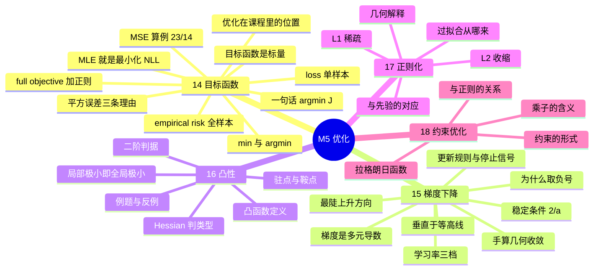

---
title: "机器学习前置知识 05｜优化：从目标函数、梯度下降到凸性、正则与拉格朗日乘子"
aliases: [机器学习前置知识M5, 优化与正则化, Optimization for ML, SIMPLEX-知几 M5]
tags: [课程笔记, 机器学习, 前置知识, 优化, 梯度下降, 凸性, 正则化, 拉格朗日乘子, SIMPLEX知几]
course: "SIMPLEX-知几《机器学习前置知识》"
module: "M5 优化与正则化"
lecture: "14–18（五讲）"
bvid: BV1pWeC6LETK
url: "https://www.bilibili.com/video/BV1pWeC6LETK"
duration: "约 140 分钟（37.3 + 26.8 + 41.4 + 22.4 + 11.8）"
speaker: SIMPLEX-知几（Serena.G）
created: 2026-11-20
---

> [!info] 课程信息
>
> - 模块：M5 — 优化与正则化（M4 说「参数怎么从数据里估计出来」，M5 说「**那个估计怎么真的算出来**」——目标函数怎么写、梯度往哪走、步子多大、为什么有些问题特别好解、怎么防过拟合、怎么带约束）
> - 讲次：五讲连播
>
>   | 讲 | 标题 | 时长 | BV |
>   |---|---|---|---|
>   | 14 | 从 Objective Function 到 Empirical Risk：机器学习到底在优化什么 | 37.3′ | [BV1pWeC6LETK](https://www.bilibili.com/video/BV1pWeC6LETK) |
>   | 15 | Gradient Descent：模型参数到底是怎么一步步学出来的 | 26.8′ | [BV1B6e46tE1q](https://www.bilibili.com/video/BV1B6e46tE1q) |
>   | 16 | 从 Local Minimum 到 Convexity：为什么有些优化问题特别好解 | 41.4′ | [BV1rah76AEm9](https://www.bilibili.com/video/BV1rah76AEm9) |
>   | 17 | L1 与 L2 Regularization：为什么正则化可以防止过拟合 | 22.4′ | [BV1xKaP6qERw](https://www.bilibili.com/video/BV1xKaP6qERw) |
>   | 18 | Constrained Optimization 与 Lagrange Multipliers：约束条件怎么进入机器学习 | 11.8′ | [BV1oFhS65EjX](https://www.bilibili.com/video/BV1oFhS65EjX) |
>
> - 讲者：SIMPLEX-知几（Serena.G）
> - 形式：14 讲把「优化」这个词拆成三层；15 讲把「怎么走」讲到底；16 讲回答「什么时候能保证走到最优点」；17、18 两讲处理「走偏了怎么办」。

> [!tip] 一句话抓住这一讲
> **训练就是一个优化问题：写一个标量目标函数，算出它往哪变，然后朝反方向挪一步。**
> 目标函数有三层（单样本损失 → 经验风险 → 加正则），梯度告诉你「往哪」，学习率告诉你「走多大」，凸性告诉你「这条路有没有坑」，正则化告诉你「别走太远」，拉格朗日乘子告诉你「有些地方不许去」。
> 而这一切的起点是 M4 的那句结论：**最大似然估计就是最小化负对数似然**——优化不是另起一套，它只是把概率论的答案算出来。

## 本课学习目标

1. 能写出 $\theta^\star=\arg\min_{\theta\in\Theta}J(\theta)$，并说清 $\min J$（最优值）与 $\arg\min J$（最优解）的区别。
2. 能按「聚合层级」把目标函数拆成三层：单样本损失 $\ell_i$、经验风险 $J_{\text{data}}=\frac1n\sum\ell_i$、完整目标 $J=J_{\text{data}}+\lambda\Omega$。
3. 能解释为什么平方误差要平方（三条理由），并能独立算出 $\hat y=wx$ 在三点上的最优斜率 $w^\star=23/14$。
4. 能把 MLE 翻译成优化问题（$\arg\max L\to\arg\min-\log L$），并复现 Bernoulli 的例子（$p^\star=3/4$）。
5. 能说清梯度是「大小＋方向」，会用 Cauchy–Schwarz 证明「沿梯度方向方向导数最大」。
6. 能用一阶 Taylor 展开证明「梯度垂直于等高线」以及「取负号一定让 $J$ 下降」。
7. 会写梯度下降的更新式与四个停止信号，能手工迭代二次函数并看出「误差每次乘 $0.6$」的几何收敛。
8. 能推导二次型的精确稳定条件 $0<\eta<\frac{2}{a}$，并解释「曲率越大、容忍的步长越小」。
9. 能区分驻点、局部极小、全局极小与鞍点，会用 Hessian 的特征值判断类型。
10. 能写出凸性的定义式，证明「凸函数的局部极小就是全局极小」。
11. 能说清 $L_2$ 与 $L_1$ 各自把参数拉向哪里、为什么 $L_1$ 产生稀疏，并能把它们对应回高斯先验与拉普拉斯先验。
12. 会用拉格朗日乘子把约束优化转成无约束问题，理解乘子的含义。

## 知识导图

## 随堂笔记

> 正文分两场：**上半场**（14–16）讲「目标、方向、步子」——目标函数三层、梯度下降、学习率与凸性；**下半场**（17–18）讲「别走偏」——L1/L2 正则与约束优化。
> 两场之间的接缝是：**正则化不是技巧，是换了一个概率假设**。

## 上半场 · 目标、方向与步子

### 模块 0 · 优化在这门课里的位置

#### 0.1 六门课的一条线

14 讲第二页是一张「模块地图」，把整个系列排成六个圆：`01 Notation → 02 Linear Algebra → 03 Calculus → 04 Probability → 05 Optimization → 06 NumPy`，其中 05 被涂成实心红色。课件给这个位置的定位是：

> **Probability models uncertainty; optimization selects the parameters that fit the model.**

也就是说：概率论负责「把不确定性写成带参数的故事」，优化负责「在故事里挑一组参数」。所以 M4 的最后一步（$\hat\theta_{\mathrm{MLE}}$）和 M5 的第一步（$\arg\min J$）其实是同一件事的两面。

课件还画了一个 "Machine-learning bridge" 的框：

> **Training is an optimization problem:** define an objective, compute how it changes, update parameters, and control generalization with regularization or constraints.

这句话把 M5 五讲全排好了：定义目标（14）→ 算它怎么变（15）→ 更新（15）→ 用正则或约束控制泛化（17、18），中间用凸性（16）回答「能不能保证」。

> [!important] 为什么先学概率再学优化
> 因为**目标函数不是拍脑袋写的**。M4 已经证明：选一个似然，取负对数，就得到一个可优化的目标。优化只是把那个目标算出来。反过来，如果先学优化再学概率，就会觉得「损失函数是天上掉下来的」。

#### 0.2 一个贯穿全讲的例子：估计一个伯努利的 $p$

14 讲开场用了一个很小的例子把整条链走了一遍：假设 $X_1,\dots,X_n\sim\mathrm{Bernoulli}(p)$，$p$ 未知，怎么估？

| 步骤 | 内容 |
|---|---|
| ① 观测 | 写成 0/1 序列，如 $(1,1,0,1,0)$ |
| ② 写似然 | $p(X_1=1)=p$、$p(X_1=0)=1-p$，于是 $L(p)=\prod_i p^{x_i}(1-p)^{1-x_i}$ |
| ③ 变成优化 | 取 log 取负号，得到 $\min_p[-\sum_i\log p(x_i\mid p)]$ |
| ④ 求解 | 求导令零，得 $\hat p=\frac1n\sum_i x_i$（0/1 的平均） |

这个例子在 14 讲里被完整推了一遍（模块 5），它的价值在于：**它同时含「概率」与「优化」两块**，而且答案简单到可以手算，正好用来验证整条链没搭错。

### 模块 1 · 一句话：优化就是在参数里挑一个让目标最小的（14）

#### 1.1 定义式

$$\theta^{\star}=\arg\min_{\theta\in\Theta}J(\theta)$$

课件的两个说明框，把两个符号各自讲清楚了：

| 符号 | 课件原文 |
|---|---|
| $\theta$（参数） | $\theta$ may be one scalar, a vector, a matrix, or millions of neural-network weights. |
| $J$（目标） | $J(\theta)$ maps model quality to **one scalar score** that can be compared across parameter choices. |

换句话说：**参数可以是任何形状，目标必须是一个数。** 参数的形状不影响优化的框架，只影响求导的复杂度。

> [!note] $\Theta$ 是什么
> 是参数的**可行域**（搜索空间）。无约束时 $\Theta=\mathbb R^d$；有约束时（如 $0\le p\le1$），$\Theta$ 就是那个子集。18 讲讲的就是「$\Theta$ 不是整个空间」的情形。

#### 1.2 为什么一定要压成一个标量

讲师在白板上给两个模型各写了一个数：

$$\text{model A: } J_1(\theta)=2.15\qquad \text{model B: } J_2(\theta)=0.92$$

于是「哪个模型好」变成「哪个数小」。他补了一句中文：

> 无论模型有多少个参数，最终 optimization 都需要把它压缩成一个 scalar.

这就是「目标函数」的作用：**把多维的比较变成一个数的比较**。它也是为什么所有的评价指标（准确率、MSE、交叉熵）最后都要变成一个标量才能用于训练。

#### 1.3 $\min J$ 与 $\arg\min J$：最优值 vs 最优解

这一页是 14 讲里最容易被跳过、但最容易错的一页。讲师用一个具体函数把它钉住：

$$J(w)=(w-3)^2\ \Rightarrow\ \arg\min_w J(w)=3,\quad \min_w J(w)=0$$

| 写法 | 返回什么 | 在例子里是 |
|---|---|---|
| $\min J(w)$ | 最小的**函数值** | $0$ |
| $\arg\min J(w)$ | 取到最小值的**那个 $w$** | $3$ |

讲师把它写成坐标对：$(\arg\min J,\ \min J)=(3,0)$——**横坐标是最优解，纵坐标是最优值**。

> [!danger] 这是本模块最高频的抄错点
> 训练要的是 $\arg\min$（参数），报告指标要的是 $\min$（损失值）。把 $\hat\theta$ 写成 $\min J$ 的人，会在代码里把「最优参数」和「最小损失」搞混，然后在保存模型时存了个数。

### 模块 2 · 三个层级：loss、empirical risk、full objective（14）

#### 2.1 区分轴是「聚合层级」，不是「功能类别」

14 讲 P20 是全讲唯一一张把三者并列的页，副标题把区分标准写死了：

> **Keep the level of aggregation clear: one sample, all samples, then optional regularization.**

| 层级 | 名称 | 公式 | 回答的问题 |
|---|---|---|---|
| ① 一个样本 | loss $\ell_i$ | $\ell_i(\theta)=\ell\big(y_i,\hat y_i(\theta)\big)$ | 这一个样本错了多少 |
| ② 全部样本 | empirical risk $J_{\text{data}}$ | $J_{\text{data}}(\theta)=\frac1n\sum_{i=1}^{n}\ell_i(\theta)$ | 平均每个样本错多少 |
| ③ 加正则 | full objective $J$ | $J(\theta)=J_{\text{data}}(\theta)+\lambda\Omega(\theta)$ | 错得少 + 参数别太野 |

课件的三句注解分别是：

- ① **Measures error on one observation.** Regression often uses squared error; classification often uses cross-entropy.
- ② **Average loss over the training set; this is the data-fitting part of the objective.**
- ③ **Regularization adds a preference for smaller, sparse, smooth, or otherwise structured parameters.**

讲师在白板上用一行箭头把三层串起来：`one sample → all samples → full objective`，并写了三行中文总结：

> `Loss: ℓᵢ(θ) — 1 个样本`
> `Empirical Risk: J_data(θ) = (1/n)Σℓᵢ(θ) — 整个 training set`
> `Full Objective: J(θ) = J_data(θ) + λΩ(θ)`

> [!important] 符号的第一眼读法
> 看到 $\ell_i$ 就知道「这是单个样本的账」；看到 $\frac1n\sum$ 就知道「这是平均」；看到 $+\lambda\Omega$ 就知道「有正则」。**符号本身就编码了层级**，不用看上下文。

#### 2.2 经验风险：为什么可以拿训练集平均去代替真实期望

讲师先写了**真实**想要最小化的东西：

$$R(\theta)=\mathbb E_{(x,y)\sim P}\big[\ell(y,f_\theta(x))\big]$$

然后立刻指出问题（这是他写在页面上的原话）：

> `P(x,y): 未知；只能用训练数据来近似.`

于是才有近似式：

$$R(\theta)\approx\frac1n\sum_{i=1}^{n}\ell_i(\theta)$$

> [!note] 这里为什么可以用「≈」
> 因为 **M4 的大数定律**：$\bar X_n\to_p\mu$。当样本 i.i.d. 时，样本平均会收敛到期望。课件在这一页**只写了「$P$ 未知，只能用训练数据近似」**，没有写 i.i.d. 三个字——那一步的依据在 M4 模块 7，这里直接用结论。

#### 2.3 正则项：本讲只给了「加法式」

讲师的第三层只写到这一条：

$$J(\theta)=J_{\text{data}}(\theta)+\lambda\Omega(\theta)$$

并在下面写了两行命名：`objective = Data fit + Regularization`，方框里 `Regularization`，框下中文「正则项」。

> [!warning] 本讲没有给 $\Omega$ 的具体形式
> 14 讲全篇 $\Omega(\theta)$ 始终只写符号；讲师举的例子用的是 $\|\theta\|=100$ 与 $\|\theta\|=2$，但**没有写 $L_1$ 或 $L_2$ 的下标**。具体形式在 17 讲才展开——这里不要提前替它补。

#### 2.4 一个说明 $\lambda$ 作用的对比

讲师给了一组对比（没有算具体数）：

| 模型 | 数据拟合 | 参数规模 |
|---|---|---|
| A | $J_{\text{data}}=1.0$ | $\|\theta\|=100$ |
| B | $J_{\text{data}}=2$ | $\|\theta\|=2$ |

A 拟合得更好但参数巨大，B 拟合稍差但参数很小。$\lambda$ 决定你更在意哪一边：$\lambda$ 大就偏向 B，$\lambda$ 小就偏向 A。

> [!tip] 这就是「正则化 = 偏好」的意思
> 课件对 regularization 的描述是 "adds a **preference** for smaller, sparse, smooth, or otherwise structured parameters"——它不是「惩罚错误」，而是「表达偏好」。惩罚只是实现偏好的手段。

### 模块 3 · 平方误差：为什么要平方，以及一个完整的算例（14）

#### 3.1 三条理由

讲师先给了一个手算的小例子：$y_i=5$、$\hat y_i=4$，于是

$$\ell_i(\theta)=(y_i-\hat y_i)^2=(5-4)^2=1$$

然后在页面上写了「为什么要平方」的三条：

> `① ℓ² > 0.`
> `② 增大误差大项.`
> `③ 光滑 → 好求导.`

| 理由 | 含义 | 反面 |
|---|---|---|
| ① 恒非负 | 正负误差不会互相抵消 | 若用 $y-\hat y$，正负相加可能为 0 |
| ② 放大大的错 | 平方让大误差的权重更高 | 用绝对值时惩罚是线性的 |
| ③ 光滑可导 | 处处可微，好求梯度 | 绝对值在 0 点不可导 |

课件对这三条**没有展开解释，也没有比较其它损失**——这是本讲的全部内容。

#### 3.2 完整算例：拟合 $\hat y=wx$ 到三个点

14 讲 P47 的例题（也是 PDF 里唯一的 EXAMPLE 页）把整条流水线走完了。数据：

$$(x_1,y_1)=(1,2),\quad (x_2,y_2)=(2,3),\quad (x_3,y_3)=(3,5)$$

模型：$\hat y_i=wx_i$（只有斜率，没有截距）。目标：

$$J(w)=\frac13\Big[(w-2)^2+(2w-3)^2+(3w-5)^2\Big]$$

展开合并：

$$J(w)=\frac13(14w^2-46w+38)$$

求导令零：

$$J'(w)=\frac13(28w-46)=0\ \Rightarrow\ w^\star=\frac{23}{14}\approx1.643$$

课件的收尾句是这一页的灵魂：

> **This is parameter estimation: the optimum is the slope that minimizes average squared prediction error.**

#### 3.3 把最优解代回去看残差

讲师没有停在 $w^\star$，而是逐个样本算了残差，检验「这个解到底意味着什么」：

| $x$ | $\hat y=1.643x$ | $y$ | 残差 $\Delta=y-\hat y$ |
|---|---|---|---|
| 1 | 1.643 | 2 | $-0.357$ |
| 2 | 3.286 | 3 | $+0.286$ |
| 3 | 4.929 | 5 | $-0.071$ |

代回目标函数：

$$J(w^\star)=\frac13\big[(-0.357)^2+(0.286)^2+(-0.071)^2\big]\approx0.0714$$

> [!example] 这一步为什么值得做
> 因为它让「最小二乘」从一个抽象的最优点变成一个可以检查的东西：**残差有正有负、绝对值都不大、平方和最小**。如果某个残差特别大，说明模型结构（这里是 $\hat y=wx$，没有截距）不对，而不是优化没做好。

#### 3.4 参数从一个变两个

14 讲最后一页把模型改成 $\hat y=wx+b$，参数变成向量：

$$\theta=\begin{bmatrix}w\\b\end{bmatrix}$$

讲师只写了这一句就结束了——因为**两个参数时可以直接解方程（正规方程），但参数一多就没法解了**，这才需要 15 讲的梯度下降。

### 模块 4 · MLE 就是优化问题（14）

#### 4.1 从似然到负对数似然

这一段是 14 讲与 M4 的接缝，讲师在五页之内走完：

$$\hat\theta_{\mathrm{MLE}}=\arg\max_\theta L(\theta),\qquad L(\theta)=\prod_{i=1}^{n}p(y_i\mid x_i,\theta)$$

取 log（因为 log 单调，且能把乘变加）：

$$\log L(\theta)=\sum_{i=1}^{n}\log p(y_i\mid x_i,\theta)$$

取负号（最大化变最小化）：

$$\boxed{\hat\theta_{\mathrm{MLE}}=\arg\min_\theta\left[-\sum_{i=1}^{n}\log p(y_i\mid x_i,\theta)\right]}$$

课件在这条式子下面写了两个词：`Negative log likelihood` / `负对数似然`。

> [!important] 这一步把两个模块粘在一起
> M4 说「参数怎么估计」——答案是似然最大；M5 说「怎么算出来」——答案是梯度下降。中间那一步就是**把 argmax 翻成 argmin**。翻的理由只有两个：log 单调、负号翻转。

#### 4.2 例子：Bernoulli 的 MLE 变成一道求导题

假设 $x_i\sim\mathrm{Bernoulli}(p)$，四个样本 $(1,1,0,1)$：

$$L(p)=p^3(1-p)$$

$$\ell(p)=3\log p+\log(1-p)$$

$$p^\star=\arg\min_{0\le p\le1}\big[-3\log p-\log(1-p)\big]$$

求导令零：

$$-\frac{3}{p}+\frac{1}{1-p}=0\ \Rightarrow\ \frac{3}{p}=\frac{1}{1-p}\ \Rightarrow\ 3(1-p)=p\ \Rightarrow\ 4p=3\ \Rightarrow\ p^\star=\frac34=0.75$$

讲师在最后圈出了 $3/4$，并注释「= 三正一样本 = 3/4」——**四个样本里 3 个 1，答案就是 3/4**，与 M4 的 $\hat p=\frac1n\sum x_i$ 完全一致。

> [!note] 注意约束 $0\le p\le1$
> 这里第一次出现「参数有可行域」：$p$ 是概率，不能超过 1。这个问题的最优解恰好落在区间内部，所以约束没起作用；但如果四个样本全是 0，闭式解会给 $p^\star=0$（边界），这正是 M4 讲过的「边界解很危险」。18 讲的约束优化就是处理「解顶到边界」的系统方法。

### 模块 5 · 梯度：大小与方向（15）

#### 5.1 梯度是多元导数

$$\nabla J(\theta)=\left[\frac{\partial J}{\partial\theta_1},\ \cdots,\ \frac{\partial J}{\partial\theta_d}\right]^T$$

课件把它拆成三个方框，这是整讲的定义骨架：

| 框 | 课件原文 |
|---|---|
| **Magnitude** | The norm $\|\nabla J\|$ measures local steepness. |
| **Direction** | $\nabla J$ points toward the **steepest local increase**. |
| **Descent** | $-\nabla J$ points toward the **steepest local decrease**. |

讲师的板书把这两句话翻成中文：`‖∇J(θ)‖ 大小 → 大 = 陡`；`∇J(θ)：指向函数值上升最快的方向`。

#### 5.2 方向导数：把「沿某个方向走多快」写成内积

$$D_uJ(\theta)=\nabla J(\theta)^Tu\qquad(\|u\|=1)$$

#### 5.3 Cauchy–Schwarz：为什么「最陡」就是「对齐」

$$D_uJ(\theta)=\nabla J(\theta)^Tu\le\|\nabla J(\theta)\|\,\|u\|$$

因为 $\|u\|=1$：

$$D_uJ(\theta)\le\|\nabla J(\theta)\|$$

等号在 $u=\dfrac{\nabla J(\theta)}{\|\nabla J(\theta)\|}$ 时成立。

> [!important] 这一步是「梯度方向最陡」的证明
> 不是「因为定义如此」，而是**内积的上界由 Cauchy–Schwarz 给出，且上界在某方向可达**。所以梯度方向就是最陡上升方向，负梯度方向就是最陡下降方向。整讲后面的所有结论都建立在这一点上。

#### 5.4 一个二维算例

$$J(w_1,w_2)=(w_1-2)^2+(w_2-1)^2\ \Rightarrow\ \frac{\partial J}{\partial w_1}=2(w_1-2),\ \frac{\partial J}{\partial w_2}=2(w_2-1)$$

于是 $\nabla J=\big[2(w_1-2),\ 2(w_2-1)\big]^T$，在 $(2,1)$ 处为零向量——那正是极小点。

### 模块 6 · 梯度垂直于等高线，以及为什么取负号（15）

#### 6.1 几何直觉

课件的图是一组同心椭圆（等高线），红色箭头 `uphill` 指向外、绿色箭头指向内。两个说明框：

- **Perpendicular to contours** — The gradient is **normal** to the local contour line.
- **Why the minus sign?** — To reduce $J$ most rapidly to first order, move **opposite** the gradient.

#### 6.2 用一阶 Taylor 证明「垂直」

先看一维版本（讲师在白板上先写这个）：

$$J(w+\Delta w)\approx J(w)+J'(w)\Delta w$$

推广到多元：

$$J(\theta+\Delta\theta)\approx J(\theta)+\nabla J(\theta)^T\Delta\theta$$

沿等高线走时 $J$ 不变，即 $\Delta J\approx0$，于是：

$$\nabla J(\theta)^T\Delta\theta\approx0\ \Rightarrow\ \nabla J(\theta)\perp\Delta\theta$$

> [!important] 这条结论的实际用处
> 「梯度垂直于等高线」不是几何趣闻：它说明**梯度方向是唯一能最快改变 $J$ 的方向**，其余方向都有一部分「白走」。这也解释了为什么沿着等高线切线方向走不会让损失变小——一阶近似下它压根不变。

#### 6.3 用一阶 Taylor 证明「负号一定下降」

取 $\Delta\theta=-\eta\nabla J(\theta)$（$\eta>0$），代进一阶展开：

$$J(\theta+\Delta\theta)\approx J(\theta)-\eta\,\nabla J(\theta)^T\nabla J(\theta)=J(\theta)-\eta\|\nabla J(\theta)\|^2$$

因为 $\eta>0$、$\|\nabla J\|^2>0$：

$$J(\theta+\Delta\theta)<J(\theta)$$

> [!note] 注意这是「一阶」结论
> 只保证**足够小**的 $\eta$ 会下降。$\eta$ 太大时高阶项会反超，一阶近似失效——这正是模块 8 要算的稳定条件。所以「取负号必下降」有一个隐含前提：**步子别太大**。

### 模块 7 · 更新规则与停止条件（15）

#### 7.1 迭代式

$$\theta_{t+1}=\theta_t-\eta\nabla J(\theta_t)$$

课件的副标题是停止条件的第一句话：**Repeat a local downhill step until a stopping criterion is met.**

三个编号框把一次迭代拆成三步：

| 步 | 标题 | 原文 |
|---|---|---|
| 1 | **Evaluate** | Compute $J$ and $\nabla J$ at the current parameters. |
| 2 | **Scale** | Multiply the gradient by the learning rate $\eta$. |
| 3 | **Update** | Subtract the step and repeat. |

#### 7.2 四个停止信号

> **Stopping signals:** small gradient norm, small objective improvement, validation plateau, or iteration budget.

| 信号 | 含义 | 什么时候用 |
|---|---|---|
| small gradient norm | $\|\nabla J\|$ 足够小 | 已经接近驻点 |
| small objective improvement | $J$ 几乎不再下降 | 数值上收敛 |
| validation plateau | 验证集走平 | 训练集还在降但泛化不动（该早停） |
| iteration budget | 迭代次数上限 | 兜底，防止跑飞 |

课件没有给任何阈值数字——**这四个都是工程判断，不是公式**。

#### 7.3 初值：本讲只说了「假设一个」

迭代式里没有 $\theta_0$。讲师在页边补了一句：`假设：θ₀ 初始的参数`，并写 `J(θ₀) 和 ∇J(θ₀)`。唯一的数值初值出现在例题里（$w_0=0$）。

> [!warning] 初值不是小事
> 梯度下降是**局部**方法：从哪出发决定落到哪个坑。课件在这里只用「假设」二字带过，但 16 讲会说明为什么凸问题里这件事不重要（局部极小就是全局极小）。

#### 7.4 手算例题：误差每次乘 $0.6$

题目：最小化 $J(w)=(w-3)^2$，从 $w_0=0$ 出发，$\eta=0.2$。

$$J'(w)=2(w-3)\qquad w_{t+1}=w_t-0.2\cdot2(w_t-3)=w_t-0.4(w_t-3)$$

| $t$ | $w_t$ | $J(w_t)$ | $J'(w_t)$ | $w_{t+1}$ |
|---|---|---|---|---|
| 0 | 0.000 | 9.000 | −6.000 | 1.200 |
| 1 | 1.200 | 3.240 | −3.600 | 1.920 |
| 2 | 1.920 | 1.166 | −2.160 | 2.352 |
| 3 | 2.352 | 0.420 | −1.296 | 2.611 |

课件的 Pattern 框：

> **Each update removes 40% of the remaining distance to $w^\star=3$. The error shrinks geometrically.**

把它写成误差递推式（讲师红笔）：

$$w_{t+1}-3=0.6\,(w_t-3)$$

> [!important] 「几何收敛」是什么
> 误差每步乘一个**固定比例**（这里是 0.6），所以 $e_t=0.6^t e_0$。这比「每步走固定距离」快得多，也是梯度下降在二次函数上表现好的根本原因。下一节把这个比例写成一个公式：$1-\eta a$。

### 模块 8 · 学习率：步子多大才不越界（15）

#### 8.1 四档表现的实测图

课件把同一个二次函数、同一个初值（$w_0=5$）、四个学习率画在一张图上：

| 图例原文 | 表现 |
|---|---|
| $\eta=0.05$ **slow** | 稳定但很慢 |
| $\eta=0.25$ **good** | 快速下降，略微过冲 |
| $\eta=0.95$ **oscillatory** | 在最优值两侧来回振荡 |
| $\eta=1.10$ **diverges** | 振幅越来越大，发散 |

三个结论框：**Too small** — Stable but slow.｜**Good range** — Fast decrease with controlled overshoot.｜**Too large** — Oscillation or divergence.

副标题一句话总结：**A larger step can accelerate progress—or destroy convergence.**

> [!warning] 「振荡」和「发散」不是一回事
> $\eta=0.95$ 时误差乘子是 $-0.9$，绝对值小于 1，所以**还在收敛**，只是每步换边（在最优值两侧跳）。$\eta=1.10$ 时乘子是 $-1.2$，绝对值大于 1，误差越乘越大，这才是发散。工程上看到 loss 上下跳，先分清是哪一种。

#### 8.2 把「乘子」算出来：$1-\eta a$

对一般的一维二次函数：

$$J(w)=\frac a2(w-w^\star)^2,\quad a>0$$

求导：

$$J'(w)=a(w-w^\star)$$

代入更新式：

$$w_{t+1}=w_t-\eta a(w_t-w^\star)\ \Rightarrow\ w_{t+1}-w^\star=(1-\eta a)(w_t-w^\star)$$

定义误差 $e_t=w_t-w^\star$，就得到

$$e_{t+1}=(1-\eta a)\,e_t$$

课件在这里写了一句关键的话：**Convergence requires the error multiplier to have magnitude less than 1.**

#### 8.3 精确的稳定条件

$$|1-\eta a|<1\iff -1<1-\eta a<1\iff 0<\eta a<2\iff \boxed{0<\eta<\frac{2}{a}}$$

课件的 Example 框：`For J(w)=(w−2)², a=2. Therefore 0<η<1 converges; η=1.1 diverges.`

General lesson 框：

> **Curvature matters. Steeper directions tolerate smaller stable steps, which motivates scaling and adaptive methods.**

讲师的中文补充：`a：曲率`、`a↑：2/a↓`、`曲面越陡`。

#### 8.4 三个 case 的验算

仍用 $a=2$（即 $J(w)=(w-2)^2$ 的 $\frac a2$ 形式，$a=2$）：

| case | $\eta$ | $1-\eta a$ | 结论 |
|---|---|---|---|
| A | 0.2 | $1-0.4=0.6$ | $e_{t+1}=0.6e_t$，稳定收敛 |
| B | 0.8 | $-0.6$ | $e_{t+1}=-0.6e_t$，$\lvert e_{t+1}\rvert=0.6\lvert e_t\rvert$，仍收敛（来回跳） |
| C | 1.1 | $1-2.2=-1.2$ | $\lvert 1-\eta a\rvert=1.2>1$，发散 |

> [!important] 这条公式解释了整讲的「为什么」
> $0<\eta<2/a$ 说明：**曲率 $a$ 越大（曲面越陡），能容忍的步长越小**。这也解释了为什么实践中要用「按参数缩放」的学习率（如 Adam）——不同方向的曲率差几个数量级，一个全局 $\eta$ 不可能对所有方向都合适。

> [!note] 全讲最后一句
> 讲师在结尾只留了三行：$J(w)=\frac a2(w-w^\star)^2$、$e_{t+1}=(1-\eta a)e_t$、方框 $0<\eta<\frac{2}{a}$（标注「收敛条件」）。**整讲的公式就这三行**，其余都是它们的展开与验算。

### 模块 9 · 驻点、局部极小、全局极小与鞍点（16）

#### 9.1 三种「点」：只有第一条带公式

16 讲第一页给三个定义，注意它们的写法差别：

| 名称 | 课件原文 | 有公式吗 |
|---|---|---|
| **Stationary point**（驻点） | $\nabla J(\theta)=0$. It can be a minimum, maximum, or saddle. | 有 |
| **Local minimum**（局部极小） | No nearby point has a smaller value. | 无（纯文字） |
| **Global minimum**（全局极小） | No point anywhere in the domain has a smaller value. | 无 |

讲师把这三种点画在一条非凸曲线上，四个红点分别标 `local minimum`、`local maximum`、`global minimum`、`local minimum`——**同一张图上就有两个局部极小**，这是本节全部动机。

#### 9.2 局部极小的 ε 定义

英文那句「附近的点都不更低」在板书上被写成了量词形式：

$$\exists\varepsilon>0,\ \text{s.t.}\ |\theta-\theta^*|<\varepsilon\ \Rightarrow\ J(\theta^*)\le J(\theta)$$

> [!note] 注意不等号
> 用的是 $\le$（非严格）：允许函数在旁边**平坦**（多个点一样低）。如果是「严格局部极小」，就得写成 $<$。

#### 9.3 全局极小，以及 $local\ne global$

$$Global:\ J(\theta^*)\le J(\theta)\quad\forall\theta\qquad\text{黄框：}\ \theta^*=\arg\min_\theta J(\theta)$$

讲师在旁边写了三个字：`local ≠ global`。

> [!important] 这句话解释了 15 讲的一个隐患
> 15 讲说「初值不同可能落到不同坑」，当时只是一句提醒；16 讲给了它数学形式：**局部极小不一定是全局极小**。所以梯度下降在非凸问题上只能保证「收敛到某个驻点」，不能保证最优。

#### 9.4 一阶条件只是必要条件

三个一维对照把这件事说完了：

| 函数 | $J'(w)$ | $w=0$ 处是什么 |
|---|---|---|
| $J(w)=w^2$ | $2w$ | 极小 |
| $J(w)=-w^2$ | $-2w$ | 极大 |
| $J(w)=w^3$ | $3w^2$ | **既不是极大也不是极小**（驻点） |

第三条的论证：$w^3$ 在 0 两侧取值一正一负，但**不存在** $w\ne0$ 使得 $J(w)<J(0)$ 且同时在其邻域内——所以它连极值都不是。

> [!danger] $\nabla J=0$ 不等于「到最优了」
> 这是本模块最容易犯的错：看到梯度为零就停下。可能是极大、可能是鞍点、可能是 $w^3$ 那种拐点。**必须看二阶信息**才能判断类型。

#### 9.5 鞍点：一个方向上升、另一个方向下降

$$\text{例：}J(x,y)=x^2-y^2\qquad \nabla J=\begin{bmatrix}2x\\-2y\end{bmatrix}=0\Rightarrow(x,y)=(0,0)$$

沿 $x$ 轴：$J(x,0)=x^2\ge0$（这方向是极小）；沿 $y$ 轴：$J(0,y)=-y^2\le0$（这方向是极大）。**一个点是极小又是极大**，这就是鞍点。

讲师在板上的写法是先给 $x$ 方向、再给 $y$ 方向，最后用 Hessian 复核：

$$H=\begin{bmatrix}2&0\\0&-2\end{bmatrix},\quad \lambda_1=2,\ \lambda_2=-2$$

一正一负 → 鞍点。这就把话题交给了下一节。

### 模块 10 · Hessian：二阶信息怎么判断类型（16）

#### 10.1 二阶 Taylor 展开

$$H(\theta)=\nabla^2J(\theta)$$
$$J(\theta+\Delta)\approx J(\theta)+\nabla J(\theta)^T\Delta+\frac12\Delta^TH(\theta)\Delta$$

课件副标题：**Curvature helps classify smooth stationary points.**（曲率帮助区分光滑驻点）

#### 10.2 在驻点处，一阶项消失

讲师的关键一步：若 $\theta$ 是驻点，则 $\nabla J(\theta)=0$，于是

$$J(\theta+\Delta)\approx J(\theta)+\frac12\Delta^TH\Delta$$

**整个判断只落在二次项上**：$\Delta^TH\Delta$ 的符号决定「往任何方向走，函数是升还是降」。

#### 10.3 用正交对角化看出符号

对对称矩阵 $H$：

$$H=Q\Lambda Q^T,\quad \Lambda=\mathrm{diag}(\lambda_1,\dots,\lambda_d)$$

令 $z=Q^T\Delta$，则

$$\Delta^TH\Delta=z^T\Lambda z=\sum_i\lambda_i z_i^2$$

> [!important] 这一步是整节的枢纽
> 二次型被换成**特征值加权平方和**。于是「符号」只取决于 $\lambda_i$ 的符号：全正 → 任何方向都上升；全负 → 任何方向都下降；有正有负 → 有的方向升、有的方向降。

#### 10.4 三种定号，三类点

| $H$ 的定号 | 结论（课件原文） | 直觉 |
|---|---|---|
| positive definite（全 $\lambda_i>0$） | All eigenvalues $>0\Rightarrow$ strict local minimum. | 碗，各方向都上升 |
| negative definite（全 $\lambda_i<0$） | All eigenvalues $<0\Rightarrow$ strict local maximum. | 倒扣的碗 |
| indefinite（有正有负） | Mixed-sign eigenvalues $\Rightarrow$ saddle point. | 马鞍 |

> [!note] 判据的边界情况
> 若某个 $\lambda_i=0$，二阶判据**失效**（既不能判极小也不能判鞍点），需要看更高阶。课件没有讨论这种情况，只说了三类定号。

### 模块 11 · 凸性：局部极小就是全局极小（16）

#### 11.1 定义式

$$J(\lambda x+(1-\lambda)y)\le\lambda J(x)+(1-\lambda)J(y),\qquad 0\le\lambda\le1$$

三个容易抄错的点：

- 系数**交叉对应**：$\lambda$ 配 $J(x)$、$(1-\lambda)$ 配 $J(y)$；
- 不等号是 $\le$（严格凸才用 $<$，且 $0<\lambda<1$）；
- 左边是「先做凸组合再算函数值」，右边是「先算函数值再做加权」。

#### 11.2 几何：曲线在弦下方

课件那页的图题就是定义：**Convexity: the graph stays below every chord.**（图像在每条弦的下方）

两个说明框：

- **Geometric meaning** — Between two points, the function lies below the chord joining their function values.
- **Key consequence** — **Every local minimum of a convex function is also a global minimum.**

讲师用 $\lambda=\frac12$ 把这个式子读成一句人话：

> $\lambda=\frac12\Rightarrow$ 左边是中点处的函数值，右边是两个高度的**线性插值**。凸 = 中点在弦下。

他还画了两个小碗（`U` 和 `Ψ`）并写「碗状 / 抛物线 / 对称轴」，这是凸函数最直观的形象。

#### 11.3 反证：为什么「局部」就一定是「全局」

讲师这一页特意留白让学员截图（"这证明大家可以截一下图"）。完整链条：

1. 反证：假设 $x^*$ 是局部极小但不是全局极小；
2. 则 $\exists y$ 使 $J(y)<J(x^*)$；
3. 在 $x^*$ 与 $y$ 之间取点：$z_\lambda=(1-\lambda)x^*+\lambda y$，$0<\lambda<1$；
4. $\lambda$ 很小时 $z_\lambda\to x^*$（任意接近）；
5. 由凸性：$J(z_\lambda)\le(1-\lambda)J(x^*)+\lambda J(y)$；
6. 但 $J(y)<J(x^*)$，所以右边 $<(1-\lambda)J(x^*)+\lambda J(x^*)=J(x^*)$；
7. 于是 $J(z_\lambda)<J(x^*)$；
8. 而 $z_\lambda$ 可以任意接近 $x^*$ —— 这与 $x^*$ 是局部极小**矛盾**。$\square$

> [!important] 这个证明只用了「凸性」一件事
> 没有用到可微、没有用到二阶导。它说明：**凸性是一个几何性质，不是求导性质**。所以它才能保证「梯度下降不会卡在坏局部极小」——因为在凸函数里根本不存在坏局部极小。

#### 11.4 严格凸：最优解至多一个

严格凸的定义（把 $\le$ 换成 $<$）：

$$J(\lambda x+(1-\lambda)y)<\lambda J(x)+(1-\lambda)J(y),\quad 0<\lambda<1,\ x\ne y$$

唯一性反证只用三行：

1. 假设有两个全局极小 $x^*\ne y^*$，且 $J(x^*)=J(y^*)=J_{\min}$；
2. 取中点 $z=\frac{x^*+y^*}{2}$，由严格凸：$J(z)<\frac12J(x^*)+\frac12J(y^*)=J_{\min}$；
3. 与「$J_{\min}$ 是最小值」矛盾。$\square$

> [!tip] 凸 vs 严格凸，差在「唯一」
> **凸** ⇒ 局部极小即全局极小，但可能有多个（比如常数函数，处处是极小）。**严格凸** ⇒ 全局极小**至多一个**。课件把这两句分开写在两页，是有意的。

### 模块 12 · 凸性判据与三个例题（16）

#### 12.1 一维：二阶导非负

$$f''(w)\ge0\ \text{在整个区间成立}\ \Rightarrow\ J\ \text{convex}$$

副标题说明了为什么要这个判据：**Second derivatives convert the geometric definition into a practical check.**（把几何定义变成可操作的检查）

反例（讲师举的）$J(w)=w^4$：$J''(w)=12w^2$，在 $w=0$ 处等于 0。**它仍然是凸的**——所以 $f''\ge0$（允许取等）才是正确条件，写成 $f''>0$ 会漏掉这类函数。

#### 12.2 多维：Hessian 半正定

$$v^TH(\theta)v\ge0\quad\text{对所有方向 }v$$

板书写成 $\Delta^TH\Delta\ge0$ 并标注 `Positive Semi-definite / PSD / 半正定`。

> [!danger] $H\succ0$ 与 $H\succeq0$ 是两个判据
> $H\succ0$（正定）⇒ **严格**局部极小；$H\succeq0$（半正定）⇒ **凸**。混用会把「凸」说成「严格凸」，从而错误地声称「最优解唯一」。

为什么半正定就够？讲师的证明很漂亮：沿任意线段把多变量降成一元。取 $z(t)=x+t(y-x)$、$g(t)=J(z(t))$，则

$$g''(t)=(y-x)^TH(z(t))(y-x)\ge0\ \Rightarrow\ g\ \text{convex}\ \Rightarrow\ J\ \text{convex}$$

#### 12.3 两个正例

| 例 | 计算 | 结论 |
|---|---|---|
| $J(w)=2w^2-8w+9$ | $J'(w)=4w-8$，$J''(w)=4>0$ | 严格凸；$J'(w^*)=0\Rightarrow w^*=2$；配方 $2(w-2)^2+1\ge1$ |
| $J(x,y)=x^2+2y^2-2x-8y+10$ | $\nabla J=[2x-2,\ 4y-8]^T$，$H=\begin{bmatrix}2&0\\0&4\end{bmatrix}$，$\lambda=2,4$ | $\nabla J=0\Rightarrow(x^*,y^*)=(1,2)$；$H\succ0$ |

课件的 "Why this is enough" 框：**Strict convexity turns the stationary point into the unique global minimizer.**（严格凸把驻点变成唯一的全局最优）

#### 12.4 一个反例：$w^4-2w^2$ 不是凸的

$$J'(w)=4w^3-4w=4w(w-1)(w+1)\ \Rightarrow\ w=-1,0,1$$

$$J''(w)=12w^2-4\ \Rightarrow\ J''(0)=-4<0,\quad J''(\pm1)=8>0$$

于是在 $w=0$ 处是局部**极大**，$w=\pm1$ 处是局部极小——**两个局部极小，函数不凸**。这个例子同时用上了一阶条件（找驻点）与二阶条件（分类）。

> [!note] 「凸」与「有多个驻点」不矛盾
> 凸函数可以有多个驻点（比如平坦段），但不会有**两个**局部极小。反过来说，一旦发现两个局部极小，就能断定不凸——这是最快的判断法。

## 下半场 · 怎么别走偏，怎么带约束

### 模块 13 · 过拟合，以及正则化到底在做什么（17）

#### 13.1 训练误差降、验证误差升

17 讲从一张图开始（`Why regularization is needed`）：横轴是「有效模型复杂度」，纵轴是误差。两条曲线先一起降，然后在某个点分岔——训练误差继续降，验证误差开始升。

课件的三句话：

| 框 | 原文 |
|---|---|
| **Overfitting** | Training error falls while validation/test error starts to rise. |
| **Regularization** | Add a preference for smaller, sparse, smoother, or otherwise simpler parameters. |
| **Goal** | Improve generalization, **not necessarily the training score**. |

> [!important] 注意 Goal 那句
> 「不一定提高训练分数」——这句话把正则化从「调参技巧」提升成「目标改变」：你要的不是更小的训练损失，而是更好的泛化。

#### 13.2 讲师举的例子：20 阶多项式

$$y=2x+\varepsilon\quad(\varepsilon:\text{noise})\qquad \hat y=w_0+w_1x+\cdots+w_{20}x^{20}$$

20 个参数拟合 20 个点可以做到**穿过每一个点**，但那时学到的已经包含噪声。这就是「有效复杂度」过高。

#### 13.3 正则化的目标函数

$$J_{\text{reg}}(\theta)=J_{\text{data}}(\theta)+\lambda\Omega(\theta)$$

课件把 $\lambda$ 分成三档：

| $\lambda$ | 原文 | 含义 |
|---|---|---|
| $\lambda=0$ | Only training fit matters. | 纯经验风险，容易过拟合 |
| Moderate $\lambda$ | Trade some training fit for preferred structure. | 用一点训练拟合换结构偏好 |
| Very large $\lambda$ | Penalty dominates and the model may underfit. | 罚得太狠，欠拟合 |

并同时给出两种 $\Omega$：

$$\Omega_{L_2}(\theta)=\|\theta\|_2^2\qquad \Omega_{L_1}(\theta)=\|\theta\|_1$$

> [!note] 三种作用路径，课件只给了标题
> 讲师在板上列了三条：① Optimization effect ② Statistical effect（`var. coeff.`）③ Typical result（趋向 0）。**三条都只有标题，正文没有落笔**（那一页是空白白板，只靠口述）。所以这里也不替它展开——只能说课件承认有「优化层面」和「统计层面」两重解释，具体论证没有板书。

### 模块 14 · $L_2$：把权重往零拉（17）

#### 14.1 目标与梯度

$$J_{L_2}(\theta)=J_{\text{data}}(\theta)+\lambda\|\theta\|_2^2=J_{\text{data}}(\theta)+\lambda\sum_{j=1}^{d}\theta_j^2$$

因为 $\|\theta\|_2^2=\theta^T\theta$，所以

$$\nabla\|\theta\|_2^2=2\theta\ \Rightarrow\ \nabla J_{L_2}(\theta)=\nabla J_{\text{data}}(\theta)+2\lambda\theta$$

讲师先给了两个数感例子：$\theta=(0.4,-0.3,0.5)\Rightarrow\|\theta\|_2^2=0.50$；$\theta=(4,-3,5)\Rightarrow\|\theta\|_2^2=50$。**同一组方向、放大 10 倍，惩罚放大 100 倍**——这就是平方项对「大权重」的偏好。

#### 14.2 更新式里的收缩因子

把梯度代进梯度下降：

$$\theta_{t+1}=\theta_t-\eta\big[\nabla J_{\text{data}}(\theta_t)+2\lambda\theta_t\big]=(1-2\lambda\eta)\theta_t-\eta\nabla J_{\text{data}}(\theta_t)$$

> [!important] 这就是「weight decay」这个名字的来源
> 每一步先把 $\theta_t$ 乘上一个略小于 1 的因子 $(1-2\lambda\eta)$，再走梯度步。**参数在被梯度推动之前，先自己缩了一点**。所以 $L_2$ 正则与 weight decay 在纯 SGD 下是同一件事（Adam 里不等价，因为自适应缩放会改变这个因子的作用）。

#### 14.3 一维算例：$w^\star=4/(1+\lambda)$

$$J(w)=(w-4)^2+\lambda w^2,\qquad J'(w)=2(w-4)+2\lambda w=0\ \Rightarrow\ w^\star=\frac{4}{1+\lambda}$$

| $\lambda$ | 0 | 0.5 | 1 | 3 |
|---|---|---|---|---|
| $w^\star$ | 4.000 | 2.667 | 2.000 | 1.000 |

课件的解读：**As λ grows, the optimum is pulled toward zero even though the data-fit term alone prefers $w=4$.** 板上红字：$\lambda\uparrow\Rightarrow\lvert w^*\rvert\downarrow$。

#### 14.4 接回 M4：$L_2$ 就是高斯先验

M4 模块 17 已经推过：若 $w\sim\mathcal N(0,\tau^2)$，则 $-\log p(w)$ 里的惩罚项是 $\frac{1}{2\tau^2}\|w\|_2^2$，令 $\lambda=\frac{1}{\tau^2}$ 就得到 $L_2$。

> [!warning] 两讲的系数写法不同，别对错
> M4（13 讲）写的是 $\frac{\lambda}{2}\|w\|_2^2$（因为高斯密度指数上有 $\frac12$）；17 讲写的是 $\lambda\|\theta\|_2^2$（把 $\frac12$ 吸收进 $\lambda$）。**两者等价，只差一个常数重参数化**。抄公式时要跟住同一讲的约定。

### 模块 15 · $L_1$：为什么能压出精确的零（17）

#### 15.1 目标与稀疏

$$\Omega_{L_1}(\theta)=\|\theta\|_1=\sum_{j=1}^{d}|\theta_j|\qquad J_{L_1}(\theta)=J_{\text{data}}(\theta)+\lambda\sum_{j=1}^{d}|\theta_j|$$

课件用一条向量演示「稀疏」：

$$\theta=(2.4,\ 0,\ -1.1,\ 0,\ 0.6,\ 0)\ \longrightarrow\ \text{Sparse param}$$

六个分量里有三个**恰好是 0**。这不是「很小」，是**精确为零**——$L_2$ 做不到这一点。

#### 15.2 $|w|$ 在 0 处不可导

$$f(w)=|w|=\begin{cases}w,&w\ge0\\-w,&w<0\end{cases}\qquad f'(w)=\begin{cases}1,&w>0\\-1,&w<0\end{cases}$$

在 $w=0$ 处左导数是 $-1$、右导数是 $+1$，两者不等：

$$f'_-(0)=-1,\quad f'_+(0)=1\ \Rightarrow\ L_1\ \text{is nonsmooth at }0$$

课件还给了个形象的词：`penalty slope: +1 / −1`，中间是一个 **kink**（折点）。

> [!note] 不可导不等于不能优化
> 课件提到 `Use subgradients or proximal methods`——但**没有展开**次梯度的定义，也没有给 prox 公式。这里只记「有专门工具处理折点」即可，细节不属本讲。

#### 15.3 软阈值：$w^\star=\max(4-\lambda,0)$

算例（课件用 $\frac12(w-4)^2+|w|$，$\lambda=1$）：

| 假设区域 | 求导 | 候选解 | 检验 |
|---|---|---|---|
| $w>0$ | $J'(w)=w-4+1=0$ | $w=3$ | $3>0$ ✓ 成立 |
| $w<0$ | $J'(w)=w-4-1=0$ | $w=5$ | $5\not<0$ ✗ 违反假设，作废 |

所以 $w^\star=3$。课件的一般写法：

$$w^\star=\max(4-\lambda,0)$$

课件的解释句：**The unregularized optimum is 4, so L1 subtracts a fixed threshold from a positive coefficient.**

> [!important] 「减一个固定阈值」是稀疏的机制
> $L_2$ 是**按比例**缩小（乘 $1/(1+\lambda)$），永远缩不到 0；$L_1$ 是**减去一个常数**（$4-\lambda$），减到 0 就**停住**（`max(·,0)` 把负数截成 0）。所以 $L_1$ 能产生精确的零，$L_2$ 只能产生「很小的数」。

#### 15.4 几何：圆与菱形

课件那张图的读法：

- 青色**圆**是 $L_2$ 约束 $\theta_1^2+\theta_2^2\le c$；
- 洋红**菱形**是 $L_1$ 约束 $|\theta_1|+|\theta_2|\le c$；
- 灰色椭圆是数据项的等高线，中心在右上方（无约束最优解所在）；
- **红点画在菱形的右顶点上**，一根红线引到一句话：`corner can create exact zeros`。

两个说明框：

| 框 | 原文 |
|---|---|
| **L2 ball** | Smooth circular boundary. Tangency usually occurs **away from an axis**, so coefficients shrink but stay nonzero. |
| **L1 ball** | Diamond-shaped boundary with **axis-aligned corners**. Tangency often occurs **at a corner**, creating exact zeros. |

> [!important] 几何解释一句话
> 圆是光滑的，切点一般落在斜方向上（两个坐标都不为零）；菱形的**顶点在坐标轴上**，切点容易落到顶点（某个坐标恰好为零）。**形状决定稀疏**，不是 $\lambda$ 大小决定。

### 模块 16 · $\lambda$ 怎么选：它不是学出来的（17）

#### 16.1 超参数：优化器解不出来的量

$$\lambda^*=\arg\min_{\lambda\in\Lambda}J_{\text{val}}(\hat\theta_\lambda)$$

注意这个式子的结构：**先对每个候选 $\lambda$ 训练出 $\hat\theta_\lambda$，再在验证集上比较**。$\lambda$ 本身不是梯度下降能优化的对象——因为它不在训练目标里（它就在训练目标外面）。

> [!note] 「超参数」这个词的定义
> 讲师只写了 `超参数 ⟹ Hyperparameter` 一行。区别很简单：**能被梯度更新的叫参数，不能的叫超参数**。学习率、$\lambda$、层数都属后者。

#### 16.2 三段数据各管一件事

| 数据 | 用途（课件原文） |
|---|---|
| **Training set** | Fit $\theta$ separately for each candidate $\lambda$. |
| **Validation / cross-validation** | Compare candidate $\lambda$ values using generalization performance. |
| **Test set** | Use once at the end for an unbiased final estimate. |

> [!danger] 用测试集选 $\lambda$ 就等于偷看答案
> 测试集只用一次。如果拿它比较 20 个 $\lambda$，报出来的数字就带上了选择偏差——这是 M1 就讲过的坑，这里在超参数层面又出现一次。

#### 16.3 特征标准化：被讲师称为「非常重要」的一句话

课件底行原文：**Feature scaling matters: standardizing features makes L1/L2 penalties comparable across coefficients.**

讲师举例：$\hat y=w_1x_1+w_2x_2$，若 $x_1\approx1000$、$x_2\approx0.01$，两个特征量级差 $10^5$。

> [!important] 为什么必须标准化
> 惩罚项罚的是「权重的大小」，而权重大小取决于特征的量级：量级大的特征只需要很小的权重就能产生影响，量级小的特征需要很大的权重。不标准化时，**惩罚实际上只在罚其中一个特征**——$L_1$ 的稀疏性也会因此偏向错误的方向。

### 模块 17 · 约束优化与拉格朗日乘子（18）

#### 17.1 问题形式

18 讲先把「约束」写成标准形式：

$$\min_\theta f(\theta)\quad\text{s.t.}\quad g_i(\theta)\le0,\quad h_j(\theta)=0$$

可行域记为 $\mathcal F=\{\theta: g_i(\theta)\le0,\ h_j(\theta)=0\}$。讲师举的最简单的例子是单位球约束 $\|\theta\|_2\le1$。

> [!note] 约束与正则的关系
> 两者常常等价：$\min J$ s.t. $\|\theta\|_2\le c$ 与 $\min J+\lambda\|\theta\|_2^2$ 会给出同一族解（$\lambda$ 与 $c$ 一一对应）。**正则是在目标里罚，约束是在可行域里挡**——17 讲的几何图（圆/菱形）其实就是把正则画成了约束。

#### 17.2 拉格朗日函数与一阶条件

$$\mathcal L(x,\lambda)=f(x)+\lambda g(x)$$

令对 $x$ 的偏导为零：

$$\nabla_x\mathcal L=0\ \Rightarrow\ \nabla f(x^*)+\lambda^*\nabla g(x^*)=0\ \Rightarrow\ \boxed{\nabla f(x^*)=-\lambda^*\nabla g(x^*)}$$

这条式子的意思是：**在最优点，目标函数的梯度与约束函数的梯度共线**（方向相反、大小成比例）。

#### 17.3 几何：相切

讲师用一张图说明：无约束最优点在椭圆中心，但那个点不在约束直线上；加上约束后，解只能落在直线上，而**等高线与约束线相切的那个点**就是最优解——相切意味着两个梯度平行。

> [!important] 相切 = 梯度平行
> 如果梯度不平行，就可以沿约束面挪一点、让目标继续下降；只有平行时，沿约束面任何方向的一阶变化都为零。这与 15 讲「梯度垂直于等高线」是同一个几何事实的两面。

#### 17.4 算例：$\min x^2+y^2$ s.t. $x+y=6$

$$\mathcal L=x^2+y^2+\lambda(x+y-6)$$
$$\frac{\partial\mathcal L}{\partial x}=2x+\lambda=0,\qquad \frac{\partial\mathcal L}{\partial y}=2y+\lambda=0$$

两式相减得 $x=y$，代回约束 $x+y=6$：

$$x^*=y^*=3,\quad \lambda^*=-6$$

验证梯度平行：$\nabla f=(6,6)^T$、$\nabla g=(1,1)^T$，确实 $\nabla f=6\nabla g$。

> [!warning] 本讲没有 KKT、没有对偶、没有 SVM
> 21 页里没有出现 KKT 条件、互补松弛 $\lambda g=0$、$\lambda\ge0$、对偶问题 $\max_\lambda\min_x$ 这些内容，也没有 SVM。**几何解释只到「两梯度共线」为止**。若要写 KKT，必须另找资料，不能挂在本讲名下。
> 另外本讲对不等号约束的讨论并不完整：板书里 $g(x)$ 有时写 $=0$、有时写 $\le0$，没有系统区分——这也是它停在「乘子法入门」而没有进入 KKT 的原因。

#### 17.5 收尾：四条式子并列

讲师最后把 M5 的主线并排写在板上：

$$\theta^*=\arg\min_\theta J(\theta)\qquad \theta_{t+1}=\theta_t-\eta\nabla J(\theta_t)$$
$$J_{\text{reg}}=J_{\text{data}}+\lambda\Omega\qquad \min f\ \text{s.t.}\ g\le0$$

## 重点速记 Cheat Sheet

### 上半场：目标、方向与步子

| 主题 | 结论 | 一句话 |
|---|---|---|
| 优化的位置 | 概率建模不确定性，优化挑参数 | 训练 = 优化问题 |
| 一句话 | $\theta^\star=\arg\min_{\theta\in\Theta}J(\theta)$ | 参数任意形状，目标必须一个数 |
| $\min$ vs $\arg\min$ | 前者是最优值，后者是最优解 | $(3,0)$：横坐标解、纵坐标值 |
| 三层结构 | $\ell_i$ → $J_{\text{data}}=\frac1n\sum\ell_i$ → $J=J_{\text{data}}+\lambda\Omega$ | 符号本身编码层级 |
| 经验风险 | $\frac1n\sum\ell_i\approx R(\theta)=\mathbb E_P[\ell]$ | $P$ 未知，只好用样本平均 |
| 平方三理由 | 恒非负、放大大的错、光滑可导 | 与绝对值损失的分界 |
| MSE 算例 | $w^\star=23/14\approx1.643$ | 三点拟合，残差 $-.357/.286/-.071$ |
| MLE=优化 | $\arg\max L\to\arg\min(-\log L)$ | log 单调 + 负号翻转 |
| 梯度 | $\nabla J$ 的大小＝陡峭，方向＝最陡上升 | 取负号就最陡下降 |
| 最陡的证明 | Cauchy–Schwarz：$D_uJ\le\|\nabla J\|$ | 等号在 $u$ 与 $\nabla J$ 同向 |
| 垂直等高线 | $\nabla J^T\Delta\theta=0\Rightarrow\nabla J\perp\Delta\theta$ | 沿等高线走一阶不变 |
| 为什么取负号 | $J(\theta-\eta\nabla J)\approx J(\theta)-\eta\|\nabla J\|^2$ | 一阶看必降 |
| 更新式 | $\theta_{t+1}=\theta_t-\eta\nabla J(\theta_t)$ | 减号、带 $\theta_t$ |
| 三步 | Evaluate → Scale → Update | 算梯度、乘步长、减掉 |
| 停止信号 | 梯度小、改进小、验证走平、迭代上限 | 四个都是工程判断 |
| 手算收敛 | 每步剩 60%：$e_{t+1}=0.6e_t$ | 几何收敛 |
| 学习率四档 | 0.05 慢 / 0.25 好 / 0.95 振荡 / 1.10 发散 | 大步子会毁掉收敛 |
| 稳定条件 | $e_{t+1}=(1-\eta a)e_t$，$0<\eta<\frac2a$ | 曲率越大，步子越小 |
| 驻点 | $\nabla J=0$，可能是极小/极大/鞍点 | 一阶只是必要条件 |
| 局部极小 | $\exists\varepsilon>0,\ \lvert\theta-\theta^*\rvert<\varepsilon\Rightarrow J(\theta^*)\le J(\theta)$ | 带邻域 |
| 全局极小 | $J(\theta^*)\le J(\theta)$ 对所有 $\theta$ | 不带邻域 |
| Hessian | $H=\nabla^2J$，二阶 Taylor 的二次项系数 | 在驻点处只剩 $\frac12\Delta^TH\Delta$ |
| 定号判类型 | $H\succ0$ 极小、$H\prec0$ 极大、不定 → 鞍点 | 特征值符号决定 |
| 二次型换元 | $\Delta^TH\Delta=\sum_i\lambda_iz_i^2$ | 用 $H=Q\Lambda Q^T$ |
| 凸函数 | $J(\lambda x+(1-\lambda)y)\le\lambda J(x)+(1-\lambda)J(y)$ | 曲线在弦下 |
| 凸的好处 | 局部极小即全局极小 | 反证：任意接近的点会更低 |
| 严格凸 | $<$ 号，$0<\lambda<1$ | 全局极小至多一个 |
| 凸判据（一维） | $f''(w)\ge0$ | $w^4$ 说明可取等 |
| 凸判据（多维） | $v^THv\ge0$（半正定） | 别与正定混用 |

### 下半场：正则与约束

| 主题 | 结论 | 一句话 |
|---|---|---|
| 过拟合 | 训练误差降、验证误差升 | 学了噪声而不是结构 |
| 正则化的目标 | 提高泛化，不一定提高训练分 | 目标变了，不是技巧 |
| 总目标 | $J_{\text{reg}}=J_{\text{data}}+\lambda\Omega$ | 数据项 + 惩罚项 |
| $\lambda$ 三档 | 0 / 中等 / 过大 | 过大就欠拟合 |
| $L_2$ 项 | $\Omega=\|\theta\|_2^2=\sum_j\theta_j^2$ | 平方，对大权重罚得狠 |
| $L_2$ 梯度 | $\nabla J_{L_2}=\nabla J_{\text{data}}+2\lambda\theta$ | 系数是 $2\lambda$ |
| 收缩因子 | $\theta_{t+1}=(1-2\lambda\eta)\theta_t-\eta\nabla J_{\text{data}}$ | weight decay 的来源 |
| $L_2$ 例子 | $w^\star=4/(1+\lambda)$ | $\lambda\uparrow\Rightarrow\lvert w^*\rvert\downarrow$ |
| $L_2$ 与先验 | 对应高斯先验（见 M4） | 系数写法差 $\frac12$ |
| $L_1$ 项 | $\Omega=\|\theta\|_1=\sum_j\lvert\theta_j\rvert$ | 绝对值，不平方 |
| $L_1$ 稀疏 | 有些系数**恰好为 0** | 不是很小，是精确为零 |
| 不可导 | $\lvert w\rvert$ 在 0 处左右导数不同 | 有 kink，需次梯度/prox |
| 软阈值 | $w^\star=\max(4-\lambda,0)$ | 减固定阈值，减到 0 停住 |
| 几何 | $L_2$ 圆、$L_1$ 菱形 | 菱形顶点在轴上 → 易切出零 |
| 选 $\lambda$ | $\lambda^*=\arg\min_{\lambda}J_{\text{val}}(\hat\theta_\lambda)$ | 超参数，梯度解不出 |
| 三段数据 | 训练拟合 / 验证选 $\lambda$ / 测试只用一次 | 用测试集选参就偷看答案 |
| 标准化 | 让惩罚在各系数间可比 | 量级差 $10^5$ 时惩罚会失真 |
| 约束形式 | $\min f$ s.t. $g\le0,\ h=0$ | 可行域 $\mathcal F$ |
| 拉格朗日 | $\mathcal L=f+\lambda g$ | 把约束吸收进目标 |
| 一阶条件 | $\nabla f=-\lambda\nabla g$ | 两梯度共线 |
| 几何 | 等高线与约束线相切 | 相切即梯度平行 |

## 易错点 / 常见误区

> [!danger] 1. 把 $\min J$ 当成最优参数
> $\min J$ 返回一个数，$\arg\min J$ 返回一个参数。训练要后者，日志要前者。搞混的后果是「存了 loss 当模型」这种事故。

> [!danger] 2. 以为「梯度为零就到最优了」
> $\nabla J=0$ 只说明是驻点：可能是极大、可能是鞍点、可能是 $w^3$ 那种拐点。必须用 Hessian（或更高阶）判断类型。

> [!danger] 3. 把 $H\succ0$ 与 $H\succeq0$ 混用
> 正定 ⇒ 严格局部极小；半正定 ⇒ 凸。写成「半正定 ⇒ 唯一最优」就把「凸」错说成「严格凸」，$f=w^4$ 立刻是反例。

> [!danger] 4. 以为「局部极小」一定就是「全局极小」
> 只有凸函数才成立。非凸函数里两个局部极小是常态（$w^4-2w^2$ 就有两个），梯度下降从不同初值会落到不同坑。

> [!danger] 5. 学习率振荡与发散不分
> 乘子 $|1-\eta a|<1$ 但为负 → 来回跳但收敛；$|1-\eta a|>1$ → 越跳越大才发散。看到 loss 上下波动先算乘子，别急着调小。

> [!danger] 6. 把 $0<\eta<\frac2a$ 当通用规则
> 它只对二次型成立（$a$ 是曲率）。神经网络的损失不是二次型，没有这个闭式界；但这个式子仍解释了「曲率大的方向要用小步」的直觉，以及为什么需要自适应学习率。

> [!danger] 7. 把 $L_2$ 惩罚当成「防过拟合的物理机制」
> 它只是一个「对大权重的偏好」。真正让它有效的是「限制有效复杂度」这个统计论证——而 17 讲里那条论证只有标题（`Statistical effect`），没有板书。别把「直觉」写成「课件证明了」。

> [!danger] 8. 认为 $L_2$ 也能得到精确的零
> 不能。$L_2$ 是按比例缩小（乘 $1/(1+\lambda)$），永远差一口气；$L_1$ 是减固定阈值，减到 0 被 `max(·,0)` 截住。要稀疏只能用 $L_1$ 或专门的稀疏方法。

> [!danger] 9. 把 $L_1$ 的不可导当成「不能优化」
> 不可导只发生在一点，且该点的次梯度是一个区间（$[-1,1]$）。实践中用次梯度法或近端方法（prox）处理，软阈值本身就是 prox 的闭式解。

> [!warning] 10. 用测试集挑 $\lambda$
> 挑完再报测试分数，等于把选择偏差算进了「泛化性能」。$\lambda$ 只能在验证集（或交叉验证）上选，测试集只用一次。

> [!warning] 11. 不标准化就上 $L_1/L_2$
> 惩罚作用在权重上，而权重量级取决于特征量级。量级差几个数量级时，惩罚实际上只约束了其中一个特征，$L_1$ 的稀疏方向也会被带偏。

> [!danger] 12. 把「约束」与「正则」当成两套无关的东西
> $\min J$ s.t. $\|\theta\|\le c$ 与 $\min J+\lambda\|\theta\|^2$ 会给出同一族解。**一个是挡在可行域外，一个是罚在目标里**，数学上是同一件事的两种写法（17 讲的圆/菱形图就是把它画成了约束）。

## 思考题 & 课后延伸

1. 对 $J(w)=(w-3)^2+1$，写出 $\arg\min J$ 与 $\min J$，并说明两者在你的代码里分别对应什么变量。
2. 用「三层结构」写出线性回归的完整目标：单样本损失、经验风险、加 $L_2$ 的完整目标，各写一行。
3. 三点 $(1,2),(2,3),(3,5)$ 拟合 $\hat y=wx+b$（注意这次有截距），写出正规方程并解出 $(w,b)$，与只有 $w$ 时的 $23/14$ 比较。
4. 从 $\hat\theta_{\mathrm{MLE}}=\arg\max L$ 推到 $\arg\min(-\log L)$，逐条说明用了哪两个性质；如果换成 $\arg\max$ 不取 log 会有什么数值问题？
5. 证明：对单位向量 $u$，$D_uJ(\theta)$ 的最大值在 $u=\nabla J/\|\nabla J\|$ 处取得，并说明为什么这同时证明了「梯度垂直于等高线」。
6. 用 $J(w)=(w-5)^2$、$\eta=0.3$ 手算前四步，写出误差乘子，并判断是否收敛；再算 $\eta=1.1$ 的情形。
7. 二次型 $J(w)=\frac a2(w-w^*)^2$ 中，若 $a=8$，允许的学习率区间是多少？若把参数缩放 $w'=2w$，新的 $a$ 与区间如何变化？（提示：这解释了为什么要「按参数缩放」学习率）
8. 判断 $J(w)=w^4-2w^2$ 的所有驻点类型，并说明它为什么不凸；再判断 $J(w)=w^4$ 是否严格凸。
9. 用二阶 Taylor 展开解释：为什么在鞍点处 Hessian 一定是不定的？给出一个 $3\times3$ 的 Hessian 例子，使它的三个特征值为 $2,-1,0$，并说明此时判据为什么失效。
10. 证明「凸函数的局部极小即全局极小」，然后把证明中的「凸性」换成「严格凸」，看能否得到「唯一」。若能，说明多用的那一步是什么。
11. 对 $J(w)=(w-4)^2+\lambda w^2$，分别取 $\lambda=0,1,3$ 求 $w^\star$，并画出 $\lambda$–$w^\star$ 曲线；再对 $J(w)=\frac12(w-4)^2+\lambda|w|$ 做同样的事，解释两条曲线形状为什么不同。
12. 用拉格朗日乘子解 $\min x^2+y^2$ s.t. $x+y=6$，验证 $\nabla f=-\lambda\nabla g$，并说明如果约束换成 $x+y\le6$，最优解会怎么变（提示：约束是否起作用）。
13. 把 M5 的三件事与 [[04-概率统计]] 的结论接起来：**为什么说「MLE 是 M5 的第一个目标函数」**？再说明 [[03-微积分与矩阵微积分]] 的链式法则在哪个环节被用到（提示：$\nabla J_{L_2}$ 与反向传播）。

## 术语表

| 英文 | 中文 | 记号 | 备注 |
|---|---|---|---|
| Objective Function | 目标函数 | $J(\theta)$ | 把模型质量压成一个标量 |
| Loss | 损失 | $\ell_i(\theta)$ | 单个样本的错 |
| Empirical Risk | 经验风险 | $J_{\text{data}}$ | 训练集上的平均损失 |
| Expected Risk | 期望风险 | $R(\theta)$ | 分布下的期望，通常未知 |
| Regularization | 正则化 | $\lambda\Omega(\theta)$ | 对参数的偏好 |
| Penalty | 惩罚项 | $\Omega(\theta)$ | 正则的具体形式 |
| Hyperparameter | 超参数 | $\lambda,\eta$ | 梯度解不出的量 |
| Stationary Point | 驻点 | $\nabla J=0$ | 极小/极大/鞍点都可能 |
| Local Minimum | 局部极小 | $\theta^*$ | 邻域内最低 |
| Global Minimum | 全局极小 | $\theta^\star$ | 全域最低 |
| Saddle Point | 鞍点 | — | 一方向升一方向降 |
| Hessian | 海森矩阵 | $H=\nabla^2J$ | 二阶偏导矩阵，曲率 |
| Positive Definite | 正定 | $H\succ0$ | 严格局部极小 |
| Positive Semidefinite | 半正定 | $H\succeq0$ | 凸 |
| Indefinite | 不定 | 特征值异号 | 鞍点 |
| Eigenvalue | 特征值 | $\lambda_i$ | 决定二次型符号 |
| Convex Function | 凸函数 | — | 曲线在弦下 |
| Strictly Convex | 严格凸 | — | 全局极小至多一个 |
| Convexity Test | 凸性判据 | $f''\ge0$ / $v^THv\ge0$ | 二阶条件 |
| Gradient | 梯度 | $\nabla J$ | 最陡上升方向 |
| Directional Derivative | 方向导数 | $D_uJ$ | 沿 $u$ 的变化率 |
| Gradient Descent | 梯度下降 | $\theta_{t+1}=\theta_t-\eta\nabla J$ | 最基本的优化器 |
| Learning Rate | 学习率 | $\eta$ | 步长 |
| Step Size | 步长 | $\eta\|\nabla J\|$ | 实际挪的距离 |
| Convergence | 收敛 | — | 误差趋于 0 |
| Divergence | 发散 | — | 误差越变越大 |
| Oscillation | 振荡 | — | 在最优值两侧跳 |
| Error Multiplier | 误差乘子 | $1-\eta a$ | 决定收敛/振荡/发散 |
| Curvature | 曲率 | $a$ | 二阶导的量级 |
| Stopping Criterion | 停止条件 | — | 梯度/改进/验证/预算 |
| Overfitting | 过拟合 | — | 训练好、验证差 |
| Underfitting | 欠拟合 | — | 两边都差 |
| Generalization | 泛化 | — | 没见过的数据上的表现 |
| Weight Decay | 权重衰减 | $(1-2\lambda\eta)$ | $L_2$ 在 SGD 下的等价形式 |
| L2 Regularization / Ridge | $L_2$ 正则 | $\lambda\|\theta\|_2^2$ | 收缩，不产生零 |
| L1 Regularization / Lasso | $L_1$ 正则 | $\lambda\|\theta\|_1$ | 稀疏，产生精确零 |
| Sparsity | 稀疏 | — | 很多分量恰为 0 |
| Soft-thresholding | 软阈值 | $\max(z-\lambda,0)$ | $L_1$ 的闭式解形态 |
| Subgradient | 次梯度 | $\partial f$ | 不可导点的替代导数 |
| Proximal Method | 近端方法 | prox | 处理非光滑项 |
| Constrained Optimization | 约束优化 | — | 在可行域里找最优 |
| Feasible Region | 可行域 | $\mathcal F$ | 满足约束的集合 |
| Lagrange Multiplier | 拉格朗日乘子 | $\lambda$ | 约束的"价格" |
| Lagrangian | 拉格朗日函数 | $\mathcal L=f+\lambda g$ | 约束吸收进目标 |
| Feature Scaling | 特征标准化 | — | 让惩罚在各系数间可比 |

## 延伸阅读

- 上一篇：[[04-概率统计]]（似然、MLE、MAP、交叉熵；本讲的第一个目标函数就是从那里的 $-\log L$ 来的）
- 下一篇：[[06-NumPy与向量化]]（本讲所有公式在代码里都是 shape 与 `axis` 上的操作；`Xw+b` 的批量形式、`mean(axis=0)` 的梯度实现都在那里）
- 相关：[[03-微积分与矩阵微积分]]（梯度、Jacobian、Hessian、链式法则；本讲的 $\nabla J$、$H$、$\nabla J_{L_2}=2\lambda\theta$ 全建在那里）
- 相关：[[02-线性代数]]（二次型 $v^THv$、正交对角化 $Q\Lambda Q^T$、范数；凸性判据与 $L_1/L_2$ 的几何都靠这些）
- 课程总索引：[[00-课程总索引]]
- 课件来源：本课**没有官方 PPT 下载**，幻灯片由 1080p 录屏逐帧还原（14 讲 64 页、15 讲 57 页、16 讲 81 页、17 讲 43 页、18 讲 21 页，共 266 页）；讲师口述由本地 whisper 转写并对齐，公式与定义一律以幻灯片为准
- 关于 KKT 与对偶：第 18 讲只讲到拉格朗日乘子（$\nabla f=-\lambda\nabla g$），**没有** KKT、互补松弛与对偶问题；若需要，须另找凸优化教材的「约束优化」一章

