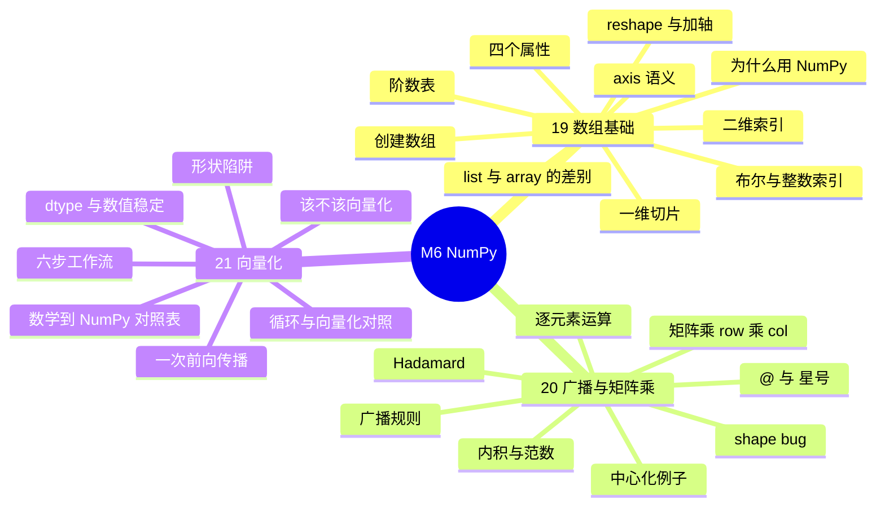

---
title: "机器学习前置知识 06｜NumPy 与向量化：shape、索引、广播与把公式写成代码"
aliases: [机器学习前置知识M6, NumPy与向量化, NumPy for Machine Learning, SIMPLEX-知几 M6]
tags: [课程笔记, 机器学习, 前置知识, NumPy, 向量化, 广播, shape, SIMPLEX知几]
course: "SIMPLEX-知几《机器学习前置知识》"
module: "M6 NumPy 与向量化"
lecture: "19–21（三讲）"
bvid: BV1zZae6VE3S
url: "https://www.bilibili.com/video/BV1zZae6VE3S"
duration: "约 64 分钟（34.1 + 18.1 + 12.0）"
speaker: SIMPLEX-知几（Serena.G）
created: 2026-11-20
---

> [!info] 课程信息
>
> - 模块：M6 — NumPy 与向量化（前五个模块都在纸上，这一模块把它们**落到代码**：数据怎么摆、公式怎么写、循环怎么消掉）
> - 讲次：三讲连播
>
>   | 讲 | 标题 | 时长 | BV |
>   |---|---|---|---|
>   | 19 | NumPy 数组基础：Shape、Indexing 与 Reshape | 34.1′ | [BV1zZae6VE3S](https://www.bilibili.com/video/BV1zZae6VE3S) |
>   | 20 | Broadcasting 与矩阵运算：NumPy 如何实现线性代数 | 18.1′ | [BV1BTaz6XEKj](https://www.bilibili.com/video/BV1BTaz6XEKj) |
>   | 21 | Vectorization：从公式到机器学习计算 | 12.0′ | [BV1CGam6HETd](https://www.bilibili.com/video/BV1CGam6HETd) |
>
> - 讲者：SIMPLEX-知几（Serena.G）
> - 形式：19 讲是「工具书式」的逐个 API 过一遍；20 讲把广播与矩阵乘的规则钉死；21 讲回答「什么时候该把循环消掉」。

> [!tip] 一句话抓住这一讲
> **NumPy 的核心只有一件事：把 shape 写对，剩下的交给一次数组运算。**
> 一维是向量、二维是矩阵、`axis` 是被压掉的那根轴；广播按「从右往左逐位比较、相等或含 1」的规则补齐；`@` 是矩阵乘、`*` 是逐元素；向量化不是「不用循环」，而是「让数值计算以数组为单位发生」。
> 这一模块的价值在于：**前五个模块的公式，到这里第一次变成能跑的代码**。

## 本课学习目标

1. 能说清 Python list 与 NumPy array 的语义差别（拼接 vs 逐元素运算），并不再把 `a * 2` 当复制。
2. 会看 `ndim / shape / size / dtype` 四个属性，能把 `(4, 3)` 读成「4 rows, 3 columns」，并知道 `ndim` 不是特征数。
3. 能按「标量 / 向量 / 矩阵 / 3D / 4D」写对 shape（`()`、`(d,)`、`(n,d)`、`(B,T,d)`、`(B,H,W,C)`），并说出各自的 ML 含义。
4. 会用 `np.array / zeros / ones / eye / arange / linspace` 创建数组，知道 `arange` 不含终点、`linspace` 含两端。
5. 能正确使用一维切片（`x[1:4]`、`x[:3]`、`x[::2]`），记住 **stop 不含**、负索引从尾部数。
6. 能读写二维索引 `X[row, column]`，并知道 `X[i, :]` 是一个样本、`X[:, j]` 是一个特征列。
7. 会用布尔掩码与整数数组索引取子集，知道两者的本质差别（条件 vs 位置）。
8. 会用 `reshape` 与 `-1`，理解 `(3,)`、`(3,1)`、`(1,3)` 三者互不等价，并知道误加一维会广播成 `(n,n)`。
9. 能说清 `axis=0` 与 `axis=1` 分别压掉哪根轴，并推出 `X.mean(axis=0)` 得到「每个特征一个数」。
10. 能默写广播规则并判断 `(4,3)` 与 `(3,)`、`(4,)` 是否兼容；能区分 `@` 与 `*`。
11. 会把 `for i in range(n)` 的预测循环改写成 `yhat = X @ w + b`，并说出向量化为什么快。
12. 会查那张「数学 ↔ NumPy」对照表，把 $\sum$、$x^Ty$、$X-\mu$ 一类公式直接写成代码。

## 知识导图



## 随堂笔记

> 正文按三讲推进（模块 0–10）：19 数组基础 → 20 广播与矩阵乘法 → 21 向量化。所有内容围绕一句话：**shape 写对，剩下交给一次数组运算**。

### 模块 0 · 这个模块要解决什么问题

#### 0.1 为什么单独有一个 NumPy 模块

19 讲封面把定位写得很直白：

> **Goal:** translate the mathematics from Modules 01-05 into concise, correct, and efficient NumPy code.

课件还画了一条流程条：`Math notation → Linear algebra → Calculus → Probability → Optimization → NumPy`，并把最后的 NumPy 框用红笔圈起来——**它是前五个模块的落点，不是新知识**。

#### 0.2 三条理由：为什么数据天然是数组

课件的 `Why NumPy?` 页给了五条，最要紧的是前三条：

| 理由 | 原文 |
|---|---|
| 数据集就是矩阵 | A dataset is naturally a matrix: **rows are samples, columns are features.** |
| 参数就是向量/矩阵 | A model parameter set is often a vector or matrix. |
| 预测要混合两种运算 | Predictions combine linear algebra with element-wise nonlinearities. |

右侧三个框把这件事写成公式：

$$X\in\mathbb R^{n\times d}\ \longrightarrow\ \hat y=Xw+b\ \longrightarrow\ L=\frac1n\|\hat y-y\|_2^2$$

课件的中心原则是这一句：

> **Write the computation in terms of whole arrays whenever the mathematics already acts on whole vectors or matrices.**

> [!important] 这句话是全模块的判据
> 不是「能写成一行就写成一行」，而是「**数学本来就是在整块数组上定义的，代码就该那样写**」。数学写 $Xw$，代码就写 `X @ w`；数学写 $X-\mu$，代码就写 `X - mu`（自动按行广播）。

### 模块 1 · 从 list 到 ndarray：语义差别（19）

#### 1.1 同一行代码，两种意思

课件把两段代码并排放：

| | PYTHON LIST | NUMPY ARRAY |
|---|---|---|
| 定义 | `a = [1, 2, 3]` | `x = np.array([1, 2, 3])` |
| 乘 2 | `print(a * 2)` → `[1, 2, 3, 1, 2, 3]` | `print(x * 2)` → `[2 4 6]` |

list 的 `* 2` 是**重复**，array 的 `* 2` 是**逐元素乘**。这不是语法糖，是两种数据模型的差别：

| 维度 | list | ndarray |
|---|---|---|
| 存储 | 通用容器，可混类型 | 同质数值存储 |
| 运算 | 不是向量代数 | 默认逐元素 |
| 形状 | 没有 shape 概念 | 支持多维 shape |

课件的 `Mental model`：**NumPy arrays are numerical objects with explicit shape and vectorized operations.**

#### 1.2 加法也完全不同

讲师在白板上把两件事并排写：

```python
a = [1, 2, 3]; b = [4, 5, 6]
a + b        # [1, 2, 3, 4, 5, 6]   拼接

x = np.array([1, 2, 3]); y = np.array([4, 5, 6])
x + y        # [5, 7, 9]   逐元素相加
```

> [!danger] 这是 NumPy 最常见的第一个坑
> 从 list 迁移过来的人，第一次看到 `a * 2` 得到 `[2 4 6]` 往往以为是 bug。**记住：ndarray 的 `+ - * /` 都是逐元素**；想要矩阵乘要用 `@`（模块 9 讲）。

### 模块 2 · 四个必须检查的属性（19）

#### 2.1 一眼看清一个数组


```python
X = np.array([[2.1, 0.3, 1.7],
              [1.4, 2.2, 0.9],
              [3.0, 1.1, 2.5],
              [0.8, 2.7, 1.2]])

X.ndim   # 2
X.shape  # (4, 3)
X.size   # 12
X.dtype  # float64
```

课件的 `Interpretation` 把它们逐个翻译：

| 属性 | 值 | 原文解释 |
|---|---|---|
| `ndim` | 2 | two axes |
| `shape` | (4, 3) | **4 rows, 3 columns** |
| `size` | 12 | total entries |
| `dtype` | float64 | storage type |

#### 2.2 `(4, 3)` 到底怎么念

这是本讲唯一把读法写死的一处：**先念行、再念列**。讲师在白板上把 `(4, 3)` 与中文「行列」上下对齐写，两个小箭头分别指下来，并在旁边标 `n=4, d=3`、`4个样本. 3个特征.`。

$$X\in\mathbb R^{4\times3}\ \Rightarrow\ \underbrace{4}_{\text{rows / samples}}\times\underbrace{3}_{\text{columns / features}}$$

#### 2.3 `size` 与 `shape` 的关系

讲师用一支箭头把 `X.size: 12` 指回 `X.shape: (4, 3)`——**size 是 shape 各项的乘积**（$4\times3=12$）。这也给出了 reshape 的合法性条件（模块 7）。

#### 2.4 `ndim` 不是特征数

课件专门用一句警示：

> **Do not confuse `ndim` with the number of features.** A 2D dataset can have thousands of features.

讲师在板上写 `ndim ≠ feature.` 并配一个例子 $X\in\mathbb R^{1000\times5000}$：ndim 还是 2，但特征有 5000 个。

> [!danger] 这条混淆会直接导致 reshape 写错
> `ndim` 是「轴的数量」，`shape` 才是「每根轴多长」。说「这个数据是 2 维的」时，通常指 ndim=2（矩阵），而不是「只有两个特征」。

### 模块 3 · 阶数表：从标量到 4D（19）

#### 3.1 一张表覆盖所有常见形状

| 对象 | shape | ndim | 典型 ML 含义 |
|---|---|---|---|
| 标量 | `()` | 0 | 一个 loss 值 / 一个 bias |
| 向量 | `(d,)` | 1 | 一个特征向量 / 权重 |
| 矩阵 | `(n, d)` | 2 | 数据集 / 权重矩阵 |
| 3D | `(B, T, d)` | 3 | 序列 batch / embedding |
| 4D | `(B, H, W, C)` | 4 | 图像 batch |

课件副标题：**NumPy tracks axes, not mathematical names.**（NumPy 只记轴，不记「行/列/通道」这些名字）

> [!important] 名字是人给的，轴是 NumPy 记的
> 「样本 × 特征」「batch × 时间 × 维度」「batch × 高 × 宽 × 通道」都是**约定**。NumPy 只知道形状，所以真正要记住的是**你自己在每一根轴上放的是什么**。

#### 3.2 shape 是「计算契约」

课件用一个蓝框强调：

> **Shape notation is a computational contract.** Before multiplying, adding, or broadcasting arrays, **write their shapes next to the formula.** This catches many bugs before execution.

> [!tip] 这条习惯值一万块
> 写代码前先在纸上（或注释里）把每个变量的 shape 写出来，比 debug 便宜得多。21 讲的「六步工作流」第一条就是它。

#### 3.3 三种「看起来差不多」的形状

讲师特意把三个 shape 并排写：

$$(3,)\ \ne\ (3,1)\ \ne\ (1,3)$$

- `(3,)`：一维，只有一个轴，长度 3；
- `(3,1)`：二维，3 行 1 列（列向量）；
- `(1,3)`：二维，1 行 3 列（行向量）。

这三个在做广播时行为完全不同（模块 7、9 会给出踩坑实例）。

### 模块 4 · 创建数组：让意图写在代码里（19）

#### 4.1 六个构造器

| 代码 | 结果 | 用途（课件原文） |
|---|---|---|
| `np.array([1, 2, 3])` | 一维数组 | 从已有数据构造 |
| `np.zeros((3, 4))` | 3×4 全 0 | initialize buffers or parameters |
| `np.ones((2, 5))` | 2×5 全 1 | 同上（常用于初始化） |
| `np.eye(3)` | 3×3 单位阵 | identity matrix $I$ |
| `np.arange(0, 10, 2)` | `[0 2 4 6 8]` | integer-like sequences |
| `np.linspace(0., 1., 6)` | `[0. 0.2 0.4 0.6 0.8 1.]` | controlled numerical grids |

课件的 `Good habit`：**Prefer code that makes both the shape and the numerical meaning obvious.**（让形状与数值含义都在代码里看得出来）

#### 4.2 `arange` 不含终点，`linspace` 含两端

讲师在板上把这句话写成中文批注：

> `np.arange(0, 10, 2)` → `[0, 2, 4, 6, 8]`：从 0 开始，到 10 结束，每次加 2，**且不包含 10**。

而 `np.linspace(0., 1., 6)` 的第三个参数是**点的个数**（不是步长），两端都含：

$$0,\ 0.2,\ 0.4,\ 0.6,\ 0.8,\ 1.0$$

> [!danger] 这两个函数最容易记混
> `arange(start, stop, step)`：给**步长**，不含 stop。
> `linspace(start, stop, num)`：给**点数**，含两端。
> 画一条从 0 到 1 的网格用 `linspace`；生成下标序列用 `arange`。

#### 4.3 为什么强调 `1.` 而不是 `1`

课件在 `include decimals when you require floating-point arrays` 一条里点了这件事：写 `np.array([1., 2., 3.])` 得到浮点数组，写 `np.array([1, 2, 3])` 得到整型。**整型数组做除法会被截断**——这个坑在 21 讲的 dtype 一节还会出现。

#### 4.4 `zeros` 的一个小笔误

讲师在白板上写 `np.zeros((3,4))` 时嘴上说的是 `2×4`，随后展开又写成三行四列。这是**口误**，代码 `(3,4)` 才是对的——照代码走，不要照口语走。

### 模块 5 · 一维索引与切片（19）

#### 5.1 基本形式与「stop 不含」

```python
x = np.array([10, 20, 30, 40, 50])

x[0]      # 10
x[-1]     # 50
x[1:4]    # [20 30 40]
x[:3]     # [10 20 30]
x[::2]    # [10 30 50]
```

课件配了一张下标尺：五格 `10 20 30 40 50`，下面标 `0 1 2 3 4`，并把 `1` 到 `4` 之间的区间用红线标出，标题写 `slice x[1:4]`。三条规则：

> - **stop index is excluded**（不含 stop）
> - **negative indices count from the end**（负索引从尾部数）
> - **slicing usually preserves array structure**（切片通常保持维度）

#### 5.2 白板上的通式

讲师先写 `[start, stop)`，后来补完整的三参数形式：

```python
x[start:stop:step]
```

并用手写例子解释：`x[:3]` 是「从头开始，到 index 3 前」；`x[::2]` 的 step 是 2，取到下标 `0, 2, 4`。

#### 5.3 切片是「视图」，不是拷贝

课件第三条说「slicing usually preserves array structure」，讲师没有展开讲视图/拷贝的区别。

> [!note] 这里补一句工程上的提醒（非课件内容）
> NumPy 的基本切片返回的是**视图**，改切片会影响原数组。要独立副本得显式 `.copy()`。课件没有讲这一点，但这是实际写代码时最容易造成「莫名其妙被改了」的原因。

### 模块 6 · 二维索引、布尔索引与整数索引（19）

#### 6.1 `X[row, column]`


```python
X = np.array([[1, 2, 3],
              [4, 5, 6],
              [7, 8, 9]])

X[1, 2]    # 6
X[1, :]    # row 1 -> [4 5 6]
X[:, 0]    # col 0 -> [1 4 7]
X[:2, 1:]  # [[2 3], [5 6]]
```

课件配了一张 3×3 数字格，**红框横圈第二行**、**绿框竖圈第一列**，分别标 `row slice` 与 `column slice`。

最重要的一行是 `ML connection`：

> **`X[i, :]` is sample $i$; `X[:, j]` is feature $j$ across all samples.**

讲师在板上把这句话写死：`X[i,:] ⇔ sample i`。

> [!important] 这一条是「数据表」的心智模型
> 行 = 样本，列 = 特征。所以取一个样本是 `X[i, :]`（固定行、放开列），取一个特征的所有取值是 `X[:, j]`。写反了不会报错，但结果会完全错——这是最常见的静默 bug 之一。

#### 6.2 布尔掩码：按条件取

```python
scores = np.array([0.82, 0.35, 0.91, 0.67])

mask = scores >= 0.70
# [ True False  True False]

scores[mask]
# [0.82 0.91]
```

课件列的四种典型用途：按标签/置信度筛样本、切训练/验证子集、选特定特征、去掉无效或缺失项。

并给了一条限制：**boolean masks must align with the axis being filtered.**（掩码长度必须与被筛的轴一致）

#### 6.3 整数数组索引：按位置取

```python
idx = np.array([2, 0])
scores[idx]
# [0.91 0.82]
```

讲师在板上用两个中文词把差别点出来：布尔是 **`boolean 条件`**，整数数组是 **`index 位置`**。

> [!tip] 两者可以叠加
> `X[mask][:, selected_cols]` 是常见写法：先用条件筛行，再按位置选列。理解「条件」与「位置」的分工，链式索引就不会写乱。

### 模块 7 · reshape 与加轴：为什么 `(3,)` 和 `(3,1)` 不一样（19）

#### 7.1 reshape 只改组织方式，不改数据

```python
x = np.arange(12)
X = x.reshape(3, 4)

X.shape            # (3, 4)
X.reshape(2, 6)    # (2, 6)
X.reshape(-1, 3)   # infer rows -> (4, 3)
X.ravel()          # 1D view when possible
```

课件的蓝框给了不变式：

$$\prod_k s_k=\text{array.size}$$

（所有轴的长度乘起来必须等于元素总数。）

三条要点：

- **`-1` asks NumPy to infer one dimension**（让 NumPy 自己算这一维）
- **reshape changes organization, not values**（只改排布，不改数值）
- use it to align shapes for model formulas（用来对齐模型公式要求的形状）

#### 7.2 `-1` 是怎么算的

`X` 有 12 个元素，`X.reshape(-1, 3)` 里 `3` 固定了列数，于是行数 $=12/3=4$，结果 `(4, 3)`。讲师在板上把 `-1` 圈出来，箭头下方写了一个「行?」——**`-1` 落在哪个位置，就推断哪个位置**。

> [!warning] `-1` 只能出现一次
> 两个 `-1` 会让方程欠定，NumPy 会直接报错。这是设计上的保护。

#### 7.3 加一维：`(3,)` vs `(3,1)` vs `(1,3)`


```python
y = np.array([2., 5., 7.])
y.shape           # (3,)
y[:, None].shape  # (3, 1)
y[None, :].shape  # (1, 3)
```

| shape | 朝向 | 用途 |
|---|---|---|
| `(3,)` | 1D | generic vector |
| `(3,1)` | column | output / sample |
| `(1,3)` | row | broadcast by row |

课件的红字警告是本节的要点：

> **Shape bug:** adding a `(n,)` array to a `(n,1)` array can create an unintended `(n,n)` result by broadcasting.

> [!danger] 这个 bug 不会报错，只会给你一个 3×3
> 讲师现场演算：`a.shape == (3,)`、`b.shape == (3,1)`，`a + b` 得到 `(3,3)`。因为 `(3,)` 被补成 `(1,3)`，与 `(3,1)` 广播成 `(3,3)`。**你以为在做向量减法，其实在算一个外积式的矩阵。**

### 模块 8 · axis：被压掉的那根轴（19）

#### 8.1 方向约定


```python
X.mean(axis=0)  # one mean per feature
X.mean(axis=1)  # one mean per sample
```

课件图上：红色横向箭头标 `axis = 1  across features`，绿色纵向箭头标 `axis = 0  across samples`。红底 `Rule of thumb`：

> **The specified axis is the axis being collapsed by the reduction.**

讲师在板上把这条口诀写成英文两句：`axis = 0 ⇒ collapse axis 0.` / `axis = 1 ⇒ collapse axis 1.`

#### 8.2 为什么 `axis=0` 得到的是「每个特征一个数」

设 $X\in\mathbb R^{n\times d}$（$n$ 个样本、$d$ 个特征）：

- `axis=0` 压掉**行**（样本维），剩下 $d$ 个位置 → 每个特征一个均值，结果 shape `(d,)`；
- `axis=1` 压掉**列**（特征维），剩下 $n$ 个位置 → 每个样本一个均值，结果 shape `(n,)`。

课件给的数值例子：`X.mean(axis=0) → [3., 4.]`（4 列数据按列求均值）。

#### 8.3 最容易说反的一句话

> [!danger] 「沿 axis=0 求和」到底沿哪个方向？
> 两种说法都在流传：「沿行方向」「压掉行」。**课件用的是后者**：`axis=0` 表示**这一根轴被消掉**。判断结果 shape 的最快方法就是：把被指定的那一维从 shape 里删掉，剩下的就是结果形状。

### 模块 9 · 广播与矩阵乘法（20）

#### 9.1 逐元素运算与 Hadamard 积

```python
a = np.array([1, 2, 3]); b = np.array([4, 5, 6])
a + b      # [5, 7, 9]     逐元素
a * b      # [4, 10, 18]   逐元素（Hadamard）
```

课件把逐元素乘写成：

$$a\odot b=[a_1b_1,\ a_2b_2,\ a_3b_3]$$

并特意标了一句 `≠ 矩阵乘法`。

#### 9.2 广播规则：从右往左，相等或含 1


课件的 `Compatibility rule` 只有两句：

> Two dimensions are compatible when they are equal, or when one of them is 1.
> **Missing leading dimensions behave like 1.**

配的判定表：

| Left | Right | Result | Valid? |
|---|---|---|---|
| `(4,3)` | `(3,)` | `(4,3)` | yes |
| `(4,3)` | `(1,3)` | `(4,3)` | yes |
| `(4,1)` | `(3,)` | `(4,3)` | yes |
| `(4,3)` | `(4,)` | – | **no** |

讲师的中文口诀：

> 规则：NumPy 比较两个 shape 时，**从最右边开始比较**。

所以 `(4,3)` 与 `(3,)`：把 `(3,)` 补成 `(1,3)`，再对齐比较 → `3 = 3`、`4 vs 1` → 兼容。而 `(4,3)` 与 `(4,)`：补成 `(1,4)`，最右位 `3 vs 4` 既不相等也不含 1 → 不兼容。

> [!important] 广播不复制内存（概念上复制）
> 课件原文：**Broadcasting repeats values conceptually; NumPy can often perform the operation without explicitly copying them.** 所以大数组广播不会真的把内存撑爆——但**结果数组**还是要占内存的。

#### 9.3 一个真实用途：特征中心化

```python
X = np.array([[2., 4., 7.],
              [6., 8., 3.]])      # (2,3)
mu = X.mean(axis=0)               # (3,)  每个特征的均值
X_c = X - mu                      # (2,3) 每行都减同一个 mu
```

讲师在板上标出 `X: (2,3)`、`mu: (3,)`，写「broadcast 到每一行」，最后收一句 `→ feature centering`。

再一个更直白的例子：

```python
A = np.ones((4,3))        # (4,3)
b = np.array([1., 2., 3]) # (3,)
A + b    # 每一行都加上 [1,2,3]
```

讲师把这句写成中文：**`Broadcasting: 沿哪个方向复制.`**——这句话就是理解广播的关键：**短的那个数组沿缺的轴被重复**。

#### 9.4 内积与范数

$$\text{内积：}\ w^Tx=\sum_{i=1}^{d}w_ix_i\qquad\text{范数：}\ \|x\|_2=\sqrt{\sum_i x_i^2}$$

```python
x = np.array([2., -1., 3.]); w = np.array([0.5, 2., -1.])
# w^T x = 0.5*2 + 2*(-1) + (-1)*3 = -4.0

np.linalg.norm(x)   # sqrt(2^2 + (-1)^2 + 3^2) = sqrt(14)
```

这两个是模块 9.5 矩阵乘法的零件：**矩阵乘的每个元素，就是一次内积**。

#### 9.5 矩阵乘法：每个元素是一次「行 · 列」

$$A\in\mathbb R^{m\times k},\ B\in\mathbb R^{k\times n}\ \Rightarrow\ AB\in\mathbb R^{m\times n}$$

```python
(2,3) @ (3,2) -> (2,2)
```

讲师把结果写成四块：

$$AB=\begin{bmatrix}\text{row}_1(A)\cdot\text{col}_1(B) & \text{row}_1(A)\cdot\text{col}_2(B)\\ \text{row}_2(A)\cdot\text{col}_1(B) & \text{row}_2(A)\cdot\text{col}_2(B)\end{bmatrix}$$

#### 9.6 `@` 与 `*` 的分界

| 符号 | 含义 | 例子 |
|---|---|---|
| `*` | 逐元素相乘（Hadamard） | `a * b → [4, 10, 18]` |
| `@` | 矩阵乘法（行·列内积） | `A @ B`，shape 按 $(m,k)@(k,n)\to(m,n)$ |

讲师用了两页才把这件事钉住：先并排写 `*  @`，再在 `*` 下写 `A×B. A⊙B. 逐元素相乘.`，翻页才写 `@ 矩阵乘法.`。

批量预测的写法正是 `@` 加广播：

$$\hat y=Xw+b:\quad (n,d)@(d,)\to(n,)\ \Rightarrow\ (n,)+( )\to(n,)$$

> [!important] 三个 shape 要同时对上
> `X:(n,d)`、`w:(d,)`、`b:()`（标量）。若 `b` 写成 `(n,1)`，`(n,)+(n,1)` 会广播成 `(n,n)`——这就是模块 7 那个 bug 的另一种出现方式。

### 模块 10 · 向量化：把循环消掉（21）

#### 10.1 同一件事的两种写法


```python
# UNNECESSARY PYTHON LOOP
yhat = np.empty(len(X))
for i in range(len(X)):
    yhat[i] = X[i] @ w + b

# VECTORIZED
yhat = X @ w + b
```

课件给的代价/收益：

| 循环写法的问题 | 向量化的好处 |
|---|---|
| more indexing code | directly mirrors $\hat y=Xw+b$ |
| more opportunities for shape mistakes | **delegates numerical loops to optimized array kernels** |
| hides the mathematical structure | easier to compose with later operations |

#### 10.2 判据：能写成哪种数组运算

课件的 `Guideline` 是一句问句：

> First ask: **"Can this loop be expressed as a matrix operation, element-wise operation, reduction, or broadcast?"**

注意是**四选一**，不是「能不能写成矩阵乘」：

- 矩阵运算 → `@`
- 逐元素 → `*`、`**`、`np.exp`
- 归约 → `.sum()`、`.mean()`、`.max()`
- 广播 → `X - mu`

#### 10.3 向量化 ≠ 不用循环

课件专门有一页纠正这个误解：

> **Vectorization does not mean "never use loops".** Use loops for structure; arrays for numerical inner work.

| 应该向量化 | 循环仍然合适 |
|---|---|
| per-sample linear prediction | optimization iterations |
| feature normalization | epochs / checkpoints |
| element-wise activations | irregular control flow |
| batch loss computation | variable-length structures |
| distances to many points | I/O and orchestration |

结论句：**The goal is not syntactic minimalism. The goal is to keep numerical computation array-native.**

> [!important] 这句话把「向量化」从风格问题变成了分工问题
> 外层训练循环（epoch、checkpoint）本来就该是 Python 循环；内层的数值计算才该交给数组。硬把所有循环压成一行，往往既不可读也不更快。

#### 10.4 dtype 与数值稳定

```python
x = np.array([1, 2, 3])
x.dtype            # integer type

x = x.astype(float)
x.dtype            # floating type
```

三条原文：

- ML computations usually require floating point
- **mixing dtypes can trigger implicit conversions**
- finite precision affects very large / small values

数值稳定的例子（softmax 减最大值）：

$$\mathrm{softmax}(z)_k=\frac{e^{z_k-m}}{\sum_j e^{z_j-m}},\qquad m=\max_j z_j$$

```python
z = z - z.max()
p = np.exp(z) / np.exp(z).sum()
```

> [!tip] 为什么减最大值不改变结果
> 分子分母同乘 $e^{-m}$，比值不变。但数值上，它把「$e^{1000}$ 溢出」变成「$e^{0}$ 附近的正常数」。这是深度学习框架里 softmax 的标准实现方式。

#### 10.5 一次前向传播：四件事在几行里

```python
X = np.array([[1.0, 2.0],
              [2.0, 0.0],
              [0.0, 3.0]])       # (n, d) = (3, 2)
y = np.array([1.5, 1.0, 2.0])    # (n,)
w = np.array([0.4, 0.6])         # (d,)
b = 0.1

yhat = X @ w + b                 # matrix multiplication + broadcasting
loss = np.mean((yhat - y) ** 2)  # element-wise square + reduction
```

课件用四个彩色标签标出四件事：`matrix multiplication`（红）、`broadcasting`（绿）、`element-wise square`（黄）、`reduction`（绿）。

> [!important] 这四行就是整个模块的缩影
> 矩阵乘（$Xw$）+ 广播（$+b$）+ 逐元素（平方）+ 归约（mean）。**M1–M5 的所有公式，落到代码里都是这四种操作的组合。**

#### 10.6 数学 ↔ NumPy 对照表

| 数学 | NumPy | 含义 |
|---|---|---|
| $x_j$ | `x[j]` | 一个分量 |
| $X_{ij}$ | `X[i, j]` | 一个矩阵元素 |
| $x^Ty$ | `x @ y` | 内积 |
| $Xw$ | `X @ w` | 矩阵-向量乘 |
| $AB$ | `A @ B` | 矩阵乘 |
| $x\odot y$ | `x * y` | 逐元素乘 |
| $x^2$ | `x ** 2` | 逐元素平方 |
| $\sum_i x_i$ | `x.sum()` | 归约 |
| $\frac1n\sum_i x_i$ | `x.mean()` | 均值 |
| $X-\mu$ | `X - mu` | 广播 |
| $X^T$ | `X.T` | 转置 |

#### 10.7 六步工作流

课件最后给了一张流程，值得抄在便签上：

1. Write the mathematical expression and **annotate every object with its shape**.
2. Create arrays with **intentional dtype and dimensions**.
3. **Check shape first**, then decide whether the operation is element-wise, matrix-based, or a reduction.
4. Use broadcasting **only when you can state exactly which axis is being repeated**.
5. Prefer vectorized numerical operations over per-element Python loops.
6. **Validate on a tiny hand-computable example.**

底部的 `Debugging mantra`：

> **Shapes explain most array bugs faster than values do.**

> [!quote] 这句话能省掉一半调试时间
> 数值错了，先打印 shape；shape 对了再看数值。绝大多数「结果怎么这么大/这么歪」的 bug，都是 shape 静默广播出来的。

## 重点速记 Cheat Sheet

| 主题 | 结论 | 一句话 |
|---|---|---|
| list vs array | `[1,2,3]*2` 是重复，`np.array([1,2,3])*2` 是逐元素 | 语义不同，不是语法糖 |
| 四属性 | `ndim / shape / size / dtype` | 先看这四个再动手 |
| `(4,3)` 读法 | 4 rows, 3 columns | 先念行、再念列 |
| ndim | 轴的数量 | **不是特征数** |
| size | 所有轴长度之积 | reshape 的合法性条件 |
| 阶数表 | `()`、`(d,)`、`(n,d)`、`(B,T,d)`、`(B,H,W,C)` | 名字是约定，轴是事实 |
| arange | 给步长，**不含** stop | `np.arange(0,10,2)`→`[0 2 4 6 8]` |
| linspace | 给点数，**含**两端 | `np.linspace(0,1,6)`→6 个点 |
| 一维切片 | `x[start:stop:step]` | stop 不含；负索引从尾部数 |
| 二维索引 | `X[row, column]` | `X[i,:]`=样本，`X[:,j]`=特征列 |
| 布尔索引 | `x[mask]` | 按**条件**取，掩码长度须对轴 |
| 整数索引 | `x[idx]` | 按**位置**取，可重排 |
| reshape | `∏s_k = size` | 只改编排，不改数值 |
| `-1` | 让 NumPy 推断那一维 | 只能出现一次 |
| 三种形状 | `(3,) ≠ (3,1) ≠ (1,3)` | 1D / 列 / 行 |
| 加轴 | `y[:, None]`、`y[None, :]` | 想清楚要列还是要行 |
| shape bug | `(n,)` 与 `(n,1)` 相加 → `(n,n)` | 不报错，静默出错 |
| axis 定义 | 被**压掉**的那根轴 | `axis=0` 删第一维 |
| `mean(axis=0)` | 每个特征一个均值 | 结果 shape `(d,)` |
| 广播规则 | 从右往左，相等或含 1；缺维按 1 | `(4,3)&(3,)` 兼容，`(4,3)&(4,)` 不兼容 |
| 广播本质 | 短数组沿缺的轴重复 | 概念复制，未必真复制内存 |
| `*` | 逐元素（Hadamard） | `[1,2,3]*[4,5,6]`→`[4,10,18]` |
| `@` | 矩阵乘（行·列内积） | `(m,k)@(k,n)`→`(m,n)` |
| 矩阵乘元素 | 每个元素是一次内积 | 呼应 `w^Tx` |
| 批量预测 | `yhat = X @ w + b` | 矩阵乘 + 广播 |
| 向量化判据 | 矩阵/逐元素/归约/广播，四选一 | 不是「能不能写成矩阵乘」 |
| 向量化收益 | 交给优化过的 array kernel | 少索引、少 shape 错、贴近数学 |
| 不该向量化 | epoch、checkpoint、I/O、不规则控制流 | 结构该用循环 |
| dtype | ML 一般要浮点 | 混用会隐式转换 |
| softmax 稳定 | 先减 `z.max()` | 结果不变，避免溢出 |
| 调试口诀 | 先 print shape，再 print value | shapes explain bugs faster |

## 易错点 / 常见误区

> [!danger] 1. 以为 `a * 2` 是复制两遍
> 那是 list 的行为。`np.array` 的 `*` 是逐元素乘。同理 `+` 在 list 里是拼接，在 array 里是逐元素加。

> [!danger] 2. 把 `ndim` 当成「特征数」
> `X.shape=(1000, 5000)` 的 ndim 是 2，特征数是 5000。混淆这两个会让 reshape 与广播全线崩。

> [!danger] 3. 把 `(3,)` 当 `(3,1)` 用
> 两者不相等，也不会自动互换。`(3,)` 与 `(3,1)` 相加会广播成 `(3,3)`——你以为在做向量差，实际得到一个矩阵。

> [!danger] 4. 切片忘掉 stop 不含
> `x[1:4]` 是下标 1、2、3，共三个元素。`x[:3]` 也是三个。写成 `x[1:3]` 只拿到两个。

> [!danger] 5. 把行和列搞反
> `X[i, :]` 是一个样本，`X[:, j]` 是一个特征。取错不会报错，但训练出来全是垃圾——这是最贵的一类静默 bug。

> [!danger] 6. 布尔掩码长度不对
> 掩码必须与被筛的那根轴等长。用 `(n,)` 的掩码去筛 `(n,d)` 的行可以，筛列就不行——而且报错信息往往不直观。

> [!danger] 7. `arange` 与 `linspace` 混用
> `arange` 给步长且不含终点，`linspace` 给点数且含两端。画网格用错会少一个点或多一个点，且不报错。

> [!warning] 8. 以为 `reshape` 会重排数据
> `reshape` 只改「怎么看待这块内存」，元素顺序不变。要让数据按新形状重新排列，得用转置（`.T`）或显式搬移。

> [!danger] 9. `axis` 理解反
> 课件用的是「**被压掉的轴**」：`axis=0` 删掉第 0 维。所以 `X.mean(axis=0)` 得到每个特征一个均值（`(d,)`）。记成「沿行求和」很容易在三维数组上翻车。

> [!warning] 10. 整型数组做除法
> `np.array([1,2,3]) / 2` 在 NumPy 里会得到浮点（真除法），但 `//` 与某些索引运算会截断。**ML 代码统一用浮点数组**，别让 dtype 隐式转换坑你。

> [!danger] 11. 为了「优雅」把所有循环压成一行
> 课件明确说 `The goal is not syntactic minimalism`。外层训练循环、I/O、不规则控制流本来就该用循环；压成一行只会让代码不可读，也不更快。

> [!warning] 12. 只看数值不看 shape
> 结果「大得离谱」或「形状怪」时，第一件事是打印 shape，而不是打印数值。90% 的 bug 在 shape 那一行就暴露了。

## 思考题 & 课后延伸

1. 对 `X = np.zeros((3,4))`，分别写出 `ndim`、`shape`、`size`，并说明为什么 `X.reshape(-1)` 得到长度 12。
2. `a=[1,2,3]`、`a*2` 与 `np.array([1,2,3])*2` 的结果各是什么？如果有人把后者当成 bug 报给你，你怎么解释？
3. 判断下列 shape 组合能否广播，并写出结果 shape：`(5,3)&(3,)`、`(5,1)&(3,)`、`(5,3)&(5,)`、`(1,4)&(3,1)`。（提示：从最右位开始逐位比较）
4. 用 `X[i, :]` 与 `X[:, j]` 分别取出「第 2 个样本」与「第 3 个特征」，在 4×3 的数组上写出两行代码并标注结果 shape。
5. `scores = np.array([0.82,0.35,0.91,0.67])`，用布尔索引取 ≥0.7 的分数，再用整数数组索引按「第 3 个、第 1 个」的顺序重排，写出两行代码。
6. 举一个「`(n,)` 与 `(n,1)` 相减得到 `(n,n)`」的完整例子（自己造数据），并说明这个结果在业务上会造成什么误判。
7. `X` 的形状是 `(100, 8)`，分别写出 `X.mean(axis=0)` 与 `X.mean(axis=1)` 的结果形状，并解释两个结果各自的业务含义。
8. 把 `for i in range(n): yhat[i] = X[i] @ w + b` 改写成向量化形式，并说明改写后省掉了哪三类潜在错误。（提示：参考课件左栏的三条代价）
9. 写一段代码：把 `(3,)` 的 `y` 与 `(3,1)` 的 `yhat` 的误差算成 `(3,)`，要求不产生 `(3,3)`。（提示：用 `y[:, None]` 或 `.ravel()`）
10. 为什么 softmax 要先减 `z.max()`？用 $e^{1000}$ 与 $e^{0}$ 说明溢出会发生什么，并证明减完之后结果不变。
11. 把 [[04-概率统计]] 里的 $L=\frac1n\sum_i(y_i-\hat y_i)^2$ 写成三行 NumPy 代码，并标出每行用到的是「矩阵乘 / 广播 / 逐元素 / 归约」中的哪一种。
12. 把 [[05-优化]] 里的 $\theta_{t+1}=\theta_t-\eta\nabla J(\theta_t)$ 写成代码时，`theta` 与 `grad` 的 shape 应该是什么关系？如果 `grad` 是 `(d,1)` 而 `theta` 是 `(d,)`，会发生什么？

## 术语表

| 英文 | 中文 | 记号 | 备注 |
|---|---|---|---|
| ndarray | N 维数组 | `np.array` | NumPy 的核心对象 |
| ndim | 轴的数量 | `X.ndim` | 不是特征数 |
| shape | 形状 | `X.shape` | 每根轴的长度 |
| size | 元素总数 | `X.size` | 各轴长度之积 |
| dtype | 元素类型 | `X.dtype` | 整型/浮点，影响精度 |
| axis | 轴 | `axis=0/1` | **被归约压掉的那根轴** |
| indexing | 索引 | `x[i]` | 按位置取值 |
| slicing | 切片 | `x[a:b]` | stop 不含 |
| boolean mask | 布尔掩码 | `x[mask]` | 按条件筛 |
| fancy indexing | 花式索引 | `x[idx]` | 用整数数组按位置取 |
| reshape | 重排形状 | `X.reshape(...)` | 不改数值，只改编排 |
| `-1` | 推断维度 | `X.reshape(-1,3)` | 只能出现一次 |
| ravel | 展平 | `X.ravel()` | 返回一维视图 |
| add axis | 加轴 | `y[:, None]` | 1D → 列/行向量 |
| broadcasting | 广播 | — | 从右往左，相等或含 1 |
| element-wise | 逐元素 | `*`、`**` | 对应位置各自运算 |
| Hadamard product | 哈达玛积 | `x ⊙ y` | 逐元素乘 |
| matrix product | 矩阵乘 | `@` | 每个元素是一次内积 |
| dot product | 内积 | `x @ y` | $x^Ty=\sum x_iy_i$ |
| norm | 范数 | `np.linalg.norm` | $\|x\|_2=\sqrt{\sum x_i^2}$ |
| reduction | 归约 | `.sum() .mean()` | 把一根轴压成一个数 |
| transpose | 转置 | `X.T` | 交换两根轴 |
| constructor | 构造器 | `zeros/ones/eye` | 用意图明确的函数建数组 |
| dtype casting | 类型转换 | `.astype(float)` | 显式转换，避免隐式 |
| numerical stability | 数值稳定 | `z - z.max()` | 防溢出/下溢 |
| array kernel | 数组内核 | — | 底层优化过的循环 |
| vectorization | 向量化 | — | 用整数组运算代替逐元素循环 |
| shape bug | 形状陷阱 | — | 静默广播出不想要的形状 |

## 延伸阅读

- 上一篇：[[05-优化]]（目标函数、梯度下降、正则与约束；本模块把它们写成代码：`loss = np.mean((yhat-y)**2)`、`theta -= eta*grad`）
- 相关：[[02-线性代数]]（矩阵乘、转置、范数、内积；本模块的 `@`、`.T`、`np.linalg.norm` 就是它们的实现）
- 相关：[[04-概率统计]]（`X.mean(axis=0)` 就是样本均值、`X - mu` 就是中心化；softmax 的数值稳定写法在这里落地）
- 相关：[[03-微积分与矩阵微积分]]（`X @ w` 的梯度是 `X.T @ err`；反向传播在代码里就是矩阵乘的转置形式）
- 课程总索引：[[00-课程总索引]]
- 课件来源：本课**没有官方 PPT 下载**，幻灯片由 1080p 录屏逐帧还原（19 讲 71 页、20 讲 43 页、21 讲 11 页，共 125 页）；讲师口述由本地 whisper 转写并对齐，代码与 shape 一律以幻灯片为准
- 课件未覆盖的两处：**`ravel()` 的遍历次序（C order / Fortran order）在 21 页画面里没有出现**，本笔记未作补充；**第 18 讲的 KKT 与对偶**同样不在本课程范围内。需要时请另查 NumPy 官方文档的 "Indexing on ndarrays" 与 "Broadcasting" 两节

